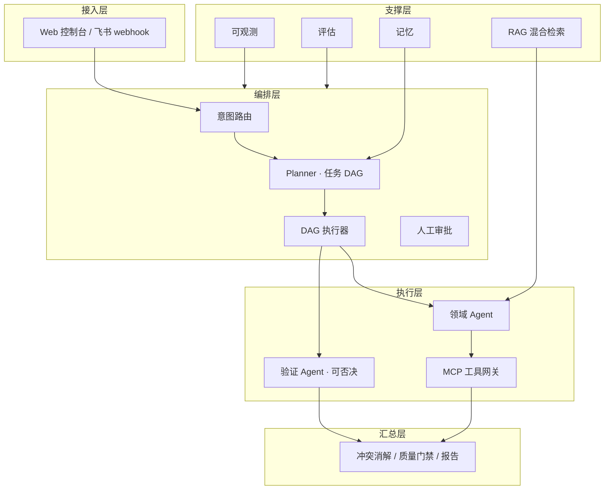

# 运筹 OpsConductor

> 从一句话到一次可审计的 ERP 操作。

[](https://github.com/qinglan-qaq/ops-conductor/actions/workflows/ci.yml)
[](LICENSE)

运筹（OpsConductor）是一个面向电商 SaaS ERP 的多 Agent 运营系统。它把「处理今天华东仓超时未发货的订单」这类模糊指令，翻译成可拆解、可审批、可回滚、可审计的 ERP 操作。

项目当前处于**骨架阶段**：HTTP 服务、配置、依赖、conda 开发环境与 CI 已就绪，业务逻辑尚未实现。当前 MVP 聚焦订单异常场景的拆单与改址可写闭环，详见 [MVP 设计规格](docs/specs/2026-11-04-mvp-order-exception-design.md)；MVP 后进入 3 周 JD 对齐阶段，补齐 ERP Adapter、SKILL、Memory、RAG、RPA 与多模型，详见 [JD 对齐设计方案](docs/specs/2026-11-04-jd-alignment-design.md)。

## 核心场景

1. **订单异常处理**：超时未发货、库存不足、地址异常，生成拆单/换仓/改址/取消方案并执行。
2. **售后退款闭环**：检索售后政策，判定退款资格与金额，审批后执行退款并回写工单。
3. **多仓库存调拨**：识别缺货仓与积压仓，生成调拨建议，审批后执行并校验库存一致性。

## 架构



设计原则：

- **LLM 负责规划与异常判断，确定性运行时负责执行与超时控制。**
- 验证 Agent 独立于生成 Agent，并拥有阻塞性否决权。
- 写操作按风险分级审批，幂等、补偿、审计三件套齐全。
- API 优先，浏览器自动化只作为无 API 旧系统的兜底。

完整设计见 [系统设计](docs/design.md)。

## 技术栈

- Python 3.11+、FastAPI、SQLAlchemy
- PostgreSQL 16 + pgvector、Redis
- LangGraph、MCP Python SDK
- BGE-M3 + bge-reranker-v2-m3、BM25 + 向量混合检索
- Playwright（RPA 兜底）、Langfuse / OpenTelemetry
- Docker Compose、pytest、ruff

## 快速开始

环境要求：Anaconda / Miniconda、Docker。

```bash
# 1. 启动依赖（PostgreSQL + Redis）
docker compose up -d

# 2. 创建并激活 conda 环境（含项目与开发依赖）
conda env create -f environment.yml
conda activate opsconductor

# 3. 启动服务
uvicorn opsconductor.api.main:app --reload
```

也可以手动创建环境：

```bash
conda create -n opsconductor python=3.11 -y
conda activate opsconductor
pip install -e ".[dev]"
```

验证：

```bash
curl http://127.0.0.1:8000/health
# {"status":"ok","version":"0.1.0","env":"development"}
```

接口文档：http://127.0.0.1:8000/docs

运行测试：

```bash
pytest -q
```

## 目录结构

```
src/opsconductor/
├── api/           # HTTP 接口与健康检查
├── orchestrator/  # Planner、DAG 调度、审批
├── agents/        # 领域 Agent 与验证 Agent
├── tools/         # MCP 工具网关
├── rag/           # 混合检索与证据组装
├── memory/        # 会话、任务、失败记忆
├── domain/        # ERP 领域模型
└── observability/ # trace、指标与评估
```

## 路线图

| 阶段 | 目标 | 交付物 |
|---|---|---|
| 第 1 周 | Mini ERP、种子数据、只读工具 | 订单查询演示 |
| 第 2 周 | Planner / Executor / Verifier、订单异常场景 | 三分钟演示录屏 |
| 第 3 周 | 退款场景、RAG 混合检索 | 引用与金额明细 |
| 第 4 周 | 写操作、幂等、补偿、审计 | v1.0 |
| 第 5 周 | 多仓调拨、浏览器自动化兜底 | RPA 演示 |
| 第 6 周 | 评测集、trace、失败注入、文档 | 评测报告与面试材料 |

## 文档

- [总规格 SPEC.md](SPEC.md) — 平台目标、端到端链路、六平面架构、归因/持久化/Skill/SOP/飞轮、验收与开放问题（审查稿）
- [文档索引](docs/README.md)
- [系统设计](docs/design.md)
- [MVP 设计规格](docs/specs/2026-11-04-mvp-order-exception-design.md)
- [JD 对齐设计方案](docs/specs/2026-11-04-jd-alignment-design.md)
- [跨境电商全流程需求分析与能力地图（草案）](docs/specs/2026-11-10-cross-border-ecommerce-platform-design.md)
- [跨境电商全流程模拟演示系统 · 需求规格](docs/specs/2026-11-10-cross-border-simulation-design.md)
- [跨境电商全流程模拟演示系统 · 实施计划](docs/plans/2026-11-10-cross-border-simulation-implementation.md)
- [电商运营 Agent 统筹架构](docs/specs/2026-11-11-agent-orchestration-design.md)
- [Agent 归因、持久化、Skill/SOP 与数据飞轮设计](docs/specs/2026-11-11-agent-attribution-persistence-flywheel-design.md)
- [电商运营 Orchestrator Skill](docs/skills/ecommerce-operations-orchestrator/SKILL.md)
- [跨境运营 SOP](docs/sop/2026-11-11-cross-border-operations-sop.md)
- [跨境电商运营异常处理指南](docs/operations/2026-11-10-cross-border-ecommerce-operations-exception-guide.md)
- [MVP 实施计划](docs/plans/2026-11-04-mvp-order-exception-implementation.md)
- [JD 对齐实施计划](docs/plans/2026-11-04-jd-alignment-implementation.md)
- [实施计划](docs/plan.md)
- [数据来源与合规](docs/data-sources.md)
- [ADR 0001：记录架构决策](docs/adr/0001-record-architecture-decisions.md)
- [ADR 0002：LLM 规划 + 确定性执行](docs/adr/0002-plan-execute-deterministic-runtime.md)
- [ADR 0003：独立验证 Agent](docs/adr/0003-independent-verifier.md)

## 许可证

[MIT](LICENSE)
