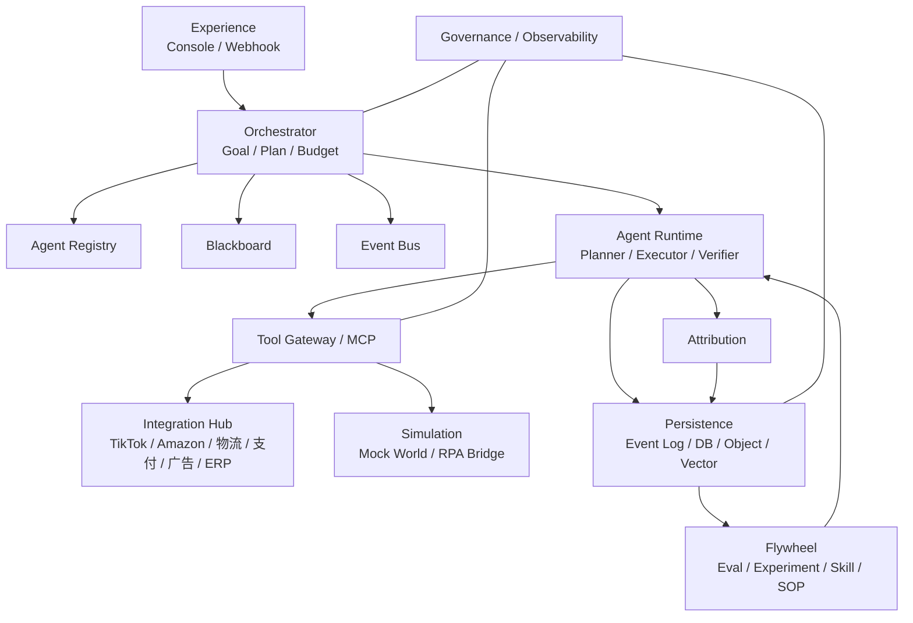
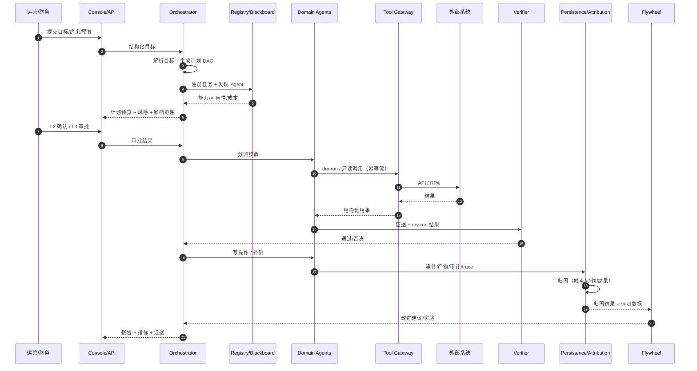
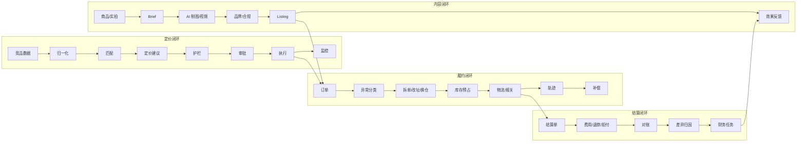
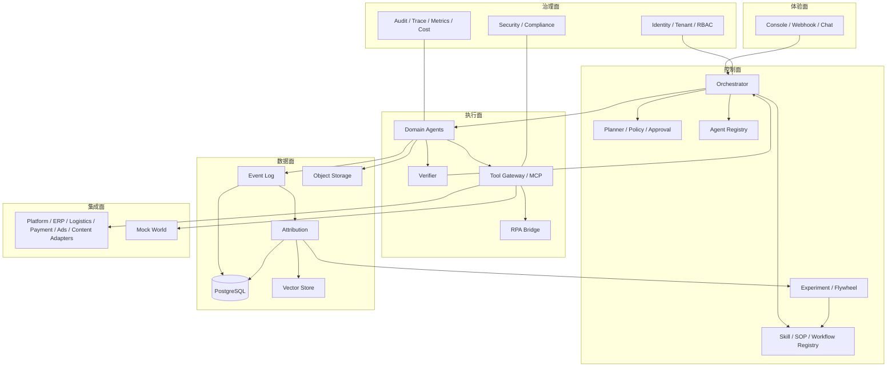
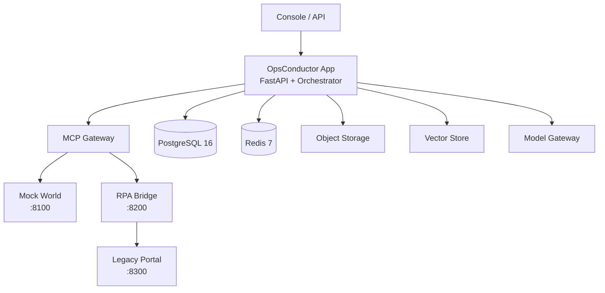
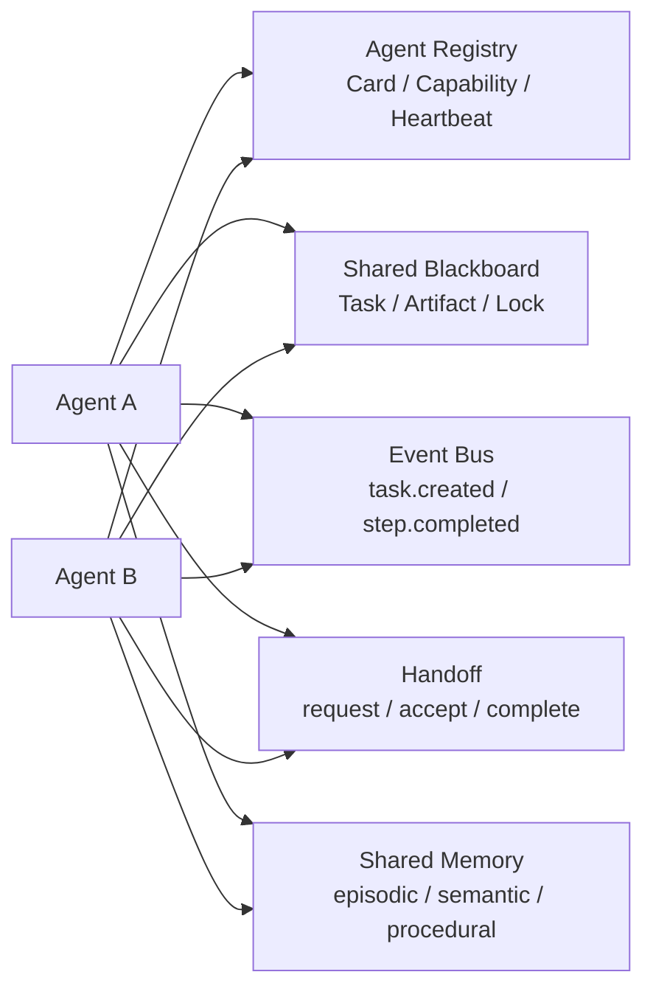
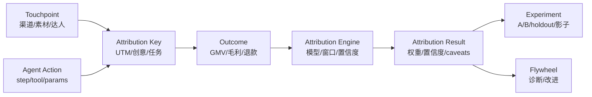
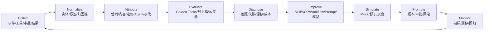

# 运筹跨境 · 跨境电商 AI 运营平台 · 总规格（SPEC）

> 从一句运营目标，到一条可归因、可复用、可自优化的跨境运营链路。

**版本** v1.0（审查稿）｜ **日期** 2026-11-11 ｜ **状态** 待审查 ｜ **Owner** qinglan-qaq

**审查重点**：范围边界、端到端链路、Agent 协作、数据/归因闭环、安全与验收标准。

**关联文档**：
[跨境电商能力地图](docs/specs/2026-11-10-cross-border-ecommerce-platform-design.md) ｜
[模拟演示系统需求规格](docs/specs/2026-11-10-cross-border-simulation-design.md) ｜
[模拟演示实施计划](docs/plans/2026-11-10-cross-border-simulation-implementation.md) ｜
[Agent 统筹架构](docs/specs/2026-11-11-agent-orchestration-design.md) ｜
[归因/持久化/Skill/SOP/飞轮设计](docs/specs/2026-11-11-agent-attribution-persistence-flywheel-design.md) ｜
[Orchestrator Skill](docs/skills/ecommerce-operations-orchestrator/SKILL.md) ｜
[跨境运营 SOP](docs/sop/2026-11-11-cross-border-operations-sop.md) ｜
[运营异常处理指南](docs/operations/2026-11-10-cross-border-ecommerce-operations-exception-guide.md) ｜
[系统设计](docs/design.md)

---

## 0. 审查指引

建议按以下顺序审查：

1. **业务与范围**（第 1–4 节）：产品定位、用户、首站、SKU/门店模型是否成立。
2. **链路**（第 6–7 节）：目标 → 计划 → 审批 → 执行 → 验证 → 归因 → 持久化 → 改进是否闭合。
3. **架构**（第 8–9 节）：控制面/执行面/数据面边界、Agent 协作方式是否合理。
4. **数据与学习**（第 10–13 节）：归因、持久化、Skill/SOP、飞轮是否可落地。
5. **证据与治理**（第 14–17 节）：Mock 演示、Golden Tasks、安全、验收是否可证明。
6. **决策与风险**（第 18–20 节）：关键取舍、开放问题是否需要拍板。

**需要拍板的事项**集中在第 20.2 节；架构取舍集中在第 19 节。

## 1. Problem Statement

跨境电商运营的日常工作被切碎在多个系统里：选品看趋势工具，内容在素材/剪辑工具，上架在平台后台，投放在广告平台，订单在 ERP，履约在物流/货代，收款在支付/结算后台，售后在客服工单。运营人员靠 Excel、群聊和 copy-paste 把这些系统缝起来。

结果是：

- **链路断**：选品时算的毛利，到定价、广告、履约、结算时失真；内容带来的订单无法追溯到素材/达人；退款/拒付无法回写到 SKU 和活动。
- **异常贵**：超时、缺货、扣关、结算差异、拒付等异常靠人盯；发现晚、定级乱、补偿不可验证。
- **经验散**：有效的 SOP 在个人手里，失败教训不沉淀；新人重复踩坑。
- **不可信**：写操作没有审批、幂等、补偿、审计；无法证明「Agent 做的事是对的」。
- **不可学**：没有归因，不知道哪个动作有效；没有评测，不知道改进了还是退化了。

现有 OpsConductor 已有一个订单异常 MVP 骨架：Planner/Executor/Verifier、MCP、审批、幂等、补偿、审计、trace。本规格要把它扩展成**跨境电商 AI 运营平台**：在现有 ERP/工具之上做「目标 → 计划 → 执行 → 验证 → 归因 → 沉淀 → 优化」的控制面，而不是再做一个 ERP。

**约束：**

- 演示阶段不接真实平台/支付/物流；用 Mock World + Mock 数据 + 影刀 RPA 证明能力。
- 目标客群：1–10 家精品店、约 5000 SKU、TikTok 内容电商起步。
- 小团队、边投简历/边验证、需要可演示、可审计、可回滚。
- 合规敏感：竞品数据、产品认证、税务、资金动作必须有边界。

## 2. Goals & Non-goals

### 2.1 Goals

**业务目标：**

- 让运营人员用一句目标驱动选品、内容、上架、投放、订单、履约、结算的协同。
- 降低人工介入率、异常处理时间、重复操作和错误写入。
- 提升内容产能、投放效率、履约时效和毛利透明度。
- 用归因证明「哪个动作有效」，用飞轮持续改进。

**产品目标：**

- 一个入口：自然语言目标 + 结构化计划 + 审批 + 报告。
- 一个控制面：跨工具、跨 Agent、跨店铺的编排与治理。
- 一个数据底座：事件、归因、Skill/SOP、实验、成本可追溯。
- 一个证据链：Mock 演示 + Golden Tasks + trace/audit。

**技术目标：**

- 计划与执行分离、生成与验证分离。
- 所有写操作：审批 + 幂等 + 补偿 + 审计。
- 所有外部能力：MCP 工具契约 + Adapter 可替换。
- 所有结果：可归因、可持久化、可回放。
- 所有 Agent：可注册、可发现、可交接、可版本化。

### 2.2 Non-goals

- 不做完整 ERP/WMS/TMS/支付处理器/广告平台/内容工具。
- 不做无人审批的资金动作（打款、赔付、大额退款）。
- 不在 MVP 同时支持所有平台/市场。
- 不把 5000 SKU 全部内容化。
- 不做通用 Agent 平台；只做跨境电商运营控制面。
- 不承诺「全自动无人运营」；定位是人机协同。

## 3. Users & Personas

| 角色 | 目标 | 痛点 | 成功标准 |
|---|---|---|---|
| 运营小运 | 用目标驱动日常运营，少点按钮 | 系统多、异常多、数据散 | 异常处理时间下降，GMV/毛利达标 |
| 财务小财 | 结算准、退款可控、现金流清楚 | 对账慢、差异难归因、退款风险 | 差异率下降，审批留痕，无重复退款 |
| 仓管小仓 | 库存准、发货快、少超卖 | 多渠道库存不同步、补货靠催 | 缺货率/超卖下降，补货及时 |
| 客服小客 | 快速回答、少升级 | 政策多、订单状态不清 | 首响/解决时长下降，误转率下降 |
| 管理员 | 租户/权限/合规可控 | 越权、数据泄露、审计缺失 | 越权写入 0，审计完整 |
| 开发者 | 工具可接、流程可配、可评测 | 集成碎、回归难 | 新工具/工作流 1–3 天接入 |
| 设计伙伴 | 低风险试用、看到 ROI | 不愿给写权限、怕出错 | 先只读后审批写，指标可证明 |

## 4. Product Strategy & Scope

### 4.1 路线：自营店做试验田，卖铲子做产品

| 路线 | 作用 | 风险 | 结论 |
|---|---|---|---|
| 自营 1–10 家精品店 | 验证链路、沉淀数据、dogfooding | 库存/内容/现金流重 | 先做 1–3 家，单店单市场 |
| 卖铲子（SaaS/服务） | 复制能力、收入杠杆 | 需求不成立、集成/信任难 | 主产品方向，先找 3–5 个设计伙伴 |
| 混合（推荐） | 自营验证 → 产品化 | 两边都慢 | 先用自营跑通一条闭环，再产品化 |

### 4.2 平台与市场策略

| 平台 | 角色 | 理由 |
|---|---|---|
| TikTok Shop | 首站，内容电商验证 | 内容/兴趣流量，适合可视化、冲动型商品；但 2026 年物流/保证金/内容治理趋严，必须履约与合规先行 |
| Amazon | 第二渠道，稳定现金流 | 搜索/货架、需求捕获、FBA 成熟；适合标准化 SKU |
| Temu | 清货/价格渠道 | 平台托管/低价，不适合品牌 |
| Shopify + Meta/Google | 品牌独立站/私域 | 全控制、复购、第一方数据；CAC 高 |
| Shopee/Lazada | 区域备选 | 东南亚低门槛，但客单/利润低 |

### 4.3 5000 SKU × 1–10 店的运营模型

**SKU 金字塔：**

| 层级 | 数量/店 | 内容 | 流量 | 履约 | 指标 |
|---|---|---|---|---|---|
| A Hero | 20–50 | 3–5 条/周 + 直播 | 付费 + 达人 + 自然 | 海外仓/FBT | GMV、ROAS、复购 |
| B Test | 200–500 | 1 条/周 + UGC | 小预算测试 | 空运/直邮 | CTR、CVR、毛利 |
| C Long-tail | 其余 | 不做内容，只做 Listing | 搜索/货架 | 国内直发/预售 | 动销、周转 |

**原则：**

- 5000 SKU 是供应链资产，不是内容资产。
- 先 1–3 家店，单店单市场单品类；10 家是品牌组合，不是复制粘贴。
- 每个 SKU 上架前算贡献毛利；负毛利不进 A 层、不自动放量。
- 1–10 店共享供应链、素材库、Agent 运行时；店铺/广告/结算账户隔离。

### 4.4 MVP 范围

**MVP 楔子：TikTok 内容 → Listing → 订单/履约 → 结算对账。**

| 包含 | 暂缓 |
|---|---|
| 目标解析、计划 DAG、L2/L3 审批 | 全部平台/市场 |
| 选品评分、AI 制图 Brief/素材、Listing | 5000 SKU 全量内容 |
| 竞品价格监控、调价建议/审批 | 全自动调价 |
| 订单异常、拆单/改址、库存预占 | 完整退款/赔付 |
| 物流比价、报关、影刀 RPA 兜底 | 海运整柜/自建海外仓 |
| 结算只读对账、差异归因 | 自动打款 |
| 归因 v1、事件持久化、Skill/SOP 草稿 | 完整数据飞轮/自治优化 |

## 5. Capability Map

| Module | 职责 | 依赖 | 阶段 |
|---|---|---|---|
| `experience` | 控制台、webhook、任务/计划/审批/trace/报告 | `orchestrator` | P0 |
| `orchestrator` | 目标解析、计划 DAG、预算、风险、调度 | `registry`、`blackboard`、`event-bus` | P0 |
| `agent-runtime` | Planner / Executor / Verifier / Memory | `orchestrator`、`tool-gateway` | P0 |
| `agent-registry` | Agent Card、能力发现、心跳、版本 | `persistence` | P1 |
| `blackboard` | 共享任务图、产物、锁、状态 | `persistence`、`event-bus` | P1 |
| `event-bus` | 事件、订阅、交接、outbox | `persistence` | P1 |
| `tool-gateway` | MCP 工具契约、鉴权、租户注入、限流、审计 | `integration-hub` | P0 |
| `integration-hub` | TikTok/Amazon/Temu/Shopify/物流/支付/广告/内容/ERP Adapter | 外部 API / Mock | P0 |
| `commerce-core` | 订单、库存、履约、拆单/改址/调拨 | `integration-hub`、`tool-gateway` | P0 |
| `content-studio` | Brief、AI 制图/视频、素材库、合规 | `tool-gateway`、`agent-runtime` | P1 |
| `pricing` | 竞品采集、匹配、定价规则、调价执行 | `integration-hub`、`agent-runtime` | P1 |
| `traffic` | 自然流量、达人/联盟、付费广告、预算护栏 | `content-studio`、`integration-hub` | P2 |
| `settlement` | 结算、费用、退款、拒付、对账 | `commerce-core`、`integration-hub` | P1 |
| `after-sales` | 退货、退款、纠纷、政策 RAG | `commerce-core`、`settlement` | P2 |
| `attribution` | 触点、结果、归因模型、实验 | `persistence`、`commerce-core` | P2 |
| `persistence` | Event Log、PostgreSQL、对象存储、向量库 | — | P1 |
| `skill-registry` | Skill 版本、评测、发布、回滚 | `persistence` | P2 |
| `sop-registry` | SOP 版本、评审、发布 | `persistence` | P2 |
| `flywheel` | 评测、实验、诊断、改进建议 | `attribution`、`skill-registry`、`sop-registry` | P3 |
| `governance` | 身份、租户、权限、审计、密钥 | 全部 | P0 |
| `observability` | trace、指标、成本、告警 | 全部 | P0 |
| `simulation` | Mock World、Mock 数据、Golden Tasks、影刀桥接 | `integration-hub` | P0 |



## 6. End-to-End Operating Chain

### 6.1 主链路



### 6.2 链路阶段与产物

| 阶段 | 输入 | 输出 | Owner | 失败处理 |
|---|---|---|---|---|
| 目标接入 | 自然语言目标/约束 | 结构化 intent | Orchestrator | 缺参数则追问/转人工 |
| 计划 | intent + 工具/Agent 能力 | DAG + 风险 + 预算 | Planner | schema 失败修复一次，仍失败转人工 |
| 审批 | 计划 + 影响范围 | 审批记录 | 人 + Approval | 拒绝则跳过/降级 |
| 执行 | 审批后的 DAG | 工具结果 + 产物 | Executor | 瞬时重试；业务失败补偿/转人工 |
| 验证 | 证据 + 结果 | 通过/否决 | Verifier | 否决则阻塞/补偿 |
| 归因 | 触点 + 动作 + 结果 | 权重/置信度 | Attribution | 低置信标记，不用于重大决策 |
| 持久化 | 事件/产物/审批/归因 | Event Log/DB/Object | Persistence | 写失败重试/告警 |
| 反思 | 运行数据 + 失败记忆 | Skill/SOP/Workflow 草稿 | Flywheel | 人工评审后才发布 |
| 优化 | 草稿 + 评测 | 新版本/实验 | Flywheel | 灰度/回滚 |

### 6.3 链路顺畅性检查

| 检查 | 标准 |
|---|---|
| 每个写操作 | 审批 + 幂等键 + 补偿动作 + 审计 |
| 每个外部调用 | MCP 契约 + 超时 + 重试 + trace |
| 每个结果 | 可归因（触点/动作/结果关联） |
| 每个产物 | 有 URI + 哈希 + 血缘 |
| 每个 Agent | Agent Card + 心跳 + 版本兼容 |
| 每次交接 | 结构化上下文 + 幂等 + 超时重路由 |
| 每次改进 | 评测 + 灰度 + 回滚 |
| 每个异常 | 定级 + owner + SLA + 复盘 |

> 如果以上任何一项不满足，链路就不算闭合；这是审查的硬标准。

## 7. Domain Loops

### 7.1 四个闭环



### 7.2 内容闭环（AI 制图 → Listing）

| 步骤 | Agent/工具 | 控制 |
|---|---|---|
| 商品/素材 intake | 内容 Agent、商品 API | 分辨率、角度、瑕疵、版权 |
| Brief | 内容 Agent、品牌 RAG | 卖点、场景、钩子、目标人群 |
| 制图/视频 | 图像/视频工具 | 商品一致性、比例、虚拟试穿、授权 |
| 合规 | 合规 Agent | 绝对化用语、功效声明、Logo/色值 |
| Listing | Listing Agent | 标题/类目/属性/价格/尺寸 |
| 反馈 | 分析 Agent | CTR、CVR、退货、差评 |

**护栏：** 商品一致性优先；Hero 图人工审核；不虚假功效；版权/模特授权；固定 seed；全链路可追溯。

**指标：** 素材周期、单素材成本、CTR、CVR、退货率、审核通过率、A/B 胜出率。

### 7.3 定价闭环（竞品情报 → 调价）

| 步骤 | Agent/工具 | 控制 |
|---|---|---|
| 采集 | Price Scout | 官方 API/授权数据优先；ToS/robots；频率限制 |
| 归一化 | 数据工具 | 币种、税、运费、优惠、会员价、到手价 |
| 匹配 | Match Agent | GTIN/SKU/标题/图片/属性；置信度阈值 |
| 建议 | Pricing Agent | 价差、竞争、需求、库存、弹性 |
| 护栏 | Risk Verifier | 毛利底线、日变动上限、冷却期、MAP、价格战 |
| 审批/执行 | 人 + Listing Agent | L2/L3；幂等；可回滚 |
| 监控 | 分析 Agent | 转化、毛利、竞品反应、回滚 |

**合规边界：** 不绕过登录/验证码/付费墙；不采集个人信息；不高频请求；不转售数据；上线前法务确认。

**指标：** 价格覆盖率、毛利、转化、Buy Box/曝光份额、价格战误跟率、回滚率。

### 7.4 履约闭环（订单 → 库存 → 物流 → RPA）

- 订单异常：超时、缺货、地址、重复、欺诈、取消。
- 库存：预占/释放、拆单、换仓、调拨、盘点。
- 物流：比价、发货、报关、轨迹、丢件/破损。
- 无 API 旧后台：影刀 RPA，截图 + 审计 + 失败转人工。
- 补偿：取消发货单、释放预占、回退状态、补发/退款。

### 7.5 结算闭环（收款 → 对账 → 退款/拒付）

- 结算单、费用、退款、chargeback、汇率、税务。
- 对账差异归因；差异不自动打款，生成财务任务。
- 退款/赔付 L3 人工审批；所有资金动作可审计。
- 指标：差异率、回款周期、拒付率、退款率。

## 8. Architecture

### 8.1 六个平面



### 8.2 平面职责

| 平面 | 负责 | 不负责 |
|---|---|---|
| 体验面 | 任务提交、计划预览、审批、trace、报告 | 业务逻辑 |
| 控制面 | 目标解析、计划、预算、风险、Agent/Skill/SOP 注册、实验 | 直接写业务库 |
| 执行面 | 领域 Agent、工具调用、验证、RPA | 修改计划语义 |
| 数据面 | 事件、业务数据、产物、向量、归因 | 绕过验证输出 |
| 集成面 | 平台/ERP/物流/支付/广告/内容 Adapter、Mock | 业务决策 |
| 治理面 | 身份、租户、权限、审计、trace、成本、安全 | 业务状态写入 |

### 8.3 部署视图



**部署原则：**

- 模块化单体优先；Mock World、RPA Bridge 独立进程；需要时再拆服务。
- 所有外部调用经 MCP；所有写操作经审批/幂等/补偿/审计。
- 模型网关可替换；默认 stub/模板，真实模型只做冒烟。
- 一条命令启动演示；生产部署再引入 K8s/队列/多副本。

## 9. Agent Model & Coordination

### 9.1 Agent 角色

| Agent | 职责 | 风险 | 输出 |
|---|---|---|---|
| Orchestrator | 目标、计划、预算、调度、升级 | — | DAG、报告 |
| Selection | 趋势、评分、SKU 组合 | L1 | 选品建议 |
| Content | Brief、制图/视频、Listing 文案 | L1/L2 | 素材、Listing |
| Pricing | 竞品、匹配、定价建议 | L2/L3 | 调价建议/执行 |
| Traffic | 自然/付费、预算、ROAS | L3 | Campaign、预算 |
| Order | 订单异常、拆单、改址 | L2 | 发货单/地址 |
| Fulfillment | 比价、发货、报关、轨迹 | L2 | 运单/报关单 |
| Settlement | 结算、对账、退款、拒付 | L3 | 对账单/退款 |
| Compliance | 政策、IP、产品安全 | L3 | 检查/整改 |
| Verifier | 独立检查、否决 | — | 通过/否决 |
| Memory | 情节/语义/程序/失败 | — | 检索/写入 |

### 9.2 Agent 感知彼此的四个组件



| 组件 | 作用 | 关键字段 |
|---|---|---|
| Agent Registry | 能力发现、版本、状态 | `agent_id`、`capabilities`、`tools`、`risk`、`sla`、`status`、`heartbeat_at` |
| Shared Blackboard | 共享任务图/产物/锁 | `task_id`、`step_id`、`owner`、`status`、`artifact_uri` |
| Event Bus | 事件通知、解耦 | `event_type`、`payload`、`trace_id` |
| Handoff | 结构化交接 | `from/to`、`context`、`constraints`、`evidence`、`deadline` |

**规则：**

- 启动注册、10–30 秒心跳、下线注销；版本变更必须升版本。
- Orchestrator 按「能力 + 可用性 + 成本 + 风险」选 Agent。
- 交接：`requested → accepted/rejected → completed → acked`；超时重路由/转人工。
- 不让 Agent 自由聊天；结构化消息 + 中心编排是默认。
- 共享记忆按 `tenant/store/task/agent` 命名空间隔离；记忆不是业务事实源。

### 9.3 协调模式

| 模式 | 适用 | 说明 |
|---|---|---|
| Orchestrator 中介（默认） | 大多数任务 | 中心规划/分派/汇总，可审计 |
| Blackboard | 共享状态/多人协作 | 任务贴板、Agent 认领、锁 |
| Contract Net | 可竞标任务 | 广播需求、报价、择优 |
| Pub/Sub | 事件驱动 | 订单/库存/审批事件 |
| 自由聊天（不推荐） | — | 不可审计、不可复现、成本高 |

## 10. Attribution

### 10.1 归因五层

| 层次 | 问题 | 方法 | 输出 |
|---|---|---|---|
| 营销 | 哪个渠道/计划？ | 末次点击、线性、Markov/Shapley、地理实验 | 渠道权重 |
| 内容 | 哪张图/视频/达人？ | UTM、创意 ID、达人码、A/B、holdout | 素材贡献 |
| 定价 | 调价是否增量？ | A/B、switchback、DID、合成控制、ITS | 弹性/增量 |
| Agent | 哪个步骤/工作流？ | 任务血缘、影子运行、消融、反事实 | 步骤贡献/成本 |
| 事故 | 根因是什么？ | 5 Whys、因果图、失败记忆 | 根因/CAPA |

### 10.2 归因数据流



**原则：** 每条结果带方法、窗口、置信度、版本、caveats；关键决策用实验验证；相关性不包装成因果。

### 10.3 归因数据模型

`event_log`、`touchpoint`、`agent_action`、`outcome`、`attribution_key`、`attribution_result`、`experiment`、`counterfactual`、`cost_ledger`。

## 11. Persistence & Data Model

### 11.1 三层持久化

| 层 | 存储 | 内容 |
|---|---|---|
| 合同层 | Git + Markdown/YAML/JSON | Skill、SOP、Agent Card、Workflow DSL、Eval Case |
| 运行时 | PostgreSQL + JSONB | task、step、action、approval、audit、attribution、experiment、registry |
| 证据层 | 对象存储 | 图片、视频、截图、报告、RPA 证据 |
| 检索层 | 向量库 | 记忆、Skill/SOP 检索、RAG |
| 缓存层 | Redis | 幂等键、会话、限流 |

**原则：JSON 是合同，数据库是运行时，Git 是评审。**

### 11.2 事件与一致性

- Event Log 追加写、不可变、可回放、带 `schema_version`。
- 当前状态表由事件投影；Outbox 保证「写库成功 → 事件发出」。
- 所有写操作幂等；所有产物有 URI + 哈希 + 血缘。
- 保留策略：原始事件 90–365 天；聚合指标长期；PII 最小化/脱敏。

### 11.3 核心表

`task_run`、`task_step`、`agent_action`、`approval`、`audit_log`、`artifact`、`event_log`、`touchpoint`、`outcome`、`attribution_result`、`experiment`、`counterfactual`、`skill_version`、`sop_version`、`agent_registry`、`agent_heartbeat`、`memory_item`、`cost_ledger`。

### 11.4 JSON 契约

- Task Run：目标、状态、计划版本、预算、风险、trace。
- Agent Card：能力、工具、Schema、SLA、成本、状态、心跳。
- Attribution Result：模型、窗口、权重、置信度、caveats。
- Skill Manifest：版本、触发、工具、风险、审批、Eval、Git 路径。

（完整示例见 [归因/持久化设计](docs/specs/2026-11-11-agent-attribution-persistence-flywheel-design.md) 第 3.4 节。）

## 12. Skill / SOP / Workflow

### 12.1 三者的关系

| 形态 | 给谁 | 作用 | 存储 |
|---|---|---|---|
| Skill | Agent | 可执行的能力包 | Git + DB 版本 |
| SOP | 人 | 操作手册/班次流程 | Git + DB 版本 |
| Workflow | 运行时 | 可执行 DAG/DSL | Git + DB 版本 |

**SOP 给人，Skill 给 Agent，Workflow 是可执行版本。三者的步骤、阈值、风险等级必须一致。**

### 12.2 Skill 生命周期


### 12.3 Agent 提炼 Skill 的流水线


**四道门：** Schema → 工具契约 → Mock 仿真 → 人工审批。护栏：不新增未授权工具、不提升风险等级、不写 PII、必须有失败路径和回滚。

### 12.4 Workflow DSL

`id`、`version`、`trigger`、`inputs`、`steps`（agent/tool/params/condition/retry/timeout/risk/approval/compensation）、`outputs`、`metrics`、`fallback`。

**Agent 只生成 DSL，不生成可执行任意代码；工具白名单；沙箱；版本/灰度/回滚。**

## 13. Data Flywheel & Continuous Optimization

### 13.1 飞轮



### 13.2 阶段与指标

| 阶段 | 数据 | 能力 | 人 |
|---|---|---|---|
| 冷启动 | SOP + 规则 + Mock | 只读/建议 | 人工执行 |
| 辅助 | 事件 + 归因 v1 | 草稿/建议 | 审批执行 |
| 增强 | 实验 + 失败记忆 | 审批内自动 | 异常处理 |
| 自主 | 全链路数据 + 评测 | 护栏内自动优化 | 目标/边界/审计 |

**指标：** 归因覆盖、置信度、评测覆盖、改进速度、实验胜率、回归率、自动化率、单位成本。

### 13.3 持续优化

- 实验：A/B、switchback、地理、holdout、影子、canary。
- 漂移：数据/模型/政策/竞争/概念。
- 自主等级：L0 手动 → L1 建议 → L2 审批执行 → L3 护栏内自动 → L4 自主优化。
- 升级：连续成功 + 评测达标 + 无事故 + 人工评审。
- 降级：回归/漂移/事故/审计发现。
- 成本：模型路由、缓存、批处理、早停、成本看板。

## 14. Simulation & Evidence

### 14.1 为什么 Mock 优先

- 不依赖真实平台账号/资金/物流，演示可离线、可重复。
- 可注入失败（超时、库存冲突、扣关、结算差异、RPA 失败），证明异常路径。
- 可用固定种子 + stub 模型做回归；真实模型只做冒烟。
- 影刀 RPA 用「真实/模拟双模式」：Mock 保证稳定，真实模式用于现场加分。

### 14.2 演示链路


**演示标准：** 8 分钟；3 次审批、1 次拒绝、1 次补偿、1 次 RPA、1 次对账差异；一键重置 ≤30 秒。

### 14.3 Golden Tasks

30 条：选品/内容 6、上架/广告 6、订单/履约 8、结算/售后 5、RPA 3、安全 2。断言最终状态、必需工具、禁止动作、审批、审计、trace。

## 15. Security, Risk & Compliance

### 15.1 风险与审批

| 等级 | 动作 | 策略 |
|---|---|---|
| L0 | 查询、评分、对账读取 | 自动 |
| L1 | Brief、素材草稿、对账任务 | 自动 + 事后通知 |
| L2 | Listing、改价、拆单、改址、发货、采购单、RPA | 二次确认 |
| L3 | 广告预算超阈值、退款、赔付、批量动作、合规声明 | 人工审批 + 双人复核（资金） |

### 15.2 安全控制

- 租户隔离：所有表/工具/日志/检索带 `tenant_id`。
- 最小权限：Agent 只拥有职责所需工具；工具 allowlist。
- 提示注入：网页/评论/SOP 视为不可信；不得改变工具白名单/租户范围。
- 竞品数据：官方 API/授权数据优先；遵守 ToS/robots；不绕过登录/验证码；不采集 PII。
- 资金：不自动打款/赔付/大额退款；L3 + 审计。
- 数据：合成数据优先；PII 最小化/脱敏；保留期限；备份。
- 账号：2FA、最小权限、异常操作审计；账号安全动作人工。

### 15.3 合规边界

- 产品认证（CE/FCC/FDA/CPC/GPSR）、税务（VAT/GST/销售税）、EPR、标签。
- 广告声明、AI 生成内容披露、版权/模特授权。
- 平台政策/禁限售/知识产权。
- 数据隐私（GDPR/CCPA）。
- 以上以官方/法务最新要求为准。

## 16. Engineering Constraints & Non-Functional Requirements

### 16.1 Commands

```bash
make up            # docker compose up -d（PostgreSQL/Redis/Mock World/RPA Bridge/主应用）
make seed          # 生成 10 店、5000 SKU、90 天订单/结算的 Mock 数据
make demo          # 跑 8 分钟演示脚本
make reset-demo    # 重置 Mock 数据，目标 ≤30 秒
pytest -q          # 单元/契约/集成/Golden Tasks
ruff check .       # lint
mypy src           # 类型检查
```

> 命令是目标态，P0/P1 落地；当前仓库只有健康检查与骨架。

### 16.2 Project Structure

```text
src/opsconductor/
├── api/              # FastAPI 接入、控制台路由
├── orchestrator/     # Planner / Executor / Verifier / Approval
├── agents/           # 领域 Agent 与 Agent Card
├── tools/            # MCP Server/Client、工具注册表
├── integration/      # 平台/ERP/物流/支付/广告/内容 Adapter
├── commerce/         # 订单、库存、履约
├── content/          # Brief、AI 制图、素材、Listing
├── pricing/          # 竞品采集、匹配、定价规则
├── settlement/       # 结算、对账、退款、拒付
├── attribution/      # 触点、结果、归因模型、实验
├── persistence/      # Event Log、DB、对象存储、向量库
├── registry/         # Agent Registry、心跳、能力发现
├── blackboard/       # 共享任务图、产物、锁
├── events/           # Event Bus、Outbox、订阅
├── skills/           # Skill 注册、版本、评测、提炼
├── sop/              # SOP 注册、版本、评审
├── experiments/      # 实验、分流、分析
├── learning/         # 诊断、漂移、改进建议
├── observability/    # trace、指标、成本、告警
├── governance/       # 身份、租户、RBAC、审计、密钥
└── config.py
mock_world/           # 独立 Mock API 进程
rpa/                  # 影刀/RPA Bridge、旧版供应商门户
console/              # Jinja2/HTMX 模板
tests/                # 单元/契约/集成/Golden/失败注入
docs/                 # 设计、计划、运营、Skill、SOP
SPEC.md               # 本规格
```

**原则：** 模块化单体优先；Mock World、RPA Bridge 独立进程；Agent 只能通过 MCP 访问外部世界；业务逻辑不写在 API handler 里。

### 16.3 Code Style

- Python 3.11、类型标注、Pydantic v2、SQLAlchemy 2.x async、psycopg 3。
- ruff line-length 100；mypy 先非严格，逐步收紧。
- 工具入参/出参用 Pydantic 模型；错误用类型化错误码，不抛裸异常。
- Agent 不直接访问数据库/网页；所有外部动作经 MCP 工具网关。
- 注释只写代码无法表达的约束，不写「这行做了什么」。
- 提交前缀：`feat:`、`test:`、`chore:`。

### 16.4 Testing Strategy

| 层级 | 内容 | 工具 |
|---|---|---|
| 单元 | 定价规则、归因权重、补偿计算、金额分摊 | pytest |
| 契约 | MCP 工具 Schema、Mock API、幂等、错误码 | pytest + httpx |
| 集成 | Orchestrator + stub 模型 + Mock World | pytest async |
| Golden | 30 条端到端业务场景 | pytest + fixtures |
| 失败注入 | 超时/限流/库存冲突/扣关/结算差异/RPA 失败 | 注入器 |
| 真实模型 | 5 条主路径冒烟，不作为硬门槛 | 脚本 |
| 演示 | 8 分钟脚本，重置 ≤30 秒 | `make demo` |

**原则：** 测试默认 stub 模型 + Mock API；真实模型/真实影刀只做冒烟；每个写操作测试必须断言审计、幂等、补偿后的最终状态。

### 16.5 Boundaries

| 类型 | 内容 |
|---|---|
| Always | `tenant_id`/`store_id`；幂等键；审计；trace；L2/L3 审批；测试与 ruff |
| Ask first | 新增工具/平台集成；提升风险等级；新租户；Schema/迁移；模型/供应商变更 |
| Never | 自动打款/赔付/大额退款；绕过审批；关闭审计；提交密钥/PII；未授权抓取；执行 DSL 中的任意代码 |

### 16.6 Non-Functional Requirements

| 维度 | 要求 | 验收 |
|---|---|---|
| 性能 | Mock 调用 P95 <300ms；任务端到端 P95 ≤8s（不含人工审批） | 压测/监控 |
| 可靠性 | 写操作幂等；失败可补偿；检查点可恢复 | 失败注入 |
| 可扩展 | Adapter 可替换；Agent/Skill 可注册；工具契约稳定 | 契约测试 |
| 可观测 | trace 完整率 100%；审计覆盖所有写操作 | 抽样/自动检查 |
| 成本 | 模型路由/缓存/批处理；单任务成本可追踪 | 成本看板 |
| 可维护 | 模块化单体；清晰边界；ADR；测试覆盖 | 代码评审 |
| 可测试 | Golden Tasks + 失败注入 + 契约测试 | CI |
| 可移植 | Docker Compose 一键启动；离线可跑 | 演示 |
| 安全 | 越权写入 0；重复写入 0；PII 不泄露 | 安全测试 |
| 合规 | 合成数据；政策核验；法务评审 | 审计 |

## 17. Acceptance Criteria

### 17.1 业务

- 1 家店、1 个市场、20 个 hero SKU、1 种履约方式跑通。
- 内容周期下降 50%；异常处理时间下降 50%；毛利不低于底线。
- 调价建议有审批、可回滚；价格战误跟 0。

### 17.2 系统

- 任务成功率 ≥90%；工具成功率 ≥99%（非注入失败）。
- L2/L3 审批覆盖率 100%；越权/重复写入 0。
- 可补偿场景补偿成功率 100%；trace 完整率 100%。
- 一键重置 ≤30 秒；8 分钟演示可重复。

### 17.3 数据与学习

- 归因覆盖 ≥80% GMV；置信度可查；与平台对账差异可解释。
- 任务/步骤/审批/归因 100% 可回放。
- 3 条 Skill/SOP 上线；每月 ≥2 个改进；回归率 ≤5%。

### 17.4 证据

- 30 条 Golden Tasks 报告。
- 失败注入报告。
- trace/audit/审批/RPA 截图。
- 5 分钟录屏 + 8 分钟现场演示。

## 18. Roadmap & Milestones

| 阶段 | 周期 | 范围 | 退出标准 |
|---|---|---|---|
| P0 规格与骨架 | 1–2 周 | 本 SPEC 评审、Mock 契约、Docker Compose、种子数据 | 评审通过；一键启动 |
| P1 Mock World + 持久化 + Registry | 3–4 周 | Mock API、Event Log、Agent Registry、Blackboard | 契约测试；Agent 可发现 |
| P2 运营楔子 | 4–6 周 | 内容→Listing、订单异常/履约、结算只读 | 单店单市场端到端 |
| P3 归因 + Skill/SOP | 3–4 周 | 归因 v1、Skill/SOP 注册、四道门 | 3 条 Skill/SOP 上线 |
| P4 数据飞轮 | 3–4 周 | 实验、失败记忆、改进建议、灰度 | 每月 ≥2 改进 |
| P5 多店/多平台 | 4–6 周 | Amazon、第二店、漂移/成本 | 可复制；回归可控 |

**最小演示版：** P0 + P1 核心 + P2 核心 + Mock RPA + 最小控制台；约 5–6 周（1 人全职），2 人并行约 4 周。

## 19. Architecture Decisions (ADR-style)

| # | 决策 | 理由 | 备选/后果 |
|---|---|---|---|
| AD-01 | 做控制面，不做完整 ERP | 集成已有工具，聚焦编排/治理/归因 | 替代方案：自建 ERP，成本高、周期长 |
| AD-02 | Orchestrator 中介 + Blackboard，不做自由多 Agent 聊天 | 可审计、可复现、可控成本 | 自由聊天灵活但不可靠 |
| AD-03 | Plan-Execute 为主，ReAct 仅用于有界探索 | 计划可审批、可回放 | 纯 ReAct 难审计 |
| AD-04 | 生成与验证分离，Verifier 可否决 | 降低幻觉/越权 | 增加一次模型/规则成本 |
| AD-05 | Event Log + 当前状态（CQRS-lite），不做全量事件溯源 | 兼顾审计与查询 | 全量 ES 复杂 |
| AD-06 | JSON 合同 + PostgreSQL 运行时 + Git 评审 | 可读、可移植、可审计 | 双写需一致性检查 |
| AD-07 | MCP 作为工具契约；A2A/Agent Card 作为内部/外部协作适配 | 协议中立、可替换 | 协议演进需 Adapter |
| AD-08 | Mock-first，真实 API 后接 | 可重复、可演示、可测失败 | Mock 失真需契约测试 |
| AD-09 | 归因用实验补因果，观察归因只做方向 | 避免把相关当因果 | 实验成本高 |
| AD-10 | Skill/SOP 由 Agent 起草，人审批发布 | 沉淀经验、控制风险 | 需要评审流程 |
| AD-11 | 资金/合规/账号动作永远 L3 | 风险不可逆 | 自动化率略低 |
| AD-12 | 模块化单体优先，Mock/RPA 独立进程 | 小团队可维护 | 规模化后再拆服务 |

## 20. Risks & Open Questions

### 20.1 风险

| 风险 | 影响 | 对策 |
|---|---|---|
| 范围膨胀 | 做不完/不可演示 | 楔子优先；切线规则；每阶段可演示 |
| Mock 失真 | 演示好看、落地失败 | 契约测试；真实 API 字段对照；Adapter 可替换 |
| 平台政策变化 | 物流/保证金/内容规则 | 政策巡检；多平台；本地履约预案 |
| 竞品数据合规 | 法律/平台风险 | 官方 API/授权数据；ToS/robots；法务确认 |
| 价格战 | 毛利崩 | 毛利底线、变动上限、冷却期、人工决策 |
| AI 图/声明违规 | 下架/封店 | 商品一致性、合规校验、Hero 图人审 |
| Agent 协作失控 | 重复/越权/不可审计 | Registry/Blackboard/Handoff、工具白名单、L3 |
| 归因误判 | 错误决策 | 置信度/窗口/实验；不把相关当因果 |
| 成本失控 | 毛利被吃 | 模型路由、缓存、批处理、成本看板 |
| 过度自动化 | 品牌/合规事故 | 自主等级、人工门禁、回滚 |

### 20.2 开放问题（需要审查拍板）

1. **首站市场**：美国 vs 东南亚 vs 欧盟/英国 vs 日本？影响物流、合规、支付。
2. **库存模式**：5000 SKU 是自有库存、海外仓备货，还是国内直发/预售？
3. **品类**：家居/美妆/服饰/3C/宠物？影响内容、合规、物流。
4. **业务目标**：求职作品集、真实现金流，还是 SaaS 创业？影响 MVP 深度。
5. **团队与预算**：工程/内容/投放/供应链/客服人数；库存/广告/内容预算。
6. **平台资质**：TikTok/Amazon 账号、广告账户、支付/收款、海外主体。
7. **影刀**：版本、开放 API 权限、可录制流程范围。
8. **数据保留**：事件/归因/产物保留多久？PII 脱敏策略？
9. **自治边界**：L3 自动执行的范围由谁定？如何审计？
10. **归因口径**：以平台为准还是内部模型为准？窗口如何统一？

## 21. Appendices

### 21.1 术语

- GMV、ROAS、ACOS、CVR、AOV、MAP、FBT/FBA/3PL、HS Code、Incoterm、DDP/DDU、Chargeback、KYC、VAT/GST、EPR/GPSR、CAPA、FMEA、RPN、MCP、A2A、CQRS、Outbox。

### 21.2 文档地图

| 主题 | 文档 |
|---|---|
| 产品/平台策略 | [跨境电商能力地图](docs/specs/2026-11-10-cross-border-ecommerce-platform-design.md) |
| 模拟演示需求 | [模拟演示系统需求规格](docs/specs/2026-11-10-cross-border-simulation-design.md) |
| 模拟实施计划 | [模拟演示实施计划](docs/plans/2026-11-10-cross-border-simulation-implementation.md) |
| Agent 统筹/AI 制图/调价 | [Agent 统筹架构](docs/specs/2026-11-11-agent-orchestration-design.md) |
| 归因/持久化/飞轮 | [归因/持久化/Skill/SOP/飞轮设计](docs/specs/2026-11-11-agent-attribution-persistence-flywheel-design.md) |
| Skill | [Orchestrator Skill](docs/skills/ecommerce-operations-orchestrator/SKILL.md) |
| SOP | [跨境运营 SOP](docs/sop/2026-11-11-cross-border-operations-sop.md) |
| 异常处理 | [运营异常处理指南](docs/operations/2026-11-10-cross-border-ecommerce-operations-exception-guide.md) |
| 系统设计 | [系统设计](docs/design.md) |

### 21.3 审查清单

- [ ] 业务范围/首站/品类/库存模式是否明确？
- [ ] 主链路每一段是否有输入、输出、owner、失败处理？
- [ ] 每个写操作是否有审批/幂等/补偿/审计？
- [ ] 每个结果是否可归因？方法/窗口/置信度是否透明？
- [ ] Agent 协作是否可发现、可交接、可版本化？
- [ ] Skill/SOP/Workflow 是否一致、可评审、可回滚？
- [ ] 数据飞轮是否能在 1 个月内跑出第一个改进？
- [ ] 安全/合规/资金边界是否足够？
- [ ] 验收指标是否可测、可复现？
- [ ] 开放问题是否拍板？

---

**一句话：这份 SPEC 的核心不是「做很多功能」，而是把「目标 → 计划 → 执行 → 验证 → 归因 → 沉淀 → 优化」做成一条可审计、可复用、可自优化的闭环。**
