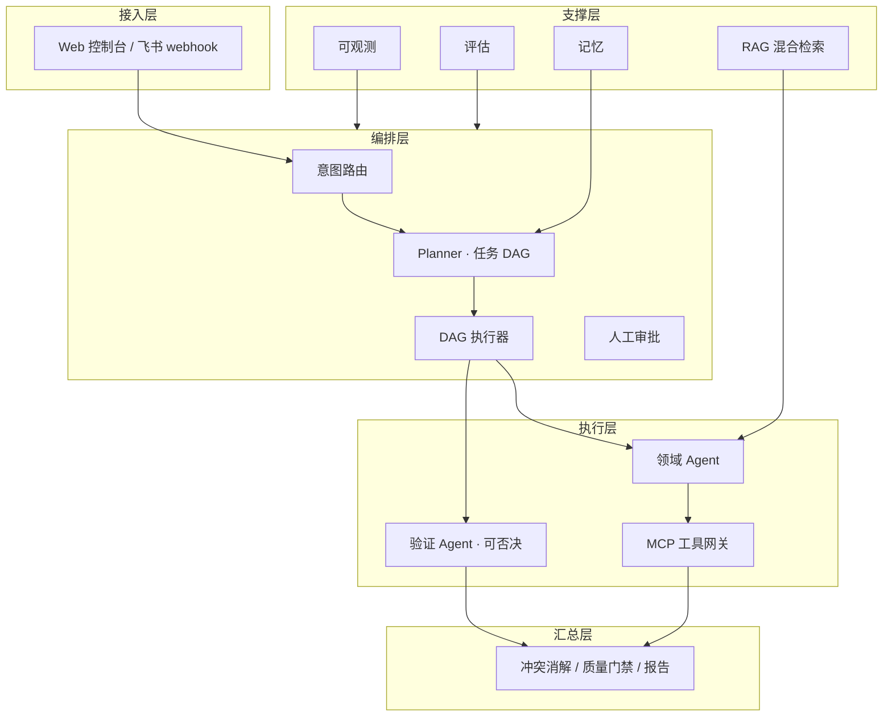
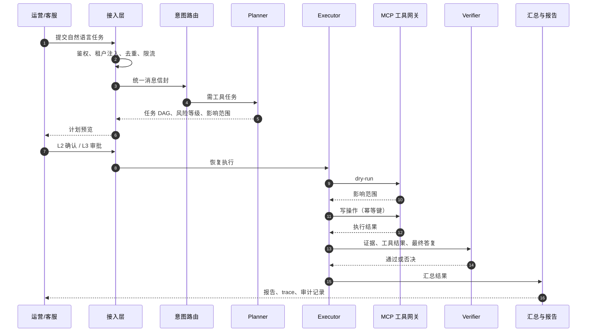
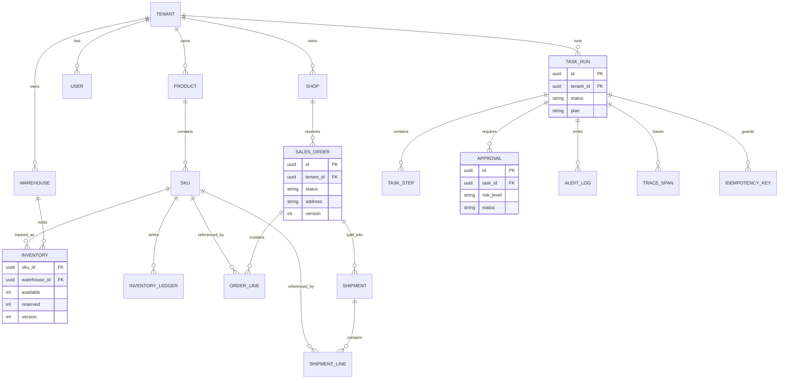
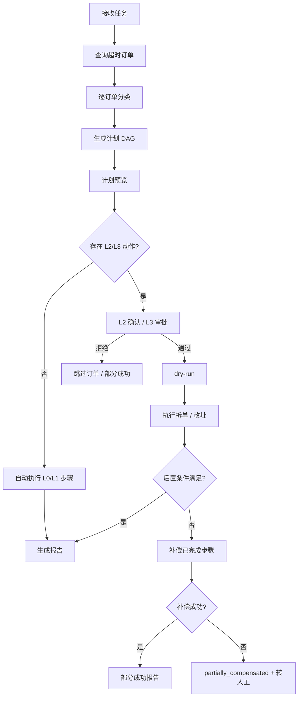
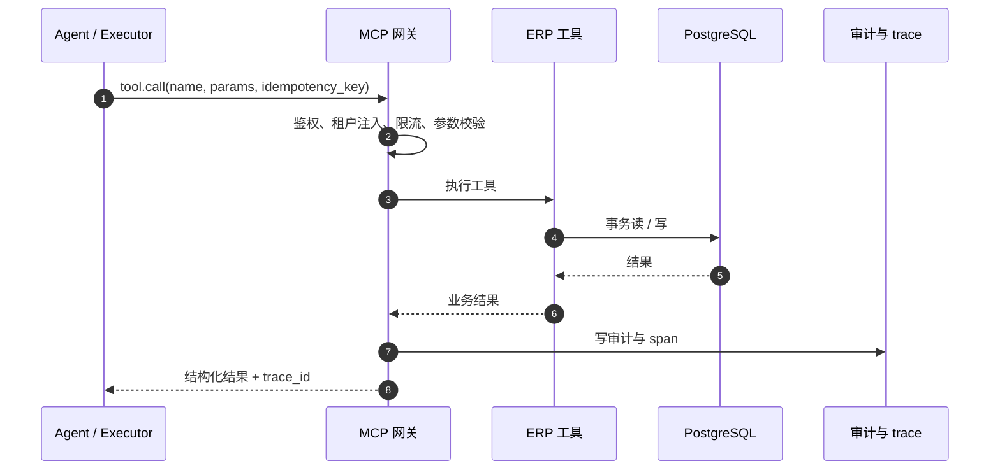
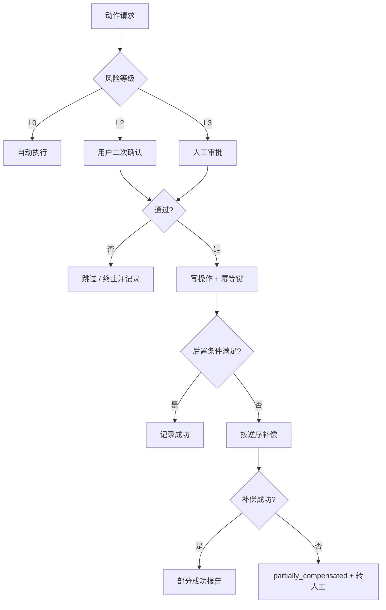
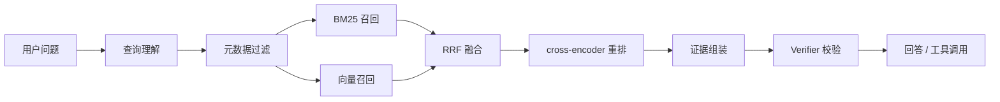
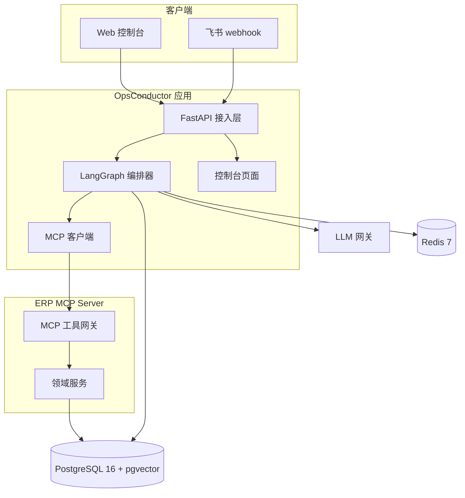

# 运筹 OpsConductor · 系统设计

> 从一句话到一次可审计的 ERP 操作。

**版本** v1.1 ｜ **日期** 2026-11-04 ｜ **状态** 设计已确认，项目处于骨架阶段

**相关文档**：[MVP 设计规格](specs/2026-11-04-mvp-order-exception-design.md) ｜ [JD 对齐设计方案](specs/2026-11-04-jd-alignment-design.md) ｜ [实施计划](plan.md) ｜ [数据来源与合规](data-sources.md) ｜ [架构决策记录](adr/README.md)

## 目录

1. [背景与目标](#1-背景与目标)
2. [使用场景与需求](#2-使用场景与需求)
3. [总体架构](#3-总体架构)
4. [领域模型与数据一致性](#4-领域模型与数据一致性)
5. [Agent 设计与任务编排](#5-agent-设计与任务编排)
6. [工具与 MCP 契约](#6-工具与-mcp-契约)
7. [审批、安全与多租户](#7-审批安全与多租户)
8. [RAG 与混合检索](#8-rag-与混合检索)
9. [浏览器自动化兜底](#9-浏览器自动化兜底)
10. [可观测与评估](#10-可观测与评估)
11. [测试策略](#11-测试策略)
12. [技术栈与运行环境](#12-技术栈与运行环境)
13. [质量目标](#13-质量目标)
14. [开放问题](#14-开放问题)
15. [已确认的默认决策](#15-已确认的默认决策)

- [附录 A：用户故事清单](#附录-a用户故事清单)

---

## 1. 背景与目标

### 1.1 项目背景

运筹（OpsConductor）是一个面向电商 SaaS ERP 的多 Agent 运营系统，对标聚水潭等产品的公开业务形态。它把「处理今天华东仓超时未发货的订单」这类模糊指令，翻译成可拆解、可审批、可回滚、可审计的 ERP 操作。

项目起源于 AI Agent 工程师岗位的实践需求：在无法接入真实 ERP、没有公司内部 SOP 和真实商家数据的约束下，自建 Mini ERP 与演示环境，完整展示多 Agent 系统的任务理解、计划拆解、工具调用、人工审批、失败补偿与效果评估能力。

### 1.2 问题与约束

当前仓库只有学习笔记、教学演示和求职材料，没有能证明上述能力的可运行系统。面试时无法展示：任务如何拆解、工具如何治理、失败如何补偿、写操作如何审批、效果如何量化。

约束条件：

- 不能接入聚水潭真实系统，也没有公司内部 SOP、能力规划资料或真实商家数据；
- 需要自建可演示环境，面试官能一条命令启动或看完整录屏；
- 需要边投简历边构建，时间充足但不能长期没有可展示成果；
- 项目必须通过公开开源数据、合成数据和自建 ERP 模拟器完成，且许可合规。

### 1.3 设计目标

- **任务闭环**：自然语言 → 结构化计划 → 审批 → 执行 → 独立验证 → 报告。
- **风险可控**：写操作具备幂等、补偿、审计与分级审批。
- **结果可信**：验证 Agent 独立于生成 Agent，拥有阻塞性否决权。
- **效果可量化**：100 条 Golden Tasks 覆盖三场景与异常路径。
- **演示可用**：一条命令启动，5 分钟内完成三场景演示。

### 1.4 范围与优先级

当前 MVP 先收敛为「订单异常 + 拆单/改址」的 3 周可写闭环，详细边界、28 条验收任务与已确认决策见 [MVP 设计规格](specs/2026-11-04-mvp-order-exception-design.md)。MVP 后进入 3 周 JD 对齐阶段，补齐 ERP Adapter、SKILL、Memory、RAG、RPA 和多模型路由，详见 [JD 对齐设计方案](specs/2026-11-04-jd-alignment-design.md)。三个场景的完整版本仍按下列顺序推进。

- 首版只做三个场景，按「订单异常 → 售后退款 → 多仓调拨」顺序实现。场景数量不再增加。
- 每个场景必须先完成只读链路，再完成写操作；写操作必须先有审批与幂等，才允许接入演示脚本。
- 方案 B 只取两个组件：浏览器自动化兜底、工作流 DSL 编排与补偿，不单独做 RPA 平台产品。

### 1.5 非目标

- 接入聚水潭真实系统或抓取其生产数据。
- 真实支付、真实物流、真实发票。
- 完整 ERP（财务、采购、生产、跨境税务）。
- 飞书/企微生产级应用上架与审批流；首版只做 webhook 演示。
- 模型微调与自研 embedding。
- 跨租户学习与数据复用。
- 多机分布式部署与大规模压测（只做单机并发验证）。
- 桌面自动化（仅浏览器自动化）。

## 2. 使用场景与需求

### 2.1 场景一：订单异常处理（主场景）

识别超时未发货、库存不足、地址异常订单，生成拆单/换仓/改址/取消方案，低风险自动执行，高风险人工审批，失败补偿，输出处理报告。

### 2.2 场景二：售后退款闭环

查询订单与物流，混合检索售后政策，判定退款资格与金额，人工审批后调用退款，回写工单并通知客户。

### 2.3 场景三：多仓库存调拨

按销量与库存水位识别缺货仓与积压仓，生成调拨建议，审批后执行，校验库存一致性。

### 2.4 关键需求摘要

- **运营人员**：用自然语言下达任务；执行前看到结构化计划和影响范围；高风险动作可确认或拒绝；重复点击或渠道重推不产生重复退款/拆单；中途失败自动补偿；失败时拿到原因和已完成步骤；任务结束产出处理报告。
- **客服与主管**：退款判断附带政策原文引用和生效时间；金额展示商品、运费、优惠、已退明细；低置信度或连续两轮未解决时转人工并带完整上下文；可查看一次解决率、转人工率、误转率。
- **仓管**：调拨建议考虑库存水位、销量、在途和仓库容量；并发调拨能检测库存冲突并重试或拒绝，避免超卖。
- **财务与安全**：退款、赔付类写操作必须审批并留痕；租户数据、知识库、缓存和日志完全隔离；Agent 只拥有最小工具权限；提示注入不能触发越权调用；所有写操作可审计。
- **开发者**：ERP 能力以 MCP 工具暴露；常见流程沉淀为 SKILL 模板；系统记住失败模式；按任务难度路由不同模型；任务可从检查点恢复；测试覆盖工具契约、策略计算、编排流程和检索质量。
- **面试与演示**：一条命令启动；3–5 分钟标准演示脚本；完整 trace；100 条评测结果；失败注入演示；实时数据来自 API 而非向量库；检索结果带来源、版本和生效时间；多 Agent 冲突有裁决过程。

完整 37 条用户故事见 [附录 A](#附录-a用户故事清单)。MVP 的需求边界与 28 条验收任务见 [MVP 设计规格](specs/2026-11-04-mvp-order-exception-design.md)。

## 3. 总体架构

### 3.1 分层架构



各层职责：

| 层 | 负责 | 明确不负责 |
|---|---|---|
| 接入层 | 统一消息信封（租户、渠道、用户、会话、消息 ID、内容、附件、时间戳）、鉴权、去重、限流、会话映射、渠道渲染抽象 | 业务逻辑 |
| 编排层 | 意图路由（规则 + 小模型三分类：可直接回答/需工具/必须人工）、快慢双路径、任务 DAG 生成、并发调度、超时预算、人工升级、检查点恢复 | 直接执行业务写操作 |
| 执行层 | 领域 Agent（知识检索、商品、订单物流、售后、政策合规、动作执行）、验证 Agent；所有外部动作经 MCP 工具网关 | 修改任务计划的语义 |
| 汇总层 | 结果合并、冲突消解、证据与时效标注、质量门禁、渠道格式化、报告生成 | 绕过验证直接输出 |
| 支撑层 | RAG 平台、记忆、可观测、评估、配置与模型路由 | 业务状态写入 |

### 3.2 请求生命周期

**请求生命周期时序**：从任务接入到报告输出，审批与验证都位于写操作之前；失败路径统一进入补偿或转人工。



1. 接入层校验租户与渠道，完成去重和限流，生成统一消息信封。
2. 意图路由判断「可直接回答 / 需工具 / 必须人工」，选择快路径或慢路径。
3. Planner 生成任务 DAG，声明节点依赖、允许工具、风险等级、超时预算和终止条件。
4. 风险分级决定是否进入二次确认或人工审批；任务进入可恢复状态。
5. Executor 按依赖关系执行节点，可并行节点并行，所有外部动作经 MCP 工具网关。
6. Verifier 基于独立上下文检查证据、金额、权限、政策与承诺边界，不通过则阻塞。
7. 汇总层做冲突消解、证据与时效标注、质量门禁和渠道格式化。
8. 输出处理报告，写入审计与 trace；失败节点按策略重试、补偿、重规划或转人工。

### 3.3 核心设计原则

- **LLM 负责规划与异常判断，确定性运行时负责执行与超时控制。** 模型不直接决定「第 3 步调用哪个工具、传什么参数」，工具调用由计划节点与参数绑定确定。详见 [ADR 0002](adr/0002-plan-execute-deterministic-runtime.md)。
- **验证 Agent 独立于生成 Agent，并拥有阻塞性否决权。** 提示词、上下文、模型完全隔离。详见 [ADR 0003](adr/0003-independent-verifier.md)。
- **写操作按风险分级审批。** 幂等、补偿、审计三件套齐全。
- **API 优先，浏览器自动化只作为无 API 旧系统的兜底。**
- **关键取舍必须留痕。** 影响多个模块或难以逆转的决策写入 ADR，详见 [ADR 0001](adr/0001-record-architecture-decisions.md)。

## 4. 领域模型与数据一致性

### 4.1 核心实体

自建 Mini ERP，核心实体按业务域划分：

| 业务域 | 实体 |
|---|---|
| 组织与权限 | 租户 `tenant`、店铺 `shop`、用户与角色 `user/role` |
| 商品 | 商品 `product`、SKU、类目、条码 |
| 仓储 | 仓库 `warehouse`、库位、库存 `inventory`（可用/锁定/在途）、库存流水 |
| 订单与履约 | 订单 `order`、订单行、支付记录、发货单 `shipment`、物流轨迹 |
| 售后 | 退款单 `refund`、售后工单 `ticket`、赔付记录 |
| 知识 | 知识文档 `policy/sop`（带版本、生效时间、适用租户/类目） |
| 任务与审计 | 任务 `task_run`、步骤 `task_step`、审批 `approval`、审计 `audit_log`、幂等键 `idempotency_key` |

**领域实体关系**：订单、发货单、库存与任务/审计链路都挂在租户下；拆单生成发货单，不创建子订单。



### 4.2 一致性要求

- 库存与订单状态使用乐观锁（版本号），避免并发写入覆盖。
- 所有写操作必须携带幂等键，重复请求返回首次执行结果。
- 关键状态变更写审计流水，记录谁、何时、依据什么证据、改了什么。
- 写操作失败按补偿动作回滚，或留下明确的未完成步骤清单供人工接手。
- 任务、步骤、审批、审计之间的关联 ID 必须可追溯，支撑 trace 与报告。

## 5. Agent 设计与任务编排

### 5.1 Agent 角色与边界

| 角色 | 职责 | 边界 |
|---|---|---|
| Planner | 把指令拆成 DAG，声明依赖、前置/后置条件与终止条件 | 不直接调用写工具 |
| Executor | 按 DAG 调用工具，处理重试、超时、补偿 | 不修改计划语义 |
| Verifier | 独立提示词、独立上下文、独立模型；检查证据支撑、金额一致、权限、政策合规、承诺边界 | 不通过则阻塞，不能替代人工审批 |
| Memory | 会话摘要、任务历史、失败记忆、可复用计划检索 | 不作为业务事实来源 |
| Skill 库 | 把「异常订单处理」「退款判定」「调拨建议」沉淀为参数化流程模板 | 不绕过工具契约与审批 |
| Handoff | 低置信度、连续失败、情绪升级、高风险动作转人工，附上下文与已查结果 | 不丢弃已完成步骤 |

### 5.2 任务规格与 DAG

每个任务包含：任务类型、输入实体、风险等级、允许工具集、超时预算、终止条件。

每个节点包含：节点 ID、执行者（Agent 或工具）、输入引用、依赖边、前置条件、后置条件、超时、重试策略、补偿动作、风险等级、是否需要审批。

### 5.3 执行语义

- 依赖满足才执行；无依赖关系的节点可并行。
- 节点失败按失败分类处理，不一律重试。
- 后置条件不满足视为失败，即使工具返回成功。
- 任务结束必须满足终止条件并产出报告。
- 计划非法、参数非法、权限不足等错误不进入无限重试，直接修正、降级或升级人工。

**DAG 执行视图**：审批是执行前的门禁，后置条件校验失败进入补偿，而不是直接重试。



### 5.4 记忆与反思

- **工作记忆**：当前会话摘要与任务上下文。
- **情节记忆**：历史任务计划、工具序列、结果，可按相似度检索作为参考。
- **失败记忆**：错误签名（工具、错误码、消息模式）→ 处理策略 → 成功次数，避免重复犯错。
- **反思循环**：失败分类 → 重试/重规划/降级/升级人工；设置最大重试次数与总预算；禁止无进展的循环重规划。
- **失败分类**：瞬时（超时、限流）、业务（库存不足、政策拒绝）、模型（计划非法、参数非法）、权限、数据冲突。

### 5.5 人工转接

触发条件：低置信度、连续两轮未解决、用户情绪升级、高风险动作。

转接时必须携带：会话摘要、已完成步骤、已查证据、失败原因、建议下一步。审批等待期间任务进入可恢复状态，进程重启后从检查点继续。

## 6. 工具与 MCP 契约

### 6.1 工具定义

- 所有 ERP 能力封装为 MCP Server 工具，Agent 作为客户端调用。
- 工具元数据必须包含：名称、描述、参数 Schema、返回 Schema、风险等级、是否写操作、是否需要审批、是否支持 dry-run、幂等语义、超时。
- 写工具必须支持 `idempotency_key` 与 `dry_run`；执行前可预演影响范围。
- 工具网关统一做鉴权、租户注入、限流、审计、参数校验与敏感字段脱敏。

**MCP 工具调用时序**：Agent 不直接访问数据库，所有 ERP 能力经工具网关；网关负责可信租户上下文、审计与 trace。



### 6.2 首版工具清单

首版约 20 个工具，按能力分组：

| 能力域 | 工具 |
|---|---|
| 商品 | 商品检索、SKU 详情 |
| 库存 | 库存查询、库存预占 |
| 订单与履约 | 订单列表、订单详情、发货单、物流轨迹 |
| 售后 | 退款政策检索、退款资格判断、退款申请、退款执行 |
| 订单异常 | 拆单、换仓、改址 |
| 工单与通知 | 工单创建、客户通知 |
| 调拨 | 调拨建议、调拨执行 |
| 审计 | 审计查询 |

## 7. 审批、安全与多租户

### 7.1 风险分级与审批

| 等级 | 类型 | 执行策略 | 示例 |
|---|---|---|---|
| L0 | 只读 | 自动执行 | 查询订单、库存、物流 |
| L1 | 低风险写 | 自动执行 + 事后通知 | 创建内部工单 |
| L2 | 中风险写 | 用户二次确认 | 改址、拆单 |
| L3 | 高风险写 | 人工审批，支持超时升级 | 退款、赔付、批量调拨 |

审批记录必须包含：动作、参数、影响范围、依据证据、审批人、时间、结果。

**审批与补偿路径**：L0 自动执行，L2/L3 必须经过确认或审批；写操作后置条件失败时按逆序补偿。



### 7.2 审批与恢复

- 审批等待期间任务进入可恢复状态，进程重启后从检查点继续。
- 审批被拒绝时任务终止或降级，保留已完成步骤与拒绝原因。
- 高风险动作不允许通过重试绕过审批。

### 7.3 多租户隔离

- 所有数据表、缓存键、检索过滤、工具调用、日志均带 `tenant_id`。
- 角色权限决定可见工具与数据范围；越权请求直接拒绝并审计。
- 租户隔离必须覆盖演示数据、知识库、任务历史与 trace。
- 演示数据全部使用开源或合成数据，不包含真实个人信息。

### 7.4 最小权限与提示注入防护

- 每个 Agent 只拥有职责所需的最小工具权限。
- 写操作必须同时具备最小权限、审批、幂等、审计，缺一不可。
- 召回内容与用户输入均视为不可信；工具调用走 allowlist。
- 防护手段：输入分级、工具白名单、输出敏感信息过滤、验证 Agent 检查。
- 知识库或用户输入中的提示注入不得触发越权工具调用。

## 8. RAG 与混合检索

### 8.1 通道选择

通道选择优先于检索：

| 数据类型 | 通道 |
|---|---|
| 库存、价格、订单、物流 | 实时 API / SQL |
| 商品参数 | 结构化字段 + 向量兜底 |
| 政策、SOP、FAQ、历史工单 | BM25 + 向量混合检索 |
| 促销规则 | 规则引擎 |

### 8.2 检索流水线

1. 查询理解：意图、实体、指代消解，必要时改写。
2. 检索前元数据过滤：租户、渠道、权限、类目、生效时间。
3. BM25 + 向量双路召回。
4. RRF 融合。
5. cross-encoder 重排。
6. 证据组装：来源、版本、时间戳、权限标记。
7. 验证 Agent 检查引用有效性与时效。

**混合检索流水线**：元数据过滤在召回之前完成；BM25 与向量结果经 RRF 融合后重排，再组装带来源与时效的证据。



### 8.3 索引新鲜度与缓存

- 政策与商品变更走增量索引。
- 文档带生效/失效时间，过期内容不进入证据集。
- 缓存带版本号，失效即清。
- 缓存分层：精确缓存、语义缓存（保守阈值）、工具结果短 TTL 缓存。

### 8.4 安全边界

- 向量库只存知识与文档，不存实时库存、价格、订单状态。
- 召回内容不可信，不能直接触发写操作。
- 输出必须经过敏感信息过滤与验证 Agent。

## 9. 浏览器自动化兜底

- 选一个只有 Web UI 的旧模块（如老版打单页），用 Playwright 实现确定性操作。
- 原则：API 优先，浏览器兜底；浏览器步骤必须有选择器、超时、截图证据和失败重试。
- 不引入视觉大模型做主路径；必要时用 Stagehand/browser-use 处理未脚本化页面，但必须有人工确认与速率限制。
- 浏览器自动化同样受风险分级、审批和审计约束。

## 10. 可观测与评估

- **全链路 trace**：任务、节点、模型调用、工具调用、审批、补偿；记录耗时、token、成本、错误。
- **指标**：任务成功率、工具成功率、首响与端到端 P50/P95、人工介入率、审批通过率、补偿成功率、单任务成本、引用准确率。
- **评估集**：100 条 Golden Tasks，覆盖三场景与异常路径；断言最终业务状态、必需工具调用、禁止动作、引用来源。
- **回归**：模型、提示词、检索策略变更必须跑回归；线上灰度与 A/B 作为后续能力。
- **失败注入**：覆盖超时、限流、工具报错、库存冲突、审批拒绝，验证补偿后的最终一致性。

## 11. 测试策略

**首选测试接缝（最高层，唯一主接缝）**：编排器的公开任务接口——提交任务、恢复任务、查询任务状态。所有端到端测试从这里驱动，断言三类外部可观察结果：最终业务数据状态、审计与审批记录、返回给用户的响应。测试内部使用确定性的 stub 模型（固定计划与工具参数），避免测试依赖模型随机性。

**次级接缝**：

- MCP 工具契约测试：参数 Schema、返回 Schema、幂等、dry-run、权限拒绝、错误码。
- 策略与金额计算：纯函数单元测试，覆盖优惠、部分退款、运费、已退金额。
- 检索质量：固定查询集 + 期望文档，测召回率与重排后 Top-N 准确率。
- 浏览器自动化：针对旧模块的页面级测试，断言操作后业务状态变化。

**好测试的标准**：只断言外部行为与业务不变量，不断言内部实现细节；每个写操作测试必须同时断言审计记录与幂等行为；失败注入测试必须断言补偿后的最终一致性。

**现有基础**：仓库中无同类测试先例，首版建立 pytest + Docker Compose 测试夹具的基线。

## 12. 技术栈与运行环境

### 12.1 技术选型

| 关注点 | 选型 |
|---|---|
| 后端 | Python 3.11+、FastAPI、SQLAlchemy、PostgreSQL 16 + pgvector、Redis |
| 编排 | LangGraph（状态图、检查点、interrupt 审批） |
| 工具 | MCP Python SDK 自建 ERP MCP Server |
| 检索 | BGE-M3（dense + sparse）、bge-reranker-v2-m3、jieba + BM25（或 OpenSearch）、RRF 融合 |
| 浏览器 | Playwright，必要时 Stagehand |
| 可观测 | OpenTelemetry + Langfuse（自托管） |
| 评估 | Ragas / DeepEval / promptfoo，优先支持工具轨迹断言 |
| 部署 | Docker Compose 一键启动；演示控制台首版用轻量 Web UI，不追求前端工程量 |
| 模型 | 统一网关配置：规划用强模型、路由与抽取用小模型、验证用独立模型；全部可替换 |

### 12.2 开发环境

统一使用 conda 管理 Python 环境，定义见仓库根目录 `environment.yml`：

```bash
conda env create -f environment.yml
conda activate opsconductor
docker compose up -d
uvicorn opsconductor.api.main:app --reload
```

- 环境名：`opsconductor`，Python 3.11。
- 依赖安装：`pip install -e ".[dev]"`，包含运行时与开发依赖。
- 质量命令：`pytest -q`、`ruff check .`、`mypy src`。
- 依赖服务：PostgreSQL 16 + pgvector、Redis 7，由 `docker-compose.yml` 提供。
- 仓库不再维护 venv 流程；历史 `.venv` 仅作为本地残留，不参与构建。

**运行结构**：控制台与 webhook 进入 FastAPI；编排器通过 MCP 客户端调用独立的 ERP MCP Server；业务数据落 PostgreSQL，会话与任务缓存用 Redis。



当前环境实测版本（2026-11-04，非锁定版本）：

| 组件 | 版本 |
|---|---|
| FastAPI | 0.162.0 |
| SQLAlchemy | 2.1.6 |
| LangGraph | 1.2.19 |
| MCP | 2.3.0 |
| Pydantic | 2.14.2 |
| Redis 客户端 | 8.1.0 |
| pytest | 9.2.0 |
| ruff | 0.17.3 |
| mypy | 2.4.1 |

注意：`pyproject.toml` 使用 `>=` 下限约束，重建环境可能得到不同版本。LangGraph 与 MCP 均存在跨大版本 API 差异，正式开发前应锁定版本或引入锁文件。MVP 实施将新增 Alembic 与 Jinja2 依赖，JD 对齐阶段再新增 Playwright、pgvector、sentence-transformers/FlagEmbedding、rank-bm25、jieba；安装后更新上表。

### 12.3 当前实现状态

| 模块 | 状态 | 说明 |
|---|---|---|
| HTTP 服务与健康检查 | 已完成 | `GET /health` 返回状态、版本、环境 |
| 配置加载 | 已完成 | pydantic-settings，`OPSCONDUCTOR_*` 前缀 |
| CI | 已完成 | ruff + pytest |
| conda 开发环境 | 已完成 | `environment.yml`，默认环境 `opsconductor` |
| MVP 设计规格 | 已完成 | 2026-11-04 确认，3 周实施 |
| JD 对齐设计方案 | 已完成 | 2026-11-04 确认，MVP 后 3 周实施 |
| Mini ERP 数据模型 | 进行中 | 领域实体尚未落库 |
| MCP 工具网关 | 未开始 | 仅目录占位 |
| Planner / Executor / Verifier | 未开始 | 仅目录占位 |
| RAG 混合检索 | 未开始 | 仅目录占位 |
| 演示控制台 | 未开始 | 暂无前端 |
| 评测集与 trace | 未开始 | 暂无评测数据 |

## 13. 质量目标

指标按实际结果填写，不编造：

- 任务成功率 ≥ 90%。
- 工具调用成功率 ≥ 99%。
- 端到端 P95 ≤ 8s。
- 高风险操作审批覆盖率 100%。
- 越权写入 0。
- 人工介入率 < 15%。
- 单任务成本较初版下降 ≥ 30%。
- 引用准确率 ≥ 95%。

MVP 阶段使用 28 条 Golden Tasks 与失败注入作为验收证据，JD 对齐阶段扩展到 60+，v1.0 再扩展到 100 条。

v1.0 验收证据：100 条 Golden Tasks 评测报告、失败注入演示、完整 trace 面板、审计与审批记录、3–5 分钟演示录屏。

## 14. 开放问题

MVP 已确认的决策不再列在这里，见 [MVP 设计规格 · 已确认决策](specs/2026-11-04-mvp-order-exception-design.md#11-已确认决策)。以下问题不阻塞 MVP 开发，但需要在对应里程碑前确认：

1. **数据库访问层**：MVP 暂定 SQLAlchemy 2.x Core + Alembic，复杂查询直接写原生 SQL；如果团队更偏好 SQL-first，psycopg 3 + aiosql 仍是备选，切换需在数据模型落库前决定。
2. **依赖锁定**：在 v1.0 前引入锁文件（pip-tools、uv lock 或 conda-lock），固定 LangGraph、MCP 等跨大版本依赖。
3. **BM25 存储**：jieba + BM25 本地实现与 OpenSearch 二选一，在 RAG 里程碑根据数据量与运维成本决定。
4. **模型网关**：MVP 使用可配置网关并保留 stub/模板兜底；最终供应商与成本策略在真实模型冒烟后确定。

## 15. 已确认的默认决策

项目已初始化，以下决策先按默认执行，后续可随实现调整：

1. 测试主接缝采用「编排器公开任务接口」，覆盖提交、恢复、查询三类入口。
2. 首版使用轻量 Web 控制台承载审批与 trace，不投入完整前端工程。
3. 自建 Mini ERP，不接 ERPNext/Odoo；后者只作为流程与单据设计参考。
4. 文档与界面中文优先，README 暂不提供英文版。
5. 项目托管在 GitHub（`qinglan-qaq/ops-conductor`），任务与缺陷使用 GitHub Issues 跟踪。

---

## 附录 A：用户故事清单

### 求职与面试

- **US-01** 作为求职者，我希望用一条命令启动完整演示环境，以便面试官能在 5 分钟内跑起来。
- **US-02** 作为求职者，我希望有一段 3–5 分钟的标准演示脚本，以便面试时按固定路径展示三个场景。
- **US-03** 作为求职者，我希望项目随时保持「可演示」状态，以便边投简历边迭代而不必等待全部完成。
- **US-04** 作为面试官，我希望看到每个任务的完整 trace（计划、工具调用、耗时、token、审批、失败），以便判断系统是否真实可用。
- **US-05** 作为面试官，我希望看到 100 条评测任务的量化结果，以便判断系统不是手工调出来的个例。
- **US-06** 作为面试官，我希望看到失败注入演示，以便确认异常路径被执行过而不是只写了文档。

### 运营人员

- **US-07** 作为运营人员，我希望用自然语言下达任务（如「处理今天华东仓超时订单」），以便不学习复杂界面。
- **US-08** 作为运营人员，我希望在执行前看到结构化计划和影响范围，以便决定是否继续。
- **US-09** 作为运营人员，我希望看到每一步的前置条件、后置条件和预计影响，以便理解系统将要做什么。
- **US-10** 作为运营人员，我希望对高风险动作进行确认或拒绝，以便保留最终决策权。
- **US-11** 作为运营人员，我希望重复点击或渠道重推不会产生重复退款/重复拆单，以便避免资金与库存损失。
- **US-12** 作为运营人员，我希望执行到一半失败时系统能自动补偿或回滚，以便数据保持一致。
- **US-13** 作为运营人员，我希望失败时收到明确原因和已完成步骤清单，以便人工接手。
- **US-14** 作为运营人员，我希望任务结束后得到处理报告（成功、失败、跳过、待审批），以便复盘。

### 客服与主管

- **US-15** 作为客服，我希望退款资格判断附带政策原文引用和生效时间，以便向客户解释。
- **US-16** 作为客服，我希望金额计算展示明细（商品、运费、优惠、已退），以便核对。
- **US-17** 作为客服，我希望系统在低置信度或连续两轮未解决时转人工，并带上完整上下文，以便无缝接手。
- **US-18** 作为客服主管，我希望看到一次解决率、转人工率、误转率，以便评估效果。

### 仓管

- **US-19** 作为仓管，我希望调拨建议考虑库存水位、销量、在途和仓库容量，以便建议可执行。
- **US-20** 作为仓管，我希望并发调拨时系统检测库存冲突并重试或拒绝，以便不超卖。

### 财务

- **US-21** 作为财务审核人，我希望退款、赔付类写操作必须经过审批并留痕，以便满足内控要求。

### 租户管理员与安全

- **US-22** 作为租户管理员，我希望不同租户的商品、订单、知识库、缓存和日志完全隔离，以便满足数据安全要求。
- **US-23** 作为安全负责人，我希望每个 Agent 只拥有职责所需的最小工具权限，以便降低越权风险。
- **US-24** 作为安全负责人，我希望知识库或用户输入中的提示注入不会触发越权工具调用，以便防止数据泄露。
- **US-25** 作为安全负责人，我希望所有写操作可审计（谁、何时、依据什么证据、改了什么），以便事后追责。

### 开发者

- **US-26** 作为开发者，我希望 ERP 能力以 MCP 工具形式暴露，以便被不同 Agent 和外部客户端复用。
- **US-27** 作为开发者，我希望常见业务流程以 SKILL 模板形式沉淀，以便新场景通过组合而非重写实现。
- **US-28** 作为开发者，我希望系统记住失败模式（错误签名 → 处理策略），以便同类错误不重复发生。
- **US-29** 作为开发者，我希望按任务难度路由不同模型，以便在成功率不降的前提下降低单任务成本。
- **US-30** 作为开发者，我希望任务能从检查点恢复执行，以便审批等待或进程重启后不丢失进度。
- **US-31** 作为开发者，我希望有覆盖工具契约、策略计算、编排流程和检索质量的测试，以便修改提示词或模型后快速回归。

### 演示观众

- **US-32** 作为演示观众，我希望看到「只有网页、没有 API」的旧版打单模块被浏览器自动化操作，以便理解 RPA 兜底能力。
- **US-33** 作为演示观众，我希望看到实时数据（库存、价格、物流）来自 API 而不是向量库，以便理解 RAG 的边界。
- **US-34** 作为演示观众，我希望看到知识检索结果带来源、版本和生效时间，以便判断答案可信度。
- **US-35** 作为演示观众，我希望看到多 Agent 结果冲突时的裁决过程，以便理解汇总层不是简单拼接。

### 求职材料

- **US-36** 作为求职者，我希望每个关键设计都有决策记录（为什么 DAG 不是纯 ReAct、为什么验证独立），以便面试时讲清取舍。
- **US-37** 作为求职者，我希望项目指标能直接改写成简历条目和面试问答，以便降低材料准备成本。
