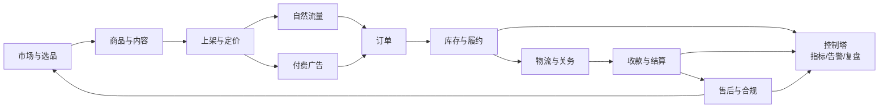

# 跨境电商运营异常处理指南

> 把「意外」变成「可分级、可处置、可复盘、可预防」的日常流程。

**版本** v1.0 ｜ **日期** 2026-11-10 ｜ **状态** 可用 ｜ **适用范围**：TikTok Shop / Amazon / Temu / Shopify 等跨境渠道，1–10 家店、约 5000 SKU 的精品店运营

**关联文档**：[跨境电商全流程能力地图](../specs/2026-11-10-cross-border-ecommerce-platform-design.md) ｜ [模拟演示系统需求规格](../specs/2026-11-10-cross-border-simulation-design.md) ｜ [系统设计](../design.md)

---

## 0. 使用说明

这份指南回答三个问题：

1. 跨境电商运营有哪些流程？
2. 运营人员会遇到哪些意外？
3. 遇到意外时，按什么标准定级、按什么步骤处理、事后怎么防？

使用方式：

- **日常**：用第 2 节的日/周/月检查清单巡检。
- **事发**：用第 3 节的方法论和第 5 节的场景目录定级，再跳到第 6 节的 playbook 处置。
- **复盘**：用第 3.5 节的模板做无责复盘，更新 runbook 和测试。
- **建设**：用第 4 节的可能性/影响标准维护风险登记册，用 FMEA 做上新前评估。

> 平台费率、物流时效、税务和合规要求会变。本文的阈值是**运营默认值**，不是平台规则；涉及具体政策时以平台 Seller Center、税局和合规顾问的最新文件为准。

## 1. 跨境电商运营全景流程



| # | 流程 | 核心动作 | 主责 | 关键产出 | 核心指标 |
|---|---|---|---|---|---|
| 1 | 市场与选品 | 趋势、竞品、评分、合规、毛利、供应商 | 运营/买手 | 选品评分卡、SKU 组合 | 上新命中率、毛利、售罄率 |
| 2 | 商品与内容 | 卖点、图片、短视频、直播脚本、本地化 | 内容/运营 | Brief、素材、Listing 文案 | 点击率、完播率、转化率 |
| 3 | 上架与定价 | 类目、标题、变体、价格、库存同步 | 运营 | Listing、价格表 | 上架通过率、价格竞争力 |
| 4 | 自然流量 | 内容日历、达人/联盟、寄样、直播 | 内容/达人运营 | 发布计划、达人合作 | 自然 GMV 占比、互动率 |
| 5 | 付费广告 | 计划、预算、出价、素材、ROAS | 投放 | Campaign、预算表 | ROAS、ACOS、CAC |
| 6 | 订单 | 同步、审核、异常、取消、改址 | 订单运营 | 订单队列、异常单 | 迟发率、取消率、缺陷率 |
| 7 | 库存与履约 | 预占、拆单、换仓、补货、盘点 | 仓管/运营 | 发货单、补货单 | 缺货率、库存周转、超卖 |
| 8 | 物流与关务 | 比价、发货、报关、轨迹、签收 | 物流/关务 | 运单、报关单 | 时效达成率、扣关率、丢件率 |
| 9 | 收款与结算 | 结算、费用、退款、汇率、对账、税务 | 财务 | 结算单、对账单 | 差异率、回款周期、拒付率 |
| 10 | 售后与合规 | 退货、退款、纠纷、IP、产品安全 | 客服/合规 | 工单、退款单、整改单 | 退款率、差评率、投诉率 |
| 11 | 控制塔 | 指标、告警、审批、trace、复盘 | 负责人 | 日报/周报/复盘 | 任务成功率、人工介入率 |

**全流程的关键不是每个环节都做到完美，而是跨环节状态一致**：选品算的毛利要传到定价、广告、履约和结算；内容带来的订单要能追溯到素材、达人和 campaign；退款和拒付要能回写到 SKU 和活动。

## 2. 运营人员的一天、一周、一月

### 2.1 每日检查清单

| 时段 | 检查项 | 异常信号 | 首响 |
|---|---|---|---|
| 08:30 | 夜间订单 | 支付失败、风控拦截、地址异常、重复单 | 进入异常队列 |
| 08:45 | 发货时效 | 临近截止、库存不足、仓库未接单 | 催仓/换仓/拆单 |
| 09:00 | 库存健康 | 可售天数 < 7 天、超卖、预占冲突 | 补货/调拨/下架 |
| 09:15 | 广告花费 | 预算烧穿、ROAS 低于盈亏线、拒登 | 降预算/换素材/申诉 |
| 09:30 | 结算与回款 | 未到账、少结、多扣、退款漏记 | 对账/工单 |
| 09:45 | 平台通知 | 政策变更、账号警告、审核失败 | 读规则/整改 |
| 10:00 | 客诉与差评 | 新差评、纠纷升级、退款争议 | 回复/补偿/升级 |
| 14:00 | 物流与关务 | 轨迹停滞、扣关、丢件、退件 | 联系承运商/补资料 |
| 17:00 | 对账与交接 | 未闭环异常、待审批、待补货 | 交接单/明日计划 |

### 2.2 每周检查

- SKU 表现：A/B/C 层动销、毛利、退货率、差评关键词。
- 内容与达人：发布量、互动率、达人履约、寄样转化。
- 广告：ROAS、ACOS、素材疲劳、预算分配。
- 库存：周转天数、滞销、缺货、在途。
- 现金：回款、应付、汇率、现金流预测。
- 合规：平台政策更新、证书到期、IP 风险。
- 异常复盘：本周 P0/P1 事件、CAPA 进度。

### 2.3 每月检查

- P&L：收入、成本、费用、毛利、净利。
- SKU 组合：上新、淘汰、清货。
- 供应商：交期、质量、成本、MOQ。
- 物流：时效、成本、丢件、扣关。
- 结算：差异率、拒付率、税务申报。
- 风险登记册：更新可能性/影响评级。
- 演练：一次失败注入或危机模拟。
- 文档：更新 SOP/runbook/checklist。

## 3. 异常管理方法论

### 3.1 五步法：Detect → Diagnose → Decide → Deal → Debrief

| 步骤 | 目标 | 关键动作 | 产出 |
|---|---|---|---|
| Detect 发现 | 尽早知道 | 监控、告警、巡检、客诉、平台通知 | 事件工单 |
| Diagnose 诊断 | 搞清范围和原因 | 影响面、时间线、证据、复现 | 影响评估 |
| Decide 定级 | 决定投入和升级 | L×I 评分、P0–P3、自动化/人工 | 定级与 owner |
| Deal 处置 | 止损、恢复、补偿、沟通 | 遏制、修复、补偿、对外沟通 | 恢复与记录 |
| Debrief 复盘 | 防止再发 | 无责复盘、5 Whys、CAPA | 行动项与测试 |

**核心原则：**

- **先止损，再找根因。** 不要为了定位原因而让损失扩大。
- **先定级，再动作。** 不同级别投入不同，不允许所有事都按最高优先级处理。
- **先证据，再结论。** 截图、日志、订单号、时间线、金额。
- **先沟通，再沉默。** 客户、平台、内部都要有节奏。
- **先复盘，再关闭。** 没有 CAPA 的事件不算关闭。

### 3.2 预防：FMEA（失效模式与影响分析）

适用场景：新 SKU、新市场、新平台、新物流商、旺季前。

| 维度 | 1 分 | 3 分 | 5 分 |
|---|---|---|---|
| Severity 严重度 | 轻微，可忽略 | 客户/财务/合规中等影响 | 封店、重大资金/法律/安全 |
| Occurrence 发生度 | 极少 | 偶尔 | 高频/几乎必然 |
| Detection 可探测度 | 自动告警 | 日报/巡检 | 只能事后发现 |

**RPN = S × O × D**。优先处理 RPN > 60 或 S ≥ 4 的项；每项必须有预防动作、责任人、验证方式。

### 3.3 定级：5×5 风险矩阵

见第 4 节。定级不是拍脑袋，而是用「可能性 × 影响」得到分数，再映射到 P0–P3 和响应 SLA。

### 3.4 响应：事件指挥（Incident Command）

| 角色 | 职责 |
|---|---|
| IC 事件指挥 | 定级、决策、对外口径、升级 |
| Ops Lead 处置负责人 | 止损、修复、补偿、证据 |
| Comms Lead 沟通负责人 | 客户、平台、内部同步 |
| Scribe 记录员 | 时间线、证据、决策记录 |

小团队可以一人多角，但必须明确谁在什么时间负责什么。P0/P1 事件必须指定 IC。

### 3.5 复盘：无责复盘 + 5 Whys + CAPA

复盘模板：

1. **事实**：发生了什么，何时，影响多少订单/金额/客户。
2. **时间线**：发现、定级、止损、恢复、关闭的关键节点。
3. **根因**：5 Whys，追到流程/系统/组织层，不追到「某个人不小心」。
4. **做得好/不好**：告警、协作、沟通、工具。
5. **CAPA**：纠正措施 + 预防措施，每项有 owner、截止日、验证方式。
6. **文档与测试**：更新 runbook/checklist，新增 Golden Task 或失败注入。

P0/P1 在 48 小时内完成复盘；P2 在 7 天内；P3 月度汇总。

### 3.6 文档三层

| 层 | 内容 | 更新频率 |
|---|---|---|
| SOP | 稳定流程：选品、上架、发货、对账 | 流程变更时 |
| Runbook | 场景处置：扣关、丢件、封店、拒付 | 每次复盘后 |
| Checklist | 班次巡检：日/周/月 | 每周微调 |

### 3.7 自动化决策矩阵

| 风险等级 | 置信度 | 动作 |
|---|---|---|
| L0 只读 | 高 | 自动 |
| L1 低风险写 | 高 | 自动 + 事后通知 |
| L2 中风险写 | 高 + 可回滚 | 自动 + 审计 |
| L2 中风险写 | 中/低 | 人工确认 |
| L3 高风险写 | 任意 | 人工审批 |
| 资金/合规/账号 | 任意 | 人工审批 + 双人复核 |

这条矩阵与 OpsConductor 的审批/幂等/补偿/审计模型一致：**Agent 可以规划和执行，但资金、价格、账号、合规声明必须有人类门禁。**

## 4. 可能性与影响标准

### 4.1 可能性 L1–L5

| 等级 | 名称 | 参考频率 | 参考概率 | 说明 |
|---|---|---|---|---|
| L1 | 极少 | ≤1 次/年 | <1% | 极端场景，但不能不准备 |
| L2 | 较少 | 1 次/季度 | 1–5% | 有先例，需 runbook |
| L3 | 可能 | 1–4 次/月 | 5–15% | 日常运营会遇到 |
| L4 | 很可能 | 1–3 次/周 | 15–40% | 高频，需自动化和巡检 |
| L5 | 几乎必然 | 每天/每批 | >40% | 常态，必须产品化/自动化 |

> 频率按「单店/单市场」校准；多店/多市场按组合风险上调一级。概率按订单、批次或活动维度定义，避免口径混乱。

### 4.2 影响 I1–I5

| 等级 | 名称 | 财务参考 | 客户/运营 | 合规/品牌 |
|---|---|---|---|---|
| I1 | 轻微 | <0.5% 日 GMV 或 <$100 | 个别客户，可本地绕过 | 无 |
| I2 | 较小 | 0.5–2% 日 GMV 或 $100–$1k | 少量客户，当日可解 | 平台提醒 |
| I3 | 中等 | 2–5% 日 GMV 或 $1k–$10k | 客户可见，24–72h | 平台警告/退款争议 |
| I4 | 重大 | 5–15% 日 GMV 或 $10k–$100k | 批量订单/账号风险 | 法律/税务/产品安全 |
| I5 | 灾难 | >15% 日 GMV 或 >$100k | 封店、大规模退款、数据泄露 | 诉讼、监管、品牌危机 |

> 财务阈值按店铺规模调整：日 GMV 1 万美元和 10 万美元的店，绝对金额不同，但「占日 GMV 比例」可比。

### 4.3 可探测度 D1–D5（用于 FMEA）

| 等级 | 名称 | 说明 |
|---|---|---|
| D1 | 自动告警 | 实时规则/监控，秒级/分钟级发现 |
| D2 | 看板/日报 | 当天或次日发现 |
| D3 | 人工巡检 | 靠人按清单检查 |
| D4 | 外部投诉 | 客户/平台/承运商告知 |
| D5 | 事后发现 | 已经造成损失才发现 |

### 4.4 风险分数与优先级

| L \ I | I1 | I2 | I3 | I4 | I5 |
|---|---|---|---|---|---|
| L1 | 1 | 2 | 3 | 4 | 5 |
| L2 | 2 | 4 | 6 | 8 | 10 |
| L3 | 3 | 6 | 9 | 12 | 15 |
| L4 | 4 | 8 | 12 | 16 | 20 |
| L5 | 5 | 10 | 15 | 20 | 25 |

| 分数 | 优先级 | 响应 SLA | 升级 |
|---|---|---|---|
| 20–25 | P0 危机 | 15 分钟响应，1 小时止损，30 分钟更新 | IC + 负责人 + 法务/财务/平台经理 |
| 12–19 | P1 高 | 30 分钟响应，4 小时止损，每小时更新 | 运营负责人 + 职能 owner |
| 6–11 | P2 中 | 4 小时响应，24 小时解决，每日更新 | 班组长 + owner |
| 1–5 | P3 低 | 次工作日，周度复盘 | 工单队列 |

### 4.5 证据标准

- **疑似**：有信号，未确认；先小范围止损，不对外定性。
- **确认**：有订单号/截图/日志/金额/时间线，可复现或可交叉验证。
- **误报**：有证据排除；记录误报原因，优化告警。
- 每个 P0/P1 事件必须保留：时间线、受影响订单/金额、截图、日志、沟通记录、决策记录。

### 4.6 升级路径

| 级别 | 谁 | 何时 | 渠道 |
|---|---|---|---|
| P0 | IC、创始人/负责人、法务/合规、财务、平台客户经理 | 立即 | 电话 + 群 + 邮件 |
| P1 | 运营负责人、职能 owner、财务（涉钱） | 30 分钟内 | 群 + 电话 |
| P2 | 班组长、owner | 4 小时内 | 工单/群 |
| P3 | 工单队列 | 次工作日 | 工单 |

### 4.7 快速定级触发词

| 级别 | 触发词/信号 | 默认动作 |
|---|---|---|
| P0 | 封店、资金冻结、数据泄露、产品安全事故、大规模超卖/超时、舆情扩散、收款账户冻结 | 立即启动 IC，15 分钟响应，通知负责人/法务/财务/平台经理 |
| P1 | 批量扣关、批量丢件、结算差异、广告账户受限、IP 投诉、供应商断供、退款争议升级 | 30 分钟响应，4 小时止损，owner + 负责人 |
| P2 | 单 SKU 缺货、单笔退款争议、单条差评、单条素材拒登、单笔地址异常 | 4 小时响应，24 小时解决 |
| P3 | 个别咨询、轻微延迟、可本地绕过的小问题 | 次工作日，周度复盘 |

## 5. 全场景异常目录

> L/I/P 是默认评级，需按店铺规模、市场、品类校准。详细处置见第 6 节 playbook；未列 playbook 的场景按同一模板执行。

### 5.1 选品与市场（SEL）

| ID | 场景 | 早期信号 | L/I/P | 首响动作 | 预防 |
|---|---|---|---|---|---|
| SEL-01 | 趋势误判，选品滞销 | 30 天动销低、点击高转化低 | L4/I2/P2 | 降价/换素材/清货 | 趋势至少看 8–12 周；小批量测试 |
| SEL-02 | 侵权/商标/专利 | 平台 IP 投诉、下架通知 | L3/I4/P1 | 下架、保留证据、联系律师 | IP 筛查、供应商授权链 |
| SEL-03 | 产品合规不达标 | 审核拒、证书缺失 | L3/I4/P1 | 停售、补证、召回 | CE/FCC/FDA/CPC/GPSR 清单 |
| SEL-04 | 毛利测算错误 | 实际费用高于预估 | L4/I3/P1 | 调价/停投/换 SKU | 全成本模型、月度复盘 |
| SEL-05 | 物流不可行 | 带电/液体/超尺寸被拒 | L3/I2/P2 | 换渠道/换包装/停售 | 选品前物流可行性检查 |
| SEL-06 | 供应商断供/交期延误 | 交期推迟、库存下降 | L4/I3/P1 | 催货、换供应商、调拨 | 双供应商、安全库存 |
| SEL-07 | MOQ 过高导致积压 | 库存周转 > 90 天 | L3/I3/P2 | 促销/捆绑/清货 | MOQ 谈判、小单快反 |
| SEL-08 | 文化/季节误判 | 内容互动低、退货高 | L3/I2/P2 | 本地化调整 | 本地顾问/小市场测试 |

### 5.2 内容与素材（CNT）

| ID | 场景 | 早期信号 | L/I/P | 首响动作 | 预防 |
|---|---|---|---|---|---|
| CNT-01 | 素材同质化，点击率低 | CTR 下降、完播率低 | L4/I2/P2 | 换钩子/换场景/换达人 | 素材 A/B、月度迭代 |
| CNT-02 | 违规声明/绝对化用语 | 平台拒登/警告 | L3/I3/P1 | 下线、改写、申诉 | 合规词库、发布前检查 |
| CNT-03 | 版权/音乐/肖像侵权 | 投诉/下架 | L3/I4/P1 | 下架、替换、留证 | 授权素材库、版权筛查 |
| CNT-04 | 本地化错误/翻译歧义 | 评论纠错、转化低 | L3/I2/P2 | 修正文案/配音 | 母语审校 |
| CNT-05 | 素材与实物不符 | 退货率高、差评 | L4/I3/P1 | 下架问题素材、补实拍 | 实物对照、样品审核 |
| CNT-06 | 达人内容翻车 | 负面评论、品牌关联 | L2/I4/P1 | 暂停合作、下架、声明 | 达人背调、内容预审 |
| CNT-07 | 素材版本混乱 | 投错素材、数据不可比 | L3/I2/P2 | 锁定版本、重命名 | DAM、版本号、审批 |
| CNT-08 | 素材尺寸/比例不符 | 平台拒登、裁切变形 | L3/I2/P2 | 重剪/重传 | 平台规格模板、发布前检查 |

### 5.3 上架与定价（LST）

| ID | 场景 | 早期信号 | L/I/P | 首响动作 | 预防 |
|---|---|---|---|---|---|
| LST-01 | 类目错放/属性错 | 流量低、审核拒 | L3/I2/P2 | 改类目/属性 | 上架模板、抽检 |
| LST-02 | 关键词/标题违规 | 审核拒、限流 | L3/I3/P1 | 改写、申诉 | 平台词库、发布前扫描 |
| LST-03 | 价格标错/价格倒挂 | 异常订单激增、毛利为负 | L3/I4/P1 | 暂停销售、取消/补偿 | 价格审批、上下限 |
| LST-04 | 库存不同步/超卖 | 超卖告警、取消率上升 | L4/I4/P1 | 下架/调拨/补偿 | 实时同步、缓冲库存 |
| LST-05 | Listing 审核被拒/下架 | 平台通知 | L3/I3/P1 | 整改、申诉 | 合规检查、证书齐全 |
| LST-06 | 变体/尺寸/颜色错 | 退货/差评 | L3/I2/P2 | 修正变体、通知客户 | 变体模板、抽检 |
| LST-07 | 平台比价/最低价规则 | 被限流/警告 | L2/I3/P2 | 调价/组合装 | 价格监控、差异化 |
| LST-08 | 重复铺货/关键词堆砌 | 平台限流/警告 | L3/I3/P1 | 合并/改写/申诉 | 铺货规则、关键词审核 |

### 5.4 流量与广告（TRF）

| ID | 场景 | 早期信号 | L/I/P | 首响动作 | 预防 |
|---|---|---|---|---|---|
| TRF-01 | 广告预算烧穿 | 花费超预算、ROAS 低 | L4/I3/P1 | 降预算/暂停/换素材 | 预算护栏、日限额 |
| TRF-02 | ROAS 暴跌 | 花费不变、转化下降 | L4/I3/P1 | 查归因/素材/竞品/库存 | 分日监控、A/B |
| TRF-03 | 广告审核拒登 | 计划不投放 | L3/I2/P2 | 改写/换素材/申诉 | 合规预审 |
| TRF-04 | 广告账户被封/限额 | 无法投放、通知 | L2/I5/P0 | 申诉、备用账户、转自然流量 | 合规运营、多账户 |
| TRF-05 | 归因错误/像素丢失 | 数据对不上、ROAS 失真 | L3/I3/P2 | 修像素/UTM/回传 | 归因校验、对账 |
| TRF-06 | 达人违约/不发货 | 内容未发、样品失踪 | L4/I2/P2 | 催稿、换人、追样 | 合同、寄样跟踪 |
| TRF-07 | 内容断更/流量下滑 | 发布量下降、自然 GMV 降 | L4/I3/P1 | 补内容、启用备选达人 | 内容日历、库存化素材 |
| TRF-08 | 竞品恶意点击/价格战 | 花费异常、转化低 | L3/I2/P2 | 排除无效流量、调价 | 监控、差异化 |

### 5.5 订单（ORD）

| ID | 场景 | 早期信号 | L/I/P | 首响动作 | 预防 |
|---|---|---|---|---|---|
| ORD-01 | 超时未发货 | 临近截止、仓库未接单 | L5/I4/P0 | 催仓/换仓/拆单/升级 | 时效看板、截单提醒 |
| ORD-02 | 支付失败/风控拦截 | 订单未支付、风控通知 | L4/I2/P2 | 通知客户、换支付方式 | 支付方式覆盖、风控预案 |
| ORD-03 | 地址异常/改址 | 地址校验失败、客户申请 | L4/I3/P1 | 校验、改址、拦截发货 | 地址校验、发货前确认 |
| ORD-04 | 重复订单/重复扣款 | 同客户同 SKU 多单 | L3/I3/P1 | 合并/取消/退款 | 幂等、去重规则 |
| ORD-05 | 恶意订单/欺诈 | 大额、异常地址、拒付史 | L3/I4/P1 | 人工审核、延迟发货 | 风控规则、黑名单 |
| ORD-06 | 客户取消/改单 | 取消请求、地址变更 | L4/I2/P2 | 未发货则取消；已发则拦截 | 取消窗口、状态同步 |
| ORD-07 | 订单状态不同步 | 平台/ERP 状态不一致 | L3/I3/P2 | 对账、手工修正 | 定时同步、冲突检测 |
| ORD-08 | 跨店/跨仓选错 | 发错货、库存错 | L2/I3/P2 | 拦截/改仓/补偿 | 路由规则、仓映射 |

### 5.6 库存与履约（INV）

| ID | 场景 | 早期信号 | L/I/P | 首响动作 | 预防 |
|---|---|---|---|---|---|
| INV-01 | 库存不足/超卖 | 可用 < 订单、超卖告警 | L4/I4/P1 | 下架/调拨/拆单/补偿 | 缓冲库存、实时同步 |
| INV-02 | 预占冲突/并发 | 乐观锁冲突、重复预占 | L3/I3/P1 | 重试/串行/补偿 | 版本号、幂等 |
| INV-03 | 仓库发错/漏发 | 客户反馈、称重异常 | L3/I3/P1 | 补发/召回/追责 | 复核、称重、拍照 |
| INV-04 | 拆单/合单错误 | 包裹数不符、运费异常 | L3/I2/P2 | 改单/补发 | 拆单规则、校验 |
| INV-05 | 盘点差异 | 账实不符 | L3/I3/P2 | 冻结库存、复盘 | 循环盘点、差异阈值 |
| INV-06 | 在途丢失/延迟 | 轨迹停滞、入库少 | L3/I3/P1 | 索赔、补货 | 在途保险、承运商考核 |
| INV-07 | 补货不及时/断货 | 可售天数 < 7 天 | L4/I3/P1 | 空运/调拨/预售 | 安全库存、补货点 |
| INV-08 | 滞销/积压 | 周转 > 90 天 | L4/I3/P2 | 促销/捆绑/清货 | 生命周期、淘汰规则 |

### 5.7 物流与关务（LOG）

| ID | 场景 | 早期信号 | L/I/P | 首响动作 | 预防 |
|---|---|---|---|---|---|
| LOG-01 | 物流延迟/时效超限 | 轨迹停滞、ETA 超期 | L4/I3/P1 | 催承运商、换渠道、通知客户 | 时效监控、备选承运商 |
| LOG-02 | 丢件/破损 | 客户反馈、称重/照片 | L3/I3/P1 | 理赔、补发/退款 | 保险、包装标准 |
| LOG-03 | 海关扣关/查验 | 清关状态异常、补资料 | L3/I4/P1 | 补资料、换口岸、退运 | HS 归类、申报合规 |
| LOG-04 | 关税/增值税/低申报 | 税单异常、罚款 | L3/I4/P1 | 补税、调整申报 | 完税价格、税务顾问 |
| LOG-05 | 禁限售/敏感货 | 承运商拒收、扣货 | L2/I4/P1 | 停发、换渠道、销毁/退回 | 品类筛查、MSDS |
| LOG-06 | 承运商爆仓/停运 | 大面积延迟、停收 | L3/I4/P1 | 切换承运商、分流 | 多承运商、旺季预案 |
| LOG-07 | 海外仓入库异常 | 入库少、破损、上架慢 | L3/I3/P1 | 核对、索赔、补发 | 预约、入库质检 |
| LOG-08 | 退件/无法投递 | 退回、地址错误 | L3/I2/P2 | 联系客户、重发/退款 | 地址确认、退件处理 |

### 5.8 收款与结算（PAY）

| ID | 场景 | 早期信号 | L/I/P | 首响动作 | 预防 |
|---|---|---|---|---|---|
| PAY-01 | 结算延迟/未打款 | 到期未到账 | L3/I3/P1 | 查结算单、联系平台/PSP | 回款日历、对账 |
| PAY-02 | 少结/多扣/费用错误 | 对账差异 | L4/I3/P1 | 拉明细、工单、调整 | 自动对账、费用规则 |
| PAY-03 | 汇率损失 | 汇率波动、结汇差 | L4/I2/P2 | 锁汇/分批结汇 | 汇率策略 |
| PAY-04 | 退款漏记/重复退款 | 账实不符、重复单 | L3/I3/P1 | 查重、冲正、审计 | 幂等、退款台账 |
| PAY-05 | 拒付/chargeback | 银行通知、扣款 | L3/I4/P1 | 举证、申诉、风控 | 3DS、风控、证据留存 |
| PAY-06 | 收款账户冻结/KYC | 无法收款、补资料 | L2/I5/P0 | 补 KYC、换账户、法律咨询 | 合规主体、备用账户 |
| PAY-07 | 税务/VAT/GST 申报 | 税局通知、平台代扣 | L3/I4/P1 | 补申报、顾问介入 | 税务登记、月度申报 |
| PAY-08 | 现金流断裂 | 回款慢、库存/广告占用 | L3/I5/P0 | 收缩投放、清货、融资 | 现金流预测、账期管理 |

### 5.9 售后与合规（AFS）

| ID | 场景 | 早期信号 | L/I/P | 首响动作 | 预防 |
|---|---|---|---|---|---|
| AFS-01 | 退货率异常 | 退货率上升、集中 SKU | L4/I3/P1 | 查原因、下架/改描述 | 质检、素材真实 |
| AFS-02 | 退款争议/政策冲突 | 客户投诉、平台介入 | L4/I3/P1 | 查政策、给证据、协商 | 政策 RAG、留证 |
| AFS-03 | 差评/评分下降 | 新差评、星级下降 | L4/I3/P1 | 回复、补偿、改进 | 售后 SOP、回访 |
| AFS-04 | 侵权投诉/IP 下架 | 平台通知、律师函 | L3/I4/P1 | 下架、申诉、律师 | IP 筛查、授权 |
| AFS-05 | 产品安全事故/召回 | 客诉、监管通知 | L1/I5/P0 | 停售、召回、通报 | 认证、质检、追溯 |
| AFS-06 | 平台政策变更/封店 | 规则更新、账号警告 | L3/I5/P0 | 读规则、整改、申诉 | 政策巡检、合规 |
| AFS-07 | 数据隐私/GDPR | 客户投诉、监管问询 | L2/I5/P0 | 删数、通报、法律 | 隐私政策、最小化 |
| AFS-08 | 客服响应超时/升级 | 首响超时、工单积压 | L4/I2/P2 | 增援、模板、升级 | 排班、知识库 |

### 5.10 系统、平台与组织（SYS）

| ID | 场景 | 早期信号 | L/I/P | 首响动作 | 预防 |
|---|---|---|---|---|---|
| SYS-01 | 平台 API 变更/限流 | 同步失败、429 | L3/I3/P1 | 降级、重试、联系平台 | 版本监控、契约测试 |
| SYS-02 | 数据同步失败/丢失 | 订单/库存不一致 | L3/I4/P1 | 停写、对账、补数 | 幂等、对账、备份 |
| SYS-03 | 账号被盗/权限滥用 | 异常登录、异常操作 | L2/I5/P0 | 冻结、改密、审计 | 2FA、最小权限 |
| SYS-04 | 模型幻觉/错误建议 | 计划/金额/政策错误 | L3/I3/P1 | 人工复核、回滚 | 确定性检查、引用 |
| SYS-05 | 提示注入/越权 | 异常工具调用 | L2/I5/P0 | 阻断、审计、修规则 | 输入分级、allowlist |
| SYS-06 | 审批延迟/交接失败 | 任务停滞、重复处理 | L4/I2/P2 | 升级、交接单 | SLA、值班表 |
| SYS-07 | 舆情危机/品牌 | 社媒扩散、媒体问询 | L2/I5/P0 | 统一口径、暂停投放 | 监测、危机预案 |
| SYS-08 | 汇率/政策突变 | 成本/合规突变 | L3/I4/P1 | 调价、停投、评估 | 情景规划、政策巡检 |

## 6. 高频高损场景 Playbook

> 每个 playbook 按「0–30 分钟 / 1–4 小时 / 24–72 小时 / 沟通 / 补偿 / 证据 / 预防 / Agent 自动化」组织。未单列的场景按同一模板执行。

### 6.1 ORD-01 超时未发货

**触发：** 订单临近平台发货截止，仓库未接单/未出库/库存不足。

**0–30 分钟：**
- 拉出所有临期订单，按剩余时间排序。
- 检查仓库接单、库存预占、地址校验、支付状态。
- 能发的优先发；不能发的拆单/换仓；地址异常的改址或联系客户。

**1–4 小时：**
- 与仓库确认产能和截单时间；必要时切换备用仓/承运商。
- 对无法按时发货的订单，主动通知客户并给方案（等待/换货/退款）。
- 在平台后台做延迟发货报备（若规则允许），避免计入违规。

**24–72 小时：**
- 复盘根因：库存、仓库、地址、支付、系统同步。
- 对批量问题调整安全库存/截单规则/仓库分配。
- 对受影响客户补偿（优惠券/运费/小礼品），记录成本。

**沟通：** 客户模板：说明原因、新时效、补偿选项；平台：按规则报备；内部：每 2 小时同步一次。

**补偿：** 优先保履约；无法履约则全额退款 + 优惠券；高价值客户人工跟进。

**证据：** 订单号、截止时间、仓库接单记录、库存快照、客户沟通记录。

**预防：** 时效看板、截单提醒、安全库存、备用仓、地址预校验。

**Agent 自动化：** `order_list_overdue` → 分类 → 拆单/改址建议 → L2 审批 → 执行 → 报告；超时升级人工。

### 6.2 INV-01 库存不足/超卖

**触发：** 可用库存 < 订单需求，或同一 SKU 被多渠道同时卖出。

**0–30 分钟：**
- 冻结该 SKU 的新订单/广告，避免继续超卖。
- 盘点可用、预占、在途、其他仓库存。
- 能调拨的调拨，能拆单的拆单，不能履约的取消并通知客户。

**1–4 小时：**
- 与供应商确认补货交期；必要时空运/加急。
- 对已超卖订单给出方案：等待/换色换码/退款 + 补偿。
- 检查同步链路：平台、ERP、WMS 是否有延迟。

**24–72 小时：**
- 复盘：安全库存、同步频率、预占逻辑、促销叠加。
- 调整补货点和缓冲库存；对高风险的 SKU 设置限购。

**沟通：** 主动告知客户；平台后台更新库存；内部同步补货计划。

**补偿：** 退款 + 优惠券；高价值客户优先换货/补发。

**证据：** 库存快照、订单时间线、同步日志、供应商交期。

**预防：** 实时同步、缓冲库存、限购、促销库存校验、并发预占锁。

**Agent 自动化：** `inventory_get` → 拆单/调拨/取消建议 → L2 审批 → 补偿；Verifier 检查库存非负。

### 6.3 ORD-03 地址异常/改址

**触发：** 地址校验失败、客户申请改址、承运商反馈无法投递。

**0–30 分钟：**
- 校验地址字段：收件人、电话、省市区、邮编、门牌。
- 未发货：允许改址；已发货：联系承运商拦截/改派。
- 高风险地址（偏远、转运仓、频繁退件）人工确认。

**1–4 小时：**
- 与客户确认新地址和时效；必要时补运费差价。
- 无法改派则退回/退款/重发。

**24–72 小时：**
- 复盘地址校验规则；对高频错误地区加提示。
- 更新地址库/黑名单。

**沟通：** 客户确认模板；承运商工单；平台地址变更记录。

**补偿：** 因改址产生的运费按责任方承担；客户原因可协商。

**证据：** 原地址、新地址、校验结果、承运商记录、客户确认。

**预防：** 地址预校验、下单二次确认、高风险地址规则。

**Agent 自动化：** `address.validate` → 改址建议 → L2 审批 → 执行 → 审计；已发货转人工。

### 6.4 LOG-03 海关扣关/查验

**触发：** 清关状态停滞、承运商要求补资料、海关查验/征税。

**0–30 分钟：**
- 确认扣关原因：申报价值、HS 编码、品名、认证、禁限售、收件人信息。
- 收集资料：发票、装箱单、成分/材质、认证、授权书。
- 通知客户可能延迟，避免承诺不确定时效。

**1–4 小时：**
- 交给报关行/承运商处理；能补资料立即补。
- 评估退运/销毁/转口成本；高货值考虑律师/关务顾问。

**24–72 小时：**
- 跟踪清关；对批量问题切换口岸/物流商。
- 复盘 HS 归类和申报流程。

**沟通：** 客户延迟说明；承运商/报关行工单；平台后台备注。

**补偿：** 清关失败按责任分摊；客户可等待/退款/退运。

**证据：** 扣关通知、申报资料、HS 编码、沟通记录、费用单。

**预防：** HS 归类库、申报合规、认证齐全、承运商白名单。

**Agent 自动化：** `customs_declare` → 资料校验 → 补资料/换渠道建议 → L2 审批；失败转人工。

### 6.5 LOG-02 丢件/破损

**触发：** 轨迹长时间停滞、客户反馈未收到/破损、承运商通知。

**0–30 分钟：**
- 查轨迹、称重、签收记录、照片。
- 判断丢件/破损/误投；启动承运商理赔。
- 给客户补发/退款方案，避免等待。

**1–4 小时：**
- 提交理赔材料：订单、发票、照片、轨迹。
- 高价值件升级承运商客户经理。

**24–72 小时：**
- 跟踪理赔；复盘包装/承运商/线路。
- 对高频线路换承运商或加保险。

**沟通：** 客户道歉 + 方案；承运商工单；内部成本记录。

**补偿：** 补发优先；无法补发则退款 + 优惠券；理赔到账后冲抵。

**证据：** 轨迹、照片、称重、签收、理赔单号。

**预防：** 包装标准、保险、承运商考核、易碎品标识。

**Agent 自动化：** `tracking_get` → 异常识别 → 补发/退款建议 → L2/L3 审批 → 审计。

### 6.6 TRF-01 广告预算烧穿

**触发：** 日花费超预算、ROAS 低于盈亏线、单条计划消耗异常。

**0–30 分钟：**
- 暂停异常计划/降低预算；保留高 ROAS 计划。
- 检查：出价、受众、素材、落地页、库存、归因。
- 确认是否人为调错预算/重复创建。

**1–4 小时：**
- 重分配预算到高效计划；换素材/换受众。
- 对低效计划设置止损线；对高效计划小步放量。

**24–72 小时：**
- 复盘：素材 fatigue、竞价环境、竞品、季节。
- 更新预算护栏和自动化规则。

**沟通：** 内部财务/负责人；平台广告经理（如需要）。

**补偿：** 无直接客户补偿；用优惠券/内容补救转化。

**证据：** 花费报表、ROAS、素材版本、调整记录。

**预防：** 日预算上限、ROAS 阈值、异常告警、素材轮换。

**Agent 自动化：** `ads_performance` → 异常检测 → 暂停/降预算建议 → L2/L3 审批 → 执行 → 审计。

### 6.7 TRF-04 / AFS-06 店铺或广告账户被封

**触发：** 平台通知、登录异常、广告账户限额、店铺不可售。

**0–30 分钟：**
- 确认封禁范围：店铺/广告账户/支付/类目。
- 停止相关投放和促销，避免扩大损失。
- 找到官方通知和申诉入口；指定 IC。

**1–4 小时：**
- 准备申诉材料：营业执照、品牌授权、发票、质检、整改说明。
- 启动备用账户/独立站/其他渠道分流（合规前提下）。
- 通知客服准备话术，避免客户恐慌。

**24–72 小时：**
- 跟进申诉；如失败，评估法律/平台经理/替代渠道。
- 复盘违规根因：侵权、假货、违规声明、物流时效、售后。

**沟通：** 内部统一口径；客户延迟说明；平台申诉信。

**补偿：** 已支付订单履约或退款；优惠券维护客户。

**证据：** 封禁通知、申诉材料、订单/库存/广告记录、沟通时间线。

**预防：** 合规巡检、品牌授权、素材审核、时效达标、多平台布局。

**Agent 自动化：** 监控平台通知 → 生成整改清单 → 人工审批 → 申诉材料草稿；账号动作永远人工。

### 6.8 PAY-02 结算少结/多扣

**触发：** 结算单与订单/退款/费用对不上；到账少于预期。

**0–30 分钟：**
- 拉结算单、订单、退款、广告费、运费、平台费。
- 按订单/费用类型拆分差异；标记疑似重复扣费/漏结。
- 冻结相关 SKU 的促销（如费用异常大）。

**1–4 小时：**
- 向平台/PSP 提交工单，附差异明细和证据。
- 财务做暂估调整，避免现金流误判。

**24–72 小时：**
- 跟踪工单；对系统性差异调整定价/费用模型。
- 更新对账规则和告警阈值。

**沟通：** 平台/PSP 工单；内部财务/负责人；必要时律师。

**补偿：** 以平台/PSP 处理结果为准；客户侧不受影响。

**证据：** 结算单、订单明细、退款记录、费用单、汇率、工单号。

**预防：** 日对账、费用规则库、差异阈值告警、双人复核。

**Agent 自动化：** `settlement_get` + `reconcile_run` → 差异归因 → 财务任务 → 人工审批；不自动打款。

### 6.9 PAY-05 拒付/chargeback

**触发：** 银行/支付机构通知拒付；订单被扣款。

**0–30 分钟：**
- 确认拒付原因：未收到、与描述不符、盗刷、重复扣款。
- 收集证据：订单、物流签收、沟通记录、退款记录、IP/设备。
- 暂停该客户后续订单（视情况）。

**1–4 小时：**
- 在时限内提交申诉；高价值案件升级支付机构。
- 对盗刷案件加强 3DS/风控。

**24–72 小时：**
- 跟踪结果；复盘拒付率高的 SKU/国家/渠道。
- 调整风控规则和退款策略。

**沟通：** 支付机构工单；客户沟通（如适用）；内部财务。

**补偿：** 以银行/支付机构裁定为准；败诉计入损失。

**证据：** 签收证明、客户沟通、退款记录、风控数据。

**预防：** 3DS、地址验证、黑名单、拒付率监控。

**Agent 自动化：** 拒付列表 → 证据包 → 申诉草稿 → 人工审批；资金动作不自动。

### 6.10 AFS-03 差评/舆情

**触发：** 新差评、评分下降、社媒负面扩散、媒体问询。

**0–30 分钟：**
- 确认事实：订单、产品、物流、客服记录。
- 判断是单点还是批量；是否涉及安全/合规。
- 指定 Comms Lead，统一口径。

**1–4 小时：**
- 联系客户道歉/补偿/换货；能删除/修改的按平台规则处理。
- 对批量问题暂停相关 SKU/素材/投放。
- 准备公开回应（如舆情扩散）。

**24–72 小时：**
- 复盘根因：产品、描述、物流、客服。
- 更新 Listing/素材/质检/售后 SOP。

**沟通：** 客户一对一；平台申诉；社媒公开声明；内部同步。

**补偿：** 退款/换货/优惠券；高价值客户人工跟进。

**证据：** 订单、沟通记录、产品照片、质检报告、舆情截图。

**预防：** 质检、真实素材、售后 SLA、舆情监测。

**Agent 自动化：** 评论/舆情监控 → 分类 → 回复草稿/补偿建议 → 人工审批；公开声明必须人工。

### 6.11 AFS-04 侵权投诉/IP 下架

**触发：** 平台 IP 投诉、律师函、Listing 下架。

**0–30 分钟：**
- 下架涉事 Listing，停止投放。
- 收集授权链、发票、设计稿、商标注册证。
- 判断是误伤/跟卖/真侵权；指定负责人。

**1–4 小时：**
- 误伤：提交申诉/反通知；真侵权：整改/召回/和解。
- 通知客户/渠道，避免继续销售。

**24–72 小时：**
- 律师评估；对供应链做 IP 排查。
- 更新选品/上架 IP 筛查流程。

**沟通：** 平台、律师、供应商、客户；统一口径。

**补偿：** 退款/召回；法律和解按律师建议。

**证据：** 投诉编号、授权链、发票、设计稿、销售记录。

**预防：** IP 筛查、授权链、品牌备案、供应商协议。

**Agent 自动化：** 投诉监控 → 下架建议 → 材料清单 → 人工/律师审批；不下架竞品、不自动申诉。

### 6.12 AFS-05 产品安全事故/召回

**触发：** 客户受伤/过敏/起火、监管通知、平台安全警告。

**0–30 分钟：**
- 立即停售涉事 SKU，冻结库存。
- 收集批次、供应商、质检报告、客户信息。
- 启动 IC，通知负责人/法务/合规。

**1–4 小时：**
- 评估召回范围；通知平台/客户；必要时通报监管。
- 保留样品和证据链。

**24–72 小时：**
- 召回/退款/销毁；供应商追责。
- 复盘质检/认证/来料检验。

**沟通：** 客户安全通知；平台/监管；媒体（如需要）。

**补偿：** 全额退款/召回/医疗协助（按法律）。

**证据：** 批次、质检、供应商、客户报告、监管文件。

**预防：** 认证、来料检验、批次追溯、安全测试。

**Agent 自动化：** 仅做监控、清单、通知草稿；召回/通报必须人工和法务。

### 6.13 SEL-06 供应商断供/质量问题

**触发：** 交期推迟、批次不良、供应商涨价/停产。

**0–30 分钟：**
- 确认影响 SKU、库存、在途、订单。
- 冻结问题批次；通知仓库/客服。
- 启动备选供应商/替代 SKU。

**1–4 小时：**
- 与供应商谈交期/补货/赔偿；必要时空运。
- 对已售问题批次评估召回/退款。

**24–72 小时：**
- 复盘供应商评分；调整双供应商策略。
- 更新安全库存和补货点。

**沟通：** 供应商、仓库、客服、客户（如涉及质量）。

**补偿：** 退款/换货/补发；供应商索赔。

**证据：** 采购合同、质检报告、批次、交期记录。

**预防：** 双供应商、供应商评分、来料检验、安全库存。

**Agent 自动化：** 库存/交期监控 → 补货建议 → L2 审批 → RPA 下 PO；质量问题转人工。

### 6.14 LST-03 标错价/价格倒挂

**触发：** 价格远低于成本/竞品、订单激增、毛利为负。

**0–30 分钟：**
- 立即暂停销售/下架，停止广告。
- 确认是人为错误/系统同步/平台活动叠加。
- 评估已售订单量和损失。

**1–4 小时：**
- 未发货：与客户协商取消/补差价（合规前提下）。
- 已发货：评估追回/补偿；高损失咨询律师。
- 修正价格和审批流程。

**24–72 小时：**
- 复盘价格审批/同步/活动规则。
- 增加价格上下限和异常告警。

**沟通：** 客户、平台、内部财务。

**补偿：** 取消/退款/优惠券；按平台规则和当地法律处理。

**证据：** 价格快照、订单、审批记录、系统日志。

**预防：** 价格审批、上下限、活动叠加校验、变更告警。

**Agent 自动化：** 价格异常检测 → 暂停销售建议 → 人工审批；不自动取消订单。

### 6.15 SYS-01 平台 API/系统故障

**触发：** 同步失败、429/5xx、订单/库存不更新、平台公告。

**0–30 分钟：**
- 确认范围：单店/全平台/单接口。
- 切换到只读/人工模式，停止自动写操作。
- 记录失败请求和幂等键，避免重复写。

**1–4 小时：**
- 重试/退避；联系平台；使用备用通道（RPA/手工）。
- 对账订单/库存/结算，标记不一致。

**24–72 小时：**
- 补数/冲正；复盘监控和降级预案。
- 更新契约测试和告警。

**沟通：** 平台工单；内部；客户（如订单延迟）。

**补偿：** 按业务影响处理；系统原因导致的延迟主动通知。

**证据：** 错误日志、请求 ID、时间线、对账差异。

**预防：** 契约测试、限流/重试、降级开关、RPA 兜底。

**Agent 自动化：** 监控 → 降级 → 重试 → 对账 → 人工确认；写操作暂停。

### 6.16 AFS-02 退款争议/政策冲突

**触发：** 客户要求退款/退货，平台政策与商家政策冲突，客户投诉/拒付。

**0–30 分钟：**
- 查订单、物流、签收、商品状态、政策原文和生效时间。
- 判断资格：可退/部分退/不可退/转人工。
- 保留证据，避免承诺超出政策。

**1–4 小时：**
- 给客户明确方案和依据；平台介入则提交证据。
- 高价值/高风险案件升级主管。

**24–72 小时：**
- 跟踪退款/纠纷结果；复盘政策盲区。
- 更新 FAQ/客服话术/政策库。

**沟通：** 客户、平台、内部财务。

**补偿：** 按政策/平台裁定；可给优惠券维护关系。

**证据：** 政策原文、订单、物流、沟通记录、照片。

**预防：** 政策 RAG、客服培训、留证、退款审批。

**Agent 自动化：** 政策检索 → 资格判定 → 金额明细 → L3 审批 → 退款；引用必须可追溯。

### 6.17 TRF-06 达人违约/内容翻车

**触发：** 达人不发内容、迟到、内容违规/负面、样品丢失。

**0–30 分钟：**
- 确认合同/沟通记录、样品签收、内容状态。
- 暂停相关投放/关联素材。
- 评估品牌风险，必要时下架。

**1–4 小时：**
- 催稿/换人/追样；违规内容要求删除/更正。
- 对负面舆情准备声明。

**24–72 小时：**
- 复盘达人筛选/合同/预审。
- 更新达人黑名单和合作条款。

**沟通：** 达人、平台、客户/粉丝、内部。

**补偿：** 按合同追责；客户侧用优惠券/内容补救。

**证据：** 合同、聊天记录、样品签收、内容截图。

**预防：** 达人背调、合同条款、内容预审、备选达人。

**Agent 自动化：** 达人/内容监控 → 风险分类 → 催稿/下架建议 → 人工审批；不自动公开发声。

### 6.18 SYS-03 账号安全/盗号

**触发：** 异常登录、异常改价/退款、权限变更、平台安全提醒。

**0–30 分钟：**
- 冻结账号/会话，改密，开 2FA。
- 检查异常操作：改价、退款、提现、Listing、广告。
- 通知平台安全团队，保留日志。

**1–4 小时：**
- 回滚异常变更；对受影响订单/客户补偿。
- 审计权限，移除可疑用户/应用。

**24–72 小时：**
- 复盘入口：钓鱼、弱密码、第三方应用、内部权限。
- 更新安全策略和培训。

**沟通：** 平台、内部、客户（如资金受影响）。

**补偿：** 按损失处理；必要时报警/法律。

**证据：** 登录日志、操作日志、IP/设备、平台通知。

**预防：** 2FA、最小权限、IP 白名单、第三方应用审计。

**Agent 自动化：** 异常操作检测 → 冻结建议 → 人工审批；账号安全动作永远人工。

## 7. 指标与阈值

> 阈值是默认建议，按店铺规模/市场/品类校准；至少每季度回顾一次。

| 指标 | 定义 | 预警 | 严重 | Owner | 动作 |
|---|---|---|---|---|---|
| 迟发率 | 超截止发货订单 / 总订单 | >2% | >5% | 订单运营 | 催仓/换仓/拆单 |
| 订单缺陷率 | 取消+退款+差评 / 总订单 | >1% | >3% | 运营 | 根因分析 |
| 缺货率 | 缺货 SKU / 在售 SKU | >3% | >8% | 库存 | 补货/调拨 |
| 库存周转 | 90 天动销 / 平均库存 | <2 次 | <1 次 | 库存 | 清货/淘汰 |
| ROAS | GMV / 广告花费 | <2.0 | <1.2 | 投放 | 降预算/换素材 |
| ACOS | 广告花费 / 广告销售额 | >35% | >50% | 投放 | 优化关键词/出价 |
| 结算差异率 | 差异金额 / 结算金额 | >0.5% | >2% | 财务 | 对账/工单 |
| 退款率 | 退款订单 / 总订单 | >5% | >10% | 客服 | 质检/描述 |
| 拒付率 | 拒付订单 / 总订单 | >0.5% | >1% | 财务/风控 | 3DS/风控 |
| 客诉首响 | 首次响应时长 | >4h | >24h | 客服 | 增援/排班 |
| 扣关率 | 扣关包裹 / 总包裹 | >2% | >5% | 物流 | HS/申报/渠道 |
| 丢件率 | 丢件包裹 / 总包裹 | >1% | >3% | 物流 | 保险/承运商 |
| 内容产出 | 每周有效内容数 | <计划 70% | <计划 50% | 内容 | 补产/达人 |
| 自然 GMV 占比 | 自然 GMV / 总 GMV | <20% | <10% | 运营 | 内容/达人 |
| 现金转换周期 | 回款 - 采购/广告付款 | >60 天 | >90 天 | 财务 | 账期/清货 |

## 8. 沟通模板

### 8.1 内部事件通报

```text
[P?] 事件标题
影响：X 订单 / Y 金额 / Z 客户 / 市场
现状：已止损 / 处理中 / 待审批
时间线：发现 → 定级 → 止损 → 下一步
需要谁：@owner @finance @legal
下一步：动作、负责人、截止时间
```

### 8.2 客户延迟/扣关

```text
您好，您的订单 [订单号] 在 [环节] 遇到 [原因]，预计延迟 [天数]。
我们正在 [动作]，预计 [新时效]。
您可以选择：继续等待 / 更换方案 / 退款。
对给您带来的不便，我们深表歉意，并会 [补偿]。
```

### 8.3 客户丢件/破损

```text
您好，关于订单 [订单号]，我们确认 [丢件/破损]。
我们为您提供：补发 / 退款 / 部分退款。
预计处理时间 [X] 天；补偿 [Y]。
感谢您的耐心，我们会跟进到解决。
```

### 8.4 平台申诉

```text
Subject: Appeal for [Store/Listing/Ad Account] - [ID]
Fact: [what happened, time, order/listing ID]
Root cause: [compliance/logistics/listing error]
Actions taken: [fixed, removed, refunded, trained]
Preventive measures: [process/tool]
Evidence: [attachments]
Request: [reinstatement/removal of warning]
```

## 9. 与 OpsConductor 模拟的映射

| 场景 ID | Mock 失败注入 | Agent 检测工具 | Agent 动作 | 审批 | Golden Task |
|---|---|---|---|---|---|
| ORD-01 | 订单超时 | `order_list_overdue` | 催仓/拆单/改址/报告 | L2 | GT-ORD-01 |
| INV-01 | 库存冲突 | `inventory_get` | 拆单/调拨/取消/补偿 | L2 | GT-INV-01 |
| ORD-03 | 地址非法 | `address_validate` | 改址/拦截/转人工 | L2 | GT-ORD-03 |
| LOG-03 | 报关失败 | `customs_declare` | 补资料/换渠道/转人工 | L2 | GT-LOG-03 |
| LOG-02 | 轨迹停滞 | `tracking_get` | 理赔/补发/退款 | L2/L3 | GT-LOG-02 |
| TRF-01 | 预算烧穿 | `ads_performance` | 降预算/暂停/换素材 | L3 | GT-TRF-01 |
| PAY-02 | 结算差异 | `reconcile_run` | 差异归因/财务任务 | L1 | GT-PAY-02 |
| PAY-05 | 拒付 | `chargeback_list` | 证据包/申诉草稿 | L3 | GT-PAY-05 |
| AFS-02 | 政策冲突 | `policy_search` | 资格判定/金额明细 | L3 | GT-AFS-02 |
| AFS-04 | IP 投诉 | `ip_complaint_list` | 下架/材料清单/律师 | L3 | GT-AFS-04 |
| SEL-06 | 供应商延迟 | `inventory_get` + RPA | 补货建议/RPA 下 PO | L2 | GT-SEL-06 |
| LST-03 | 价格倒挂 | `price_anomaly` | 暂停/调价/人工 | L2 | GT-LST-03 |
| SYS-01 | API 超时 | 网关错误 | 重试/降级/对账 | L0/L1 | GT-SYS-01 |
| SYS-05 | 提示注入 | 输入分级 | 阻断/审计/转人工 | L3 | GT-SYS-05 |

## 10. 落地路线

| 阶段 | 动作 | 产出 |
|---|---|---|
| 第 1 周 | 建立风险登记册；选 20 个高频高损场景 | 风险清单、owner、初始 L/I/P |
| 第 2 周 | 写 SOP/runbook/checklist；定义告警阈值 | 三层文档、指标看板 |
| 第 3 周 | 接入监控；配置 P0/P1 升级路径 | 告警、值班表、群 |
| 第 4 周 | 做一次失败注入/危机演练 | 演练报告、CAPA |
| 每月 | 复盘 P0/P1；更新风险登记册；优化自动化 | 月度运营复盘 |
| 每季度 | FMEA 重评；政策巡检；供应商/物流考核 | 季度风险报告 |

**角色 RACI（简版）：**

| 事项 | 运营 | 仓管 | 客服 | 财务 | 法务/合规 | 负责人 |
|---|---|---|---|---|---|---|
| 订单/履约异常 | R | A | C | I | — | I |
| 库存/补货 | A | R | I | C | — | I |
| 广告/流量 | R | — | I | C | — | A |
| 结算/拒付 | C | — | I | R/A | C | I |
| 侵权/合规 | C | — | C | — | R/A | I |
| 封店/舆情 | R | — | C | I | C | A |
| 系统/安全 | C | — | I | I | C | A |

> R=负责执行，A=最终负责，C=被咨询，I=被通知。

## 11. 附录

### 11.1 术语

- **GMV**：成交总额；**ROAS**：广告回报率；**ACOS**：广告花费/广告销售额。
- **FBT**：Fulfilled by TikTok；**FBA**：Fulfilled by Amazon；**3PL**：第三方仓。
- **HS Code**：海关商品编码；**Incoterm**：贸易术语；**DDP/DDU**：完税/未完税交付。
- **Chargeback**：拒付；**KYC**：客户身份验证；**VAT/GST**：增值税/商品服务税。
- **CAPA**：纠正与预防措施；**FMEA**：失效模式与影响分析；**RPN**：风险优先数。

### 11.2 政策核验清单

- 平台发货时效、取消/退款规则、禁限售清单。
- 目的国关税/增值税/产品认证/标签要求。
- 支付机构结算周期、拒付规则、KYC 要求。
- 物流商禁运清单、申报要求、赔偿标准。
- 数据隐私（GDPR/CCPA）、消费者权益、广告声明规范。

### 11.3 事件复盘模板

```text
# 事件复盘：[P?] 标题
## 1. 事实
- 时间：
- 影响：订单/金额/客户/市场
- 现状：
## 2. 时间线
- 发现：
- 定级：
- 止损：
- 恢复：
- 关闭：
## 3. 根因（5 Whys）
1.
2.
3.
## 4. 做得好 / 不好
## 5. CAPA
| 动作 | 类型 | Owner | 截止 | 验证 |
## 6. 文档与测试
- 更新 runbook：
- 新增 Golden Task：
```

---

**一句话：运营的核心不是「不出意外」，而是「意外发生时，能在正确的级别、用正确的动作、在正确的时间窗口内把它关掉，并让下一次更早发现」。**
