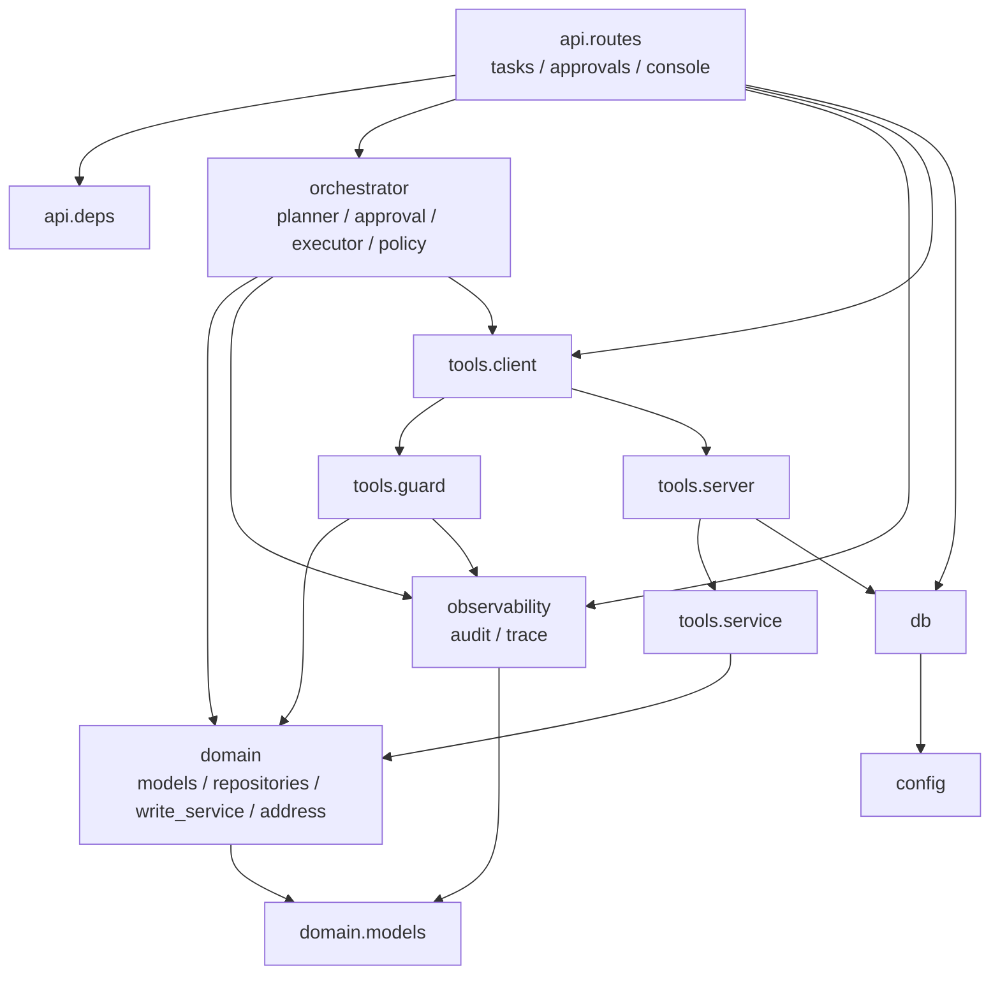

# OpsConductor MVP 项目代码审查

**审查范围**：`main..HEAD`，`2af335f..eb90af4`，28 个提交，84 个文件（约 +20,099 / -362 行）  
**审查日期**：2026-11-04  
**规格**：[MVP 设计规格](../specs/2026-11-04-mvp-order-exception-design.md)  
**标准**：`pyproject.toml` 的 ruff/mypy 配置、README 约束、Fowler smell 基线；仓库没有 `CODING_STANDARDS.md` / `CONTRIBUTING.md` / `docs/agents/issue-tracker.md`  
**方法**：code-review 技能的两轴审查（Standards / Spec 并行子代理）+ 控制器结构分析  
**本地验证**：164 passed + 5 xfailed；`ruff check .` 通过；`mypy src` 通过（42 files）

> 本文档只做审查，不修改业务代码。两轴发现保持分离；结构分析是补充视角，不是对两轴结论的重新排序。

## 1. 结论摘要

项目是一个可运行的模块化单体 MVP：FastAPI 接入、LangGraph 执行、MCP 工具网关、PostgreSQL 事实源，覆盖订单异常的拆单/改址写闭环。核心写路径具备租户过滤、审批、幂等、审计、trace、补偿和真实数据库测试，已经达到可演示状态。

主要问题不在“有没有功能”，而在**结构边界与生产化缺口**：

- 执行器验证了 DAG 依赖，但实际按计划列表顺序执行，`depends_on` 没有真正驱动执行顺序。
- `write_service.py`（1152 行）和 `executor.py`（902 行）是两个 god module；动作扩展会引发 shotgun surgery。
- CI 没有 PostgreSQL 服务，而测试固定连 `localhost:15432`；当前 CI 配置无法跑通测试。
- 补偿工具绕过审批守卫且直接暴露给 Agent；审批超时没有恢复路径；终态任务可以再次执行。
- 测试量很大（7,585 行测试 vs 5,796 行源码），但 eval harness 自己补了部分生产行为；5 条 known gaps 已披露，另有 GT-18 等未披露偏差。

## 2. 项目结构总览

### 2.1 目录与职责

```text
src/opsconductor/
├── api/                 FastAPI 接入、身份、任务/审批/控制台路由
│   └── routes/          tasks.py、approvals.py、console.py
├── orchestrator/        Planner、Approval、Policy、Executor、Graph、Verifier
├── domain/              模型、枚举、仓储、地址、种子、写服务
├── tools/               MCP server/client、ERP service、审批守卫、故障注入
├── observability/       audit、trace
├── llm/                 ChatModel gateway（stub/http）
├── templates/console/   Jinja2 控制台页面
├── agents/              占位（1 行）
├── memory/              占位（1 行）
└── rag/                 占位（1 行）
tests/
├── test_*.py            单元/集成测试
└── eval/                Golden Tasks：cases.py、harness.py、faults
scripts/                 demo.sh、smoke_live.py
```

关键事实：

- `agents/`、`memory/`、`rag/` 仍是空包；`skills/`、`erp/` 不存在。JD 对齐阶段的 SKILL、Memory、RAG、ERP Adapter、RPA 尚未实现。
- 真实可用的是订单异常 MVP，不是完整的三场景/JD 版本。
- 项目是模块化单体，不是微服务；API、编排、领域、工具、可观测在同一进程/仓库内。

### 2.2 模块依赖方向



结构观察：

- 顶层分层清晰：API → Orchestrator → Domain/Tools → Observability。
- 但存在**层次反向依赖**：`domain.write_service` 依赖 `observability.audit`，而 `observability.audit` 又依赖 `domain.models`；`domain.seed` 依赖 `db`。领域层不应依赖可观测/基础设施实现，建议通过端口/回调反转。
- `api.routes.tasks` 同时负责计划生成、审批记录、幂等、执行入口，职责过宽；`routes` 直接 import executor/planner/LLM gateway，缺少应用服务层。
- `tools.server` 是 MCP 适配层，`tools.service` 是业务适配层；`ErpToolService` 的写方法基本是纯转发（Middle Man）。

### 2.3 关键运行路径

```text
POST /api/v1/tasks
  → identity + idempotency
  → Planner (Template or LLM)
  → Plan + Approval rows
  → awaiting_approval / planned

POST /api/v1/tasks/{id}/approve|reject
  → ApprovalService.decide
  → approval rows decided
  → task running

POST /api/v1/tasks/{id}/execute
  → TaskExecutor.start
  → LangGraph: load → dry_run → execute → verify → compensate → report
  → MCP tools → tools.guard → ErpToolService → write_service → PostgreSQL
  → audit + trace + task result
```

### 2.4 规模热点

| 源码文件 | 行数 |
|---|---:|
| `domain/write_service.py` | 1,152 |
| `orchestrator/executor.py` | 902 |
| `api/routes/console.py` | 371 |
| `orchestrator/approval.py` | 366 |
| `orchestrator/planner.py` | 342 |
| `api/routes/tasks.py` | 312 |
| `domain/models.py` | 279 |
| `orchestrator/verifier.py` | 239 |
| `tools/server.py` | 219 |

| 测试文件 | 行数 |
|---|---:|
| `tests/eval/harness.py` | 1,568 |
| `tests/test_executor.py` | 900 |
| `tests/eval/cases.py` | 889 |
| `tests/test_write_split.py` | 874 |
| `tests/test_write_address.py` | 659 |

`write_service.py` 与 `executor.py` 是明显的 god module；测试代码总量超过源码，eval harness 本身已成为需要维护的子系统。

## Standards

> 仓库没有 `CODING_STANDARDS.md`/`CONTRIBUTING.md`。以下硬性约束来自 `pyproject.toml`（ruff E/F/I/UP/B、行宽 100、py311；mypy 非 strict）与 README；其余为 smell 基线判断。当前 ruff/mypy 本地均通过，所以没有可报告的硬性工具违规。

### 文档/README 与实现不一致

- README 声称运行时负责超时控制，但工具调用没有统一超时（`orchestrator/executor.py:569-617`、`tools/client.py:57-65`）。
- README 的“DAG 执行器”没有真正使用 `depends_on`：计划在 `schemas.py:78-92` 验证依赖，但执行器按计划列表顺序执行（`executor.py:283,347`）。
- `pyproject.toml:27` 仍声明 Redis 依赖，README 却说 MVP 不依赖 Redis；pgvector 被描述为 MVP 必需（README:75），迁移中并未使用。
- `tools/guard.py:1-8` 写的是“每个写工具都需要审批”，但四个补偿工具绕过守卫；ADR 0004 又把补偿工具排除在守卫外，文档与实现不一致。

### Duplicated Code

- `domain/write_service.py` 六个写入口重复同一套骨架：校验 key → scope → fingerprint → replay → lock → audit → IdempotencyKey → commit/replay → rollback（约 537-1152 行）。
- 幂等实现有两套：`orchestrator/idempotency.py:22-76` 与 `write_service.py:211-261`。
- `orchestrator/approval.py:200-292` 的 targeted/bulk 决策逻辑高度重复。
- `executor.py:745-902` 有五个近似相同的 step upsert。
- `verifier.py:180-216` 重复 multiset 构建，并与 `write_service.py:288-352` 的 shipment coverage 逻辑重复。
- `console.py:74-95` 与 `tasks.py:218-245`、`approvals.py:24-50` 与 `console.py:316-339` 各有一份任务/审批查询逻辑。
- 测试层：五个文件复制 `_client/_task/_order/_inventory/_steps`；`harness.py:596-623` 有两个相同的时间操作 helper；三个并行 MCP dispatcher（`test_executor.py:84`、`test_execute_api.py:60`、`harness.py:279`）。

### Smells

- **Shotgun Surgery（最突出）**：新增一个写动作会同时改 `schemas.py:32`、`policy.py:41-50`、`planner.py:151,236-243`、`executor.py:24-32,638-651`、`verifier.py:74-79`、`guard.py:20-23`、`tasks.py:38`、`tools/service.py`/`server.py`，以及四张测试动作表。应建立单一 action registry。
- **Repeated Switches**：同一组 action if/elif/map 在上述位置重复；状态字符串在 `write_service.py:572,763,847,913` 等处重复。
- **Primitive Obsession**：`"pending_shipment"`/`"split"`/role 字符串大量出现，而 `domain/enums.py` 已有 `Role`/`OrderStatus` 却未统一使用。
- **Speculative Generality**：`PlanNode.action` 包含 `verify`/`report`，`compensation` 字段基本未用（`schemas.py:32,38`）；`resume` 丢弃 `approved` 参数（`executor.py:135-145`）；每次执行都新建 `InMemorySaver` 线程（168-174）；`TaskReport`/`ApprovalDecision` 未使用（`schemas.py:49,54`）；`mcp_server_command/args` 被 client 忽略（`client.py:32-35`）。
- **Middle Man**：`tools/service.py:88-190` 的写方法是纯转发。
- **Data Clumps**：`(session, tenant_id, order_id, idempotency_key, task_id, actor_id)` 贯穿所有写/补偿签名，适合打包为命令对象。
- **Divergent Change**：`write_service.py` 混合地址、拆单、补偿、幂等；`routes/tasks.py` 混合计划、审批、幂等、执行。
- **Test-harness complexity**：1,568 行 harness + 889 行 cases；`harness.py:1070-1130` 的 `assert_case` 按 `case.id` 分支，新 case 需要改 harness；`smoke_live.py` 是第三个驱动入口。
- **Mysterious Name**：`normalized_address` 对空地址直接造出 `"city+district+世纪大道100号"`（`address.py:46-50`，用于 `planner.py:124`），这是占位数据而不是真正的地址归一化。

## Spec

> 规格：`docs/specs/2026-11-04-mvp-order-exception-design.md`。GT-08/09/12/17/26 已在 `docs/KNOWN_GAPS.md` 披露；以下是不在 known-gaps 表中的偏差或测试造假风险。

### 缺失/部分实现

- **API 面**：规格 §7.1 列出 `POST /resume`、`GET /trace`、`GET /report`；当前只有 `POST /execute`、`GET /{id}`、`approve/reject`（`tasks.py:295`、`approvals.py:52,64`）。`/execute` 是未列出的替代；§4.6“禁止从终态恢复”没有实现，`succeeded`/`partially_compensated` 任务可以再次执行（`executor.py:193-269`）。
- **Router/Handoff/audit**：§4.1 的规则路由器和 Handoff 缺失；`create_task` 总是生成订单异常计划（`tasks.py:98-137`）。§6.5 要求“计划生成、验证否决、转人工”审计，当前只审计写/审批/拒绝访问（`write_service.py:620,698,856`）。
- **重试**：§4.4“瞬时错误有限重试”缺失；工具错误直接失败，`attempt` 始终为 1（`executor.py:374-383,756`）。
- **Verifier**：§4.5 要求“权限允许、幂等键存在”和独立 LLM 复核；当前只检查库存/状态/覆盖/地址（`verifier.py:66-82`）。
- **MCP 网关**：§5.1 要求补偿工具“不直接暴露给 Agent”，但 `shipment_cancel`、`inventory_release`、`order_revert_split` 是公开 MCP 工具且无审批守卫（`tools/server.py:144-215`）。§5.4 的鉴权/限流/脱敏缺失：`tenant_id` 由调用方提供，`order_get` 返回原始手机号（`service.py:39-46`），只读工具不写审计/trace（§6.5）。
- **Dry-run/审批 UI**：dry-run 影响范围被丢弃（`executor.py:307-311`），与 §2.2“先 dry-run 展示影响”不符；Approval 行缺少 params/impact/evidence（§6.2，`models.py:211-229`）；控制台没有审计/报告视图，按钮未按角色显示（`task_detail.html:83-146`，§7.2）。
- **Trace/租户**：没有模型调用 span；生产 span 不设置 `parent_span_id`，每个 span 都是独立 root trace（§6.6）。租户 B 种子没有 warehouse/inventory/SKU（§6.7，`seed.py:60-81`）。真实模型 5 条冒烟未运行（§1.3；`README.md:189`）。`compensating`/`compensated` 状态从未产生（`executor.py:697-712`）。
- **API 契约**：`POST /execute` 替代 `/resume`；控制台在开发环境静默使用 `dev-operator-a`（`console.py:52-57`），不是登录选择器。

### Scope creep

- `/execute` 不在规格中，是演示需要的额外入口。
- 补偿工具直接暴露给 Agent，超出“内部补偿”的边界。
- 开发态控制台自动身份，超出规格的“登录选择用户”描述。

### Harness-satisfied / 测试风险

- **GT-18**：harness 把 `expires_at` 往后改（`harness.py:611-623,726-733`），生产代码把超时审批标记 `expired` 后永久等待（`approval.py:218-223,285-291`；`test_approvals.py:280-316`），没有 re-arm；§2.3“审批超时保持可恢复”未实现，但 GT-18 未列入 known gaps。
- **GT-21/22**：所谓 retry 是测试手动调用两次 `_execute`（`harness.py:737-743`），生产没有重试或幂等键对账。
- **GT-25/26**：失败来自无条件 `FailingVerifier` stub（`harness.py:365-374`），不是真实后置条件失败。
- **GT-24**：per-order 隔离证明是空洞的：失败 O1004 只有一个节点，`compensated == []` 不能证明“成功订单未被补偿”（`harness.py:1083-1087`、`cases.py:719-729`）。

## 3. 结构分析（补充视角）

### 3.1 分工与边界

做得好的部分：

- API、编排、领域、工具、可观测的顶层目录清晰，依赖方向总体可读。
- 写操作的事务边界明确由 `write_service` 持有；幂等键、审计、库存流水、补偿都有真实数据库测试。
- MCP 客户端/服务端、工具守卫、故障注入形成了可替换的工具边界。
- Golden Tasks 与 `KNOWN_GAPS.md` 透明记录了 23/28 + 5 known gaps，没有宣称全绿。
- `pytest` 164 passed + 5 xfailed、`ruff`/`mypy` 通过，说明当前基线可运行。

需要收敛的部分：

- `write_service.py` 和 `executor.py` 职责过宽；建议按“动作/阶段”拆成小模块，用共享的 saga/idempotency helper。
- `api/routes/tasks.py` 是应用服务、编排和 HTTP 的混合体；建议引入 `application/task_service.py`，route 只做协议转换。
- `domain` 反向依赖 `observability`/`db`；建议用 `AuditSink`/`TraceSink` 端口在应用层注入，保持领域纯函数/服务可单测。
- `agents/`、`memory/`、`rag/` 是空占位；JD 阶段的 SKILL/Memory/RAG/ERP Adapter 还没有落地，文档应明确“未实现”，避免与已实现 MVP 混淆。

### 3.2 CI 与配置

- **P0：CI 没有 PostgreSQL 服务**。`.github/workflows/ci.yml` 只做 `pip install -e ".[dev]"`、`ruff check .`、`pytest -q`；`tests/conftest.py` 固定 `localhost:15432`，CI 的 Ubuntu runner 没有该数据库，测试会全部连接失败。需要加 Postgres service（pgvector 镜像或 postgres:16），创建 `opsconductor_test`，设置 `OPSCONDUCTOR_DATABASE_URL`；或者显式提供可切换的 SQLite 测试配置。
- CI 没有运行 `mypy src`，与项目文档的“mypy 通过”不一致；建议加一步。
- 配置漂移：应用默认 `5432`、Docker Compose 映射 `15432`、`.env.example` 仍写 `5432`、README/demo 使用 `15432`。本地 demo 已覆盖，但新开发者按 `.env.example` 会连到本机原生 PostgreSQL 12，容易踩坑。建议统一默认或提供 `docker/.env` 模板。
- `pyproject.toml` 的 `redis`/`pgvector` 与 MVP 实际使用不一致；建议把未使用依赖移到 optional extras，或明确标注“JD 阶段使用”。

### 3.3 测试拓扑

- 单元/集成测试覆盖模型、仓储、MCP、写路径、审批、执行器、控制台，质量总体好。
- `tests/eval/harness.py` 1,568 行，`cases.py` 889 行，本身已成为需要测试的子系统；建议把 harness 拆成 `fixtures / drivers / assertions`，并让 `assert_case` 走数据驱动，而不是按 case.id 分支。
- 多个测试文件复制 `_client/_task/_order/_inventory/_steps`；建议统一到 `tests/factories.py`。
- 测试代码量（7,585）大于源码（5,796），且部分用例依赖 harness 写生产行为（GT-18/21/22/25/26）；建议增加“生产路径断言”而不是 harness 补行为。
- 测试固定依赖本地 Docker Postgres；CI/沙箱环境需要明确启动步骤。

### 3.4 运行时与一致性

- **DAG 依赖未执行**：`Plan.depends_on` 只参与校验，执行器按列表顺序；含并行/依赖的计划可能以错误顺序执行。P0。
- **终态可重入/无执行锁**：`succeeded`/`partially_compensated` 任务可再次执行；并发 execute 可能竞争 `TaskStep` 唯一约束，或重复触发工具调用（幂等键降低风险，但不消除竞争）。P0/P1。
- **审批超时死胡同**：超时 approval 标记 expired 后 task 永远 `awaiting_approval`，没有 re-arm/重提交流程；GT-18 的“可恢复”未实现。P0。
- **工具调用无超时**：`ErpToolClient.call` 没有统一超时；MCP 子进程/工具卡住会占住执行链。P1。
- **补偿工具暴露**：`shipment_cancel`/`inventory_release`/`order_revert_split` 公开且绕过 guard，Agent 可直接调用；与“补偿工具不直接暴露”冲突。P0（安全）。
- **只读工具缺少审计/trace/限流/脱敏**：读路径没有统一的网关治理，`order_get` 返回手机号。P1。
- **Trace 层级**：生产 span 没有 parent_span_id，plan/tool/approval 无法形成一棵 trace；模型调用 span 缺失。P1。

### 3.5 安全与租户

- API 已在硬化中补了跨租户 403 + audit；MCP 写工具已有 `require_approved_write` 守卫。这是进步。
- 但 `tenant_id` 在 MCP 工具参数中由调用方提供，读工具没有同等守卫；补偿工具绕过守卫；控制台开发态默认身份且 API key 出现在 URL。P0/P1。
- 租户 B 种子没有仓库/库存/SKU，跨租户测试只能覆盖任务可见性，不能覆盖真实业务数据隔离。P2。

## 4. 优先级建议

| 优先级 | 事项 | 理由 |
|---|---|---|
| P0 | CI 增加 PostgreSQL service + 测试库 + 环境变量 | 当前 CI 实际跑不通测试 |
| P0 | 执行器按 DAG 依赖执行，或明确限制为线性计划 | 依赖校验与执行语义不一致 |
| P0 | 终态禁执行 + 任务级执行锁 | 防止重复写/重复补偿 |
| P0 | 补偿工具收回内部边界或加审批守卫 | 与补偿“不暴露给 Agent”冲突 |
| P0 | 审批超时恢复路径（re-arm/重提/转人工） | GT-18 未真正满足 |
| P1 | 拆 `write_service.py`/`executor.py`，引入 action registry | 降低 shotgun surgery/divergent change |
| P1 | 引入 application service 层，瘦身 routes | 路由过宽、编排耦合 |
| P1 | 合并 idempotency/approval/verifier/step/test helpers | 重复代码与漂移风险 |
| P1 | Verifier 补权限、幂等键、独立 LLM 复核 | 规格 §4.5 |
| P1 | 工具调用超时/有限重试；trace parent/model span | 稳定性与可观测性 |
| P1 | 只读工具审计/限流/脱敏 | 工具网关一致性 |
| P2 | 统一枚举、去掉未用字段/参数 | primitive obsession / speculative generality |
| P2 | 租户 B 完整种子；配置端口统一；文档/guard 注释修正 | 数据隔离、开发体验、文档一致性 |
| P2 | 拆分 eval harness，测试工厂复用 | 测试可维护性 |

## 5. 验证证据与限制

**已执行**：

- `pytest -q`：164 passed + 5 xfailed（约 3:57，PostgreSQL 16 / 15432）
- `ruff check .`：通过
- `mypy src`：42 files clean
- `scripts/demo.sh`：真实 MCP 客户端走通审批、执行、重复执行 no-op、跨租户 403 + audit、控制台/trace

**未执行/限制**：

- 真实 LLM 冒烟没有凭据，`scripts/smoke_live.py` 只验证了 SKIPPED 路径；5 条真实模型主路径未跑。
- 没有做动态安全渗透测试；403/guard 只按测试覆盖判断。
- 没有在 CI 上验证 Postgres 服务；本文档已把 CI 缺口列为 P0。
- 审查以 MVP 规格为准；JD 对齐规格是未来范围，不计入本次缺失。
- 仓库没有 issue tracker 和 coding standards 文档，Standards 轴主要依赖 `pyproject.toml` 与 smell 基线。

## 6. 已知缺口

`docs/KNOWN_GAPS.md` 披露 5 条：

- GT-08：非法计划在创建时 500，没有失败 TaskRun/转人工记录。
- GT-09：单缺失订单导致 `failed`，不是字面 `partially_succeeded`。
- GT-12：使用 `FOR UPDATE` 等待，不是有限的乐观锁重试。
- GT-17：没有任务级 `rejected` 状态，拒绝批次结束为 `partially_succeeded`。
- GT-26：记录 failed_compensations，但没有转人工/工作队列产物。

另外，本次审查发现 **GT-18 未被列入 known gaps**：审批超时后生产端没有 re-arm，harness 通过改写 `expires_at` 让用例通过；`GT-21/22/25/26` 也分别依赖手动重试或 `FailingVerifier` stub。建议把这些补进 known-gaps 表，或在 v1.0 实现真实重试/超时恢复/真实后置条件失败。

---

**审查结论**：MVP 可以作为可演示基线，但上述 P0 项（CI、DAG 依赖、终态/并发、补偿守卫、审批超时）应在把项目作为“生产形态”证据或进入 JD 对齐阶段前处理。当前代码质量的主要风险不是缺少功能，而是核心模块过大、测试 harness 过重，以及规格与生产行为之间仍有未披露的偏差。
