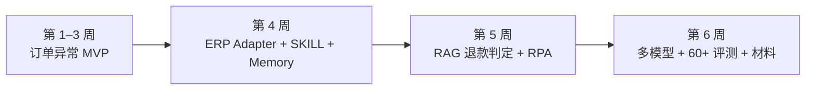
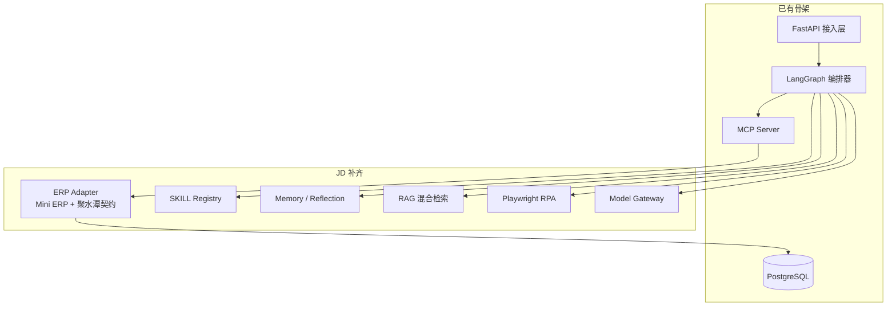

# 运筹 OpsConductor · JD 对齐设计方案

**版本** v1.0 ｜ **日期** 2026-11-04 ｜ **状态** 已确认，待实施 ｜ **总周期** 约 6 周（3 周 MVP + 3 周 JD 补齐）

**关联文档**：[系统设计](../design.md) ｜ [MVP 设计规格](2026-11-04-mvp-order-exception-design.md) ｜ [实施计划](../plan.md) ｜ [数据来源与合规](../data-sources.md)

## 1. 目标与背景

本方案面向 AI Agent 工程师岗位的 JD：构建业务场景下的 AI Agent 系统，核心是流程编排、工具调用、多 Agent 协作，完成从对话到业务自动执行的闭环。

项目不是另一个 ERP，也不是通用 Agent 平台，而是 **ERP 之上的异常运营与可信写操作层**：

- 一个入口接收自然语言任务；
- 跨订单、库存、仓库、地址、售后聚合信息；
- 生成计划、分级审批、安全执行；
- 失败补偿、审计、trace、报告；
- ERP 能力通过 Adapter/MCP 接入，不绑定某一家。

目标客群：中大型电商商家，多仓、订单量高、异常订单处理依赖人工，客服、仓库、运营之间需要反复确认。

## 2. JD 能力覆盖

| JD 要求 | 方案落点 | 证据 |
|---|---|---|
| Planner/Executor/Memory/Tool/SKILLs/MCP | LangGraph + MCP + SKILL 注册表 + Memory | 订单异常与退款判定两条链路 |
| 复杂 ERP 任务拆解 | DAG Planner + Plan Schema + SKILL 模板 | 计划预览、依赖、前后置条件 |
| 自动执行 + 反思自纠错 | 确定性 Executor + Verifier + 失败记忆 | 失败分类、重试/重规划、补偿 |
| 类 RPA 流程编排 | Playwright + 工作流 DSL | 旧版打单页自动化 + 截图 + 审计 |
| Tool Calling / Memory / Reflection | MCP + Pydantic + Postgres/pgvector | 工具契约、任务记忆、失败记忆 |
| 稳定性 / 成本 / 成功率 | 幂等、补偿、审计、模型路由、评测 | trace、成本看板、60+ Golden Tasks |
| 与 SaaS ERP 核心模块集成 | ERP Adapter + 聚水潭契约 mock | 契约测试、可替换真实端点 |
| 熟悉主流 Agent 框架，理解 ReAct/Plan-Execute | LangGraph + ADR 0002 | Plan-Execute DAG vs 纯 ReAct 取舍 |
| Prompt / Function Calling / RAG / SKILL / MCP | Pydantic 结构化输出、MCP、BGE-M3 + BM25 | 政策引用、工具契约、技能模板 |
| 加分：RPA / 浏览器自动化 | Playwright | 旧系统兜底演示 |
| 加分：多模型 / 多 Agent 调度 | 模型网关 + 独立验证模型 | 规划/路由/验证分模型，成本对比 |

**明确不做**

- 真实退款打款、完整退款场景。
- 完整多仓调拨。
- 桌面自动化。
- 真实商家数据、真实聚水潭凭据。
- 生产级 SSO/等保。
- 100% 无人审批。

## 3. 总体路线



### 3.1 第 1–3 周：订单异常 MVP

沿用 [MVP 设计规格](2026-11-04-mvp-order-exception-design.md)：

- 拆单 + 改址；
- 审批、幂等、补偿、审计、trace；
- 28 条 Golden Tasks；
- 3 分钟演示。

### 3.2 第 4 周：ERP Adapter + SKILL + Memory

**ERP Adapter**

- 定义 `ErpAdapter` 接口：订单查询、订单详情、库存查询、拆单、改址、发货单查询。
- `MiniErpAdapter`：现有自建演示实现。
- `JushuitanContractAdapter`：按聚水潭开放平台契约实现签名、订单查询、商品映射的 mock server。
- 契约测试：同一组 JSON 夹具分别跑两个 Adapter，保证替换真实端点时行为一致。
- MCP Server 通过 Adapter 调用 ERP，不直接依赖具体数据库表。

**SKILL 注册表**

- `skills/order_exception.yaml`：意图、步骤、工具白名单、风险等级、前后置条件、提示词片段。
- 加载时校验 schema；版本化；禁止未在白名单内的工具。
- Planner 可以选择 SKILL，Executor 使用 SKILL 提供的计划模板。

**Memory 基础**

- `failure_memory`：错误签名 → 处理策略 → 成功次数。
- 任务历史：任务类型、计划、工具序列、结果，支持按相似度检索。
- 反思循环：失败分类 → 查询失败记忆 → 重试/重规划/降级/转人工。

### 3.3 第 5 周：RAG + RPA

**RAG：退款资格判定（只判定，不真实退款）**

- 政策/SOP 文档入库，带租户、类目、生效时间等元数据。
- BGE-M3 dense + BM25 稀疏召回，RRF 融合。
- 轻量 cross-encoder 重排；资源允许时替换为 bge-reranker-v2-m3。
- 输出结论、金额明细、政策引用和生效时间。
- 与 SKILL 结合，形成 `refund_eligibility` 技能。
- 不调用支付接口，不产生真实退款。

**RPA：旧系统兜底**

- 本地搭一个「旧版打单页」。
- Playwright 做确定性操作：选择器、超时、截图、重试、人工确认。
- 通过 MCP 工具 `legacy.print_shipment` 暴露给工作流。
- RPA 只作为无 API 旧系统的兜底，不作为主路径。

### 3.4 第 6 周：多模型 + 评测 + 材料

- 模型网关：统一 `ChatModel` 接口，支持 OpenAI 兼容端点、stub 模型、模板兜底。
- 模型路由：强模型做 Planner，小模型做意图/抽取，独立模型做 Verifier。
- 记录 token、耗时、成本；支持降级与 fallback。
- 评测扩展到 60+；产出成本对比、5 分钟演示、ADR、面试问答卡。

## 4. 架构增量



**模块落点**

```text
src/opsconductor/
├── api/             FastAPI 接入与审批 API
├── orchestrator/    LangGraph 计划、执行、检查点
├── agents/          Planner、Executor、Verifier、Handoff
├── erp/             ErpAdapter + Mini ERP + 聚水潭契约 mock
├── tools/           MCP Server / 工具网关
├── skills/          SKILL manifest、加载器、校验器
├── memory/          任务记忆、失败记忆、反思策略
├── rag/             政策入库、混合检索、引用组装
├── rpa/             Playwright 旧系统自动化
├── llm/             模型网关、路由、成本统计
├── domain/          ERP 领域模型
├── observability/   trace、成本、评测
└── config.py        环境与模型配置
```

**新增依赖**

- Alembic、Jinja2、Playwright、pgvector。
- sentence-transformers 或 FlagEmbedding、rank-bm25、jieba。
- 测试仍以 pytest + TestClient + PostgreSQL 为主；Playwright 测试单独标记，避免主测试变慢。

## 5. 评测与验收

### 5.1 60+ Golden Tasks

| 类别 | 数量 | 覆盖点 |
|---|---|---|
| 订单异常 | 28 | 拆单、改址、审批、幂等、补偿、租户、失败注入 |
| SKILL / Memory | 12 | 技能选择、错误技能、失败记忆复用、重规划、记忆冲突 |
| RAG 退款判定 | 10 | 政策引用、生效时间、冲突政策、证据不足、金额明细、租户隔离 |
| RPA | 5 | 旧版打单成功、选择器失败、超时、人工确认、截图与审计 |
| 多模型 | 5 | 规划/验证模型对比、成本、延迟、降级 |

### 5.2 指标

- 任务成功率 ≥ 90%。
- 工具成功率 ≥ 99%（非注入失败）。
- L2/L3 审批覆盖率 100%。
- 越权写入、重复写入 0。
- 可补偿场景补偿成功率 100%。
- RAG 引用准确率 ≥ 95%。
- RPA 成功率 ≥ 95%。
- trace 完整率 100%。
- 单任务成本与 P95 延迟可对比。

### 5.3 演示

5 分钟演示：

1. 订单异常：提交任务 → 计划 → 审批 → 拆单/改址 → 失败补偿 → 报告。
2. 退款资格：政策 RAG → 引用 → 金额明细 → 只判定不退款。
3. 旧系统：Playwright 操作旧版打单页，截图与审计。
4. 多模型：规划/验证模型切换，成本与延迟对比。
5. Trace：完整链路、审批、审计与成本。

## 6. 商业价值与边界

**价值**

- 效率：高频、多步骤、规则明确的异常处理收益最大；人从操作员变成审核员。
- 成本：模型路由、缓存、stub 测试控制成本；ROI 取决于异常频次、人工成本、集成成本和错误代价。
- 门槛：运营人员使用门槛降低；IT 集成门槛仍然存在。审批、验证、审计降低的是信任门槛。
- 证据：60+ 评测、失败注入、trace、成本对比，比「演示很酷」更能支撑商业化讨论。

**边界**

- 当前不是商用系统，没有真实商家数据；它是生产形态 + 契约模拟。
- 聚水潭契约 mock 不等于真实 SaaS ERP 集成。
- JD 的「真实商用项目经验」不能靠技术选型解决；下一步应找设计合作伙伴做真实试点，而不是把 Demo 包装成商用系统。

## 7. 风险与切线规则

| 风险 | 对策 |
|---|---|
| 6 周范围过大 | 按切线规则：先保 Adapter/SKILL、RAG、评测；RPA 和多模型可降级 |
| 聚水潭契约 mock 被质疑为假 | Adapter 接口 + 契约测试 + 可替换真实端点；文档写清限制 |
| RAG 质量不足 | 小语料高精度、强制引用、评估集覆盖冲突/过期政策 |
| RPA 脆弱 | 确定性选择器、截图、重试、人工确认；只做兜底 |
| 模型成本/延迟 | 强弱模型路由、缓存、stub 测试、成本看板 |
| 商用经验不足 | 不伪造；补真实试点/设计合作伙伴，面试明确边界 |

**切线规则**

- 第 4 周延期：先把 Memory 推到第 6 周，保住 Adapter + SKILL。
- 第 5 周延期：RPA 退化为录屏演示，保住 RAG。
- 第 6 周延期：多模型对比减到两个模型，保住 60 条评测和文档。
- 任何情况下不砍审批、幂等、补偿、审计。

## 8. 交付物

- ERP Adapter + 聚水潭契约 mock + 契约测试。
- SKILL 注册表与订单异常/退款判定技能。
- Memory/失败记忆与反思闭环。
- RAG 退款资格判定与政策引用。
- Playwright 旧系统 RPA 演示。
- 模型网关、路由与成本对比。
- 60+ Golden Tasks 评测报告。
- 5 分钟演示、ADR、面试问答卡。

## 9. 已确认决策

1. 主线保持订单异常，JD 能力以薄切片方式补齐。
2. ERP 集成采用 Adapter + 聚水潭契约 mock，不依赖真实商家凭据。
3. 总周期约 6 周：3 周 MVP + 3 周 JD 补齐。
4. RAG 只做退款资格判定，不做真实退款。
5. RPA 只做旧系统浏览器兜底，不做桌面自动化。
6. 多模型采用模型网关 + 任务级路由 + 独立验证模型。
7. 评测目标 60+，100 条留到 v1.0。
8. 不伪造商用经验；定位为生产形态项目，后续找设计合作伙伴试点。
