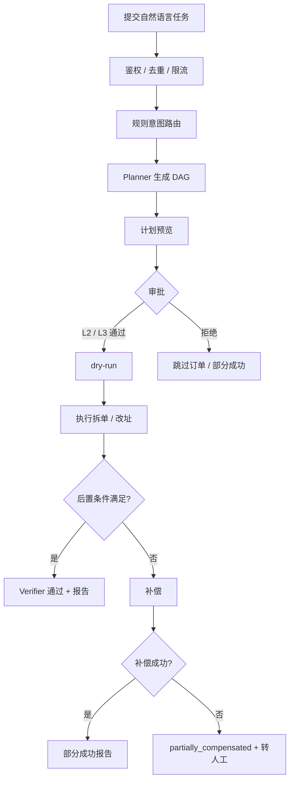
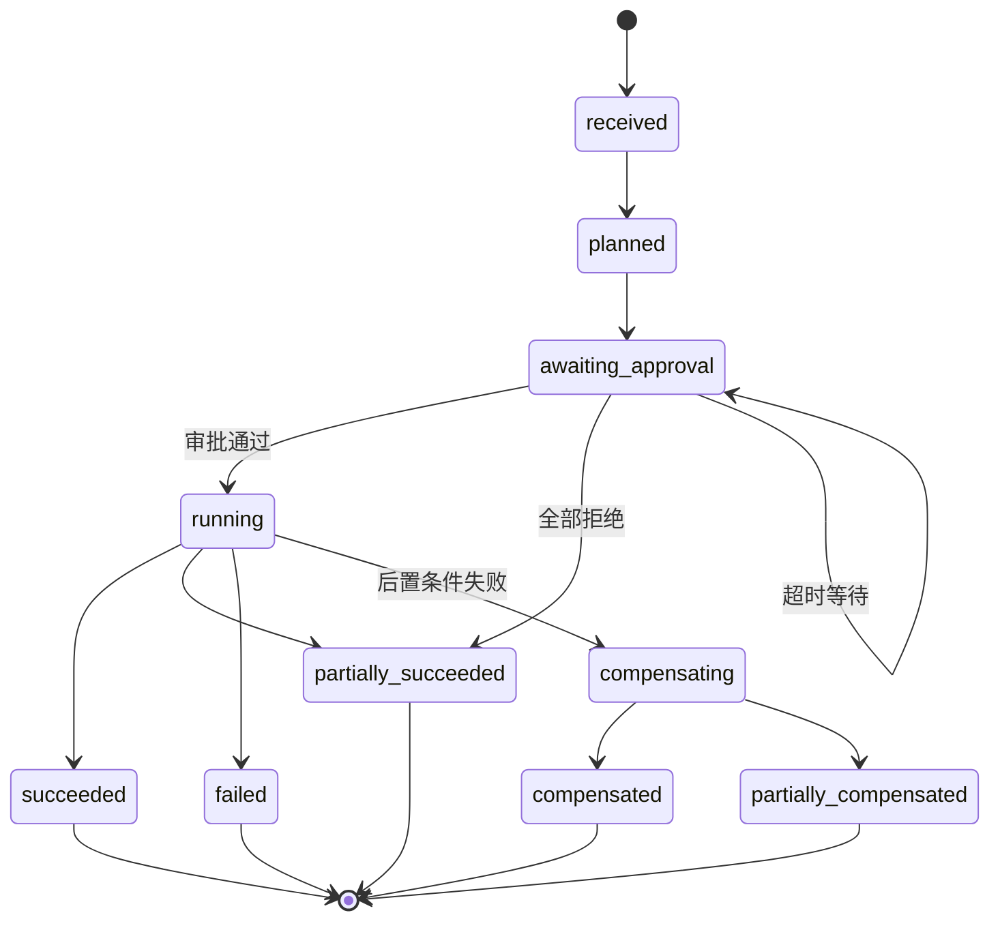
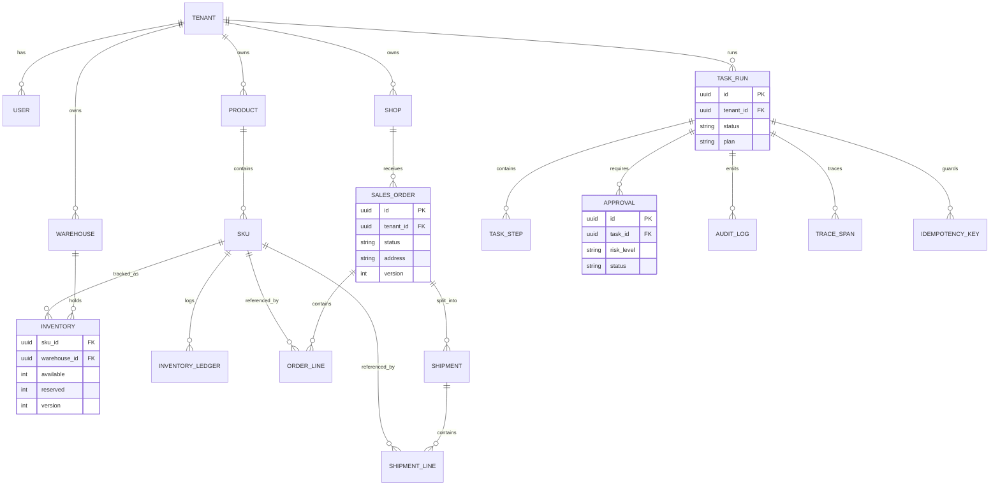
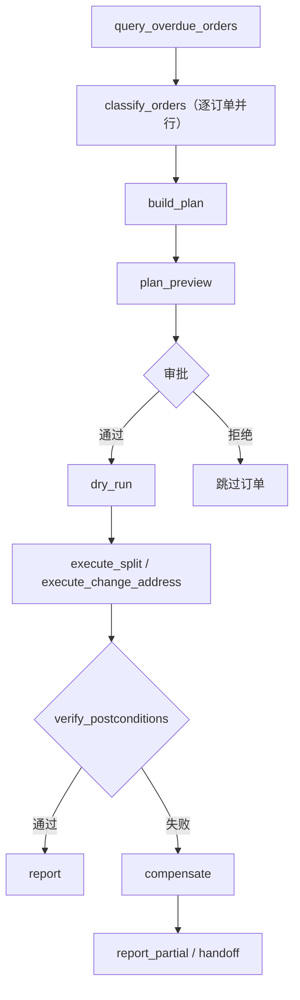
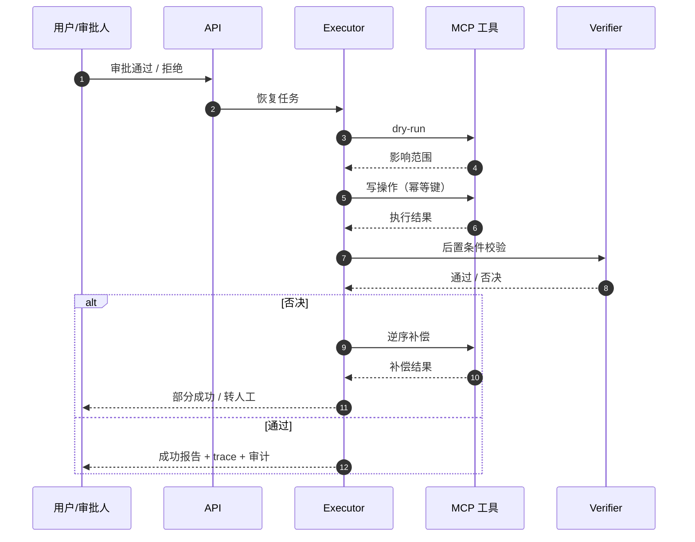

# 运筹 OpsConductor · MVP 设计规格：订单异常可写闭环

**版本** v1.0 ｜ **日期** 2026-11-04 ｜ **状态** 已确认，待实施 ｜ **周期** 3 周

**关联文档**：[系统设计](../design.md) ｜ [实施计划](../plan.md) ｜ [数据来源与合规](../data-sources.md) ｜ [ADR 0002](../adr/0002-plan-execute-deterministic-runtime.md) ｜ [ADR 0003](../adr/0003-independent-verifier.md)

## 目录

1. [目标与范围](#1-目标与范围)
2. [端到端流程](#2-端到端流程)
3. [领域模型](#3-领域模型)
4. [Agent 与编排](#4-agent-与编排)
5. [MCP 工具契约](#5-mcp-工具契约)
6. [审批、幂等、补偿、审计与 trace](#6-审批幂等补偿审计与-trace)
7. [控制台与 API](#7-控制台与-api)
8. [三周实施切片](#8-三周实施切片)
9. [评测设计](#9-评测设计)
10. [风险与开放问题](#10-风险与开放问题)
11. [已确认决策](#11-已确认决策)

---

## 1. 目标与范围

### 1.1 目标

在 3 周内交付一条订单异常的完整可写链路：

```text
自然语言任务 → 结构化计划 → 风险分级审批 → 拆单/改址
→ 幂等执行 → 失败补偿 → 审计与 trace → 处理报告
```

只做订单异常一个场景，用「拆单 + 改址」证明系统不是 Demo：写操作有审批、幂等、补偿和审计，执行过程可追踪，失败路径可复现。

### 1.2 范围

**必做**

- 订单异常场景：超时未发货订单的拆单与改址。
- 写操作：拆单、改址。
- 治理：L2 二次确认、L3 人工审批、幂等、补偿、审计、trace。
- 控制台：任务列表、计划预览、审批、trace 时间线、报告。
- 评测：28 条 Golden Tasks、失败注入、真实模型主路径冒烟。
- 基础多租户：所有业务数据、工具调用、审计和 trace 带 `tenant_id`。

**暂缓**

- 换仓、取消订单、售后退款、多仓调拨。
- RAG 混合检索、RPA 浏览器自动化、失败记忆、模型路由。
- 100 条评测、Langfuse 自托管、完整多租户隔离测试。
- 飞书/企微接入、真实支付与物流、生产级部署。

### 1.3 成功标准

- 一条命令启动环境与种子数据。
- 3 分钟演示可完整走通：计划 → 审批 → 执行 → 失败补偿 → 报告。
- 28 条 Golden Tasks 可复现，核心指标达到第 9 节门槛。
- 至少 5 条真实模型主路径冒烟通过。
- 所有 L2/L3 写操作均有审批记录、审计记录和 trace。
- 重复提交、重复审批不产生重复写入。

## 2. 端到端流程

### 2.1 主流程

```text
提交自然语言任务
  → 接入层校验租户/渠道/去重/限流
  → 规则意图路由（MVP 只有一个意图）
  → Planner 生成计划 DAG
  → 计划预览（动作、风险、影响范围、证据）
  → L2 二次确认 / L3 人工审批
  → dry-run 展示影响
  → 执行拆单/改址（逐订单，幂等）
  → 后置条件验证（独立 Verifier）
  → 报告 + 审计 + trace
       ↘ 任一步失败 → 补偿 → 部分成功报告 / 转人工
```

**MVP 端到端流程**：审批门禁位于写操作之前；后置条件失败进入补偿，不允许直接重试写操作。



### 2.2 演示脚本

1. 种子数据准备 6 个华东仓超时未发货订单：正常可拆、地址异常、库存不足等。
2. 输入「处理今天华东仓超时未发货的订单」。
3. 展示结构化计划：每个订单的动作、风险等级、影响范围、依据证据、预计终态。
4. 审批：单笔拆单和改址走 L2 二次确认；演示中通过一单、拒绝一单。
5. 执行：先 dry-run 展示影响，再携带幂等键执行；重复提交同一任务返回首次结果。
6. 失败注入：拆单过程中制造库存冲突或工具超时，展示补偿动作和「部分成功」报告。
7. 展示 trace、审计记录、审批记录和最终业务状态。

### 2.3 任务状态机

```text
received → planned → awaiting_approval → running
  → succeeded | partially_succeeded | failed
  → compensating → compensated | partially_compensated
```

**任务状态机**：审批超时保持可恢复；全部拒绝进入部分成功；后置条件失败进入补偿。



- `awaiting_approval`：等待 L2 确认或 L3 审批，可从检查点恢复。
- `partially_succeeded`：部分订单完成，部分被拒绝、阻塞或补偿。
- `partially_compensated`：补偿未全部成功，必须转人工并保留未完成步骤。
- 任何状态都不得通过重试绕过审批或幂等。

### 2.4 订单与审批状态

| 对象 | 状态 |
|---|---|
| 订单 | `pending_shipment → split`；MVP 不实现发货、取消、退款 |
| 发货单 | `created → cancelled`；MVP 不实现实际发货 |
| 审批 | `pending → approved / rejected / expired` |
| 库存 | 只用 `available / reserved`，带 `version` 乐观锁 |

## 3. 领域模型

### 3.1 实体

| 实体 | 关键字段与说明 |
|---|---|
| `tenant` | 租户；所有业务表带 `tenant_id` |
| `shop` | 店铺，归属租户 |
| `user` | 用户、角色、租户；角色决定审批权限 |
| `product` / `sku` | 商品与 SKU，MVP 只需基础字段 |
| `warehouse` | 仓库，MVP 只用华东仓 |
| `inventory` | SKU × 仓库的可用量、预占量、版本号 |
| `inventory_ledger` | 库存流水，记录变动原因与关联任务 |
| `order` | 订单头、状态、收货地址、版本号 |
| `order_line` | 订单行、SKU、数量 |
| `shipment` / `shipment_line` | 拆单后生成的发货单及行 |
| `task_run` | 任务类型、输入、状态、计划、结果 |
| `task_step` | 节点、尝试次数、输入输出、错误、补偿状态 |
| `approval` | 动作、风险等级、审批人、意见、结果、超时时间 |
| `audit_log` | 谁、何时、依据什么证据、改了什么前后值 |
| `idempotency_key` | 租户、作用域、请求哈希、首次响应、状态 |
| `trace_span` | trace/span 关系、任务、模型/工具调用、耗时、属性 |

**MVP 实体关系**：租户是隔离边界；订单拆分为发货单；任务、审批、审计和 trace 通过 `task_run` 关联。



### 3.2 拆单建模

- **不创建子订单**：在原订单下生成多个发货单 `shipment` 和 `shipment_line`，订单状态变为 `split`。
- 拆单工具在事务内完成发货单创建与库存预占，避免出现半成品数据。
- 拆单前必须通过预检查：订单状态为 `pending_shipment`、无已有发货单、所有行库存充足。
- 补偿：取消发货单、释放预占库存、订单状态回退到 `pending_shipment`。
- 拆单是「全有或全无」：任何一行库存不足则整单不拆，不产生部分发货单。

### 3.3 改址建模

- 只允许在 `pending_shipment` 且没有已创建发货单时改址。
- 改址更新订单收货地址，写入审计前后值；订单状态不变。
- 改址补偿：恢复原地址并写审计。
- MVP 地址校验使用本地规则（长度、字符、手机号、行政区字段），不接第三方地址服务。

### 3.4 一致性规则

- 库存与订单状态使用乐观锁（版本号），冲突时重试有限次数后失败。
- 所有写操作必须携带幂等键；重复请求返回首次执行结果。
- 关键状态变更写审计流水，记录谁、何时、依据什么证据、改了什么。
- 写操作失败按补偿动作回滚；补偿失败标记 `partially_compensated` 并转人工。
- 任务、步骤、审批、审计、trace 之间的关联 ID 必须可追溯。

## 4. Agent 与编排

### 4.1 角色

| 角色 | MVP 职责 | 边界 |
|---|---|---|
| 规则路由器 | 识别「订单异常处理」意图，其余请求转人工 | 不调用写工具 |
| Planner | LLM 生成结构化 DAG；schema 校验失败修复一次；订单异常提供模板计划兜底 | 不直接写库 |
| Executor | 按 DAG 执行，先 dry-run 后写入，处理重试、超时、补偿 | 不改变计划语义 |
| Verifier | 确定性不变量检查 + 独立模型复核；拥有阻塞否决权 | 不替代审批 |
| Handoff | 计划非法、审批超时、补偿失败、连续失败时转人工 | 保留完整上下文 |

### 4.2 DAG 示例

```text
query_overdue_orders
  → classify_orders（逐订单并行）
  → build_plan
  → plan_preview
  → approval（按订单 L2 / 批量 L3）
  → dry_run
  → execute_split / execute_change_address（逐订单）
  → verify_postconditions
  → report
       ↘ 失败 → compensate → report_partial
```

**DAG 执行图**：按订单并行分类与执行；审批通过后先 dry-run 再写入，验证失败统一进入补偿。



每个节点包含：节点 ID、执行者、输入引用、依赖、前置/后置条件、超时、重试策略、补偿动作、风险等级、是否需要审批。

### 4.3 Planner 策略

- LLM 输出必须通过计划 schema 校验；失败允许修复一次，仍失败则任务失败并转人工。
- 订单异常场景提供模板计划作为兜底；模板计划与 LLM 计划走同一套 schema 和执行器。
- 黄金测试使用固定 stub 模型输出固定计划；演示使用真实模型；无模型密钥时自动降级到模板计划，保证离线可演示。
- 意图路由在 MVP 中只用规则，不引入第二模型。

### 4.4 Executor 策略

- 使用 LangGraph `StateGraph` 表达 DAG，`interrupt` 处理审批，checkpointer 保存执行进度。
- 业务状态以 PostgreSQL 的 `task_run` / `task_step` 为准，LangGraph checkpoint 只保存执行进度，不作为业务事实来源。
- 节点失败按失败分类处理：瞬时错误有限重试，业务错误不重试，后置条件失败进入补偿。
- 每个节点执行前写 `task_step`，执行后记录输出、耗时和错误。

### 4.5 Verifier 策略

- 确定性检查必须执行：库存非负、订单状态合法、发货单行与订单行一致、地址合法、权限允许、幂等键存在。
- 独立 LLM 复核检查计划与证据、最终答复是否一致；离线模式下可关闭 LLM 复核，但确定性检查不可关闭。
- 验证不通过时阻塞输出或写入，任务进入修正、降级或人工处理。

### 4.6 检查点与恢复

- 在计划生成、审批等待、每个节点完成后写检查点。
- 审批等待或进程重启后，从最近成功节点恢复，不重复执行已成功且有幂等保证的写操作。
- 恢复接口必须校验任务状态，禁止从终态恢复。

## 5. MCP 工具契约

### 5.1 工具清单

| 工具 | 类型 | 风险 | 关键约束 |
|---|---|---|---|
| `order.list_overdue` | 只读 | L0 | 按租户、仓库、截止时间查询 |
| `order.get` | 只读 | L0 | 返回订单、订单行、地址、状态 |
| `inventory.get` | 只读 | L0 | 返回可用量、预占量、版本 |
| `address.validate` | 只读 | L0 | 本地规则校验 |
| `shipment.list` | 只读 | L0 | 查询订单下已有发货单 |
| `order.split` | 写 | L2 | 支持 `dry_run`、`idempotency_key`；事务内完成发货单创建与库存预占 |
| `order.change_address` | 写 | L2 | 支持 `dry_run`、`idempotency_key`；仅发货前允许 |
| `order.get_state` | 只读 | L0 | 后置条件校验 |
| 内部补偿工具 | 写 | — | `shipment.cancel`、`inventory.release`、`order.revert_split`；不直接暴露给 Agent |

### 5.2 写工具契约

所有写工具必须提供：

- `idempotency_key`：同一键重复调用返回首次结果。
- `dry_run`：返回影响范围、预计变更和前置条件检查结果，不写库。
- 明确的参数 Schema、返回 Schema、超时和错误码。
- 风险等级、是否写操作、是否需要审批。
- 补偿动作或补偿工具。

### 5.3 错误码

至少覆盖：

`VALIDATION_ERROR`、`NOT_FOUND`、`INVALID_STATE`、`INSUFFICIENT_STOCK`、`CONFLICT`、`PERMISSION_DENIED`、`TIMEOUT`、`UPSTREAM_ERROR`。

### 5.4 网关与身份

- MCP Server 作为独立进程运行，MVP 默认 stdio 传输；编排器通过 MCP 客户端调用。
- 网关统一做鉴权、租户注入、限流、参数校验、审计和敏感字段脱敏。
- Agent 不能把 `tenant_id` 当作可信输入；租户来自会话上下文。
- 每次工具调用生成审计记录和 trace span。

## 6. 审批、幂等、补偿、审计与 trace

### 6.1 风险分级

| 等级 | 动作 | 策略 |
|---|---|---|
| L0 | 查询、校验、dry-run | 自动执行 |
| L2 | 单笔拆单、改址 | 用户二次确认 |
| L3 | 同一任务批量拆单 ≥ 10 单 | 人工审批，支持拒绝和超时 |

L3 阈值可配置，测试与演示可下调到 2–3 单以覆盖审批路径。

### 6.2 审批

- 审批记录包含：动作、参数、影响范围、依据证据、审批人、时间、结果、意见。
- 审批拒绝时跳过该订单，继续处理其他订单，任务标记为部分成功。
- 审批超时默认 30 分钟，任务停在 `awaiting_approval`，可通过恢复接口继续。
- 审批等待期间任务可恢复；审批动作本身幂等。

### 6.3 幂等

- 任务级幂等键由客户端 `Idempotency-Key` 提供；同一租户内重复提交返回首次结果。
- 动作级幂等键由任务 ID + 动作 + 订单 ID 生成，写工具必须校验。
- 相同键但请求体不同返回 `CONFLICT`，不执行第二次写入。
- 重复审批、超时重试不得产生第二次业务影响。

### 6.4 补偿

- 按已完成订单逆序补偿。
- 拆单补偿：取消发货单、释放预占库存、订单状态回退。
- 改址补偿：恢复原地址并写审计。
- 补偿失败标记 `partially_compensated`，报告列出未补偿项并转人工。
- MVP 不接真实支付、物流，补偿只涉及本地数据库，不涉及外部不可逆副作用。

**审批与补偿时序**：审批通过后才允许 dry-run 和写操作；验证否决时按逆序补偿，补偿失败则转人工。



### 6.5 审计

所有以下事件写 `audit_log`：

- 工具调用与返回结果。
- 订单、库存、发货单状态变更。
- 审批通过、拒绝、超时。
- 补偿执行与失败。
- 跨租户或未授权访问尝试。
- 计划生成、验证否决、转人工。

### 6.6 Trace

- 任务、计划、模型调用、工具调用、审批、补偿各自生成 span。
- `trace_span` 保存 trace/span 关系、父 span、任务 ID、名称、开始/结束时间、属性。
- 使用 OTel 兼容字段；MVP 不接 Langfuse，控制台读取数据库中的 span 渲染时间线。
- trace 完整率要求 100%：每个任务至少包含计划、工具、审批、报告 span。

### 6.7 多租户

- 所有业务表、查询、工具调用、审计、trace 带 `tenant_id`。
- 跨租户访问返回 403 并写审计；越权写入 0。
- MVP 只做基础隔离和越权测试，完整隔离测试（缓存、检索、日志租户化）暂缓。
- 演示数据使用两个租户，分别有独立用户、订单和库存，用于越权用例。

## 7. 控制台与 API

### 7.1 API

| 方法 | 路径 | 说明 |
|---|---|---|
| POST | `/api/v1/tasks` | 提交任务，支持 `Idempotency-Key` |
| GET | `/api/v1/tasks/{id}` | 查询状态与计划 |
| POST | `/api/v1/tasks/{id}/approve` | 审批通过 |
| POST | `/api/v1/tasks/{id}/reject` | 审批拒绝 |
| POST | `/api/v1/tasks/{id}/resume` | 超时或重启后恢复 |
| GET | `/api/v1/tasks/{id}/trace` | 查看 trace |
| GET | `/api/v1/tasks/{id}/report` | 查看处理报告 |

### 7.2 控制台

- 页面：任务列表、任务详情、计划预览、审批、trace 时间线、审计与报告。
- 技术：FastAPI + Jinja2 模板 + 少量 HTMX/原生 JS，不引入前端构建链。
- 审批按钮只对具备角色的用户可见；操作仍由后端校验。
- trace 页面按时间线展示 span，支持展开查看模型/工具输入输出摘要。

### 7.3 认证与角色

- MVP 使用 `X-API-Key` 映射种子用户，用户带租户和角色；控制台通过开发态登录选择种子用户。
- 角色至少包含：操作员（提交任务）、审批人（L3 审批）、管理员（全部）。
- 生产级 SSO、细粒度 RBAC、飞书身份集成不在 MVP 范围。

## 8. 三周实施切片

| 周 | 工作 | 退出标准 | 可演示产出 |
|---|---|---|---|
| 第 1 周 | Alembic 初始迁移、最小领域表、种子数据、只读 MCP 工具、任务提交与计划预览、规则路由、Planner schema + 模板兜底、审计/trace 骨架、只读测试 | 能提交任务并看到结构化计划；只读链路测试通过 | 任务提交 → 计划预览 |
| 第 2 周 | 拆单/改址写工具、审批 API 与控制台、幂等、补偿、Verifier、检查点恢复、失败注入夹具、写操作测试 | 能审批并执行；重复提交不重复写；注入库存冲突能补偿；审计完整 | 审批 → 执行 → 失败补偿 |
| 第 3 周 | 控制台完善、28 条 Golden Tasks、真实模型 5–10 条冒烟、失败注入套件、演示脚本与录屏、指标报告、文档更新 | 评测报告可复现；3 分钟演示可完整走通 | 完整演示 + 评测报告 |

**切线规则**

- 第 2 周延期：先砍控制台样式和真实模型冒烟，不砍审批、幂等、补偿、审计。
- 第 3 周延期：先砍真实模型冒烟，不砍 28 条评测和失败注入。
- 任何情况下不得用「跳过审批」「关闭幂等」「省略补偿」换取进度。

## 9. 评测设计

### 9.1 28 条 Golden Tasks

测试与演示使用同一套种子数据；L3 用例通过配置把批量阈值下调到 2–3 单，避免依赖 10 单的全量数据，默认阈值仍为 10。

| ID | 类别 | 场景 | 预期结果 |
|---|---|---|---|
| GT-01 | 主路径 | 单笔拆单，库存充足 | 生成多个发货单，库存预占，订单 `split`，审计完整 |
| GT-02 | 主路径 | 多行订单拆单 | 发货单行与订单行匹配，库存正确 |
| GT-03 | 主路径 | 发货前改址 | 地址更新，订单状态不变，审计记录前后值 |
| GT-04 | 主路径 | 拆单 + 改址混合任务 | 两类动作均经审批并完成，报告完整 |
| GT-05 | 主路径 | 多订单正常处理 | 全部按预期完成，无重复写入 |
| GT-06 | 校验/状态 | 非法地址 | 拒绝写入，返回校验错误，报告可读 |
| GT-07 | 校验/状态 | 已拆单后改址 | 拒绝写入，返回 `INVALID_STATE` |
| GT-08 | 校验/状态 | Planner 输出非法计划 | 修复失败，任务失败，无写入，转人工 |
| GT-09 | 校验/状态 | 订单不存在 | 返回 `NOT_FOUND`，任务部分失败 |
| GT-10 | 库存 | 库存不足 | 整单不拆，报告阻塞原因，无写入 |
| GT-11 | 库存 | 部分行库存不足 | 整单不拆，不产生部分发货单 |
| GT-12 | 库存 | 并发预占冲突 | 乐观锁冲突有限重试，最终安全失败 |
| GT-13 | 库存 | 后置库存不一致 | Verifier 否决，已执行部分补偿 |
| GT-14 | 审批 | L2 通过 | 审批记录完整，写操作执行 |
| GT-15 | 审批 | L2 拒绝 | 不写该订单，任务部分成功，报告拒绝原因 |
| GT-16 | 审批 | L3 通过（测试阈值下调） | 批量拆单在审批后执行 |
| GT-17 | 审批 | L3 拒绝 | 批量动作全部不执行，任务标记拒绝 |
| GT-18 | 审批 | 审批超时后恢复 | 任务保持可恢复，恢复后继续 |
| GT-19 | 幂等 | 重复提交同一任务 | 返回首次结果，无重复写入 |
| GT-20 | 幂等 | 重复审批 | 审批幂等，无第二次执行 |
| GT-21 | 幂等 | 超时重试 | 使用同一键重试，不产生重复业务影响 |
| GT-22 | 失败/补偿 | 拆单工具超时 | 按幂等键确认是否已提交；已提交则补偿，未提交则重试或安全失败 |
| GT-23 | 失败/补偿 | 改址上游错误 | 不写入，报告错误并保留可重试信息 |
| GT-24 | 失败/补偿 | 多订单中一单工具失败 | 该单补偿，其余订单保持成功，报告部分成功 |
| GT-25 | 失败/补偿 | 已执行拆单后验证失败 | 补偿释放库存、取消发货单、回退订单，并断言最终一致性 |
| GT-26 | 失败/补偿 | 补偿工具失败 | 标记 `partially_compensated`，转人工并列出未补偿项 |
| GT-27 | 租户/安全 | 跨租户访问订单 | 403，审计记录，无数据泄露 |
| GT-28 | 租户/安全 | 未授权工具调用 | 拒绝执行，审计记录，无写入 |

### 9.2 指标

- 任务成功率 ≥ 90%：以「最终状态、审计、审批、补偿与预期一致」为成功，不要求失败注入任务的所有写入都成功。
- 工具调用成功率 ≥ 99%：统计非注入失败的调用；注入失败单独统计。
- L2/L3 审批覆盖率 100%：所有 L2/L3 动作都有审批记录。
- 越权写入 0。
- 重复写入 0。
- 可补偿场景的补偿成功率 100%；GT-26 的补偿工具失败属于专项安全失败用例，单独断言 `partially_compensated` 与转人工，不计入该分母。
- trace 完整率 100%：每个任务至少包含计划、工具、审批、报告 span。

### 9.3 真实模型冒烟

- 从 28 条中选 5–10 条主路径，用真实模型跑端到端。
- 结果单独报告，不作为 MVP 硬指标；模型供应商波动不阻塞交付。
- 真实模型失败时，记录计划、工具参数和错误，作为提示词与 schema 改进输入。

### 9.4 失败注入

- 在 MCP 网关或工具调用层注入：超时、上游错误、库存冲突、后置条件失败、补偿失败。
- 每次注入必须可复现，使用固定随机种子或任务级开关。
- 注入失败不计入工具成功率，但必须计入补偿成功率和任务最终状态断言。

## 10. 风险与开放问题

### 10.1 风险

| 风险 | 对策 |
|---|---|
| LLM 计划不稳定 | schema 校验 + 一次修复 + 模板兜底；测试用 stub |
| 3 周周期不足 | 按切线规则砍控制台样式和真实模型冒烟，不砍治理能力 |
| 拆单模型边界不清 | 只做发货单模型，整单全有或全无，不做部分拆单 |
| MCP 进程增加启动复杂度 | stdio 传输，一条命令拉起；失败时明确报错 |
| 审批控制台范围膨胀 | 只做任务、审批、trace、报告四类页面 |
| 租户认证做得过重 | MVP 只做 API Key + 角色，不接 SSO |
| 评测受模型波动影响 | stub 为主，真实模型只做冒烟 |

### 10.2 开放问题

1. 模型供应商与统一网关的最终选择，在第 1 周结束前确定。
2. 地址校验规则的地域范围，MVP 只覆盖中文地址基础字段。
3. 审批超时默认值是否保持 30 分钟，可按演示需要配置。
4. `trace_span` 的保留周期与控制台展示字段，在第 3 周确定。

## 11. 已确认决策

1. 拆单建模为「同一订单下多个发货单」，不创建子订单。
2. 批量拆单 ≥ 10 单升级 L3，阈值可配置。
3. Planner 使用 LLM + schema 校验 + 模板兜底；黄金测试用 stub，真实模型只做冒烟。
4. Verifier 采用确定性检查 + 独立 LLM 复核；离线模式可关闭 LLM 复核，但确定性检查不可关闭。
5. 控制台使用 FastAPI + Jinja2/HTMX，不做前端构建链。
6. Trace 使用数据库 span 表 + OTel 兼容字段，Langfuse 推迟。
7. 第 1 周引入 Alembic 初始迁移。
8. 评测 28 条，stub 为主、真实模型冒烟为辅。
9. MCP Server 与编排器分进程，MVP 默认 stdio 传输。
10. MVP 使用 API Key 映射种子用户与角色，生产级 SSO 不在范围。
