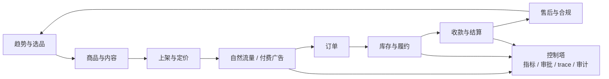

# 运筹跨境 · 跨境电商全流程 AI 运营平台

> 从趋势信号到一笔可对账的跨境订单。

**版本** v0.1（草案）｜ **日期** 2026-11-10 ｜ **状态** 需求分析与能力地图，待确认后进入模块规格

**关联文档**：[系统设计](../design.md) ｜ [MVP 设计规格](2026-11-04-mvp-order-exception-design.md) ｜ [JD 对齐设计方案](2026-11-04-jd-alignment-design.md) ｜ [数据来源与合规](../data-sources.md) ｜ [模拟演示系统需求规格](2026-11-10-cross-border-simulation-design.md) ｜ [模拟演示实施计划](../plans/2026-11-10-cross-border-simulation-implementation.md)

---

## 0. 文档定位与假设

本文回答两个问题：

1. 现有 OpsConductor 如何从「订单异常运营层」扩展到跨境电商全流程？
2. 是自营 1–10 家精品店，还是把系统产品化成「AI 整合的电商操作平台」（卖铲子）？

本文是**需求分析 + 能力地图**，不是模块级实施规格。按 spec-driven-development 的门禁，能力地图确认后，再逐个模块写 SPEC、计划和任务。

先列出本文的假设，避免把不确定的东西写成结论：

1. 「5000 SKU、精品店 1–10」理解为：供应链目录约 5000 个 SKU，计划运营 1–10 家精品店；不是 5000 个 SKU 全部做内容。
2. 首站为 TikTok Shop；Amazon 为第二渠道；Temu 作为清货/价格渠道；Shopify 作为品牌独立站。
3. 履约采用「跨境直邮 + 空运 + 海运 + 海外仓/FBT」组合，具体比例按品类、时效和资金决定。
4. 平台只做**跨环节的 AI 编排与可信执行层**，ERP/WMS/TMS/支付/广告/内容工具通过 MCP/Adapter 集成，不重造。
5. 资金、价格、超预算广告、合规声明必须人工审批；平台不自动打款。
6. 当前 OpsConductor 是生产形态的项目原型，不是商用系统；商用前需要设计伙伴、法务/税务/合规与真实数据授权。
7. 平台费率、物流政策、保证金和合规要求以各平台官方 Seller Center 为准；本文引用的公开资料只用于方向判断。

## 1. 结论先行

1. **全流程可以实现，但不能一次做完。** 跨境全链路有八个环节，每个环节都有成熟 SaaS。OpsConductor 的机会不是再做一个 ERP，而是做**跨环节的 AI 编排与可信执行层**：把选品、内容、广告、履约、结算串成一条可审批、可审计、可补偿的任务链。
2. **TikTok 是内容电商的合适切入点，但不是低风险蓝海。** 2026 年 TikTok Shop 的方向是「官方物流/本地履约 + 更高保证金 + 更严内容治理」，公开资料还显示大多数中国卖家不盈利。平台必须从第一天就算清楚履约成本与单位经济模型，不能只做内容生成。
3. **5000 SKU 不能平均用力。** 用 SKU 金字塔：A 层 20–50 个 hero SKU 做内容和投放，B 层 200–500 个测试 SKU，C 层长尾只做货架/搜索。内容电商的胜负在 A 层，不在 SKU 数量。
4. **「卖铲子」比「自己开店」更匹配现有项目。** OpsConductor 的 Planner/Executor/Verifier、审批、幂等、补偿、审计、RAG、RPA、Adapter 正是「卖铲子」的底层能力；自营店是验证场景，不是最终产品。
5. **推荐楔子：TikTok commerce control tower（内容 → 订单 → 履约 → 结算）。** 不做全链路大而全，先做「内容简报 → Listing → 订单异常/履约 → 结算对账」这条可度量、可收费的闭环。

## 2. 两条路线：自营店 vs 卖铲子

| 维度 | A. 自营精品店（1–10 家） | B. 卖铲子（AI 运营平台） | C. 混合（推荐） |
|---|---|---|---|
| 收入 | 商品毛利 | SaaS 订阅 + 用量 + 集成/服务 | 先商品毛利，后订阅 |
| 核心能力 | 供应链、内容、投放、履约 | 产品、集成、Agent、客户成功 | 先用自营验证，再产品化 |
| 启动成本 | 库存 + 广告 + 内容 + 仓配 | 研发 + 设计伙伴 + 合规 | 自营店同时作为设计伙伴 |
| 风险 | 库存、平台政策、现金流 | 需求不成立、集成碎片化、信任 | 两边都慢，但验证更真实 |
| 与 OpsConductor 的关系 | 内部工具，成本中心 | 产品本体，价值中心 | 自营店是实验室，平台是产品 |
| 适合的前提 | 有供应链、资金、运营团队 | 有工程能力、行业认知、3–5 个设计伙伴 | 两者都有一点，先小步验证 |

**推荐路线 C**：先用 1 家自营店 + 1 个市场 + 20 个 hero SKU 跑通一条链路，把「内容 → 订单 → 履约 → 结算」的异常、审批、补偿、对账数据沉淀下来；再把验证过的链路产品化，卖给同类商家。不要先造平台再找用户，也不要把自营店做成重库存的赌注。

## 3. 跨境电商全流程拆解

| # | 环节 | 核心动作 | 关键数据/系统 | 典型失败 | AI 可增强的点 | 风险 |
|---|---|---|---|---|---|---|
| 1 | 市场与选品 | 趋势采集、竞品分析、需求评分、合规/IP 筛查、SKU 组合 | TikTok Creative Center、FastMoss/Kalodata、Amazon BSR、Google Trends、Keepa | 选错品、侵权、毛利为负、物流不可行 | 趋势聚类、评分卡、评论痛点抽取、合规初筛 | L1 |
| 2 | 商品与内容 | 商品资料、卖点、图片、短视频、直播脚本、本地化 | PIM/DAM、Canva/CapCut、生成式图片/视频、品牌规范 | 素材同质化、违规声明、版权问题 | Brief 生成、变体生成、合规校验、品牌一致性检查 | L1/L2 |
| 3 | 上架与定价 | 标题、卖点、类目、变体、价格、库存同步 | TikTok Shop、Amazon SP-API、Shopify、Temu | 类目错、关键词错、价格倒挂、库存不同步 | Listing 生成、关键词覆盖、价格带建议、竞品监控 | L2 |
| 4 | 自然流量 | 内容日历、达人/联盟、寄样、直播排期、UGC | 达人 CRM、联盟后台、内容日历 | 内容断更、达人履约差、样本浪费 | 选题、脚本、达人匹配、发布节奏、效果归因 | L2 |
| 5 | 付费流量 | 广告计划、预算、出价、素材轮换、ROAS | TikTok Ads、Amazon Ads、Meta/Google Ads | 预算烧穿、ROAS 低于盈亏线、素材疲劳 | 预算护栏、异常检测、暂停/放量建议、创意轮换 | L3（超预算） |
| 6 | 订单与库存 | 订单同步、库存预占、拆单/改址、缺货处理 | 渠道订单 API、ERP/WMS、库存中心 | 超卖、超时未发、地址异常、重复履约 | 异常分类、拆单/改址方案、补偿、库存调拨 | L2 |
| 7 | 履约与物流 | 直邮/空运/海运/海外仓、报关、轨迹、签收 | 4PX/YunExpress/Yanwen/DHL/FedEx/UPS、FBT/3PL、货代 | 清关失败、时效超限、丢件、运费倒挂 | 路由建议、时效预测、异常预警、报关资料校验 | L2/L3 |
| 8 | 收款与结算 | 平台结算、PSP、汇率、费用、退款、对账、税务 | TikTok/Amazon/Temu 结算、PingPong/LianLian/Airwallex/Stripe/PayPal | 少结、多扣、汇率损失、退款漏记、税务风险 | 自动对账、差异归因、费用洞察、现金流预测 | L3 |
| 9 | 售后与合规 | 退货退款、纠纷、chargeback、IP/产品合规 | 工单、政策库、合规证书 | 超退、误退、封店、侵权下架 | 政策 RAG、资格判定、证据组装、合规检查 | L3 |
| 10 | 控制塔（横向） | 指标、告警、审批、trace、审计、评估 | 数据仓库、可观测、评测集 | 数据孤岛、无法复盘、无法证明效果 | 统一指标、异常检测、任务复盘、自动评估 | L0 |

**全链路的关键不是「每个环节都做」，而是「跨环节的状态一致」。** 选品时算的毛利，必须能一路传到 Listing 定价、广告出价、履约路由和结算对账；内容带来的订单，必须能追溯到素材、达人和广告计划；退款和 chargeback 必须能回写到 SKU 和活动。OpsConductor 的 `task_run` / `task_step` / `audit_log` / `trace_span` 正是这条追溯链的骨架。



## 4. 平台对比：Amazon / Temu / TikTok Shop / Shopify / Shopee

| 维度 | Amazon | Temu | TikTok Shop | Shopify + Meta/Google | Shopee / Lazada |
|---|---|---|---|---|---|
| 流量逻辑 | 搜索/货架，需求捕获 | 平台算法 + 极致低价 | 内容/兴趣，短视频与直播 | 独立站 + 付费/内容引流 | 平台搜索 + 本地活动 |
| 适合品类 | 标准化、合规成熟、高客单 | 白牌、工厂货、低客单 | 可视化、演示型、冲动消费 | 品牌型、复购型 | 东南亚本地化商品 |
| 商家控制 | 中（平台规则强） | 低（平台托管/半托管） | 中（内容与定价可控，物流受约束） | 高（品牌、数据、定价） | 中 |
| 履约 | FBA 为主 | 平台/半托管物流 | FBT/官方物流/海外仓，2026 年趋严 | 3PL/自发货 | 平台物流/海外仓 |
| 内容要求 | 低（Listing/评论） | 低（价格/主图） | 高（短视频/直播/达人） | 高（素材/品牌） | 中低 |
| 资金/风险 | 高库存 + 高 PPC | 低毛利 + 价格战 | 内容/达人/库存 + 平台政策 | CAC 高 + 独立站信任 | 本地化运营 + 低客单 |
| 对 5000 SKU 的意义 | 适合目录型货架，需 Listing/广告运营 | 适合清货，不适合品牌 | 只适合 A/B 层 SKU 做内容 | 适合品牌沉淀与复购 | 适合东南亚测试 |
| 建议角色 | 第二渠道，稳定现金流 | 清货/尾货渠道 | 首站，内容电商验证 | 品牌独立站/私域 | 区域备选市场 |

**2026 年 TikTok Shop 的运营环境（公开资料摘要，需以官方 Seller Center 为准）：**

- 美国市场在 2026 年完成合规重组，政治层面的「随时封禁」风险下降，但运营门槛上升。
- 美国订单趋向平台管理物流（FBT/官方物流/指定物流），自发货空间收窄；保证金提高，履约时效和物流评分权重上升。
- 欧盟/英国要求 VAT、EPR/GPSR 等合规；东南亚门槛相对低，但客单和利润也低。
- 公开资料显示大多数中国 TikTok 卖家不盈利，流量波动、退货/库存、封店和 ROI 压力是主要原因。

这些信号共同说明：**TikTok 内容电商的胜负不只在内容，而在「内容 + 本地履约 + 合规 + 单位经济」的组合。** 平台设计必须把履约和结算放进同一条任务链，而不是先做内容工具再补后端。

## 5. 5000 SKU × 1–10 家精品店的运营模型

### 5.1 SKU 金字塔

| 层级 | 数量（每店） | 内容节奏 | 流量 | 库存/履约 | 核心指标 | 淘汰规则 |
|---|---|---|---|---|---|---|
| A. Hero | 20–50 | 每周 3–5 条短视频 + 直播 | 付费 + 达人 + 自然 | 海外仓/FBT，保安全库存 | GMV、ROAS、复购、退货率 | 连续 2 周 ROAS 低于盈亏线则降级 |
| B. Test | 200–500 | 每周 1 条 + UGC/达人寄样 | 小预算测试 + 自然 | 空运/直邮，小批量 | 点击率、转化率、毛利 | 30 天无起量则降 C |
| C. Long-tail | 其余 | 不做内容，只做 Listing | 搜索/货架 | 国内直发/预售 | 动销率、库存周转 | 90 天不动销则清货 |

**5000 SKU 是供应链资产，不是内容资产。** 内容团队和 Agent 的产能应该集中在 A/B 层；C 层用规则和批量工具维护，不占用创意和投放预算。

### 5.2 单店与多店

- 先做 1–3 家店，单店单市场单品类；不要一开始 10 家店 × 5000 SKU 全铺。
- 每个店要有独立的品牌、人群和内容角度；共享供应链、素材库和 Agent 运行时，但店铺数据、广告账户、结算账户隔离。
- 10 家店是「品牌组合」而不是「一个店的复制粘贴」；复制之前先证明单店模型可复制。

### 5.3 单位经济模型

每个 SKU 在上架前必须算清楚：

```text
贡献毛利 = 售价
         - 采购成本
         - 平台佣金
         - 支付/汇兑费用
         - 头程/尾程/仓储费
         - 广告费（按目标 ROAS 分摊）
         - 退货/退款/chargeback 预备金
         - 关税/税费
```

平台应把这张表做成选品评分卡的一部分：**毛利为负的 SKU 不允许进入 A 层，也不允许自动放量。** 这比事后看报表更有价值，也是「卖铲子」最容易向商家证明 ROI 的地方。

### 5.4 选品评分卡

| 维度 | 权重建议 | 判断方式 |
|---|---|---|
| 需求趋势 | 20% | 搜索/内容/销量趋势，至少 8–12 周 |
| 竞争强度 | 15% | 同类供给、价格带、评论数、广告密度 |
| 毛利空间 | 20% | 按 5.3 公式，扣除所有费用 |
| 物流可行性 | 15% | 重量/体积、带电/液体/粉末、时效、破损率 |
| 合规/IP | 15% | 认证、标签、专利/商标、平台禁限售 |
| 内容可塑性 | 10% | 可视化、演示性、前后对比、场景感 |
| 供应稳定性 | 5% | MOQ、交期、品质、补货能力 |

## 6. 与 OpsConductor 的映射

### 6.1 现有能力可直接复用

| OpsConductor 能力 | 在跨境全流程中的用途 |
|---|---|
| Planner / DAG | 选品、内容、上架、投放、履约、对账的多步骤任务拆解 |
| Executor + 检查点 | 长流程执行、审批等待、失败恢复 |
| Verifier（独立否决） | 毛利、库存、合规声明、金额、政策引用的一致性校验 |
| 审批 + 风险分级 | 广告超预算、改价、退款、赔付、合规声明 |
| 幂等 + 补偿 + 审计 | 订单/库存/退款/结算等写操作的安全底座 |
| MCP 工具网关 + Adapter | 接 TikTok/Amazon/Temu/Shopify/物流/支付，不绑定单一 ERP |
| RAG | 平台政策、品牌规范、合规知识、售后政策 |
| RPA | 无 API 的旧版 ERP/货代后台兜底 |
| Memory / 失败记忆 | 选品、内容、履约、对账的失败模式复用 |
| 多模型路由 | 选品分析用强模型，分类/抽取用小模型，验证用独立模型 |
| Trace / 评估 | 全链路复盘、指标、Golden Tasks |

### 6.2 需要新增的能力

| 新增能力 | 说明 |
|---|---|
| 平台连接器 | TikTok Shop、Amazon SP-API、Temu、Shopify；先只读，再审批写 |
| 跨境主数据 | HS Code、原产地、申报价值、关税/税率、Incoterm、带电/液体属性 |
| 履约路由 | 直邮/空运/海运/海外仓的时效、成本、可发性比较 |
| 结算对账 | 平台结算单、PSP、汇率、费用、退款、chargeback 的差异归因 |
| 内容资产 | 商品素材库、Brief、图片/视频、版本、版权/合规标记 |
| 达人/联盟 | 达人画像、寄样、佣金、内容验收、效果归因 |
| 广告护栏 | 预算上限、ROAS 阈值、异常检测、暂停/放量建议 |
| 控制塔 | 统一指标、告警、审批台、trace、评估集 |

### 6.3 明确不做

- 不做完整 ERP/WMS/TMS/支付处理器/广告平台/内容工具。
- 不做无人审批的资金动作（打款、赔付、大额退款）。
- 不在 MVP 同时支持所有平台和所有市场。
- 不把 5000 SKU 全部内容化。
- 不承诺「全自动无人运营」。

## 7. 能力地图

| Module id | 职责 | 依赖 | 构建顺序 | 现有 OpsConductor 资产 |
|---|---|---|---|---|
| `integration-hub` | 平台/物流/支付/广告连接器，MCP 工具网关 | — | 1 | MCP 网关、ERP Adapter 设计 |
| `agent-runtime` | Planner/Executor/Verifier/Memory/SKILL、模型网关 | `integration-hub` | 1 | 现有编排骨架、ADR 0002/0003 |
| `catalog` | SKU 主数据、合规属性、Listing、定价 | `integration-hub` | 2 | 领域模型基础 |
| `commerce-core` | 订单、库存、履约路由、异常处理 | `catalog`、`integration-hub`、`agent-runtime` | 2 | MVP 订单异常、拆单/改址 |
| `content-studio` | 内容简报、图片/视频、素材库、A/B 变体 | `catalog`、`agent-runtime` | 3 | RAG、Verifier、审批 |
| `traffic-ops` | 自然流量日历、达人/联盟、付费广告、预算护栏 | `content-studio`、`catalog` | 4 | DAG、审批、审计 |
| `settlement` | 平台结算、PSP、汇率、费用、对账 | `commerce-core` | 4 | 幂等、审计 |
| `after-sales` | 退货退款、纠纷、合规 | `commerce-core`、`settlement` | 5 | 退款 RAG、审批 |
| `market-intel` | 趋势、选品评分、SKU 组合 | `integration-hub` | 5 | RAG、Planner |
| `control-tower` | 指标、告警、trace、评估、审批台 | 全部 | 1（薄）/5（完整） | trace、评估、控制台 |

**构建顺序的理由：**

1. `integration-hub` + `agent-runtime` 是地基；没有连接器和编排，其他模块都是空的。
2. `catalog` + `commerce-core` 是运营楔子：OpsConductor 已有订单异常/拆单/改址的基础，最容易先跑出可度量结果。
3. `content-studio` 是 TikTok 内容电商的差异化，但依赖 SKU 主数据，所以排在 catalog 之后。
4. `traffic-ops` 依赖内容和素材；`settlement` 依赖订单和履约数据。
5. `after-sales`、`market-intel`、完整 `control-tower` 放在验证期之后，避免范围膨胀。

## 8. MVP 切片

### 8.1 阶段

| 阶段 | 周期 | 范围 | 退出标准 |
|---|---|---|---|
| Phase 0：验证 | 2 周 | 1 个市场、1 家店、20 个 hero SKU、1 种履约方式；TikTok Shop 沙盒；单位经济模型；合规/税务/支付方案 | 选品评分卡跑通；毛利模型可算；平台/物流/支付账号可用 |
| Phase 1：运营楔子 | 4–6 周 | `integration-hub` 只读接 TikTok；`catalog` 20 SKU；`commerce-core` 订单异常/履约；`content-studio` Brief；薄 `control-tower` | 端到端：趋势信号 → Brief → Listing → 订单 → 异常处理 → 报告；审批/审计/trace 完整 |
| Phase 2：内容与流量 | 4–6 周 | 内容素材、达人/联盟、自然流量日历、广告异常检测、结算只读对账 | 内容产能提升；ROAS/预算护栏生效；对账差异可归因 |
| Phase 3：扩展 | 4–6 周 | `market-intel`、Amazon 连接器、多店、完整售后 | 第二渠道/第二店铺可复制；评测集 30+ |

### 8.2 MVP 验收标准

- 1 家店、1 个市场、20 个 hero SKU、1 种履约方式跑通。
- 端到端链路：趋势信号 → 内容 Brief → Listing → 订单 → 异常处理 → 结算差异标记，全链路有审批、审计、trace。
- 运营指标：异常处理时间下降 50%；内容 Brief 产出周期 < 30 分钟；对账差异识别率 100%（种子用例）。
- 安全指标：未授权写入 0；重复写入 0；L2/L3 审批覆盖率 100%；trace 完整率 100%。
- 经济指标：每个 SKU 可计算贡献毛利；负毛利 SKU 在上架前被拦截。
- 评测：30 条 Golden Tasks，覆盖订单异常、内容 Brief、Listing、结算差异；5 条真实模型冒烟。

### 8.3 暂缓

- 全平台（Amazon/Temu/Shopify）同时接入。
- 海运整柜/拼柜、海外仓自建。
- 自动打款、自动赔付、自动大额退款。
- 全自动内容生成与无人审核发布。
- 5000 SKU 全量内容化。
- 多租户商用版、SSO、等保。

## 9. 数据模型与集成清单

### 9.1 核心实体

| 业务域 | 实体 |
|---|---|
| 组织 | `tenant`、`store`、`channel`、`market`、`currency`、`user/role` |
| 商品 | `product`、`sku`、`supplier`、`cost`、`compliance_cert`、`hs_code` |
| 内容 | `asset`、`content_brief`、`listing`、`creator`、`sample`、`campaign` |
| 交易 | `order`、`order_line`、`shipment`、`inventory`、`warehouse`、`in_transit` |
| 资金 | `settlement`、`fee`、`refund`、`chargeback`、`reconciliation` |
| 任务 | `task_run`、`task_step`、`approval`、`audit_log`、`idempotency_key`、`trace_span` |

### 9.2 跨境特有字段

`hs_code`、`country_of_origin`、`declared_value`、`duty_rate`、`tax_rate`、`incoterm`、`logistics_mode`（direct/air/sea/express）、`lead_time`、`in_transit`、`customs_status`、`compliance_flags`（带电/液体/粉末/磁性）。

### 9.3 集成优先级

| 优先级 | 集成 | 用途 |
|---|---|---|
| P0 | TikTok Shop（订单/商品/结算只读） | 首站验证 |
| P0 | 1 家物流商 + 1 家支付/收款 | 履约与结算闭环 |
| P1 | TikTok Ads / 达人联盟 | 流量与内容归因 |
| P1 | 海外仓/FBT 或 3PL WMS | 本地履约 |
| P2 | Amazon SP-API / Amazon Ads | 第二渠道 |
| P2 | Shopify / Meta / Google | 品牌独立站 |
| P3 | Temu、Shopee/Lazada、ERP（聚水潭/领星/店小秘） | 扩展渠道 |

## 10. 风险与合规

| 风险 | 影响 | 对策 |
|---|---|---|
| 平台政策变化 | 物流/保证金/内容规则导致成本上升 | 连接器抽象、政策 RAG、每周政策巡检、留出本地履约方案 |
| 单位经济不成立 | 卖得越多亏得越多 | 上架前毛利模型、负毛利拦截、按 SKU 核算 |
| 合规/税务 | 封店、罚款、扣货 | VAT/GST/销售税、EPR/GPSR、产品认证、IP 筛查；法务/税务顾问 |
| 集成脆弱 | API 变更、限流、授权失效 | Adapter + 契约测试 + 只读优先 + 降级到 RPA/人工 |
| 商家信任 | 不愿给写权限 | 先只读，再审批写；审计/trace 透明；最小权限 |
| 内容/品牌风险 | 违规声明、版权、同质化 | 品牌规范 RAG、合规校验、人工审核、素材版本 |
| 欺诈/拒付 | 资金损失 | 风控规则、人工审批、预留准备金 |
| 模型成本/延迟 | 毛利被吃掉 | 模型路由、缓存、stub 测试、成本看板 |
| 范围膨胀 | 6 个月做不出可用版本 | 楔子优先、能力地图门禁、每阶段可演示 |
|  incumbent ERP 竞争 | 被聚水潭/领星等覆盖 | 差异化在跨环节编排与可信执行，不在单点功能 |
| 数据隐私/多租户 | 数据泄露 | 全链路 `tenant_id`、加密、最小权限、审计 |

## 11. 开放问题

1. **首站市场**：美国、东南亚、欧盟/英国还是日本？美国门槛高但客单高；东南亚门槛低但利润薄。这个选择决定物流、合规和支付方案。
2. **库存模式**：5000 SKU 是自有库存、海外仓备货，还是国内直发/预售？资金占用和退货风险差别很大。
3. **品类**：内容电商适合的品类（美妆、家居、服饰、3C 配件、宠物等）与合规/物流约束强相关。
4. **业务目标**：这是求职作品集、真实现金流生意，还是 SaaS 创业？三者的 MVP 完全不同。
5. **团队**：工程、内容、投放、供应链、客服各有多少人？没有内容团队，TikTok 内容电商很难跑起来。
6. **平台资质**：TikTok Shop/Amazon 卖家账号、广告账户、支付/收款账户、海外主体是否就绪？
7. **现有系统**：是否已有 ERP/3PL/支付/广告服务商？平台是替换还是叠加？
8. **预算**：库存、广告、内容、仓配的月度预算是多少？现金流能撑几个月？
9. **设计伙伴**：如果走「卖铲子」，能否找到 3–5 家愿意试用并付费的商家？

## 12. 下一步

1. 确认本文的**路线选择**（自营 / 卖铲子 / 混合）和**能力地图**。
2. 确认首站市场、品类、履约模式和预算，把 Phase 0 的假设变成事实。
3. 若走「卖铲子」，先找 3–5 个设计伙伴，用「订单异常 + 履约 + 对账」楔子验证付费意愿。
4. 能力地图确认后，按 `integration-hub` → `catalog` → `commerce-core` → `content-studio` 的顺序，逐个模块写 SPEC、计划和任务。

---

**本文是草案，能力地图未确认前不进入模块级规格和实现。**
