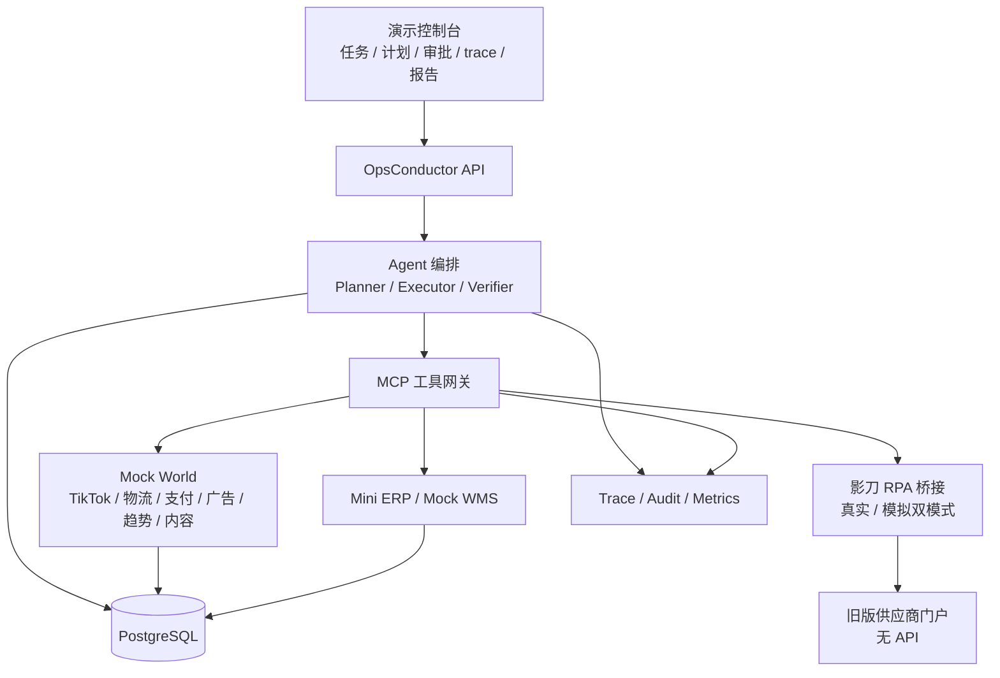

# 跨境电商全流程模拟演示系统 · 需求规格

> 用 Mock 世界 + 影刀 RPA，证明 Agent 能真正操作跨境电商业务，而不只是聊天。

**版本** v0.1 ｜ **日期** 2026-11-10 ｜ **状态** 待确认 ｜ **关联文档**：[跨境电商全流程能力地图](2026-11-10-cross-border-ecommerce-platform-design.md) ｜ [系统设计](../design.md) ｜ [MVP 设计规格](2026-11-04-mvp-order-exception-design.md) ｜ [实施计划](../plans/2026-11-10-cross-border-simulation-implementation.md)

---

## 1. 目标与非目标

### 1.1 目标

在**不接真实平台、不碰真实资金、不产生真实物流**的前提下，模拟一条完整的跨境电商运营链路，重点展示 Agent 的六类能力：

1. **理解目标**：把一句自然语言运营目标转成结构化任务。
2. **制定计划**：生成带依赖、风险、影响范围、终止条件的任务 DAG。
3. **调用工具**：通过 MCP 调用 Mock 平台 API、Mini ERP、物流/支付/广告 API。
4. **操作自动化**：通过影刀 RPA 操作没有 API 的旧版供应商门户。
5. **验证与纠错**：独立 Verifier 检查毛利、库存、预算、合规、金额；失败时补偿或转人工。
6. **可信执行**：审批、幂等、补偿、审计、trace 全链路可回放。

### 1.2 成功标准

- 一条命令启动，5–8 分钟完成端到端演示，可重复、可离线运行。
- 演示至少包含：3 次人工审批、1 次拒绝、1 次失败补偿、1 次影刀 RPA 操作、1 次结算差异。
- 所有写操作带幂等键，重复提交不产生第二次业务影响；所有 L2/L3 动作有审批记录。
- 所有外部调用可追溯到 trace span；所有业务变更可追溯到 audit log。
- Mock 数据可一键重置；固定随机种子，结果可复现。
- 30 条 Golden Tasks 可自动评测；核心指标达到第 12 节门槛。

### 1.3 非目标

- 真实 TikTok Shop / Amazon / Temu 生产 API 接入。
- 真实支付、真实物流、真实广告投放、真实退款。
- 完整 ERP/WMS/TMS/财务系统。
- 无人审批的全自动运营。
- 5000 SKU 全量内容生产。
- 多租户商用化、SSO、等保、生产部署。

## 2. 演示故事线

### 2.1 角色与场景

| 角色 | 说明 |
|---|---|
| 店铺 | NestWell Home US，TikTok Shop 美国店，家居类目，1 号店 |
| 运营小运 | 提交目标、审批 L2 动作 |
| 财务小财 | 审批 L3 广告预算、退款 |
| 仓管小仓 | 审批 RPA 补货、处理履约异常 |
| Agent | 规划、调工具、执行、验证、补偿、报告 |

### 2.2 目标指令

> 本周把 NestWell 美国店的家居类目做到 10 万美元 GMV，广告预算不超过 1 万美元；优先处理断货和超时订单；上新 5 个 hero SKU，ROAS 目标 2.5。

### 2.3 剧本

1. **提交目标**：Agent 识别意图、租户、店铺、市场、预算、时间窗口。
2. **计划预览**：生成 DAG，展示每个 SKU 的评分、毛利、合规、库存、内容 Brief、广告预算、风险等级。
3. **审批**：
   - 广告预算 1 万美元：L3，财务通过。
   - 一个涨价建议：L2，运营拒绝，Agent 改为保持原价并换一个 SKU。
   - 一个退款：L3，财务通过；另一个退款因政策不符被拒绝。
4. **执行**：
   - 趋势扫描 → 5 个 hero SKU：1 个毛利不达标被替换，1 个合规不达标被剔除。
   - 内容 Brief → 每个 SKU 3 张图 + 2 条短视频脚本（Mock 生成占位素材）。
   - Listing 创建/更新 → 标题、卖点、类目、价格、库存同步。
   - 广告计划 → 3 个 campaign，总预算 1 万美元，ROAS 护栏 2.5。
   - 订单同步 → 6 个异常订单：超时未发、缺货、地址异常、已拆单、跨租户、重复提交。
   - 履约 → 空运/海运/海外仓比价；创建发货单；一票报关失败触发补偿。
   - 影刀 RPA → 登录旧版供应商门户，查库存、下补货单、下载 PO、截图。
   - 结算 → 日对账，发现 3 笔差异，生成财务任务。
5. **失败注入**：
   - TikTok 订单 API 超时 → 用同一幂等键重试。
   - 拆单库存冲突 → 补偿：取消发货单、释放预占、回退订单。
   - RPA 选择器超时 → 重试备用选择器；仍失败则转人工。
6. **验证**：Verifier 检查毛利、库存非负、预算未超、Listing 合规、结算总额、审计完整。
7. **报告**：GMV 预测、毛利、异常、审批、RPA 截图、trace、成本。
8. **回放**：控制台展示 trace 时间线、审计记录、RPA 截图、Mock 数据最终状态。

### 2.4 演示指标

- 演示时长 ≤ 8 分钟；一键重置 ≤ 30 秒。
- 至少 3 次审批、1 次拒绝、1 次补偿、1 次 RPA、1 次对账差异。
- 报告可导出 Markdown/JSON；trace 可回放。

## 3. 系统架构



**关键决策：**

- **Mock World 是独立进程**，有自己的数据库 schema 和 OpenAPI；Agent 不直接访问 Mock 数据库。
- **Agent 只看到 MCP 工具**，不看到具体平台 SDK；替换真实 API 时只换 Adapter。
- **影刀桥接与 Mock 桥接实现同一接口**；默认 Mock 模式保证离线可演示，真实影刀模式用于现场加分。
- **确定性优先**：固定种子、stub 模型、可注入失败；真实模型只做冒烟。
- **写操作先审批、后 dry-run、再执行**；失败进入补偿或转人工。

## 4. 功能需求

| ID | 需求 | 优先级 | 验收标准 |
|---|---|---|---|
| FR-01 | 自然语言目标接入 | P0 | 能解析店铺、市场、品类、GMV、预算、时间窗口、优先级 |
| FR-02 | 计划 DAG 生成与预览 | P0 | 节点含依赖、工具、风险、影响范围、超时、补偿 |
| FR-03 | L2/L3 审批 | P0 | 审批记录含动作、参数、影响、证据、审批人、结果 |
| FR-04 | Mock API 网关 | P0 | 统一鉴权、租户、幂等、限流、延迟、失败注入、错误码 |
| FR-05 | Mock 数据生成与重置 | P0 | 5000 SKU、10 店、90 天订单/结算；一键重置；固定种子 |
| FR-06 | 选品与趋势评分 | P0 | 输出趋势分、竞争、毛利、物流、合规、内容可塑性 |
| FR-07 | 内容 Brief 与素材 | P0 | 每个 SKU 生成 Brief、图片/视频占位素材、合规标记 |
| FR-08 | Listing 与定价 | P0 | 创建/更新 Listing；价格变更走审批；库存同步 |
| FR-09 | 广告计划与预算 | P0 | 创建 campaign；预算超阈值走 L3；ROAS 护栏 |
| FR-10 | 订单异常处理 | P0 | 超时、缺货、地址异常、已拆单、跨租户、重复提交 |
| FR-11 | 库存与履约 | P0 | 预占/释放、拆单、发货、物流比价、报关、轨迹 |
| FR-12 | 结算与对账 | P0 | 拉取结算、费用、退款、chargeback；差异归因 |
| FR-13 | 影刀 RPA 桥接 | P0 | 真实/模拟双模式；输入参数、输出结果、截图、日志、状态 |
| FR-14 | 独立 Verifier | P0 | 确定性检查 + 独立模型复核；可否决 |
| FR-15 | 幂等/补偿/审计/trace | P0 | 重复写 0、越权写 0、补偿可验证、trace 完整 |
| FR-16 | 演示控制台 | P0 | 任务、计划、审批、trace、审计、报告、Mock 数据 |
| FR-17 | 失败注入 | P0 | 超时、限流、库存冲突、报关失败、对账差异、RPA 失败 |
| FR-18 | Golden Tasks | P1 | 30 条可复现；断言最终状态、必需工具、禁止动作 |
| FR-19 | 一键启动与重置 | P0 | `docker compose up` + `make demo`；重置 ≤ 30 秒 |
| FR-20 | 报告导出 | P1 | Markdown/JSON；含指标、审批、异常、RPA 证据 |

## 5. 非功能需求

| ID | 需求 | 验收标准 |
|---|---|---|
| NFR-01 | 确定性 | 固定种子 + stub 模型，重复运行结果一致 |
| NFR-02 | 性能 | Mock 调用 P95 < 300ms；完整演示 ≤ 8 分钟 |
| NFR-03 | 隔离 | 所有表/工具/日志带 `tenant_id`、`store_id` |
| NFR-04 | 安全 | 不存真实凭据；Mock 密钥走环境变量；最小权限 |
| NFR-05 | 可观测 | trace 完整率 100%；审计覆盖所有写操作 |
| NFR-06 | 可扩展 | Adapter 可替换真实 API；工具契约不变 |
| NFR-07 | 可移植 | Docker Compose 一键启动；离线可跑 |
| NFR-08 | 可测试 | 契约测试 + Golden Tasks + 失败注入 |
| NFR-09 | 成本 | 默认零真实 API 成本；真实模型可选 |
| NFR-10 | 合规 | 只用合成数据；不含真实 PII；不调用真实支付/物流 |

## 6. Mock API 契约

### 6.1 通用约定

- **Base URL**：`http://127.0.0.1:8100`（独立进程）。
- **鉴权**：`Authorization: Bearer <mock-token>`；token 映射 tenant/store/role。
- **租户**：`X-Tenant-Id`、`X-Store-Id`；服务端校验，不信任 body 中的租户。
- **幂等**：`Idempotency-Key`；同键同 body 返回首次响应；同键不同 body 返回 `409 CONFLICT`。
- **请求追踪**：响应头 `X-Request-Id`；日志与 trace 关联。
- **分页**：`limit`、`cursor`；默认 50。
- **限流**：按 tenant/store 令牌桶；超限返回 `429 RATE_LIMITED` + `Retry-After`。
- **延迟模拟**：`MOCK_LATENCY_MS`；默认 20–80ms。
- **失败注入**：请求头 `X-Mock-Failure: timeout|rate_limit|server_error|stock_conflict|customs_hold|settlement_mismatch|rpa_selector_failure`，或场景配置文件。
- **确定性**：`X-Mock-Seed` 或 `MOCK_SEED`；同一 seed + 同一请求返回同一结果。
- **错误模型**：

```json
{
  "error_code": "INSUFFICIENT_STOCK",
  "message": "SKU-10023 在 US-WEST 仓可用库存不足",
  "retryable": false,
  "request_id": "req_01J...",
  "details": {"sku": "SKU-10023", "warehouse": "US-WEST", "available": 3, "required": 10}
}
```

错误码至少覆盖：`VALIDATION_ERROR`、`UNAUTHORIZED`、`FORBIDDEN`、`NOT_FOUND`、`CONFLICT`、`RATE_LIMITED`、`TIMEOUT`、`UPSTREAM_ERROR`、`INSUFFICIENT_STOCK`、`INVALID_STATE`、`POLICY_VIOLATION`、`SETTLEMENT_MISMATCH`。

### 6.2 TikTok Shop Mock

| 方法 | 路径 | 用途 | 风险 | 幂等 |
|---|---|---|---|---|
| GET | `/tiktok/products` | 商品列表/详情 | L0 | — |
| POST | `/tiktok/products` | 创建 Listing | L2 | 是 |
| PATCH | `/tiktok/products/{id}` | 改价/库存/状态 | L2 | 是 |
| GET | `/tiktok/orders` | 订单列表 | L0 | — |
| GET | `/tiktok/orders/{id}` | 订单详情 | L0 | — |
| POST | `/tiktok/orders/{id}/split` | 拆单/生成发货单 | L2 | 是 |
| POST | `/tiktok/orders/{id}/address` | 改址 | L2 | 是 |
| GET | `/tiktok/returns` | 退货/退款列表 | L0 | — |
| POST | `/tiktok/returns/{id}/refund` | 退款 | L3 | 是 |
| GET | `/tiktok/settlements` | 平台结算 | L0 | — |
| GET | `/tiktok/creators` | 达人列表 | L0 | — |
| POST | `/tiktok/samples` | 寄样 | L2 | 是 |

付费广告统一走 6.5 的 `/ads/*`；TikTok Shop 侧的 campaign 指平台活动/联盟计划，演示不单独建模。

**订单对象关键字段**：`order_id`、`store_id`、`market`、`status`、`paid_at`、`ship_deadline`、`currency`、`items[]`（`sku`、`qty`、`price`、`discount`、`warehouse_id`）、`address`、`version`。

**结算对象关键字段**：`settlement_id`、`store_id`、`period`、`gross_sales`、`platform_fee`、`payment_fee`、`refunds`、`chargebacks`、`net_amount`、`currency`、`payout_status`。

### 6.3 物流 Mock

| 方法 | 路径 | 用途 | 风险 | 幂等 |
|---|---|---|---|---|
| POST | `/logistics/rates` | 空运/海运/直邮/海外仓比价 | L0 | — |
| POST | `/logistics/shipments` | 创建发货单 | L2 | 是 |
| GET | `/logistics/shipments/{id}` | 发货单状态 | L0 | — |
| GET | `/logistics/shipments/{id}/tracking` | 轨迹 | L0 | — |
| POST | `/logistics/customs/declare` | 报关 | L2 | 是 |
| GET | `/logistics/warehouses` | 仓库与时效 | L0 | — |

**报价字段**：`mode`（direct/air/sea/express）、`carrier`、`cost`、`currency`、`eta_days`、`min_weight`、`max_weight`、`restrictions[]`。

### 6.4 支付/结算 Mock

| 方法 | 路径 | 用途 | 风险 | 幂等 |
|---|---|---|---|---|
| GET | `/payment/settlements` | 结算单 | L0 | — |
| GET | `/payment/payouts` | 打款记录 | L0 | — |
| GET | `/payment/fx-rates` | 汇率 | L0 | — |
| GET | `/payment/fees` | 费用明细 | L0 | — |
| GET | `/payment/chargebacks` | 拒付 | L0 | — |
| POST | `/payment/refunds` | 退款执行 | L3 | 是 |

平台侧退款走 `/tiktok/returns/{id}/refund`，资金侧执行走 `/payment/refunds`；两者用同一个 `refund_id` 关联，避免重复退款。

### 6.5 广告 Mock

| 方法 | 路径 | 用途 | 风险 | 幂等 |
|---|---|---|---|---|
| GET | `/ads/campaigns` | 计划列表 | L0 | — |
| POST | `/ads/campaigns` | 创建计划 | L3（超预算） | 是 |
| PATCH | `/ads/campaigns/{id}/budget` | 调预算 | L3 | 是 |
| PATCH | `/ads/campaigns/{id}/status` | 暂停/恢复 | L2 | 是 |
| GET | `/ads/performance` | ROAS/花费/转化 | L0 | — |
| GET | `/ads/recommendations` | 放量/暂停建议 | L0 | — |

### 6.6 趋势/内容 Mock

| 方法 | 路径 | 用途 | 风险 | 幂等 |
|---|---|---|---|---|
| GET | `/trend/products` | 趋势商品 | L0 | — |
| GET | `/trend/keywords` | 关键词/搜索量 | L0 | — |
| GET | `/trend/competitors` | 竞品价格/评论 | L0 | — |
| POST | `/content/briefs` | 内容 Brief | L1 | 是 |
| POST | `/content/assets` | 图片/视频占位素材 | L1 | 是 |
| POST | `/content/compliance-check` | 合规/版权检查 | L0 | — |

### 6.7 ERP/WMS Mock

| 方法 | 路径 | 用途 | 风险 | 幂等 |
|---|---|---|---|---|
| GET | `/erp/inventory` | 库存查询 | L0 | — |
| POST | `/erp/inventory/reserve` | 预占 | L2 | 是 |
| POST | `/erp/inventory/release` | 释放 | L2 | 是 |
| POST | `/erp/purchase-orders` | 采购单 | L2 | 是 |
| GET | `/erp/purchase-orders/{id}` | 采购单状态 | L0 | — |
| GET | `/erp/warehouses` | 仓库列表 | L0 | — |

ERP 采购单是内部记录；供应商门户 PO 是外部单据。RPA 创建 PO 后回写 `external_po_number` 到 ERP，形成双向可追溯。

### 6.8 RPA 桥接

| 方法 | 路径 | 用途 | 风险 | 幂等 |
|---|---|---|---|---|
| POST | `/rpa/runs` | 触发影刀流程 | L2 | 是 |
| GET | `/rpa/runs/{id}` | 查询状态/结果 | L0 | — |
| GET | `/rpa/runs/{id}/screenshots` | 截图列表 | L0 | — |
| POST | `/rpa/runs/{id}/cancel` | 取消 | L2 | 是 |
| GET | `/rpa/flows` | 可用流程 | L0 | — |

## 7. Mock 数据规格

| 实体 | 数量 | 说明 |
|---|---|---|
| 店铺 | 10 | 2 个市场（US、SG），2 个渠道（TikTok、Amazon stub） |
| SKU | 5000 | A 层 50、B 层 500、C 层 4450；5 个类目 |
| 商品/Listing | 5000 | 其中 50 个 hero 有完整素材 |
| 仓库 | 3 | US-WEST 3PL、US-EAST 3PL、CN 直发 |
| 库存 | 5000 × 3 | 可用/预占/在途；含 20 个缺货 SKU |
| 订单 | 5000 | 90 天；含 6 个异常订单 |
| 结算单 | 90 天 × 10 店 | 含 3 个差异用例 |
| 广告计划 | 20 | 含 3 个超预算/低 ROAS 用例 |
| 达人 | 20 | 家居/美妆/宠物类目 |
| 寄样 | 50 | 含 3 个履约异常 |
| 政策文档 | 20 | 平台规则/售后/合规，带版本和生效时间 |
| RPA 流程 | 3 | 供应商补货、库存查询、PO 下载 |

- 生成器：`scripts/seed_demo.py`，固定种子 `DEMO_SEED=20261110`。
- 重置：`POST /admin/reset`（仅 demo 环境）或 `make reset-demo`。
- 数据全部合成；姓名/地址用 Faker，商品标题用模板；不使用真实 PII。
- 5000 SKU 的完整数据不进入 Git；仓库只保留 schema、生成脚本和小样本。

## 8. Agent 工具与风险分级

| 工具 | 域 | 风险 | dry-run | 审批 | 补偿 |
|---|---|---|---|---|---|
| `trend_scan` | 选品 | L0 | — | 否 | — |
| `product_score` | 选品 | L0 | — | 否 | — |
| `compliance_check` | 合规 | L0 | — | 否 | — |
| `content_brief_generate` | 内容 | L1 | — | 否 | 删除草稿 |
| `asset_generate` | 内容 | L1 | — | 否 | 删除草稿 |
| `listing_create` | 上架 | L2 | 是 | 是 | 下架 |
| `listing_update` | 上架 | L2 | 是 | 是 | 恢复原值 |
| `ads_campaign_create` | 广告 | L3（超预算） | 是 | 是 | 暂停 |
| `ads_budget_update` | 广告 | L3 | 是 | 是 | 恢复原预算 |
| `ads_status_update` | 广告 | L2 | 是 | 是 | 恢复原状态 |
| `order_list` | 订单 | L0 | — | 否 | — |
| `order_get` | 订单 | L0 | — | 否 | — |
| `order_split` | 订单 | L2 | 是 | 是 | 取消发货单/释放库存 |
| `order_change_address` | 订单 | L2 | 是 | 是 | 恢复原地址 |
| `inventory_get` | 库存 | L0 | — | 否 | — |
| `inventory_reserve` | 库存 | L2 | 是 | 是 | 释放 |
| `inventory_release` | 库存 | L2 | 是 | 是 | — |
| `logistics_quote` | 履约 | L0 | — | 否 | — |
| `shipment_create` | 履约 | L2 | 是 | 是 | 取消发货单 |
| `customs_declare` | 履约 | L2 | 是 | 是 | 撤回申报 |
| `settlement_get` | 结算 | L0 | — | 否 | — |
| `reconcile_run` | 结算 | L1 | — | 否 | 删除对账任务 |
| `refund_create` | 售后 | L3 | 是 | 是 | 撤销退款（mock） |
| `rpa_yingdao_run_flow` | RPA | L2 | 是 | 是 | 取消 RPA 任务/人工接手 |

工具元数据必须包含：名称、描述、参数 Schema、返回 Schema、风险等级、是否写、是否支持 dry-run、幂等语义、超时、补偿动作。

## 9. 影刀 RPA 集成规格

### 9.1 两种模式

| 模式 | 用途 | 实现 |
|---|---|---|
| `mock`（默认） | CI、离线演示、稳定复现 | Playwright 驱动本地旧版供应商门户，返回截图/日志 |
| `real` | 现场演示、真实影刀能力展示 | 调用影刀开放 API 或本地桥接触发已录制流程 |
| `hybrid` | 演示时真实，测试时 mock | 按环境变量切换 |

环境变量：

```bash
YINGDAO_MODE=mock|real|hybrid
YINGDAO_API_BASE=http://127.0.0.1:8200
YINGDAO_API_KEY=...
YINGDAO_FLOW_SUPPLIER_REPLENISH=flow_...
YINGDAO_FLOW_STOCK_QUERY=flow_...
YINGDAO_FLOW_PO_DOWNLOAD=flow_...
```

### 9.2 流程契约

```json
{
  "flow_id": "supplier_replenish",
  "params": {
    "supplier": "SUP-001",
    "sku": "SKU-10023",
    "quantity": 200,
    "warehouse": "US-WEST"
  },
  "idempotency_key": "task_123:po:SKU-10023",
  "timeout_seconds": 120
}
```

返回：

```json
{
  "run_id": "rpa_01J...",
  "status": "succeeded",
  "output": {
    "po_number": "PO-2026-0001",
    "unit_cost": 12.5,
    "lead_time_days": 18,
    "stock_available": 320
  },
  "screenshots": ["artifacts/rpa/rpa_01J/login.png", "..."],
  "logs": ["login ok", "stock query ok", "po created"],
  "duration_ms": 8421
}
```

### 9.3 旧版供应商门户

- 页面：登录、库存查询、创建采购单、下载 PO PDF、订单列表。
- 无 API，只有 HTML 表单；用于证明 RPA 兜底价值。
- 登录凭据走环境变量；页面数据来自 Mock 数据。
- 影刀流程录制步骤：登录 → 查询 SKU → 读取库存/交期 → 创建 PO → 下载 PDF → 截图。
- Mock 模式用 Playwright 执行同样步骤，输出同样的结果和截图。

### 9.4 失败与补偿

| 失败 | 处理 |
|---|---|
| 选择器超时 | 重试一次备用选择器；仍失败转人工 |
| 登录失败 | 检查凭据/验证码；不重试超过 2 次 |
| PO 重复 | 用幂等键查询已有 PO；返回首次结果 |
| 流程中断 | 查询 run 状态；已创建 PO 则保留并标记，人工确认 |
| 截图缺失 | 视为验证失败，不允许通过 |

### 9.5 双向集成

- **Agent → 影刀**：Agent 通过 MCP 工具触发影刀流程，拿到结构化结果。
- **影刀 → Mock API**：影刀流程内部可以通过 HTTP 指令调用 Mock API（如拉取订单、回写 PO 状态），证明 RPA 与 API 可以混合编排。
- 所有 RPA 调用写审计和 trace；截图作为证据归档。

## 10. 审批、幂等、补偿、审计与 trace

### 10.1 风险分级

| 等级 | 动作 | 策略 |
|---|---|---|
| L0 | 查询、评分、合规检查、报价、对账读取 | 自动 |
| L1 | 内容 Brief、素材草稿、对账任务 | 自动 + 事后通知 |
| L2 | Listing、改价、拆单、改址、发货、报关、采购单、RPA | 二次确认 |
| L3 | 广告预算 > 1000 美元、退款、赔付、批量动作 | 人工审批 |

### 10.2 幂等

- 任务级：`Idempotency-Key` 由客户端提供。
- 动作级：`task_id + action + entity_id`。
- 同键同 body 返回首次结果；同键不同 body 返回 `CONFLICT`。
- 重复审批、超时重试不产生第二次业务影响。

### 10.3 补偿

- 按已完成动作逆序补偿。
- 拆单：取消发货单、释放预占、回退订单状态。
- 改址：恢复原地址并写审计。
- 广告：暂停/恢复预算。
- RPA：取消任务/人工接手；已创建 PO 保留并标记。
- 补偿失败：`partially_compensated` + 转人工 + 未补偿清单。

### 10.4 审计与 trace

- 所有工具调用、状态变更、审批、补偿、RPA 截图写 audit log。
- 每个任务至少包含：计划、工具、审批、补偿、报告 span。
- trace 完整率 100%；控制台可按任务回放。

## 11. 控制台与演示

| 页面 | 内容 |
|---|---|
| 任务列表 | 状态、店铺、目标、耗时、成本 |
| 任务详情 | 目标解析、计划 DAG、影响范围、风险 |
| 审批 | 待审批动作、参数、证据、通过/拒绝 |
| Trace | 时间线、span、模型/工具输入输出摘要、耗时 |
| 审计 | 谁、何时、依据、前后值 |
| 报告 | GMV/毛利/异常/审批/RPA 截图/对账差异 |
| Mock 数据 | SKU/订单/库存/结算浏览与重置 |
| 场景控制 | 失败注入开关、种子、重置 |

技术：FastAPI + Jinja2 + HTMX；不引入前端构建链。

## 12. 评测与验收

### 12.1 Golden Tasks（30 条）

| 类别 | 数量 | 覆盖 |
|---|---|---|
| 选品/内容 | 6 | 趋势评分、毛利拦截、合规剔除、Brief、素材、替换 SKU |
| 上架/广告 | 6 | Listing 创建、改价审批、库存同步、预算审批、ROAS 护栏、暂停 |
| 订单/履约 | 8 | 拆单、改址、缺货、超时、并发冲突、报关失败、补偿、重复提交 |
| 结算/售后 | 5 | 对账差异、费用异常、退款通过/拒绝、chargeback |
| RPA | 3 | 补货成功、选择器失败、PO 重复 |
| 安全/失败 | 2 | 跨租户、未授权工具 |

### 12.2 指标

- 任务成功率 ≥ 90%。
- 工具调用成功率 ≥ 99%（非注入失败）。
- L2/L3 审批覆盖率 100%。
- 越权写入 0；重复写入 0。
- 可补偿场景补偿成功率 100%。
- trace 完整率 100%。
- 演示时长 ≤ 8 分钟；重置 ≤ 30 秒。
- 30 条 Golden Tasks 全部可复现。

### 12.3 失败注入矩阵

| 注入 | 触发点 | 期望 |
|---|---|---|
| API 超时 | TikTok 订单查询 | 同键重试；已提交则查询结果 |
| 限流 | 广告 API | 退避重试；超限转人工 |
| 库存冲突 | 拆单预占 | 乐观锁重试；失败补偿 |
| 报关失败 | 履约 | 换渠道/拆单/转人工 |
| 对账差异 | 结算 | 标记差异、生成任务、不自动打款 |
| RPA 选择器失败 | 供应商门户 | 备用选择器/转人工 |
| 重复请求 | 任务/审批/PO | 幂等返回首次结果 |

## 13. 风险与开放问题

| 风险 | 对策 |
|---|---|
| 范围膨胀 | 锁定演示剧本；30 条 Golden Tasks；切线规则 |
| Mock 失真 | 契约测试 + 真实 API 字段对照 + Adapter 可替换 |
| 影刀 API 不稳定 | Mock 模式兜底；真实模式只做演示/冒烟 |
| RPA 选择器脆弱 | 确定性选择器 + 截图 + 重试 + 人工确认 |
| LLM 不确定 | stub 模型跑测试；真实模型只做冒烟 |
| 5000 SKU 数据量 | 预生成聚合数据；演示只用 50 个 hero；分页 |
| 演示环境故障 | 录屏 + 预置快照 + 一键重置 |
| 安全/合规 | 合成数据；不接真实支付/物流；Mock 密钥隔离 |

**开放问题：**

1. 影刀的版本、开放 API 权限和可录制流程范围？
2. 演示环境是本地 Docker，还是需要公网/远程演示？
3. 是否使用真实 LLM 生成 Brief/素材，还是全部模板/占位？
4. 5000 SKU 是全部落库，还是只落 500 个样本 + 聚合？
5. 首站市场用美国还是东南亚？影响订单/物流/结算字段。
6. 是否需要 Amazon/Temu 的 Mock 连接器，还是只做 TikTok + 一个 stub？

---

**本文是需求规格，待确认后进入实施计划任务拆解。**
