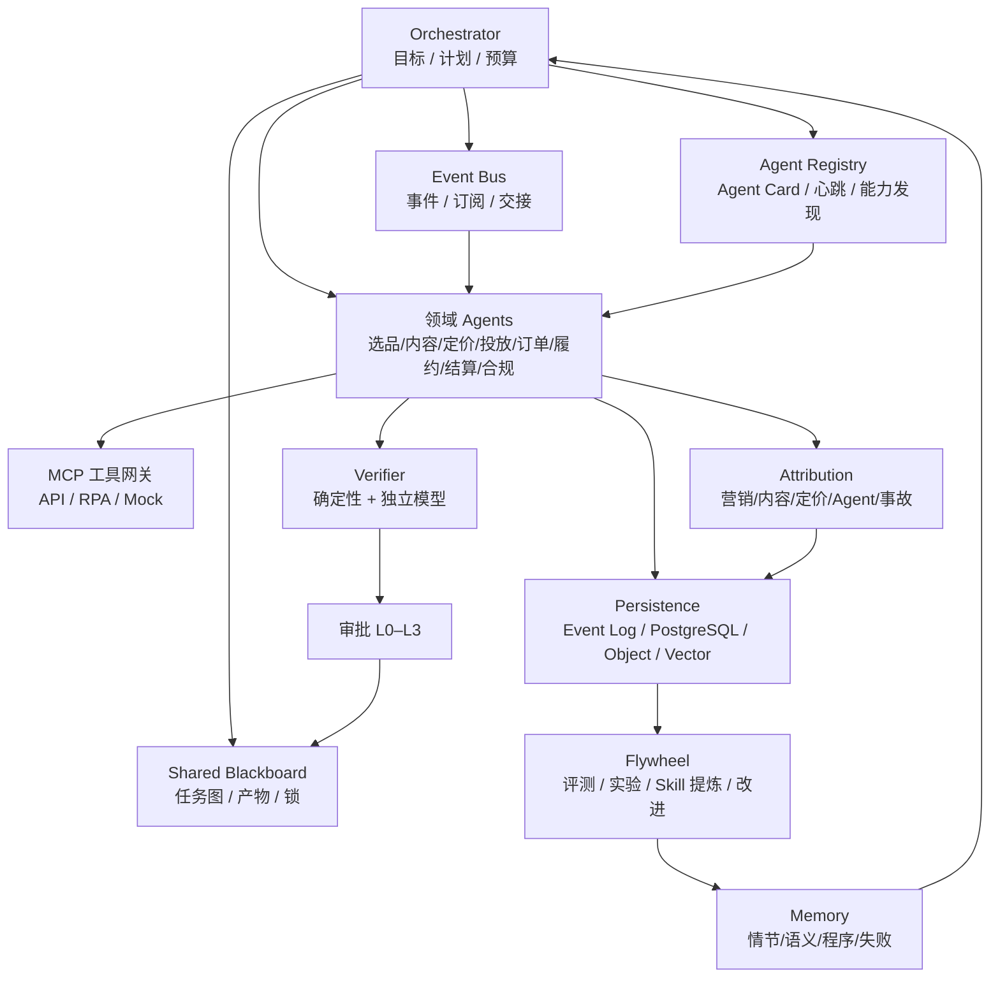
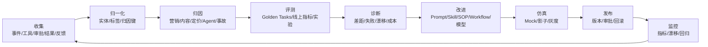

# Agent 归因、持久化、Skill/SOP 与数据飞轮设计

> 让 Agent 不只「会做」，还「知道为什么有效、记住做过什么、把经验变成 Skill/SOP、并持续变好」。

**版本** v1.0 ｜ **日期** 2026-11-11 ｜ **状态** 设计可用 ｜ **关联文档**：[Agent 统筹架构](2026-11-11-agent-orchestration-design.md) ｜ [模拟演示系统需求规格](2026-11-10-cross-border-simulation-design.md) ｜ [运营异常处理指南](../operations/2026-11-10-cross-border-ecommerce-operations-exception-guide.md) ｜ [系统设计](../design.md)

**配套文档**：[电商运营 Orchestrator Skill](../skills/ecommerce-operations-orchestrator/SKILL.md) ｜ [跨境运营 SOP](../sop/2026-11-11-cross-border-operations-sop.md)

---

## 0. 结论先行

1. **归因是数据飞轮的方向盘。** 没有归因，Agent 只能「做事」；有了归因，才知道哪个动作带来了 GMV、哪个素材拉高了退货、哪次调价毁了毛利、哪个 Agent 步骤在浪费成本。
2. **持久化分三层：JSON 是合同，数据库是运行时，Git 是评审。** Skill/SOP/Agent Card 用 Markdown+YAML/JSON 存 Git，便于评审和移植；运行态用 PostgreSQL JSONB + 关系表；图片/截图/报告放对象存储；语义检索放向量库。
3. **Skill 和 SOP 是经验的两种形态。** Skill 给 Agent 执行，SOP 给人执行；两者互相引用、独立版本、共同演进。Agent 可以从成功 trace 和人工 SOP 中「提炼」Skill 草稿，但必须经过仿真、评测、人工审批才能上线。
4. **数据飞轮不是「收集更多数据」，而是「收集 → 归因 → 评测 → 改进 → 验证 → 再收集」的闭环。** 每一轮都要有明确的假设、实验、护栏和回滚。
5. **Agent 之间靠「注册表 + 共享黑板 + 事件总线 + 交接协议」感知彼此，而不是靠自由聊天。** Agent Card 声明能力，Registry 负责发现，Blackboard 负责共享任务状态，Event Bus 负责通知，Handoff 负责上下文传递。
6. **持续优化要分级放权。** 从「只读 → 建议 → 审批执行 → 护栏内自动 → 自主优化」逐级提升；每一级都要有评测、审计、回滚和人工兜底。

## 1. 总体架构



**核心数据流：**

- 每个任务、步骤、工具调用、审批、补偿、报告都写入 Event Log 和运行表。
- 每个业务结果（订单、GMV、毛利、退款、拒付）写入 Outcome 表。
- Attribution 把 Action/Touchpoint 与 Outcome 关联，输出带置信度的归因结果。
- Flywheel 读取归因、评测、失败记忆，生成改进建议，经过实验/仿真后更新 Skill/SOP/Workflow。
- Agent 通过 Registry 发现彼此，通过 Blackboard 共享任务状态，通过 Event Bus 通知，通过 Handoff 传递上下文。

## 2. 归因能力

### 2.1 归因的五个层次

| 层次 | 问题 | 典型方法 | 输出 |
|---|---|---|---|
| 营销归因 | 哪个渠道/计划带来了订单？ | 末次点击、线性、时间衰减、Markov/Shapley、地理实验 | 渠道/计划贡献权重 |
| 内容归因 | 哪张图/哪条视频/哪个达人带来了转化？ | UTM/创意 ID/达人码、A/B、holdout | 素材/达人贡献 |
| 定价归因 | 调价是否带来增量？ | A/B、switchback、DID、合成控制、中断时间序列 | 价格弹性/增量 |
| Agent 归因 | 哪个 Agent/步骤/工作流贡献了结果？ | 任务血缘、影子运行、消融、反事实 | 步骤贡献/成本 |
| 事故归因 | 哪个原因导致失败/损失？ | 5 Whys、因果图、失败记忆 | 根因/CAPA |

> 归因是概率性的，不是「真相」。每条结果必须带方法、窗口、置信度、版本；不要把相关性包装成因果。

### 2.2 归因方法选择

| 方法 | 适用 | 优点 | 局限 |
|---|---|---|---|
| 末次点击 | 日常投放对账 | 简单、与平台口径接近 | 忽略上漏斗、易高估收割渠道 |
| 线性/位置/时间衰减 | 内容/达人组合 | 多触点、易解释 | 权重主观 |
| Markov/Shapley | 数据量足够 | 数据驱动、可比较 | 需要足够样本、解释成本高 |
| A/B / switchback | 定价、广告、内容 | 因果最强的运营方法 | 需要实验设计、可能影响体验 |
| 地理实验/holdout | 渠道/市场级 | 可测增量 | 成本高、周期长 |
| DID/合成控制/ITS | 不能随机分组 | 准实验、可回溯 | 依赖对照组质量 |
| 影子运行/消融 | Agent/工作流 | 可测步骤贡献 | 需要仿真环境、不能完全替代线上 |

### 2.3 归因数据模型

| 表 | 关键字段 | 说明 |
|---|---|---|
| `event_log` | `event_id`、`tenant_id`、`task_id`、`agent_id`、`event_type`、`payload`、`trace_id`、`occurred_at` | 追加写、不可变、可回放 |
| `touchpoint` | `touchpoint_id`、`channel`、`campaign_id`、`asset_id`、`creator_id`、`cost`、`occurred_at` | 营销/内容触点 |
| `agent_action` | `action_id`、`task_id`、`step_id`、`agent_id`、`tool`、`params`、`result`、`risk`、`approval_id` | Agent 动作 |
| `outcome` | `outcome_id`、`order_id`、`gmv`、`margin`、`refund`、`currency`、`occurred_at` | 业务结果 |
| `attribution_key` | `key_type`、`key_value`、`touchpoint_id`、`outcome_id` | UTM/创意 ID/达人码/任务 ID |
| `attribution_result` | `result_id`、`outcome_id`、`model`、`entity_id`、`weight`、`confidence`、`window`、`version` | 归因结果 |
| `experiment` | `experiment_id`、`hypothesis`、`unit`、`variants`、`metrics`、`guardrails`、`status`、`result` | 实验 |
| `counterfactual` | `scenario`、`predicted_outcome`、`method`、`confidence` | 反事实/增量 |

**归因结果 JSON 示例：**

```json
{
  "attribution_id": "attr_01J...",
  "outcome_id": "order_10086",
  "model": "markov_v1",
  "window": "30d",
  "computed_at": "2026-11-11T10:00:00Z",
  "version": 3,
  "results": [
    {"entity_type": "campaign", "entity_id": "cmp_tiktok_001", "weight": 0.42, "confidence": 0.78},
    {"entity_type": "asset", "entity_id": "asset_778", "weight": 0.31, "confidence": 0.72},
    {"entity_type": "agent_step", "entity_id": "step_pricing_03", "weight": 0.18, "confidence": 0.61},
    {"entity_type": "organic", "entity_id": "organic", "weight": 0.09, "confidence": 0.55}
  ],
  "caveats": ["平台归因窗口与内部口径不一致", "样本量低于推荐阈值"]
}
```

### 2.4 Agent 归因与事故归因

- **Agent 归因**：每个 `task_step` 记录输入、工具、参数、输出、耗时、成本；通过任务血缘把步骤与最终结果关联。用影子运行/消融估计「如果没有这个步骤会怎样」。
- **事故归因**：失败事件写入 `failure_memory`（错误签名 → 处理策略 → 成功次数），并与根因、CAPA、修复版本关联。复盘时用 5 Whys/因果图，避免「归因到某个人」。
- **成本归因**：`cost_ledger` 记录 token、工具、RPA、人工审批成本；按任务/Agent/客户/渠道分摊，支撑单位经济模型。

## 3. 持久化设计

### 3.1 三层持久化

| 层 | 存储 | 内容 | 特点 |
|---|---|---|---|
| 合同层 | Git + Markdown/YAML/JSON | Skill、SOP、Agent Card、Workflow DSL、Eval Case | 可评审、可 diff、可移植 |
| 运行时 | PostgreSQL + JSONB | task、step、approval、audit、attribution、experiment、registry | 事务、查询、并发、审计 |
| 证据层 | 对象存储 | 图片、视频、截图、报告、RPA 证据 | 大文件、内容寻址、版本 |
| 检索层 | 向量库 | 记忆、Skill/SOP 语义检索、RAG | 语义相似、带元数据过滤 |
| 缓存层 | Redis | 幂等键、会话、限流、短期状态 | 低延迟 |

**原则：JSON 是合同，数据库是运行时，Git 是评审。** Skill/SOP 的源文件在 Git；数据库存版本、引用、运行记录；对象存储存证据；向量库存索引。

### 3.2 事件溯源与当前状态

- **Event Log 追加写**：所有动作、审批、结果、归因、实验、Skill 变更都写事件；事件不可变、带 `schema_version`、可回放。
- **当前状态表**：`task_run`、`task_step`、`agent_registry` 等由事件投影生成；读多写少。
- **Outbox Pattern**：业务事务与事件发布解耦，保证「写库成功 → 事件一定发出」。
- **幂等**：所有写操作带 `idempotency_key`；事件消费幂等。
- **血缘**：每个产物/结果记录 `task_id`、`step_id`、`agent_id`、`skill_version`、`model_version`、`prompt_version`。
- **保留策略**：原始事件 90–365 天；聚合指标长期；PII 最小化/脱敏；支持导出和删除。

### 3.3 核心表

| 表 | 用途 |
|---|---|
| `task_run` | 任务主表：目标、状态、计划、预算、结果 |
| `task_step` | 步骤：Agent、工具、输入输出、耗时、成本、错误 |
| `agent_action` | 动作：写操作、审批、补偿、幂等键 |
| `approval` | 审批：动作、参数、影响、审批人、结果 |
| `audit_log` | 审计：谁、何时、依据、前后值 |
| `artifact` | 产物：图片/视频/报告/截图/PO，含存储 URI 和哈希 |
| `event_log` | 追加事件 |
| `touchpoint` / `outcome` / `attribution_result` | 归因 |
| `experiment` / `counterfactual` | 实验/反事实 |
| `skill_version` / `sop_version` | Skill/SOP 版本、内容、审批、状态 |
| `agent_registry` / `agent_heartbeat` | Agent 注册与心跳 |
| `memory_item` | 情节/语义/程序/失败记忆 |
| `cost_ledger` | 成本 |

### 3.4 JSON 文档示例

**Task Run：**

```json
{
  "task_id": "task_01J...",
  "tenant_id": "tenant_a",
  "store_id": "nestwell_us",
  "goal": "本周家居类目 10 万美元 GMV，广告预算 1 万美元",
  "status": "running",
  "plan_version": 3,
  "budget": {"amount": 10000, "currency": "USD", "spent": 4200},
  "risk": "L3",
  "created_at": "2026-11-11T08:00:00Z",
  "trace_id": "trace_01J..."
}
```

**Agent Card：**

```json
{
  "agent_id": "pricing_agent",
  "name": "Pricing Agent",
  "version": "1.2.0",
  "capabilities": ["price_monitor", "price_recommend", "price_execute"],
  "skills": ["competitor_price_adjust"],
  "tools": ["competitor_price_fetch", "product_match", "listing_update"],
  "input_schema": "schemas/pricing_input.json",
  "output_schema": "schemas/pricing_output.json",
  "risk": "L2-L3",
  "sla": {"latency_p95_ms": 8000, "availability": 0.99},
  "cost_model": {"per_run_usd": 0.02},
  "status": "active",
  "endpoint": "mcp://pricing-agent",
  "heartbeat_at": "2026-11-11T10:00:05Z"
}
```

**Skill Manifest：**

```json
{
  "skill_id": "competitor_price_adjust",
  "version": "1.3.0",
  "owner": "pricing_team",
  "status": "active",
  "triggers": ["schedule.every_6h", "manual"],
  "tools": ["competitor_price_fetch", "product_match", "listing_update"],
  "risk": "L2",
  "approval": "required_if_delta_gt_3pct",
  "eval_cases": ["eval_price_001", "eval_price_002"],
  "git_path": "skills/pricing/competitor_price_adjust/SKILL.md",
  "changelog": ["1.3.0: add price war guard", "1.2.0: add margin floor"]
}
```

## 4. Skill 文档体系

### 4.1 Skill 的定位

Skill 是**给 Agent 执行的结构化程序性知识**：什么时候用、输入输出是什么、调用哪些工具、按什么步骤、有什么护栏、失败怎么处理、如何评测。

Skill ≠ Prompt。Prompt 是一次对话的指令；Skill 是可版本化、可评测、可复用的能力包。

### 4.2 Skill 文档格式

```markdown
---
name: skill_name
version: 1.0.0
owner: team
description: 一句话说明
triggers: [event, schedule, manual]
inputs: [...]
outputs: [...]
tools: [...]
risk: L0-L3
approvals: [...]
metrics: [...]
eval_cases: [...]
changelog: [...]
---
# Purpose
# When to use / not use
# Preconditions
# Workflow (steps, tools, params, conditions)
# Guardrails
# Failure handling / compensation
# Attribution hooks
# Persistence hooks
# Examples
# Evaluation
# Changelog
```

### 4.3 Skill 生命周期

```text
draft → simulated → reviewed → active → deprecated
```

| 状态 | 条件 |
|---|---|
| draft | Agent/人起草，Schema 通过 |
| simulated | Mock/影子模式跑通 happy path + 失败路径 |
| reviewed | 人工评审风险、合规、成本、指标 |
| active | 发布，版本化，可灰度 |
| deprecated | 被新版本替代，保留回滚 |

### 4.4 Agent 从经验中提炼 Skill

```text
成功 trace / 人工 SOP / 失败记忆
  → 聚类相似任务
  → 抽取共同步骤、工具、参数、护栏
  → 生成 Skill 草稿 + Eval Cases
  → Mock 仿真 / 离线评测
  → 人工评审
  → 发布 / 灰度
  → 监控 → 迭代
```

**护栏：**

- 不引入未授权工具；不提升风险等级；不扩大租户范围。
- 不把单次成功当成通用规律；至少 N 次成功 + 评测通过。
- 不把包含 PII/密钥/客户数据的 trace 写进 Skill。
- 生成 Skill 必须附 Eval Cases 和失败路径。
- 人工审批后才能 active；发布后可回滚。

## 5. SOP 文档体系

### 5.1 SOP 的定位

SOP 是**给人的操作手册**：谁在什么时间、按什么步骤、用什么模板、遇到异常怎么升级。SOP 与 Skill 一一映射：

| SOP | Skill | Workflow |
|---|---|---|
| 每日运营检查 | `daily_ops_check` | `daily_ops_workflow` |
| 竞品调价 | `competitor_price_adjust` | `price_adjust_workflow` |
| 超时订单处理 | `order_exception_handle` | `order_exception_workflow` |
| 结算对账 | `settlement_reconcile` | `reconcile_workflow` |
| 新品上架 | `new_sku_launch` | `new_sku_workflow` |

### 5.2 SOP 结构

```markdown
# SOP 名称
## 目的与范围
## 角色与 RACI
## 触发条件
## 输入与前置检查
## 步骤
## 决策点与阈值
## 异常与升级
## SLA 与指标
## 模板与话术
## 关联 Skill / Workflow
## 版本与变更记录
```

### 5.3 SOP 的生成与维护

- **初始**：人工编写，来自运营指南、平台规则、历史复盘。
- **提炼**：Agent 从成功 trace/复盘报告中生成「建议 SOP 变更」，人工评审。
- **版本**：每次变更记录原因、审批人、生效时间、回滚点。
- **评审节奏**：SOP 每月/每季度评审；发生 P0/P1 事件后强制评审。
- **一致性**：SOP、Skill、Workflow 三者的步骤/阈值/风险等级必须对齐；用契约测试检查。

## 6. 数据飞轮

### 6.1 飞轮闭环



### 6.2 飞轮阶段

| 阶段 | 数据 | 能力 | 人 |
|---|---|---|---|
| 冷启动 | SOP + 规则 + Mock | 只读/建议 | 人工执行 |
| 辅助 | 事件 + 归因 v1 | 草稿/建议 | 审批执行 |
| 增强 | 实验 + 失败记忆 | 审批内自动 | 异常处理 |
| 自主 | 全链路数据 + 评测 | 护栏内自动优化 | 目标/边界/审计 |

### 6.3 飞轮指标

- 数据覆盖：有归因的订单/GMV 占比。
- 归因质量：置信度、与实验一致性、平台对账差异。
- 评测覆盖：Golden Tasks 数量、失败路径覆盖。
- 改进速度：从发现到上线的天数。
- 实验胜率：显著正向实验占比。
- 回归率：发布后指标回退比例。
- 自动化率：无需人工的任务占比。
- 单位成本：每任务/每订单的模型+工具成本。

### 6.4 治理

- **数据质量**：实体对齐、去重、口径统一、缺失标注。
- **隐私**：最小化、脱敏、租户隔离、保留期限。
- **偏差/Goodhart**：不要只优化单一指标；设置护栏指标（退货率、毛利、投诉率）。
- **反馈回路**：模型建议影响数据，数据再训练模型；用 holdout/随机对照防止自证。
- **人工门禁**：资金、合规、品牌、账号动作永远人工。

## 7. 分工 Agent 如何感知彼此

### 7.1 四个组件

| 组件 | 作用 | 实现 |
|---|---|---|
| Agent Registry | 能力发现、版本、状态 | `agent_registry` 表 + 心跳 + 能力搜索 |
| Shared Blackboard | 共享任务图、产物、锁、状态 | `tasks`/`artifacts`/`claims` 表 + API |
| Event Bus | 事件通知、订阅、解耦 | `event_log` + outbox + pub/sub |
| Handoff Protocol | 结构化交接上下文 | 请求/接受/拒绝/结果/确认 |

### 7.2 Agent Card

Agent Card 是 Agent 的「身份证 + 能力清单」：

```json
{
  "agent_id": "content_agent",
  "version": "1.1.0",
  "capabilities": ["content_brief", "image_generate", "listing_copy"],
  "skills": ["new_sku_content"],
  "tools": ["image_generate", "brand_guide_search", "listing_create"],
  "input_schema": "schemas/content_input.json",
  "output_schema": "schemas/content_output.json",
  "risk": "L1-L2",
  "sla": {"latency_p95_ms": 15000, "availability": 0.99},
  "cost_model": {"per_run_usd": 0.05},
  "status": "active",
  "heartbeat_at": "2026-11-11T10:00:05Z"
}
```

**规则：**

- 启动时注册；每 10–30 秒心跳；下线 deregister。
- 能力/工具/风险变更必须升版本。
- Orchestrator 按「能力匹配 + 可用性 + 成本 + 风险」选 Agent。
- 不兼容版本不能交接。

### 7.3 共享黑板

- 任务图：节点、依赖、状态、owner、deadline。
- 产物：图片、报告、计划、审批记录，带 URI 和哈希。
- 锁/认领：防止两个 Agent 同时改同一订单/Listing。
- 事件：`task.created`、`step.completed`、`handoff.requested`、`agent.heartbeat`。
- 读权限按租户/任务/角色；写权限最小化。

### 7.4 交接协议

```json
{
  "handoff_id": "ho_01J...",
  "from_agent": "pricing_agent",
  "to_agent": "compliance_agent",
  "task_id": "task_01J...",
  "reason": "price_change_compliance_check",
  "context": {
    "sku": "SKU-10023",
    "current_price": 29.99,
    "proposed_price": 27.99,
    "margin": 0.18,
    "evidence": ["price_snapshot_778", "policy_ref_12"]
  },
  "constraints": {"deadline": "2026-11-11T12:00:00Z", "risk": "L2"},
  "status": "requested"
}
```

流程：`requested → accepted/rejected → completed → acked`。拒绝要带原因；超时由 Orchestrator 重新路由或转人工。

### 7.5 共享记忆

| 类型 | 内容 | 例子 |
|---|---|---|
| 情节记忆 | 任务历史、计划、工具序列、结果 | 上次同类调价的结果 |
| 语义记忆 | 政策、品牌、SOP、知识 | 平台价格规则 |
| 程序记忆 | Skill、Workflow、成功模式 | 新品上架步骤 |
| 失败记忆 | 错误签名 → 策略 → 成功次数 | 报关失败的处理 |

命名空间：`tenant/store/task/agent`；读写权限分离；冲突用版本号/时间戳解决；记忆不作为业务事实源。

### 7.6 协调模式

| 模式 | 适用 | 做法 |
|---|---|---|
| Orchestrator 中介（默认） | 大多数任务 | 中心规划、分派、汇总 |
| Blackboard | 共享状态、多人协作 | 任务贴板、Agent 认领 |
| Contract Net | 可竞标任务 | 广播需求、Agent 报价、择优 |
| Pub/Sub | 事件驱动 | 订阅订单/库存/审批事件 |

**不要**让 Agent 自由聊天决定一切：不可审计、不可复现、成本高。结构化消息 + 中心编排是默认。

## 8. 持续优化迭代

### 8.1 优化闭环

```text
指标异常/机会
  → 归因诊断
  → 假设
  → 实验设计
  → 仿真/灰度/A/B
  → 评测（业务指标 + 护栏）
  → 推广/回滚
  → 更新 Skill/SOP/Workflow/Prompt/模型
  → 监控漂移
```

### 8.2 实验类型

| 类型 | 用途 | 注意 |
|---|---|---|
| A/B | 内容/价格/广告 | 样本量、分流、护栏 |
| Switchback | 时段/市场 | 避免跨期污染 |
| 地理实验 | 渠道/市场 | 成本高、周期长 |
| Holdout | 长期增量 | 保留对照组 |
| 影子运行 | Agent/工作流 | 不对外，只比较 |
| 灰度/Canary | 新版本上线 | 小流量、回滚 |

### 8.3 漂移检测

- 数据漂移：价格分布、订单结构、退货率。
- 模型漂移：计划准确率、工具选择、金额计算。
- 政策漂移：平台规则、税率、物流限制。
- 竞争漂移：竞品价格、素材、活动。
- 概念漂移：用户偏好、季节性。

触发后：暂停自动执行 → 诊断 → 重新评测 → 更新 Skill/SOP → 灰度。

### 8.4 自主等级

| 等级 | 行为 | 前提 |
|---|---|---|
| L0 手动 | Agent 只记录 | — |
| L1 建议 | 生成建议，人执行 | 有评测 |
| L2 审批执行 | 人审批后执行 | 审批/审计/回滚 |
| L3 护栏内自动 | 阈值内自动，异常转人工 | 高置信 + 护栏 + 监控 |
| L4 自主优化 | 自动提出并验证改进 | 实验平台 + 人工监督 |

升级条件：连续 N 次成功、评测达标、无重大事故、人工评审通过。降级条件：回归、漂移、事故、审计发现。

### 8.5 成本优化

- 模型路由：强模型做规划，小模型做分类/抽取，独立模型做验证。
- 缓存：精确缓存、语义缓存、工具结果短 TTL。
- 批处理：图片/文案/归因批量跑。
- 早停：低置信/高风险直接转人工，不反复试。
- 成本看板：按任务/Agent/客户/渠道分摊。

## 9. 与 OpsConductor 的映射

| 新模块 | 职责 | 现有基础 |
|---|---|---|
| `attribution/` | 触点、结果、归因模型、实验 | trace、audit、订单/结算 |
| `persistence/` | event log、outbox、artifact、schema | PostgreSQL、trace_span |
| `skills/` | Skill 注册、版本、评测、提炼 | SKILL 设计（JD 对齐） |
| `sop/` | SOP 注册、版本、评审 | 运营指南 |
| `registry/` | Agent Card、心跳、发现 | MCP 工具注册表 |
| `events/` | 事件总线、订阅、交接 | task_step、audit |
| `experiments/` | 实验、分流、分析 | Golden Tasks |
| `learning/` | 诊断、Skill 提炼、漂移、改进 | 失败记忆、评测 |
| `observability/` | trace、指标、成本 | 现有 trace |

**新增表：** `agent_registry`、`agent_heartbeat`、`touchpoint`、`outcome`、`attribution_result`、`experiment`、`counterfactual`、`skill_version`、`sop_version`、`memory_item`、`cost_ledger`、`artifact`、`event_log`。

**API 草案：**

- `POST /api/v1/attribution/run`、`GET /api/v1/attribution/{outcome_id}`
- `POST /api/v1/experiments`、`GET /api/v1/experiments/{id}`
- `POST /api/v1/skills/draft`、`POST /api/v1/skills/{id}/publish`
- `POST /api/v1/sops/{id}/versions`
- `GET /api/v1/registry/agents`、`POST /api/v1/registry/agents/{id}/heartbeat`
- `GET /api/v1/blackboard/tasks/{id}`、`POST /api/v1/handoffs`
- `GET /api/v1/flywheel/metrics`

## 10. 实施路线

| 阶段 | 周期 | 交付 | 验收 |
|---|---|---|---|
| P1 持久化与注册表 | 2 周 | event log、task/step/action、agent registry、heartbeat | 所有动作可回放；Agent 可发现 |
| P2 归因 v1 | 2–3 周 | UTM/创意/任务血缘；末次点击 + 线性 | 归因覆盖 80% 订单；可对账 |
| P3 Skill/SOP 注册 | 2 周 | Skill/SOP 版本、评审、Git 同步 | 3 条 Skill/SOP 上线 |
| P4 数据飞轮 v1 | 3–4 周 | 评测、失败记忆、实验、改进建议 | 每月至少 2 个改进上线 |
| P5 持续优化 | 3–4 周 | 漂移检测、自主等级、成本优化 | 回归可控；L3 自动占比提升 |

**验收指标：**

- 归因：覆盖 ≥80% GMV；与平台对账差异可解释；置信度可查。
- 持久化：任务/步骤/审批/归因 100% 可回放；无丢失。
- Skill/SOP：3 条上线；每条有 Eval；版本可回滚。
- 飞轮：每月 ≥2 个改进上线；回归率 ≤5%。
- Agent 感知：注册/心跳/交接可用；交接超时自动重路由。
- 治理：越权 0、重复写 0、审计覆盖 100%。

## 11. 风险与开放问题

| 风险 | 对策 |
|---|---|
| 归因误判 | 方法/窗口/置信度透明；关键决策用实验；与平台对账 |
| 数据质量差 | 实体对齐、去重、缺失标注、抽检 |
| 反馈回路/Goodhart | 护栏指标、holdout、人工评审 |
| Skill 过拟合 | 多次成功 + 评测 + 灰度；失败路径覆盖 |
| Agent 交接丢上下文 | 结构化 Handoff + 幂等 + 超时重路由 |
| 注册表单点 | 高可用/本地缓存；心跳失联降级 |
| 数据隐私 | 最小化、脱敏、租户隔离、保留期限 |
| 成本失控 | 路由、缓存、批处理、预算护栏 |
| 过度自动化 | 自主等级 + 人工门禁 + 回滚 |

**开放问题：**

1. 归因窗口与平台口径如何统一？以平台为准还是内部模型为准？
2. 数据飞轮的标注由谁做？人工、模型还是混合？
3. Skill 提炼的最小样本量是多少？按任务类型区分吗？
4. Agent Registry 用中心化还是去中心化？是否需要 A2A 协议？
5. 数据保留期限和 PII 脱敏策略？
6. L3 自动执行的边界由谁定？如何审计？

---

**一句话：归因告诉你「什么有效」，持久化让你「记得住」，Skill/SOP 让经验「可复用」，Agent 感知让协作「可编排」，数据飞轮让系统「越跑越聪明」。**
