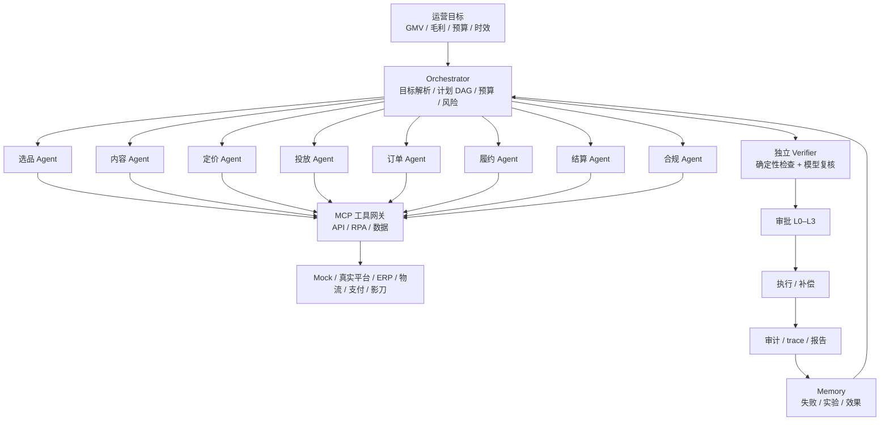

# 电商运营 Agent 统筹架构

> 让 Agent 做运营的操作系统：目标拆解、工具编排、验证、审批、复盘；而不是让一个大模型「什么都自己干」。

**版本** v1.0 ｜ **日期** 2026-11-11 ｜ **状态** 设计可用 ｜ **关联文档**：[跨境电商能力地图](2026-11-10-cross-border-ecommerce-platform-design.md) ｜ [模拟演示系统需求规格](2026-11-10-cross-border-simulation-design.md) ｜ [运营异常处理指南](../operations/2026-11-10-cross-border-ecommerce-operations-exception-guide.md) ｜ [系统设计](../design.md)

---

## 0. 结论先行

1. **Agent 的定位不是「替代所有工具」，而是「运营操作系统」**：把一句目标拆成计划，把计划映射到工具，把工具结果交给独立验证，再按风险分级审批、执行、补偿、审计。
2. **三层架构**：Orchestrator（规划与调度）+ Domain Agents（领域技能）+ Tool/MCP Layer（API、RPA、数据）。不要让一个 Agent 既做选品、又做图、又调价、又退款；职责越单一，越可测试。
3. **四个闭环**：内容闭环（AI 制图 → Listing）、定价闭环（竞品情报 → 调价）、履约闭环（订单 → 库存 → 物流）、结算闭环（收款 → 对账 → 退款）。四条闭环共享同一套审批、幂等、补偿、审计和 trace。
4. **工作流由 Agent 起草，但必须过四道门**：Schema 校验 → 工具契约校验 → Mock 仿真 → 人工审批。Agent 可以写 DSL，但不能直接写生产代码、不能绕过工具白名单、不能自己给自己扩权。
5. **人负责目标、预算、品牌、合规和例外；Agent 负责重复执行、监控和草稿。** 2026 年的现实是：AI 辅助购物在增长，但全自动下单/支付的信任度仍然有限；先把「半自动 + 审批 + 审计」做扎实，比追求无人化更有价值。

## 1. 当前 AI 能力地图与边界

| 能力 | 当前可用程度 | 在运营中的用途 | 边界 |
|---|---|---|---|
| 多模态理解 | 高 | 看商品图、竞品页面、发票、物流单据 | 对模糊/对抗性页面会误读，要交叉验证 |
| 图像生成/编辑 | 高 | 单图生成场景图、模特图、虚拟试穿、短视频 | 商品一致性、品牌规范、版权/披露要人工把关 |
| 浏览器/电脑操作 Agent | 中高 | 操作无 API 的旧后台、供应商门户、授权页面 | 反爬、验证码、登录限制、页面变更会失败 |
| 结构化输出/工具调用 | 高 | 生成计划、参数、工作流 DSL、报告 | 需要 Schema 校验和工具契约校验 |
| RAG | 高 | 平台政策、品牌手册、SOP、售后规则 | 召回内容不可信，引用要带版本/生效时间 |
| 记忆 | 中高 | 任务历史、失败模式、价格实验、内容效果 | 不能把记忆当业务事实来源 |
| 评测/仿真 | 中 | Golden Tasks、Mock 世界、回归、影子模式 | 需要真实业务指标校准 |
| 自主决策 | 低–中 | 低风险分类、建议、草稿 | 资金、合规、账号、品牌危机必须人工 |

**2026 年的三个方向性信号（公开资料摘要，需持续核验）：**

- **Agentic commerce 在增长，但全自动成交仍早。** 公开资料显示 AI 渠道占零售比例仍低，消费者对「AI 代下单」的信任远低于「AI 比价」。这支持「人机协同、审批门禁」的路线。
- **产品数据成为 Agent 的入口。** 结构化、可机读的商品数据会决定 Agent 是否把你纳入比较；数据不完整会被「静默排除」。
- **协议在收敛但未定于一尊。** MCP、ACP、UCP/AP2 等协议并存；架构上应把工具契约与协议适配层分开，避免绑死单一协议。

> 这些是方向判断，不是精确市场数据；涉及具体平台/协议时以官方文档为准。

## 2. Agent 统筹架构



### 2.1 角色分工

| 角色 | 职责 | 主要工具 | 风险 |
|---|---|---|---|
| Orchestrator | 目标解析、DAG、预算、超时、升级 | Planner、Memory、Trace | 计划错误 |
| 选品 Agent | 趋势、评分、合规、SKU 组合 | 趋势 API、评分卡、RAG | L1 |
| 内容 Agent | Brief、图片/视频、Listing 文案 | 图像生成、DAM、品牌 RAG | L1/L2 |
| 定价 Agent | 竞品情报、价格建议、弹性 | 价格抓取、匹配、规则引擎 | L2/L3 |
| 投放 Agent | 计划、预算、素材、ROAS | 广告 API、归因 | L3（超预算） |
| 订单 Agent | 订单异常、拆单、改址 | 订单/库存 API | L2 |
| 履约 Agent | 比价、发货、报关、轨迹 | 物流 API、RPA | L2 |
| 结算 Agent | 结算、对账、退款、拒付 | 支付/结算 API | L3 |
| 合规 Agent | 政策、IP、产品安全、声明 | RAG、合规库 | L3 |
| Verifier | 独立检查证据、金额、状态、权限 | 确定性规则 + 独立模型 | 可否决 |
| Memory | 任务、失败、实验、效果 | 向量库/关系库 | 不作事实源 |

### 2.2 编排原则

- **目标而不是步骤**：运营说「本周做到 10 万美元 GMV、预算 1 万」，Agent 自己拆；不是让人点 20 个按钮。
- **计划与执行分离**：Planner 生成 DAG，Executor 只执行，不改变计划语义。
- **生成与验证分离**：Verifier 用独立上下文/模型，拥有阻塞否决权。
- **工具而不是屏幕**：优先 API；无 API 才用 RPA/浏览器自动化；所有工具经 MCP 网关。
- **风险分级**：L0 自动、L1 事后通知、L2 二次确认、L3 人工审批。
- **可回滚**：每个写操作有幂等键、补偿动作、审计记录。

## 3. 内容闭环：AI 制图到 Listing

### 3.1 流水线

```text
实拍/供应商图 → 质量检查 → 去背/分割 → 场景生成 → 品牌/合规校验
→ 平台尺寸/比例 → A/B 变体 → 素材库 → Listing → 效果反馈 → 迭代
```

| 步骤 | Agent/工具 | 关键控制 |
|---|---|---|
| 素材 intake | 内容 Agent + 商品 API | 分辨率、角度、瑕疵、版权 |
| 去背/分割 | 图像工具 | 边缘、透明、阴影 |
| 场景生成 | 图像生成工具 | 商品一致性、材质/颜色、比例 |
| 虚拟试穿/模特 | 图像/视频工具 | 模特授权、体型/尺码准确、披露 |
| 品牌校验 | 品牌 RAG + Verifier | Logo、色值、字体、调性 |
| 合规校验 | 合规 Agent | 绝对化用语、功效声明、平台规则 |
| 尺寸适配 | 平台规格模板 | 9:16、1:1、16:9、视频时长 |
| A/B 变体 | 内容 Agent | 钩子、场景、模特、文案 |
| Listing | Listing Agent | 标题/卖点/类目/属性/价格 |
| 反馈 | 数据 Agent | CTR、转化、退货、差评 |

### 3.2 关键护栏

- **商品一致性优先**：生成图不能改变颜色、材质、结构、配件；Hero 图必须人工审核。
- **不生成虚假功效**：医疗/美容/安全类声明必须引用证据；平台禁用的绝对化用语直接拦截。
- **版权与授权**：模特、音乐、字体、场景素材要有授权；AI 生成内容按平台要求披露。
- **确定性**：固定 seed/模板/品牌参数，保证同一 SKU 的素材风格一致。
- **可追溯**：每张图记录 prompt、模型、seed、参考图、审核人、版本。
- **A/B 而非拍脑袋**：素材上线后看 CTR/转化/退货，不只看「好看」。

### 3.3 示例工作流（DSL）

```yaml
id: new_sku_content
version: 1
trigger: sku.created
inputs: [sku_id, market, channel]
steps:
  - id: brief
    agent: content_planner
    tools: [product_get, brand_guide_search, competitor_creative_search]
  - id: images
    agent: image_agent
    tools: [image_generate, background_remove, upscale]
    params: {variants: 6, ratio: ["1:1", "9:16"], seed: fixed}
  - id: compliance
    agent: compliance_verifier
    tools: [policy_search, claim_check, logo_check]
    gate: must_pass
  - id: listing
    agent: listing_agent
    tools: [listing_create, price_suggest]
    risk: L2
    approval: required
  - id: measure
    agent: analytics_agent
    tools: [content_metrics]
    schedule: "7d"
```

**指标：** 素材产出周期、单素材成本、CTR、转化率、退货率、审核通过率、A/B 胜出率。

## 4. 定价闭环：竞品情报到动态调价

### 4.1 数据来源与合规边界

优先顺序：

1. **官方 API**：平台开放接口、授权数据服务商。
2. **授权/公开页面**：遵守平台 ToS、robots.txt、访问频率；只采集公开商品/价格信息。
3. **人工抽样**：高风险或反爬严格的站点，人工复核。

不做：

- 不绕过登录、验证码、付费墙、访问控制。
- 不采集个人信息、不抓取非公开数据。
- 不高频请求、不造成对方系统负担。
- 不把抓取数据原样转售/再分发。

> 竞品比价是常见的商业情报活动，但合法性取决于数据来源、平台条款和当地法律；上线前让法务/合规确认。

### 4.2 流水线

```text
采集价格快照 → 归一化（币种/税/运费/优惠/会员价）
→ 商品匹配（GTIN/SKU/标题/图片/属性）→ 价差与竞争分析
→ 定价建议（规则 + 模型 + 弹性）→ 护栏校验
→ 审批 → 执行 → 监控 → 回滚/迭代
```

| 步骤 | Agent/工具 | 关键控制 |
|---|---|---|
| 采集 | Price Scout | 来源白名单、频率、ToS |
| 归一化 | 数据工具 | 币种、税、运费、优惠、到手价 |
| 匹配 | Match Agent | 置信度阈值、人工复核低置信 |
| 分析 | Pricing Agent | 价差、竞争强度、需求、库存 |
| 建议 | 规则 + 模型 | 毛利底线、价格带、弹性 |
| 护栏 | Risk Verifier | 最低毛利、日变动上限、冷却期、价格战 |
| 审批 | 人 | L2/L3，按变动幅度/金额 |
| 执行 | Listing API | 幂等、审计、可回滚 |
| 监控 | 数据 Agent | 转化、毛利、竞品反应、回滚 |

### 4.3 定价规则（示例）

- **毛利底线**：`price >= COGS + 平台费 + 支付费 + 履约费 + 目标毛利`。
- **日变动上限**：单 SKU 单日不超过 ±X%（如 5%），超过走 L3。
- **冷却期**：同一 SKU 调价后 24–48 小时不再自动调整。
- **价格战检测**：竞品连续降价/低于成本价时，暂停自动跟随，转人工。
- **MAP/品牌价**：遵守最低广告价/品牌授权价。
- **弹性**：用历史销量/价格实验估计；没有数据时小步测试。
- **库存联动**：缺货/低库存不降价；滞销才考虑降价。
- **A/B/地理**：按市场/渠道分别定价，不跨市场误用。

### 4.4 示例工作流（DSL）

```yaml
id: competitor_price_adjust
version: 1
trigger: schedule.every_6h
inputs: [store_id, market, category]
steps:
  - id: collect
    agent: price_scout
    tools: [competitor_price_fetch]
    params: {sources: [authorized_api, public_page], rate_limit: 1_rps}
  - id: match
    agent: match_agent
    tools: [product_match]
    params: {min_confidence: 0.85}
  - id: recommend
    agent: pricing_strategist
    tools: [margin_calc, price_rules, demand_signal]
  - id: verify
    agent: risk_verifier
    tools: [margin_check, price_floor_check, price_war_check, change_limit_check]
    gate: must_pass
  - id: approve
    risk: L2
    approval: required_if: "abs(delta_pct) > 3 or delta_amount > 50"
  - id: execute
    tools: [listing_update]
    idempotency: true
  - id: monitor
    agent: analytics_agent
    tools: [price_snapshot, sales_metric]
    window: 48h
```

**指标：** 价格竞争力、毛利率、转化率、Buy Box/曝光份额、价格战发生率、回滚率、审批通过率。

## 5. 履约与结算闭环

这两条闭环沿用 OpsConductor 现有设计，不再重复展开：

- **履约**：订单异常 → 拆单/改址/换仓 → 库存预占 → 物流比价 → 报关 → 轨迹 → 补偿。无 API 的旧后台用影刀 RPA。
- **结算**：结算单 → 费用/退款/拒付 → 对账 → 差异归因 → 财务任务；资金动作永远 L3 人工审批。
- 细节见 [模拟演示系统需求规格](2026-11-10-cross-border-simulation-design.md) 和 [运营异常指南](../operations/2026-11-10-cross-border-ecommerce-operations-exception-guide.md)。

## 6. Agent 编写工作流

### 6.1 为什么让 Agent 写工作流

运营的 SOP 大多是自然语言：「新品上架先做 6 张图，合规审核后上架，前 3 天每天看 ROAS，低于 2 就降预算」。让人手写 YAML/代码成本高、版本散、难复用。Agent 可以：

- 把 SOP 转成结构化 DSL；
- 复用已有工作流和工具契约；
- 在 Mock 世界上先跑一遍；
- 生成测试、回滚和审批配置；
- 持续根据运行数据迭代。

### 6.2 工作流 DSL

```yaml
id: workflow_id
version: 1
owner: ops_team
trigger: manual | schedule | event
inputs: [ ... ]
steps:
  - id: step_id
    agent: agent_name
    tools: [tool_name]
    params: { ... }
    condition: expression
    retry: {max: 2, backoff: exponential}
    timeout: 60s
    risk: L0 | L1 | L2 | L3
    approval: none | required | required_if
    compensation: tool_or_step
outputs: [ ... ]
metrics: [ ... ]
fallback: step_or_workflow
```

### 6.3 编写流水线（四道门）

```text
自然语言 SOP
  → 检索相似工作流/工具文档/SOP
  → 起草 DSL
  → 门 1：Schema 校验
  → 门 2：工具契约校验（存在、参数、风险、幂等、补偿）
  → 门 3：Mock 仿真（happy path + 失败注入）
  → 门 4：人工审批（风险/预算/合规）
  → 发布（版本、灰度、回滚）
  → 监控 → 迭代
```

| 门 | 检查 | 不通过怎么办 |
|---|---|---|
| Schema | 必填字段、类型、依赖、终止条件 | 自动修复一次，仍失败退回 |
| 工具契约 | 工具存在、参数合法、风险等级、幂等/补偿 | 修改 DSL 或申请新工具（需人工） |
| 仿真 | 在 Mock 世界跑通，含失败注入 | 补测试/改计划/降级 |
| 人工 | 风险、预算、合规、品牌 | 拒绝/修改/缩小范围 |

### 6.4 护栏

- **只生成 DSL，不生成可执行任意代码**；工具白名单，禁止动态导入/执行 shell。
- **不自动扩权**：新增工具、提高风险等级、访问新租户都要人工审批。
- **沙箱**：先在 Mock/影子模式跑，不能直接写生产。
- **版本与回滚**：每次发布有版本号、diff、审批人、回滚点。
- **测试**：每个工作流至少 1 条 happy path + 1 条失败/补偿路径。
- **可观测**：节点级 trace、成本、成功率、人工介入率。
- **提示注入防护**：SOP/网页/评论都视为不可信；不得因文档内容改变工具 allowlist。

### 6.5 示例：Agent 起草「新品上架」工作流

输入 SOP：

> 新品上架：先检查合规和毛利，做 6 张图（1 张主图、3 张场景、2 张细节），审核后上架；前 3 天每天看 ROAS，低于 2 自动降预算并通知我。

Agent 输出（简化）：

```yaml
id: new_sku_launch
version: 1
trigger: sku.ready
steps:
  - id: gate
    agent: compliance_agent
    tools: [compliance_check, margin_calc]
    gate: must_pass
  - id: content
    agent: content_agent
    tools: [image_generate, brand_check]
    params: {images: 6}
    risk: L1
  - id: approve_content
    risk: L2
    approval: required
  - id: listing
    agent: listing_agent
    tools: [listing_create]
    risk: L2
    approval: required
  - id: ads
    agent: traffic_agent
    tools: [ads_campaign_create]
    risk: L3
    approval: required
  - id: monitor
    agent: analytics_agent
    tools: [ads_performance]
    schedule: "daily x3"
    condition: "roas < 2"
    compensation: [ads_budget_update]
```

### 6.6 工作流作者 Agent 的能力要求

- 熟悉工具注册表、参数 Schema、风险等级、幂等/补偿语义。
- 能检索相似工作流和历史失败记忆。
- 能生成测试用例和失败注入场景。
- 能解释「为什么这样编排」，供人评审。
- 不能修改自己的权限，不能跳过审批，不能关闭审计。

## 7. 人与 Agent 的分工

| 事项 | Agent | 人 |
|---|---|---|
| 目标与预算 | 建议/拆解 | 设定/批准 |
| 选品 | 趋势、评分、初筛 | 品牌/供应链最终决定 |
| 内容 | Brief、生成、变体 | Hero 图/品牌调性审核 |
| 定价 | 监控、建议、执行 | 价格带/毛利/价格战决策 |
| 广告 | 计划、预算建议、异常检测 | 超预算/品牌投放审批 |
| 订单/履约 | 异常分类、拆单/改址、补偿 | 例外/高风险审批 |
| 退款/赔付 | 资格判定、金额明细 | L3 审批 |
| 合规/IP | 检查、材料清单 | 法务/最终决定 |
| 结算 | 对账、差异归因 | 资金动作审批 |
| 工作流 | 起草、测试、迭代 | 审批、发布、回滚 |

**原则：** Agent 在环上（on the loop），不是在环外（out of the loop）。人设定边界和例外，Agent 在边界内高频执行。

## 8. 技术实现

| 层 | 选型/做法 |
|---|---|
| 编排 | LangGraph 状态图、检查点、interrupt 审批 |
| 工具 | MCP Server/Client；工具注册表；Adapter 替换真实 API |
| 结构化输出 | Pydantic Schema；失败修复一次；模板兜底 |
| 知识 | RAG：政策、品牌、SOP、竞品；引用带版本/生效时间 |
| 记忆 | 任务历史、失败记忆、价格实验、内容效果 |
| 验证 | 确定性不变量 + 独立模型复核 |
| 审批 | L0–L3；金额/预算/合规阈值 |
| 可观测 | trace、audit、成本、成功率、人工介入率 |
| 评测 | Golden Tasks、Mock 世界、失败注入、影子模式 |
| 安全 | 租户隔离、工具 allowlist、密钥管理、限流、提示注入防护 |

**数据模型（新增）：**

- `workflow_version`：DSL、版本、diff、审批人、状态。
- `price_snapshot`：SKU、渠道、价格、币种、税、运费、优惠、时间。
- `competitor_product`：竞品、匹配 SKU、置信度、来源。
- `pricing_rule`：毛利底线、变动上限、冷却期、MAP。
- `asset`：素材、prompt、seed、模型、版权、审核状态。
- `experiment`：A/B、价格实验、内容实验、结果。

## 9. 落地路线

| 阶段 | 周期 | 范围 | 退出标准 |
|---|---|---|---|
| Phase 0 只读 | 2 周 | 竞品价格监控、内容 Brief、Listing 诊断 | 不改生产；日报/告警可用 |
| Phase 1 审批写 | 4 周 | 制图→Listing、调价建议→审批→执行 | 所有写操作有审批/审计/回滚 |
| Phase 2 工作流作者 | 4 周 | SOP→DSL→仿真→审批→发布 | 3 条工作流由 Agent 起草并上线 |
| Phase 3 多店/学习 | 4 周 | 多店/多平台、实验、失败记忆 | 复制到 3 家店；指标提升 |

**验收指标：**

- 内容：素材周期下降 50%，CTR/转化提升，退货率不升。
- 定价：价格覆盖率、毛利不低于底线、价格战误跟 0、回滚可执行。
- 工作流：3 条 Agent 起草工作流上线，仿真通过率 100%，人工审批覆盖率 100%。
- 治理：越权写入 0、重复写入 0、trace 完整率 100%。

## 10. 风险与边界

| 风险 | 对策 |
|---|---|
| 模型幻觉/错误建议 | Schema 校验、确定性检查、独立 Verifier、人工审批 |
| AI 图与实物不符 | 商品一致性检查、Hero 图人工审核、退货率监控 |
| 虚假/违规声明 | 合规词库、RAG 引用、平台规则校验 |
| 版权/肖像/模特授权 | 授权素材库、生成记录、披露 |
| 竞品抓取合规 | 官方 API 优先、ToS/robots、频率限制、法务确认 |
| 反爬/页面变更 | 浏览器 Agent + 选择器 + 截图 + 失败转人工 |
| 价格战 | 毛利底线、变动上限、冷却期、价格战检测、人工决策 |
| 品牌风险 | 品牌手册 RAG、人工审核、A/B |
| 工具/协议变化 | Adapter 层、契约测试、版本锁定 |
| 成本/延迟 | 模型路由、缓存、批处理、成本看板 |
| 过度自动化 | 人 on the loop、L3 门禁、可回滚、审计 |
| 提示注入/越权 | 输入分级、工具 allowlist、租户隔离、最小权限 |

## 11. 结论

**Agent 统筹的核心不是「一个更聪明的模型」，而是「规划 + 工具 + 验证 + 审批 + 审计」这套操作系统。** AI 制图、竞品比价、工作流编写都是这套系统上的「技能」；技能可以替换，治理层不能省。

落地顺序建议：

1. 先做**只读 + 副驾**：价格监控、内容 Brief、Listing 诊断。
2. 再做**审批写**：制图→Listing、调价建议→审批→执行。
3. 再做**工作流作者**：SOP→DSL→仿真→审批→发布。
4. 最后做**多店/学习**：实验、失败记忆、跨店复制。

**一句话：让 Agent 负责「高频、重复、可验证」的执行，让人负责「低频、高风险、需要判断」的决策；工作流是两者之间的合同。**
