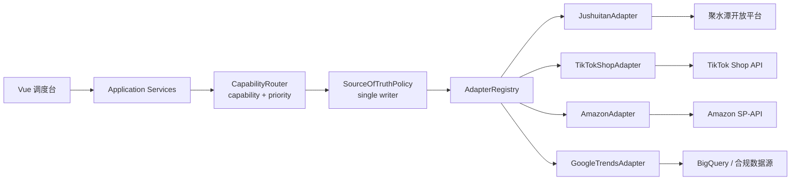

# 跨境电商 · 台前调度导航、阶段工作台与平台集成扩展设计

> 把「单页长滚动」升级为「场景目录 + 今日态势 + 阶段工作台」，前端迁移到 Vue 3 + TypeScript，并为电商平台控制接口与数据获取接口预留端口、canonical model、Adapter Registry 与防腐层。

**版本** v1.2 ｜ **日期** 2026-11-12 ｜ **状态** 设计已确认，待实现 ｜ **关联文档**：[系统设计](../design.md) ｜ [跨境电商能力地图](2026-11-10-cross-border-ecommerce-platform-design.md) ｜ [模拟演示系统需求规格](2026-11-10-cross-border-simulation-design.md) ｜ [Agent 统筹架构](2026-11-11-agent-orchestration-design.md) ｜ [运营异常处理指南](../operations/2026-11-10-cross-border-ecommerce-operations-exception-guide.md) ｜ [现有调度台页面](../../design/cross-border-dispatch/index.html)

---

## 0. 结论先行

1. **不是加一条装饰性侧边栏，而是把页面重构为「场景目录 + 今日态势 + 阶段工作台」三层信息架构**。顶部导航只保留全局动作，场景导航由侧边栏承担，避免双导航。
2. **侧边栏严格按电商运营顺序组织**：选品 → 内容 → 上架定价 → 流量广告 → 订单 → 库存履约 → 物流关务 → 收款结算 → 售后合规 → 控制塔。每组 4–5 个子流程，默认折叠，当前组展开。
3. **首页新增「今日态势」面板**：审批进度、十段链路状态、8 个 Agent 状态、P0–P3 异常分布一次展示；数据来自后端 snapshot，不在前端各算一套。
4. **阶段工作台的内容栏展示子 Agent 真实产出**：摘要、产物、指标、证据；数据由新增的 `StageResult` / `StageDetail` 和 `GET /api/v1/dispatch/stages/{id}` 提供，前端只保留离线 fixture fallback。
5. **代码质量按生产标准执行**：领域层不依赖 FastAPI/SQLAlchemy；新增/修改的 Python 代码使用中文 Google 风格多行 docstring；类型标注、不可变值对象、线程安全仓储、错误码映射、DOM 安全渲染和 1440/375 双端测试全部纳入验收。
6. **前端迁移到 Vue 3 + TypeScript + Vite**：Vue Router、Pinia、Vue Query、Zod、Vitest、Playwright；按功能域拆组件，不再维护 1600 行单文件 HTML。当前朱墨页面保留为视觉参考，Vue 版本达到视觉与交互 parity 后接管 `/dispatch`。
7. **为平台控制与数据获取预留稳定边界**：领域层定义 canonical model 与 `CommerceDataPort` / `PlatformControlPort`；应用层提供 `AdapterRegistry`、`SyncService`、`ControlService`；本期由 `MockPlatformAdapter` 实现，后续 TikTok/Amazon/Temu/Shopify/ERP/WMS/物流/支付 Adapter 不改变领域层与页面组件。
8. **「留足空间」有可验收的定义**：不是 TODO 或空目录，而是新增平台只新增 Adapter/manifest/canonical 映射/路由配置/contract tests，领域层、应用层、Vue 组件不改；聚水潭、TikTok、Amazon、Google Trends 的适配示例见 §6.9–§6.10。

## 1. 背景与问题

当前页面已经是一个可运行的统一台前调度原型：

- 顶部导航：总览、十段链路、Agent 调度、审批案、异常簿。
- 首页：命令栏 + 4 个 KPI + 六步流程条。
- 工作区：十段链路、阶段详情、Agent 调度表、四闭环、审批案、异常簿、trace。
- 后端：`DispatchService` 提供 snapshot、目标、审批、重置、Demo 编排、异常 playbook。

但存在四个结构性问题：

1. **导航层级不足**：十段链路是横向条，子流程没有入口；用户无法从「订单」直接进入「拆单 / 改址 / 缺货处理」等详细流程。
2. **首页信息不完整**：只有 GMV、异常、待批、补偿四个数字，没有审批进度、链路状态矩阵、Agent 状态汇总、异常优先级分布。
3. **阶段内容太薄**：当前阶段详情只有动作/失败/AI 可增强，没有子 Agent 的实际产出内容，无法审查 Agent 到底拿到了什么结果。
4. **数据源分散**：阶段说明和异常 playbook 在前端硬编码，新增结果内容会继续扩大前后端两份数据，容易漂移。

## 2. 目标与非目标

### 2.1 目标

- 新增按电商场景顺序组织的侧边栏，支持 10 个运营阶段 + 控制塔，每组 4–5 个子流程。
- 首页集中展示所有当前状态和审批进度，审批后实时更新。
- 阶段工作台展示子 Agent 的摘要、产物、指标、证据，并关联该阶段的审批与异常。
- 后端新增阶段结果/阶段详情数据模型和 API，保持领域层/应用层/适配层边界。
- 前端迁移到 Vue 3 + TypeScript + Vite + Vue Router + Pinia + Vue Query + Zod，组件按功能域拆分，视觉保持朱墨案牍。
- 为平台控制接口与数据获取接口预留 canonical model、端口、Adapter Registry、防腐层和能力清单；本期提供 MockPlatformAdapter 与集成健康接口。
- 保持 1440/1024/375 三档响应式；旧 HTML 页面保留为视觉参考，Vue 版本接管 `/dispatch`。
- 保持现有 53 个测试通过，新增领域/应用/API/前端类型检查/单元/E2E 测试。

### 2.2 非目标

- 本期不接真实平台凭据或生产 API；只交付 `MockPlatformAdapter`、集成健康接口与适配器契约，真实 Adapter 后续接入。
- 本期不实现平台账号管理、OAuth/密钥托管、全量同步调度和自动控制写；只预留 `CommerceDataPort` / `PlatformControlPort`、`AdapterRegistry`、canonical model 与能力清单。
- 不引入重量级 UI 组件库；Vue 组件和朱墨设计 tokens 由项目自维护。
- 不做完整的多租户认证系统；认证/租户隔离作为后续独立安全需求。
- 不重写现有 `src/opsconductor/api/routes/tasks.py` 等 MVP 数据库路由。
- 不把评审台改成通用 BI 平台；首页只展示本 Demo 的运行状态。

## 3. 方案选择

| 方案 | 内容 | 优点 | 代价 | 结论 |
|---|---|---|---|---|
| A | 场景目录 + 阶段工作台 + Vue 前端 + 平台集成契约 | 真正解决三个需求；首页/详情分工清楚；结果由后端提供 | 需要改布局、数据模型、API、Vue 迁移和集成契约，约 11–14 天 | **采用** |
| B | 轻量侧边栏 + 现有长页面锚点 | 2–3 天可上线 | 不是“不同详细流程”，结果内容仍然薄 | 备选，不采用 |
| C | 每个阶段独立路由页面 | 导航最清晰 | 拆散统一调度台，演示成本高 | 不采用 |

### 3.1 前端框架决策

采用 **Vue 3 + TypeScript + Vite**，不引入重量级 UI 组件库：

- Vue Router 4 管理总览、阶段、审批、异常、集成健康路由。
- Pinia 管理纯 UI 状态（侧栏展开、移动端抽屉、筛选）。
- `@tanstack/vue-query` 管理服务端状态（snapshot、stage detail、integrations），统一 loading/error/retry/缓存。
- Zod 在 API 边界做运行时校验；TypeScript strict 模式；`vue-tsc --noEmit` 纳入 CI。
- 设计 tokens、组件和 scoped CSS 自维护；保持朱墨案牍视觉，不用通用后台模板。
- 旧 `design/cross-border-dispatch/index.html` 保留为视觉参考和迁移对照，Vue 达到 parity 后接管 `/dispatch`。

### 3.2 平台集成决策

采用端口-适配器 + 防腐层（ACL）：

- 领域层定义 canonical model（订单、库存、Listing、结算、广告、物流）与 `CommerceDataPort` / `PlatformControlPort`。
- 应用层 `AdapterRegistry` 按平台/店铺/能力发现 Adapter；`SyncService` 负责数据拉取与游标；`ControlService` 负责控制写、审批、幂等、dry-run、补偿。
- 适配层 `MockPlatformAdapter` 本期实现；未来 TikTok Shop、Amazon SP-API、Temu、Shopify、Shopee、ERP/WMS、物流、支付、广告 Adapter 通过注册表接入。
- 页面只消费 canonical API 与能力清单，不出现平台 SDK、字段名或签名逻辑；平台不支持的动作由 capability 驱动隐藏/禁用。
- 本期只提供 `GET /api/v1/dispatch/integrations` 的 Mock 健康/能力视图；真实同步/控制端点作为后续契约，不在本期伪造成功。

**采用方案 A**，分四个实施阶段交付；详见第 10 节。

## 4. 信息架构

### 4.1 全局布局

```text
┌──────────────────────────────────────────────────────────────┐
│ 顶栏：品牌 / 平台店铺切换 / 命令 / 后端状态 / 审批待办 / 目录  │
├───────────────┬──────────────────────────────────────────────┤
│ 场景目录       │ 主内容                                       │
│ 260px sticky   │  ┌ 今日态势（总览）                         │
│               │  ├ 阶段工作台（当前阶段）                    │
│ 总览           │  ├ Agent 调度 / 四闭环 / 五步法              │
│ 壹 选品与市场  │  └ 审批 / 异常 / trace / 集成健康           │
│ 贰 商品与内容  │                                              │
│ …             │                                              │
│ 拾 售后与合规  │                                              │
│ 控制塔         │                                              │
└───────────────┴──────────────────────────────────────────────┘
```

- 桌面 ≥1280px：侧边栏 260px 固定，主内容最大 1440px。
- 1024–1279px：侧边栏 220px，内容区自适应。
- <1024px：侧边栏变为抽屉，主内容全宽；顶部出现「目录」按钮。
- 顶部导航精简为：品牌、平台/店铺切换、命令入口、后端连接状态、审批待办计数、目录按钮；原「十段链路 / Agent 调度 / 审批案 / 异常簿」移入侧栏与工作台上下文，避免重复导航。
- 平台/店铺切换本期显示 Demo 店铺（NestWell Home US · Mock），数据来自 `GET /integrations`；未来接入真实 Adapter 后切换真实账号。
- 顶栏显示数据新鲜度摘要；过期时使用金色提醒，不阻塞页面。

### 4.2 场景目录

侧边栏定位为「卷宗目录」，使用中文序号、细分隔线和状态点，不使用通用 SaaS 图标。

| 序 | 分组 | 子流程 | 阶段 ID |
|---|---|---|---|
| 总览 | 今日态势 | 审批进度 / 链路状态 / Agent 状态 / 异常分布 | `overview` |
| 壹 | 选品与市场 | 趋势扫描 / 竞品分析 / 评分卡 / 合规 IP / SKU 组合 | `selection` |
| 贰 | 商品与内容 | Brief / AI 制图视频 / 品牌合规 / Listing 文案 / 效果反馈 | `content` |
| 叁 | 上架与定价 | 类目属性 / 标题关键词 / 价格带 / 库存同步 / 价格审批 | `listing` |
| 肆 | 自然流量 | 内容日历 / 达人联盟 / 寄样 / 直播排期 / 效果归因 | `organic` |
| 伍 | 付费广告 | 计划 / 预算 / 出价 / 素材轮换 / ROAS | `paid` |
| 陆 | 订单 | 同步 / 异常分类 / 拆单改址 / 缺货处理 / 重复欺诈 | `order` |
| 柒 | 库存与履约 | 预占 / 拆单换仓 / 补货 / 盘点 / 补偿 | `fulfillment` |
| 捌 | 物流与关务 | 比价 / 发货 / 报关 / 轨迹 / 理赔退件 | `logistics` |
| 玖 | 收款与结算 | 结算单 / 费用退款拒付 / 对账 / 差异归因 / 财务任务 | `settlement` |
| 拾 | 售后与合规 | 退货退款 / 纠纷 / 差评 / IP 产品安全 / 平台政策 | `aftersales` |
| 控制塔 | 全局控制塔 | 指标 / 告警 / 审批 / trace 审计 / 集成健康 / 复盘飞轮 | `control` |

> 十段链路的 10 个阶段各成一组，控制塔作为第 11 组；「总览」是固定入口，不计入这 11 组。侧边栏序号壹–拾对应 10 个运营阶段，控制塔不占用阶段序号。

#### 4.2.1 交互规则

- 每个分组默认折叠；当前阶段所在组自动展开，其余折叠。
- 分组标题显示：序号、名称、状态点、审批待批数、异常数。
- 状态点四态：`done` 靛青实心、`running` 靛青空心脉冲、`alert` 朱砂实心、`waiting` 墨色虚线空心。
- 当前子流程使用朱砂左线和浅红底；`aria-current="page"`。
- 点击阶段：切换阶段工作台，更新 URL；点击子流程：定位到该阶段内具体步骤，URL 同步。
- URL 形如 `#stage=order&step=split`；`#overview` 返回总览；浏览器前进/后退可用。
- 移动端：点击「目录」打开抽屉；选择后自动关闭；ESC 关闭；打开时锁定 body 滚动。

#### 4.2.2 可访问性

- 侧边栏 `nav[aria-label="场景目录"]`。
- 分组按钮 `aria-expanded`，子项 `aria-current`；键盘 Enter/Space 可操作。
- 抽屉打开后焦点进入侧栏，关闭后回到「目录」按钮。
- 状态点不只靠颜色：同时有文字标签或计数。

### 4.3 首页今日态势

在命令栏下方新增 `.status-board`，使用现有 snapshot 数据，不新增第二个页面。

| 区块 | 内容 | 交互 |
|---|---|---|
| 审批进度 | `0/3 已批 · 3 件待批`；分段进度条 pending / approved / rejected；L2 ×1 / L3 ×2 | 点击跳到审批案；审批后实时更新 |
| 十段链路 | 10 个紧凑状态格；状态点 + 摘要 + 分组计数 | 点击进入对应阶段工作台 |
| Agent 状态 | 8 个 Agent chip：已完成/进行中/待批/补偿/对账 | 点击过滤下方 Agent 调度表 |
| 异常分布 | P0 / P1 / P2 / P3 数量与 SLA | 点击跳到异常簿并过滤优先级 |
| 集成健康 | 平台/店铺、connected/mock/degraded、能力数量、最近同步、数据新鲜度 | 点击进入集成健康页；过期显示金色告警 |

视觉：

- 审批进度条：金色待批、靛青已准、朱砂已驳；高度 6px；右侧显示百分比。
- 链路矩阵：5 列 ×2 行或 10 列单行（桌面），移动端 2 列 ×5 行。
- 所有数字使用等宽数字；标签 ≥12px；正文 ≥14px；对比度 ≥4.5:1。
- 状态面板不能变成「又一组卡片」：使用细线、矩阵、进度条和小印章，而不是大圆角卡片。

### 4.4 阶段工作台

选中阶段后，主内容显示 `.stage-workspace`：

```text
┌ 阶段工作台 ─ 订单 ───────────────────────────────────────────┐
│ 阶段头：订单 · L2 · 订单运营 · 6 单异常 · 2 单 P0/P1          │
├───────────────┬──────────────────────────┬───────────────────┤
│ 流程步骤       │ Agent 产出                 │ 本阶段上下文       │
│ 1 同步         │ 订单 Agent · 处理中        │ 审批：无/待批      │
│ 2 异常分类     │ 摘要：分类 6 单异常…       │ 异常：3 条         │
│ 3 拆单/改址    │ 产物：order-exceptions.csv │ trace：查看全局    │
│ 4 缺货处理     │ 指标：异常 6 / P0P1 2      │ 相关文档           │
│ 5 补偿         │ 证据：订单号范围 / trace   │                   │
└───────────────┴──────────────────────────┴───────────────────┘
```

- 左栏：子流程步骤、状态、负责人/Agent；当前步骤高亮。
- 中栏：Agent 结果。包含摘要、产物、指标、证据、动作按钮。
- 右栏：本阶段审批、异常、trace 链接、相关文档、数据来源。
- 移动端：三栏改为单列，顺序为阶段头 → 流程 → Agent 产出 → 上下文。
- 未选中阶段时显示总览；错误时显示「阶段详情加载失败 + 重试」；无结果时显示「本阶段暂无产出」。

#### 4.4.1 Agent 产出栏

每个阶段的内容栏必须展示：

- **Agent**：执行 Agent（如订单 Agent）、验证方（Verifier）。
- **状态**：完成 / 进行中 / 待批 / 补偿 / 待办。
- **摘要**：一句话结果，最多 2 行；超出可展开。
- **产物**：至少文件名 + 类型标签（JSON / CSV / PNG / MD / PDF），不使用 emoji。
- **指标**：键值对，最多 6 项；数字等宽。
- **证据**：订单号范围、trace ID、审批 ID、文档章节；最多 4 条。
- **来源**：平台/店铺、Adapter、同步时间、schema 版本；来自 `StageResult.provenance`。
- **动作**：查看完整报告 / 打开 trace / 审批（仅当该阶段有待批项且 Adapter 声明对应 capability）。

内容不得使用 Lorem ipsum、静态占位或仅前端拼接的假结果；必须来自 `StageResult` API。平台不支持的动作由 capability 驱动隐藏或禁用，不在前端硬编码平台判断。

## 5. 交互与视觉规范

### 5.1 视觉语言

- 继续使用纸白 `#F7F3E9`、墨 `#17130F`、朱砂 `#A8342A`、靛青 `#2C4A56`、鎏金 `#A8894F`。
- 侧边栏：纸色底、右侧墨线、竖排「卷宗目录」小标题、中文序号；当前项朱砂左边线或小印。
- 状态板：细线表格/矩阵；审批进度用细条；不使用大面积渐变、霓虹、玻璃拟态。
- 阶段结果：像「案卷」而不是 SaaS 卡片；产物标签像书签，指标像账目条目。
- 字体：宋体标题、仿宋正文、楷体批注、JetBrains Mono 数字。
- 动效：仅用于状态切换、抽屉、进度更新；支持 `prefers-reduced-motion`。

### 5.2 响应式

| 断点 | 行为 |
|---|---|
| ≥1280 | 侧栏 260px；状态板 4 列；阶段工作台三栏 |
| 1024–1279 | 侧栏 220px；状态板 2×2；工作台两栏，上下文折叠 |
| 768–1023 | 侧栏抽屉；状态板 2×2；工作台单列 |
| <768 | 单列；侧栏抽屉；链路横向滚动并显示滑动提示；产物标签换行 |

任何断点都不得出现页面级横向滚动；`document.documentElement.scrollWidth === innerWidth` 是验收硬标准。

### 5.3 错误、加载与空态

- 加载：阶段工作台显示骨架条，不阻塞侧栏。
- 404：显示「阶段不存在」并回到总览。
- 网络错误：显示「离线数据」横幅，Vue 回退到打包的 fixture；旧设计页仅作为视觉参考。
- 空结果：显示「本阶段暂无产出」，不显示假数据。
- 审批失败：toast 报错，按钮恢复可点，状态不被前端乐观修改。

## 6. 数据模型与 API

### 6.1 领域层新增

文件：`src/opsconductor/dispatch/domain/models.py`、`enums.py`、`errors.py`。

```python
class ArtifactKind(str, Enum):
    """阶段产物的展示类型。"""
    json = "json"
    csv = "csv"
    markdown = "markdown"
    image = "image"
    video = "video"
    pdf = "pdf"
    other = "other"


@dataclass(frozen=True)
class Artifact:
    """阶段产物引用。

    Attributes:
        name: 文件名，例如 ``order-exceptions.csv``。
        kind: 展示类型，用于前端标签。
        uri: Mock 或对象存储 URI；Demo 使用 ``mock://`` 前缀。
        description: 可选的一句话说明。
    """
    name: str
    kind: ArtifactKind
    uri: str
    description: str = ""

    def __post_init__(self) -> None:
        if not self.name.strip() or not self.uri.strip():
            raise ValueError("artifact name and uri must not be blank")


@dataclass(frozen=True)
class Metric:
    """阶段指标键值对。"""
    key: str
    value: str | int


@dataclass(frozen=True)
class DataProvenance:
    """阶段结果的数据来源与新鲜度。

    Attributes:
        platform: 平台标识，Demo 为 ``mock``。
        shop_id: 店铺/账号标识。
        adapter: 生成该结果的 Adapter。
        synced_at: 数据同步时刻，``HH:MM``。
        schema_version: canonical schema 版本。
    """
    platform: str
    shop_id: str
    adapter: str
    synced_at: str
    schema_version: str

    def __post_init__(self) -> None:
        if not self.platform or not self.shop_id or not self.adapter:
            raise ValueError("provenance platform, shop_id and adapter are required")


@dataclass(frozen=True)
class StageResult:
    """子 Agent 在某个阶段的确定性产出。

    Attributes:
        stage_id: 阶段 ID，例如 ``order``。
        agent_id: 产出的 Agent ID，例如 ``order``。
        status: 展示状态。
        summary: 一句话结果摘要。
        artifacts: 产物元组。
        metrics: 指标元组；序列化时转为对象。
        evidence: 证据/引用描述元组。
        provenance: 平台/店铺/Adapter/同步时间/schema 版本。
        at: 展示时刻，``HH:MM``。
    """
    stage_id: str
    agent_id: str
    status: StageStatus
    summary: str
    artifacts: tuple[Artifact, ...]
    metrics: tuple[Metric, ...]
    evidence: tuple[str, ...]
    provenance: DataProvenance
    at: str

    def __post_init__(self) -> None:
        if not self.stage_id.strip() or not self.agent_id.strip():
            raise ValueError("stage_id and agent_id must not be blank")
        if not self.summary.strip():
            raise ValueError("summary must not be blank")
        keys = [metric.key for metric in self.metrics]
        if len(keys) != len(set(keys)):
            raise ValueError("metric keys must be unique")


@dataclass(frozen=True)
class StageStep:
    """阶段内的子流程步骤。"""
    id: str
    name: str


@dataclass(frozen=True)
class StageDefinition:
    """阶段目录中的静态定义。

    Attributes:
        id: 阶段 ID。
        order_label: 中文序号，例如 ``陆``。
        name: 阶段名称。
        owner: 主责角色。
        risk: 默认风险等级。
        actions: 核心动作。
        failures: 典型失败。
        ai: AI 可增强点。
        metrics: 关键指标名称。
        steps: 子流程步骤。
    """
    id: str
    order_label: str
    name: str
    owner: str
    risk: RiskLevel
    actions: tuple[str, ...]
    failures: tuple[str, ...]
    ai: tuple[str, ...]
    metrics: tuple[str, ...]
    steps: tuple[StageStep, ...]
```

`StageResult` 的 `metrics` 用元组而不是 dict，避免 frozen dataclass 内含可变映射；序列化时转为 JSON 对象。

新增错误：

```python
class StageNotFound(DispatchError):
    """请求的阶段 ID 不在 StageDefinition 目录中。"""


class AdapterNotFound(DispatchError):
    """指定平台/店铺没有注册 Adapter。"""


class CapabilityNotSupported(DispatchError):
    """Adapter 未声明请求的 data/control 能力。"""


class ApprovalRequired(DispatchError):
    """L2/L3 控制写缺少已批准的 approval_id。"""


class IdempotencyConflict(DispatchError):
    """同一幂等键被用于不同的控制命令。"""
```

### 6.2 现有模型扩展

- `ApprovalDraft` 增加 `stage_id: str`。
- `ApprovalCase` 增加 `stage_id: str`。
- `ExceptionCase` 增加 `stage_id: str`。
- `DispatchState` 增加 `results: dict[str, StageResult]`。
- `DispatchSnapshot` 增加：
  - `navigation: tuple[StageNavigation, ...]`
  - `status_summary: StatusSummary`
  - `approval_progress: ApprovalProgress`

阶段归属映射（用于侧栏计数与工作台上下文，必须与种子数据一致）：

- 审批：`budget` → `paid`，`price` → `listing`，`refund` → `settlement`。
- 异常：`ORD-01/ORD-03/ORD-04` → `order`，`INV-01` → `fulfillment`，`LOG-03` → `logistics`，`PAY-02` → `settlement`。
- 控制塔：`control` 组的 `order_label` 使用 `—`，`approval_count` / `exception_count` 展示全局计数；不实现 `GET /stages/control`。

`StageNavigation`、`StageDetail`、`StatusSummary`、`ApprovalProgress` 是应用层只读视图模型，放在 `application/service.py`：

```python
@dataclass(frozen=True)
class StageNavigation:
    """侧边栏的一组场景目录。"""
    id: str
    order_label: str
    name: str
    status: StageStatus
    meta: str
    approval_count: int
    exception_count: int
    steps: tuple[StageStep, ...]


@dataclass(frozen=True)
class StageDetail:
    """阶段工作台的组合视图。"""
    definition: StageDefinition
    status: StageStatus
    meta: str
    result: StageResult | None
    approvals: tuple[ApprovalCase, ...]
    exceptions: tuple[ExceptionCase, ...]


@dataclass(frozen=True)
class ApprovalProgress:
    """首页审批进度。"""
    total: int
    pending: int
    approved: int
    rejected: int
    decided_percent: int
    l2_total: int
    l3_total: int


@dataclass(frozen=True)
class StatusSummary:
    """首页全部状态的聚合视图。"""
    chain: dict[str, int]
    agents: dict[str, int]
    approvals: ApprovalProgress
    exceptions: dict[str, int]
```

### 6.3 阶段目录与种子结果

新增 `src/opsconductor/dispatch/application/stages.py`：

- `STAGE_CATALOG`: 10 个 `StageDefinition`，顺序固定为选品 → 内容 → 上架定价 → 自然流量 → 付费广告 → 订单 → 库存履约 → 物流关务 → 收款结算 → 售后合规。
- `STAGE_RESULTS`: 10 个 `StageResult`，内容来自现有 Mock 演示剧本，不编造额外金额。
- `CONTROL_NAV`: 控制塔第 11 组，只提供导航和聚合指标，不实现 `StageDetail`。

阶段结果种子（实现时必须逐字使用；金额/数量来自 `docs/specs/2026-11-10-cross-border-simulation-design.md` §2）：

| 阶段 | 结果摘要 | 产物 | 指标 | 证据 |
|---|---|---|---|---|
| `selection` | 扫描 8–12 周趋势，输出 5 个 Hero SKU；NW-102 毛利 6.8% 被 Verifier 否决并替换 | `trend-report.json` / `selection-scorecard.csv` | `hero_skus=5`, `vetoed=1` | 选品评分卡；Verifier 否决记录 |
| `content` | 产出 5 份 Brief、15 张商品图与 10 条短视频脚本草稿 | `brief-NW-101.md` / `hero-NW-101-01.png` / `reel-NW-101-01.mp4` | `briefs=5`, `images=15`, `videos=10` | 品牌规范；合规词库（Mock） |
| `listing` | 生成 5 个 Listing 草稿与 1 条涨价建议，等待 L2 审批 | `listing-draft.json` / `price-band.csv` | `listings=5`, `price_changes=1` | 平台类目模板；价格带规则 |
| `organic` | 内容日历与达人寄样排期已生成，等待发布 | `content-calendar.csv` / `creator-samples.md` | `planned_posts=15`, `creators=8` | 内容日历；达人清单（Mock） |
| `paid` | 生成 3 个 Campaign、总预算 $10,000、ROAS 护栏 2.5，等待 L3 审批 | `campaign-plan.csv` / `budget-guard.json` | `campaigns=3`, `budget=10000`, `roas=2.5` | 投放剧本；预算护栏 |
| `order` | 分类 6 单异常，2 单 P0/P1；拆单/改址建议已生成 | `order-exceptions.csv` / `split-address-plan.json` | `exceptions=6`, `p0_p1=2`, `sla_minutes=15` | 异常目录 ORD-01/03/04；5×5 定级 |
| `fulfillment` | 完成空运/海运/海外仓比价，1 票报关失败触发拆单补偿 | `shipment-plan.json` / `compensation-log.md` | `compensations=1`, `reservations_released=6` | 拆单补偿剧本；库存预占记录 |
| `logistics` | 1 票扣关，补资料/换口岸建议已生成，轨迹监控中 | `customs-declaration.pdf` / `tracking-events.json` | `customs_failures=1`, `sla_minutes=30` | 异常目录 LOG-03；报关资料清单 |
| `settlement` | 3 笔对账差异，已生成财务任务；退款等待 L3 审批 | `settlement-diff.csv` / `finance-tasks.md` | `diffs=3`, `pending_approvals=1` | PAY-02 playbook；对账规则 |
| `aftersales` | 1 个 SKU 合规不达标被剔除，售后政策 RAG 待命 | `compliance-report.md` | `vetoed_skus=1` | AFS 异常目录；政策 RAG（Mock） |

> 本期所有阶段结果的 provenance 固定为 `platform=mock`、`shop_id=nestwell-us`、`adapter=MockPlatformAdapter`、`schema_version=1.0`；`synced_at` 按 Demo 剧本时间分配。后续真实 Adapter 必须填入真实来源。

### 6.4 Snapshot 扩展 JSON

`GET /api/v1/dispatch/snapshot` 在现有字段基础上增加：

```json
{
  "navigation": [
    {
      "id": "order",
      "order_label": "陆",
      "name": "订单",
      "status": "alert",
      "meta": "6 单异常",
      "approval_count": 0,
      "exception_count": 3,
      "steps": [
        {"id": "sync", "name": "订单同步"},
        {"id": "classify", "name": "异常分类"},
        {"id": "split", "name": "拆单 / 改址"},
        {"id": "stockout", "name": "缺货处理"},
        {"id": "compensate", "name": "补偿"}
      ]
    }
  ],
  "status_summary": {
    "chain": {"done": 1, "running": 3, "alert": 2, "waiting": 4},
    "agents": {"done": 2, "running": 4, "waiting": 2, "error": 0},
    "approvals": {
      "total": 3, "pending": 3, "approved": 0, "rejected": 0,
      "decided_percent": 0, "l2_total": 1, "l3_total": 2
    },
    "exceptions": {"total": 6, "p0": 1, "p1": 4, "p2": 1, "p3": 0}
  }
}
```

`StageResult.provenance` 在 API 中序列化为 `source`；前端只读 `source`，不自行推断平台。

`navigation` 共 11 组：10 个阶段 + 控制塔。控制塔 `id="control"`，包含指标/告警/审批/trace/复盘五个子项，不调用阶段详情 API。

`decided_percent` 的计算方式：

```text
decided_percent = 0 if total == 0 else round((approved + rejected) / total * 100)
```

阶段结果的 `at` 时间按 Demo 剧本 10:42–11:15 的展示时间分配，不引入新的业务时间口径。

### 6.5 阶段详情 API

```http
GET /api/v1/dispatch/stages/{stage_id}
```

200 响应：

```json
{
  "id": "order",
  "order_label": "陆",
  "name": "订单",
  "status": "alert",
  "meta": "6 单异常",
  "owner": "订单运营",
  "risk": "L2",
  "actions": ["订单同步", "库存预占", "拆单/改址", "缺货处理"],
  "failures": ["超卖", "超时未发", "地址异常", "重复履约"],
  "ai": ["异常分类", "拆单/改址方案", "补偿", "库存调拨"],
  "metrics": ["迟发率", "取消率", "缺陷率"],
  "steps": [
    {"id": "sync", "name": "订单同步"},
    {"id": "classify", "name": "异常分类"}
  ],
  "result": {
    "stage_id": "order",
    "agent_id": "order",
    "status": "alert",
    "summary": "分类 6 单异常，2 单 P0/P1；拆单/改址建议已生成",
    "artifacts": [
      {"name": "order-exceptions.csv", "kind": "csv", "uri": "mock://dispatch/order/order-exceptions.csv", "description": "6 单异常明细"},
      {"name": "split-address-plan.json", "kind": "json", "uri": "mock://dispatch/order/split-address-plan.json", "description": "拆单/改址建议"}
    ],
    "metrics": {"exceptions": 6, "p0_p1": 2, "sla_minutes": 15},
    "evidence": ["异常目录 ORD-01/03/04", "5×5 定级"],
    "source": {
      "platform": "mock",
      "shop_id": "nestwell-us",
      "adapter": "MockPlatformAdapter",
      "synced_at": "10:42",
      "schema_version": "1.0"
    },
    "at": "11:02"
  },
  "approvals": [],
  "exceptions": [
    {"id": "ORD-01", "title": "超时未发货", "priority": "P0", "stage_id": "order"}
  ]
}
```

错误：

- 未知阶段 ID → `404 {"detail": "unknown stage: xxx"}`。
- 服务内部错误 → 500，前端显示错误态并允许重试。

### 6.6 API 兼容性

- 现有 snapshot 字段保持不变；新增字段全部是增量。
- 现有 53 个测试必须继续通过；新增 `stage_id` 字段需要更新相关测试夹具和序列化断言。
- Vue 版本要求 HTTP；旧设计页保留 `file://` 作为视觉参考。API 不可用时 Vue 使用 bundled fixture 和错误态，不伪造成功。
- `GET /stages/control` 不实现；控制塔由 snapshot 聚合数据渲染。

### 6.7 平台控制与数据获取契约

平台接入不是把平台 SDK 塞进 Agent，而是 **端口 + canonical model + 防腐层 + Adapter Registry**。本期只实现 Mock Adapter，但接口必须按真实平台接入设计，后续新增 TikTok/Amazon/Temu/Shopify/ERP/WMS/物流/支付 Adapter 时，领域层、应用层、页面组件不改。

#### 6.7.1 Canonical models

平台原始响应先由 Adapter 映射为 canonical model；领域层/应用层/前端只看到 canonical 字段。

| 模型 | 最小字段 | 用途 |
|---|---|---|
| `PlatformRef` | `tenant_id`, `platform`, `shop_id`, `market` | 选择 Adapter 与租户/店铺边界 |
| `CanonicalOrder` | `external_id`, `status`, `currency`, `total`, `lines`, `shipping_address`, `updated_at`, `raw_ref` | 订单同步与异常处理 |
| `CanonicalInventory` | `sku`, `warehouse`, `available`, `reserved`, `in_transit`, `version` | 库存预占、补货、超卖校验 |
| `CanonicalListing` | `external_id`, `sku`, `title`, `price`, `currency`, `status`, `version` | Listing/价格控制 |
| `CanonicalShipment` | `external_id`, `order_external_id`, `carrier`, `tracking_no`, `status`, `events` | 发货、轨迹、理赔 |
| `CanonicalSettlement` | `external_id`, `period`, `gross`, `fees`, `refunds`, `net`, `currency` | 对账与差异归因 |
| `CanonicalAdMetric` | `campaign_id`, `spend`, `impressions`, `clicks`, `conversions`, `roas` | 投放与归因 |
| `CanonicalTrendSignal` | `keyword`, `geo`, `window`, `interest`, `confidence`, `source` | 趋势/选品信号（只读、弱信号） |
| `CanonicalPolicy` | `platform`, `policy_id`, `version`, `effective_at`, `source_url` | 平台政策/合规引用 |

```python
@dataclass(frozen=True)
class PlatformRef:
    """选择 Adapter 的租户/平台/店铺边界。"""
    tenant_id: str
    platform: str
    shop_id: str
    market: str
```

约束：

- canonical model 不出现平台专有字段名、SDK 类型或签名参数。
- 每个模型带 `raw_ref`/`source` 字段，指向原始响应归档；Demo 使用 `mock://` 引用。
- 金额使用整数最小货币单位或明确 `Decimal`，禁止 float 账务计算；Demo 可保留整数美元，但字段名必须标注 `_minor`/`_usd`。
- 时间统一 ISO 8601 UTC；展示层再转本地时间。
- PII（收件人、电话、地址）在日志/trace 中脱敏，原文只进受控存储。

#### 6.7.2 端口

```python
from collections.abc import Mapping
from typing import Protocol, runtime_checkable


@runtime_checkable
class CommerceDataPort(Protocol):
    """电商平台数据获取端口；只读，不得产生业务副作用。"""

    def fetch_orders(self, query: DataQuery) -> DataPage[CanonicalOrder]: ...
    def fetch_inventory(self, query: DataQuery) -> DataPage[CanonicalInventory]: ...
    def fetch_listings(self, query: DataQuery) -> DataPage[CanonicalListing]: ...
    def fetch_settlements(self, query: DataQuery) -> DataPage[CanonicalSettlement]: ...
    def fetch_ads(self, query: DataQuery) -> DataPage[CanonicalAdMetric]: ...
    def fetch_logistics(self, query: DataQuery) -> DataPage[CanonicalShipment]: ...


@runtime_checkable
class PlatformControlPort(Protocol):
    """平台控制端口；所有写操作必须经过审批、幂等、dry-run 与审计。"""

    def execute(self, command: ControlCommand) -> ControlResult: ...


@runtime_checkable
class PlatformAdapter(CommerceDataPort, PlatformControlPort, Protocol):
    """一个平台/店铺适配器同时暴露数据与控制能力。"""

    def manifest(self) -> AdapterManifest: ...
    def health(self) -> IntegrationHealth: ...
```

```python
class ControlStatus(str, Enum):
    """控制命令生命周期。"""
    accepted = "accepted"
    rejected = "rejected"
    succeeded = "succeeded"
    failed = "failed"
    compensated = "compensated"


class SyncStatus(str, Enum):
    """数据同步生命周期。"""
    running = "running"
    succeeded = "succeeded"
    partial = "partial"
    failed = "failed"


class IntegrationStatus(str, Enum):
    """平台连接状态。"""
    connected = "connected"
    mock = "mock"
    degraded = "degraded"
    disconnected = "disconnected"


class IntegrationMode(str, Enum):
    """平台运行模式。"""
    mock = "mock"
    live = "live"


class Freshness(str, Enum):
    """数据新鲜度。"""
    fresh = "fresh"
    stale = "stale"
    unknown = "unknown"


class IntegrationCapability(str, Enum):
    """跨平台能力名。"""
    data_orders = "data.orders"
    data_inventory = "data.inventory"
    data_listings = "data.listings"
    data_settlements = "data.settlements"
    data_ads = "data.ads"
    data_logistics = "data.logistics"
    data_trends = "data.trends"
    control_purchase = "control.purchase"
    control_listing = "control.listing"
    control_price = "control.price"
    control_inventory = "control.inventory"
    control_shipment = "control.shipment"
    control_refund = "control.refund"
    control_ads = "control.ads"
```

`ToolPort` 继续保留给尚未 typed 化的 MCP 工具（内容生成、RPA 等）；`MockPlatformAdapter` 同时实现 typed ports 与 `ToolPort` 兼容方法。新代码优先使用 typed ports，`ToolPort` 只作为过渡缝。

#### 6.7.3 控制命令契约

```python
@dataclass(frozen=True)
class IntegrationError:
    """跨平台可归因错误。"""
    code: str
    message: str
    retryable: bool
    external_ref: str | None = None


@dataclass(frozen=True)
class ControlCommand:
    """跨平台控制写命令。"""
    command_id: str
    tenant_id: str
    platform: str
    shop_id: str
    capability: IntegrationCapability
    operation: str
    entity_type: str
    entity_id: str | None
    params: Mapping[str, object]
    expected_version: int | None
    risk: RiskLevel
    dry_run: bool
    idempotency_key: str
    approval_id: str | None
    requested_by: str
    requested_at: str


@dataclass(frozen=True)
class ControlResult:
    """控制命令结果；失败必须可归因、可重试判断、可补偿。"""
    command_id: str
    status: ControlStatus
    external_id: str | None
    evidence: tuple[str, ...]
    error: IntegrationError | None
    adapter_meta: Mapping[str, object]
    completed_at: str
```

`ControlService.execute(command)` 的硬规则：

1. 校验 `capability` 在 Adapter manifest 中；不支持直接拒绝，不静默降级。
2. `risk` 为 `L2/L3` 时必须带已批准的 `approval_id`；否则拒绝。
3. `idempotency_key` 必填；同键同 body 返回首次结果，同键不同 body 返回冲突。
4. `dry_run=True` 只能返回预检结果，不得写平台。
5. 执行前记录 audit/trace；执行后记录 external_id、证据、adapter_meta。
6. 失败产生补偿动作；补偿失败标记 `partially_compensated` 并转人工。
7. 页面/Agent 不得直接调用 `PlatformControlPort`；只能经 `ControlService`。

#### 6.7.4 数据查询与同步契约

```python
@dataclass(frozen=True)
class DataQuery:
    """分页/增量数据查询。"""
    query_id: str
    tenant_id: str
    platform: str
    shop_id: str
    resource: str
    filters: Mapping[str, object]
    cursor: str | None
    page_size: int
    since: str | None
    until: str | None


@dataclass(frozen=True)
class DataQuality:
    """数据质量与新鲜度告警。"""
    warnings: tuple[str, ...]
    missing_fields: tuple[str, ...]
    stale_after: str | None


@dataclass(frozen=True)
class DataPage(Generic[T]):
    """一页 canonical 数据及同步元信息。"""
    items: tuple[T, ...]
    next_cursor: str | None
    fetched_at: str
    source: DataProvenance
    quality: DataQuality


@dataclass(frozen=True)
class SyncRun:
    """一次数据同步的可审计记录。"""
    id: str
    resource: str
    platform: str
    status: SyncStatus
    cursor_start: str | None
    cursor_end: str | None
    fetched: int
    upserted: int
    failed: int
    started_at: str
    finished_at: str | None
    errors: tuple[IntegrationError, ...]
```

`SyncService`（后续可实现，本期只定义）负责：分页拉取、游标持久化、去重/upsert、限流退避、数据质量检查、raw payload 归档、失败重试；不得在请求线程里做全量同步。

#### 6.7.5 Adapter Registry 与能力

```python
@dataclass(frozen=True)
class AdapterManifest:
    """适配器能力与限制声明。"""
    adapter_id: str
    platform: str
    version: str
    capabilities: tuple[IntegrationCapability, ...]
    default_risk: RiskLevel
    rate_limit_per_minute: int
    supports_dry_run: bool
    supports_idempotency: bool


@dataclass(frozen=True)
class IntegrationHealth:
    """集成健康与数据新鲜度。"""
    platform: str
    shop_id: str
    status: IntegrationStatus
    mode: IntegrationMode
    capabilities: tuple[IntegrationCapability, ...]
    last_sync_at: str | None
    freshness: Freshness
    warnings: tuple[str, ...]
```

`IntegrationCapability` 的枚举值就是 Adapter manifest、页面门禁和 `/integrations` 响应的唯一能力名；新增能力必须同时更新枚举、manifest、fixture 与测试。

`AdapterRegistry`：

- `register(adapter)`：启动时注册，重复 adapter_id 拒绝。
- `get(adapter_id)`：按 ID 取回 Adapter；缺失返回 `AdapterNotFound`。
- `CapabilityRouter.resolve(capability, ref)`：按能力、平台/店铺、优先级选择 Adapter；它是页面/Agent 的唯一入口。
- `SourceOfTruthPolicy`：声明每个 canonical 实体的主写方，防止平台与 ERP 双写。
- `manifests()` / `health()`：供 `/integrations` 页面使用。
- 能力是唯一门禁：页面和 Agent 不根据平台名写 if/else；只看 capability。

#### 6.7.6 后续 Adapter 接入面

| 系统 | 数据获取 | 控制写 | Adapter | 本期状态 |
|---|---|---|---|---|
| Mock World | 订单/库存/Listing/结算/广告/物流/趋势 | Listing/价格/库存/发货/退款/广告预算 | `MockPlatformAdapter` | **实现** |
| TikTok Shop | Orders/Products/Finance/Analytics | Listing/Price/Inventory/Shipment/Ads | `TikTokShopAdapter` | 后续 |
| Amazon SP-API | Orders/Listings/Inventory/Finance | Listings/Prices/Inventory | `AmazonAdapter` | 后续 |
| Temu | 订单/商品/结算 | Listing/Price | `TemuAdapter` | 后续 |
| Shopify | Orders/Products/Inventory | Listing/Price/Inventory | `ShopifyAdapter` | 后续 |
| Shopee/Lazada | Orders/Products/Finance | Listing/Price/Inventory | `ShopeeAdapter` | 后续 |
| ERP/WMS | 采购/库存/仓配 | 补货/调拨/发货 | `ErpAdapter` / `WmsAdapter` | 后续 |
| 物流/支付/广告/内容 | 轨迹/账单/花费/素材 | 下单/退款/预算/发布 | 专用 Adapter | 后续 |

真实平台以官方 API 文档、ToS、限流与授权要求为准；Adapter 负责版本、签名、分页、错误码和字段映射，领域层不感知。

### 6.8 集成 API（本期只读）

本期新增：

```http
GET /api/v1/dispatch/integrations
```

响应：

```json
{
  "default_platform": "mock-nestwell-us",
  "platforms": [
    {
      "platform": "mock",
      "shop_id": "nestwell-us",
      "name": "NestWell Home US",
      "status": "mock",
      "mode": "mock",
      "capabilities": [
        "data.orders", "data.inventory", "data.listings",
        "data.settlements", "data.ads", "data.logistics",
        "control.listing", "control.price", "control.inventory",
        "control.shipment", "control.refund"
      ],
      "last_sync_at": "10:42",
      "freshness": "fresh",
      "warnings": []
    }
  ]
}
```

后续预留但 **本期不实现、不返回假成功**：

- `POST /api/v1/dispatch/sync-runs`：启动数据同步。
- `GET /api/v1/dispatch/sync-runs/{id}`：同步进度。
- `POST /api/v1/dispatch/control/commands`：控制写命令，必须带 approval/idempotency/dry-run。

前端本期只展示集成健康、能力清单、数据新鲜度和平台切换（Demo 只读）；真实同步/控制按钮在 capability 和 adapter 状态满足后再出现。

### 6.9 「留足空间」的明确定义

> **「留足空间」不是留 TODO、留空目录、先写一个万能 `call(tool, params)` 接口，也不是现在就把所有平台都接完。**
>
> 它指的是：**平台差异被限制在 Adapter 和配置里；新增一个平台时，领域层、应用层、Vue 页面组件不需要改动，只需新增 Adapter、manifest、canonical 映射、路由/归属配置和 contract tests。**

#### 6.9.1 必须保证的五件事

1. **稳定契约**：领域层只依赖 `CommerceDataPort` / `PlatformControlPort` / canonical model；平台字段、签名、分页、错误码不进入领域层。
2. **能力驱动**：页面和 Agent 只看 `IntegrationCapability`（`data.*` / `control.*`），不看平台名；平台不支持的动作由 manifest 门禁隐藏或禁用。
3. **写入归属**：每个 canonical 实体有明确的 single writer；`SourceOfTruthPolicy` 决定库存、订单、Listing、价格、结算分别由谁写，避免平台与 ERP 双写。
4. **可替换传输**：REST、OAuth、Webhook、异步 Report/Feed、RPA、公开数据集都封装在 Adapter；上层只看到 `DataPage`、`SyncRun`、`ControlCommand`、`ControlResult`。
5. **证据与新鲜度**：每个阶段结果带 `provenance`（平台、店铺、Adapter、同步时间、schema 版本）；Google Trends 这类弱信号额外带 confidence/freshness，不伪装成业务事实。

#### 6.9.2 明确不包含的内容

- 本期不接真实平台凭据、OAuth、密钥托管、真实平台生产 API。
- 本期不实现全量同步调度、数据仓库、湖仓、流式 CDC。
- 本期不实现所有平台的所有能力；只实现 `MockPlatformAdapter` 与集成健康视图。
- 不承诺“一个 Adapter 通吃所有平台”；不同平台必须有独立 Adapter 和 ACL。
- 不在 Vue 组件、Agent 或领域模型里写平台专有 if/else。

#### 6.9.3 架构与路由



- **数据获取平面**：`SyncService` → `CommerceDataPort` → Adapter → 外部数据接口 → canonical model。
- **控制写入平面**：`ControlService` → 审批/幂等/dry-run/审计/补偿 → `PlatformControlPort` → Adapter → 外部控制接口。
- **路由与归属**：`AdapterRegistry` 只负责注册/发现；`CapabilityRouter.resolve(capability, ref)` 选择适配器；`SourceOfTruthPolicy` 决定写入归属。
- 上述路由/归属是配置，不是页面分支；新增平台不修改 Vue 组件。

#### 6.9.4 判断「留足空间」是否成功的标准

新增一个平台或数据源时，代码 diff 应满足：

| 允许修改 | 不应修改 |
|---|---|
| `adapters/integration/<platform>/` 新 Adapter | `dispatch/domain/` 实体与端口 |
| Adapter manifest、canonical 映射、fixture | `dispatch/application/` 编排/服务 |
| `CapabilityRouter` / `SourceOfTruthPolicy` 配置 | Vue 页面组件、模板、样式 |
| 集成健康配置、凭据引用（不提交密钥） | 现有阶段结果/审批/异常语义 |
| Adapter contract tests | 现有 53 个后端测试的断言 |

新增一个 **capability** 时，只允许：

- 更新 `IntegrationCapability` 枚举；
- 更新 Adapter manifest 与 fixture；
- 在前端 capability 映射中增加一个显示门禁；
- 如果是全新 canonical 实体，才允许新增领域模型与迁移。

如果新增平台必须在 Vue 组件里加 `if (platform === 'tiktok')`，说明抽象失败，回到 Adapter 修，而不是在页面打补丁。

### 6.10 四类系统适配示例

> 以下为设计示例，不代表本期实现真实平台连接；具体字段、签名、限流、授权以各平台官方文档与 ToS 为准。

#### 6.10.1 能力矩阵

| 能力 | 聚水潭 ERP | TikTok Shop | Amazon SP-API | Google Trends |
|---|---|---|---|---|
| `data.orders` | 读/归集 | 读 | 读 | — |
| `data.inventory` | 读（主数据） | 读/镜像 | 读/镜像 | — |
| `data.listings` | 读/部分同步 | 读 | 读 | — |
| `data.settlements` | 读/归集 | 读 | 读 | — |
| `data.ads` | — | 读 | 读 | — |
| `data.logistics` | 读/写仓配 | 读 | 读 | — |
| `data.trends` | — | 可选 | 可选 | 读 |
| `control.inventory` | **写（主）**：调拨/盘点/预占 | 渠道同步 | 渠道同步 | — |
| `control.purchase` | **写（主）**：采购/补货 | — | — | — |
| `control.shipment` | **写（主）**：仓配发货 | 回写 | Feed/回写 | — |
| `control.listing` | — | 写 | 写 | — |
| `control.price` | — | 写 | 写 | — |
| `control.ads` | — | 写 | 写 | — |

**写入归属不是“谁都能写”，而是一个实体一个主写方：**

| canonical 实体 | 主写方 | 其他系统 |
|---|---|---|
| 库存/预占/采购/调拨 | 聚水潭 ERP | TikTok/Amazon 只做渠道镜像/可售量 |
| 订单状态 | TikTok / Amazon | 聚水潭归集，不反向改平台订单 |
| Listing/价格 | TikTok / Amazon | 聚水潭只读/归集 |
| 发货/轨迹 | 聚水潭/仓配或平台官方物流 | 按商家履约模式选择 |
| 结算/对账 | 平台/支付机构 | 聚水潭财务归集 |
| 趋势信号 | Google Trends（只读） | 仅作为选品/内容输入 |

#### 6.10.2 聚水潭 ERP

**角色**：ERP/库存/采购/仓配底座，不是销售渠道。

- **数据获取**：订单归集、库存、采购、仓库、调拨、发货、物流轨迹；Adapter 处理签名、分页、字段编码、错误码，映射为 canonical 模型。
- **控制写入**：采购单、补货、调拨、库存调整、仓配发货；通常 L2/L3，走 `ControlService` 审批/幂等/补偿。
- **主写边界**：库存、采购、调拨、仓配主写聚水潭；TikTok/Amazon 只做渠道库存镜像，禁止双减库存。
- **补偿**：取消采购单、回滚调拨、释放预占、冲正库存；由 `CompensationRegistry` 注册，Adapter 只执行。
- **Adapter**：`JushuitanAdapter`；capability 至少包含 `data.orders`、`data.inventory`、`data.logistics`、`control.purchase`、`control.inventory`、`control.shipment`（以聚水潭开放平台实际能力为准）。

#### 6.10.3 TikTok Shop API

**角色**：内容电商渠道，负责 Listing、价格、订单、结算、广告。

- **数据获取**：订单、商品、财务/结算、分析；Adapter 处理 OAuth、签名、限流、Webhook/轮询、增量游标。
- **控制写入**：Listing、价格、库存镜像、发货、广告预算；价格/预算/批量动作 L2/L3 审批。
- **异步事件**：订单/履约 Webhook 进入 `EventInbox`，去重、验签、规范化后通知 `SyncService`/`ControlService`；Webhook 不是事实源，最终以 API 对账为准。
- **补偿**：价格回滚、暂停广告、取消发货、释放库存；不可重试错误转人工。
- **Adapter**：`TikTokShopAdapter`；按 market/shop 配置实例；能力 `data.orders`、`data.listings`、`data.settlements`、`data.ads`、`control.listing`、`control.price`、`control.ads` 等。

#### 6.10.4 Amazon SP-API

**角色**：货架电商渠道，接口形态与 TikTok 完全不同。

- **数据获取**：Orders、Listings、Inventory、Finance、Reports；很多数据是异步报告（创建 → 轮询/通知 → 下载 → 解析），Adapter 将其封装为 `DataPage`/`SyncRun`。
- **控制写入**：Listings、Prices、Inventory、Feeds；Feed 提交也是异步的，Adapter 负责提交、轮询、结果解析、错误码映射。
- **认证/限流**：LWA、RDT、限流配额与 TikTok 不同；全部封装在 Adapter，不进入领域层。
- **主写边界**：Listing/价格主写 Amazon；库存以聚水潭为准，Amazon 做镜像；需要 `SourceOfTruthPolicy` 按实体配置。
- **补偿**：价格回滚、Listing 下架/恢复、库存纠正；记录 external request id，便于对账。
- **Adapter**：`AmazonAdapter`；能力 `data.orders`、`data.listings`、`data.inventory`、`data.settlements`、`control.listing`、`control.price`、`control.inventory` 等。

#### 6.10.5 Google Trends

**角色**：外部趋势信号，只读，不参与控制写。

- **现实约束**：Google Trends 没有稳定、官方的公共 API；通常通过 BigQuery 公开数据集、合规数据供应商或受限的页面/接口方式获取。Adapter 必须隔离这种不确定性，并标注 freshness/confidence。
- **数据获取**：关键词趋势、地区兴趣、相关查询；映射为 `CanonicalTrendSignal`（关键词、地区、时间窗口、兴趣值、置信度、来源）。没有 `control.*` capability。
- **缓存与合规**：趋势数据变化慢，适合缓存；严格遵守 ToS/robots/授权；不把页面抓取当稳定生产依赖。
- **使用方式**：只进入选品/内容 Agent 的输入，不作为订单/库存/结算事实源；结果带 `provenance` 和 `confidence`，页面显示“信号源/新鲜度”，不显示为业务事实。
- **失败处理**：数据缺失/过期时显示“趋势信号 stale”，不阻塞订单/履约主链路。
- **Adapter**：`GoogleTrendsAdapter`；能力仅 `data.trends`；manifest 标注 `supports_control=false`、限流、数据延迟。

#### 6.10.6 三个端到端例子

**例子 A：超时未发货**

```text
订单来源：TikTok / Amazon
  → CanonicalOrder
  → CapabilityRouter：订单读 TikTok/Amazon，库存/仓配走 Jushuitan
  → SyncService 拉订单 + Jushuitan 库存
  → 订单 Agent 分类：超时/缺货/地址异常
  → ControlService 创建补货/调拨/拆单命令
  → JushuitanAdapter 执行采购/调拨/发货
  → TikTok/Amazon Adapter 回写发货状态
  → 审计 + 补偿注册
```

页面只显示“订单 Agent、Jushuitan 库存、TikTok/Amazon 发货”的 canonical 结果，不显示平台 API 细节。

**例子 B：调价**

```text
趋势/竞品信号：Google Trends + 竞品数据（只读）
  → 定价 Agent 生成建议
  → ControlService 检查 L2/L3 审批
  → CapabilityRouter：价格写 TikTok/Amazon，不写 Jushuitan
  → TikTok/Amazon Adapter 执行改价
  → 失败则价格回滚/人工复核
```

**例子 C：库存同步**

```text
Jushuitan = 库存 single writer
  → JushuitanAdapter 拉库存/预占
  → CanonicalInventory
  → TikTok/Amazon 只做渠道镜像/可售量同步
  → 任何库存写只进 Jushuitan
  → 渠道库存差异进入对账/告警
```

#### 6.10.7 新平台接入步骤

1. **声明能力**：更新 `IntegrationCapability` 和 `AdapterManifest`，例如 `data.orders`、`control.price`。
2. **实现端口**：数据方法 + `execute(ControlCommand)` + `manifest()` + `health()`。
3. **写 ACL 映射**：平台 DTO → canonical model；平台错误码 → `IntegrationError`；分页/异步报告 → `DataPage`/`SyncRun`。
4. **配置路由与归属**：`CapabilityRouter` 声明能力优先级；`SourceOfTruthPolicy` 声明主写方。
5. **接集成健康**：`/integrations` 返回 connected/mock/degraded、能力、最近同步、freshness。
6. **补测试**：共享 Adapter contract tests + 录制 fixture；覆盖 429、超时、部分失败、幂等冲突、补偿；不依赖生产凭据。
7. **页面不改**：Vue 只按 capability 显示/隐藏动作；没有平台名分支。

#### 6.10.8 留足空间失败的样子

- Vue 组件里出现 `if (platform === 'tiktok')`。
- Agent 直接 import 平台 SDK 或调用订单/库存 API。
- 一个 `GodAdapter` 同时处理聚水潭、TikTok、Amazon 的字段，导致字段名泄漏到领域层。
- 平台和 ERP 都写库存，靠“后写覆盖”解决冲突。
- 新增平台需要改审批/阶段/页面语义，而不是只加 Adapter。
- 把 Google Trends 这种低置信度信号当订单/库存事实源。
- 把平台密钥、OAuth token 放在 Vue 或仓库明文。
- 控制写绕过 `ControlService`，没有审批、幂等、dry-run、补偿。

出现以上任一情况，先修抽象，不要继续堆平台分支。


## 7. 后端分层与代码规范

### 7.1 分层边界

| 层 | 文件 | 允许依赖 | 禁止 |
|---|---|---|---|
| 领域层 | `dispatch/domain/`；`domain/integration.py` 放 canonical model 与集成端口 | 标准库、domain | FastAPI、SQLAlchemy、Pydantic、adapters、平台 SDK |
| 应用层 | `dispatch/application/`；`application/integration.py` 放 Registry/Sync/Control 服务 | domain、ports | FastAPI、SQLAlchemy、adapters、平台 SDK |
| 适配层 | `dispatch/adapters/`；`adapters/integration/` 放平台 ACL 与 Mock/真实 Adapter | domain、application、FastAPI、Pydantic | 反向导入 |
| 装配 | `dispatch/adapters/container.py` | 全部内层 | 业务规则 |

### 7.2 设计模式

- 端口-适配器：`DispatchRepository`、`AgentPort`、`ToolPort`、`ClockPort`。
- 仓储：`InMemoryDispatchRepository` 负责锁与深拷贝。
- 策略：`RiskPolicy`、`PriorityPolicy`、`ApprovalPolicy`。
- 工厂：`build_agents`、`build_plan`、`STAGE_CATALOG`。
- 状态机：`ApprovalCase.decide/reset`、`PlanStep.start/finish/fail`。
- 门面：`DispatchService` 统一暴露 snapshot/goal/approval/demo/stage。
- 依赖注入：`container.get_service()` + FastAPI `Depends`。
- 观察者式 trace：所有写操作追加 `TraceEvent`。
- Adapter Registry：按 `PlatformRef` + capability 发现平台适配器。
- 防腐层（ACL）：平台 DTO/错误码/签名在 Adapter 内映射为 canonical model。
- 命令/结果契约：`ControlCommand` / `ControlResult` 统一控制写；审批、幂等、dry-run、审计、补偿是硬规则。
- 同步游标：`SyncRun` / `DataQuery` 支持增量、去重与限流退避。

### 7.3 中文 Google 风格 docstring

所有新增/修改的 Python 模块、类、公开函数必须使用中文 Google 风格多行 docstring：

```python
def get_stage_detail(self, stage_id: str) -> StageDetail:
    """返回阶段工作台所需的定义、结果与上下文。

    Args:
        stage_id: 阶段 ID，必须存在于 ``STAGE_CATALOG``。

    Returns:
        包含阶段定义、状态、子流程、Agent 产出、审批与异常的只读视图。

    Raises:
        StageNotFound: 阶段 ID 未知。
    """
```

规则：

- 模块 docstring 写职责与 Invariants；类 docstring 写 Attributes；函数写 Args/Returns/Raises/Note。
- 私有 helper 可用简短中文 docstring；不写“这里加一”式流水账。
- 行宽 ≤100；`from __future__ import annotations`；完整类型标注；禁止可变默认值。
- 领域层不导入 FastAPI/SQLAlchemy；应用层不导入 adapters。
- 新增/修改的错误类型继承 `DispatchError`；API 统一映射 404/409/422。
- `StageResult`/`Artifact`/`Metric` 为 frozen dataclass；`metrics` 用元组而不是 dict。
- 仓储快照必须 deep copy；并发访问由 `RLock` 保护。
- 新 API 使用 Pydantic 请求/响应模型；`stage_id` 用字符串，错误码明确。
- 所有新增逻辑必须有单元测试；API 必须有 TestClient 冒烟测试。

### 7.4 Vue / TypeScript 代码规范

- 组件使用 Vue 3 SFC + `<script setup lang="ts">`；props/emits 明确类型；禁止 `any`，外部输入用 `unknown` + Zod 收窄。
- 服务端状态只放在 Vue Query；纯 UI 状态只放在 Pinia；路由参数是“当前阶段/子流程”的唯一来源，禁止三份状态互相覆盖。
- API 客户端集中管理 base URL、超时、错误映射和运行时校验；组件不直接 `fetch`。
- 每个组件单一职责；页面级组件只编排，业务转换放在 composables/adapters；不把平台判断写进模板。
- 样式使用设计 tokens + scoped CSS；禁止全局泄漏；不使用通用后台 UI 套件。
- 可访问性：`aria-expanded`、`aria-current`、`role="progressbar"`、焦点管理、键盘操作；表单控件必须有 label。
- 注释只写约束和原因，使用中文；公开 composable/类型使用中文 TSDoc，不写逐行流水账。
- 组件/组合式函数必须有 Vitest 测试；关键用户路径必须有 Playwright E2E。

### 7.5 平台适配器规范

- 领域层不导入平台 SDK、HTTP 客户端或平台 DTO；Adapter 负责把原始响应映射为 canonical model。
- 每个 Adapter 必须提供 `AdapterManifest`：能力、默认风险、限流、dry-run/idempotency 支持；能力是 UI/Agent 的唯一门禁。
- 控制写必须经 `ControlService`：审批、幂等、dry-run、审计、补偿；Adapter 只执行，不自行决定风险。
- 数据获取只读；分页/游标/增量同步、限流退避、去重、数据质量、raw payload 归档、PII 脱敏。
- Adapter 必须通过共享 contract tests：同一组 canonical query/command 在 Mock 与真实 Adapter 上返回兼容结果；测试不依赖生产凭据。
- 真实平台接入以官方 API/ToS/限流为准；平台版本差异放 Adapter，不放页面或 Agent。

### 7.6 中文 TSDoc 示例

```typescript
/**
 * 读取阶段工作台数据，并在阶段变化时取消旧请求。
 *
 * @param stageId 当前阶段 ID；变化时触发新查询。
 * @returns 阶段详情查询对象，含 loading/error/refetch。
 */
export function useStageDetailQuery(stageId: Ref<string>) {
  return useQuery({
    queryKey: ['stage', stageId],
    queryFn: ({ signal }) => dispatchApi.getStage(stageId.value, signal),
    enabled: computed(() => Boolean(stageId.value)),
  });
}
```


## 8. Vue 前端实现设计

### 8.1 技术栈与原则

| 类别 | 选择 | 理由 |
|---|---|---|
| 框架 | Vue 3 + `<script setup lang="ts">` | 组合式 API，组件边界清晰 |
| 构建 | Vite | 快速开发、按路由 code split、静态产物简单 |
| 路由 | Vue Router 4 | 阶段/审批/异常/集成健康独立 URL，可深链 |
| UI 状态 | Pinia | 侧栏、抽屉、筛选等纯客户端状态 |
| 服务端状态 | `@tanstack/vue-query` | 缓存、loading/error、重试、失效，避免手写 fetch 状态机 |
| 契约校验 | Zod | API 边界运行时校验，防止后端字段漂移静默进入 UI |
| 测试 | Vitest + Vue Test Utils + Playwright | 组件/组合式函数 + 真实浏览器 E2E |
| 质量 | TypeScript strict、ESLint、Prettier、`vue-tsc --noEmit` | 类型与风格门禁 |

原则：

- 不引入 Element Plus/Ant Design Vue 等通用后台 UI 套件；朱墨案牍的视觉由项目自维护的 tokens + 组件实现。
- 服务端状态不复制到 Pinia；组件通过 query 读取。
- 页面组件只编排；数据转换、平台能力判断、格式化放在 composables/adapters。
- 所有外部数据先过 Zod，再进入业务组件。
- Node ≥20，npm 锁定 `package-lock.json`；CI 使用 `npm ci`。
- 依赖版本在实施时锁定到 `package.json`/`package-lock.json`，不追最新；升级单独提交并跑 typecheck/unit/e2e。

### 8.2 项目结构

```text
frontend/
├── package.json
├── vite.config.ts
├── tsconfig.json
├── playwright.config.ts
├── index.html
├── src/
│   ├── main.ts
│   ├── App.vue
│   ├── router/index.ts
│   ├── api/
│   │   ├── client.ts          # base URL、超时、ApiError
│   │   ├── dispatch.ts        # snapshot/stage/approval/goal/demo/integrations
│   │   ├── schemas.ts         # Zod schemas
│   │   └── types.ts           # z.infer 导出的类型
│   ├── stores/ui.ts           # Pinia：侧栏、抽屉、筛选
│   ├── queries/
│   │   ├── useSnapshotQuery.ts
│   │   ├── useStageDetailQuery.ts
│   │   ├── useIntegrationsQuery.ts
│   │   └── mutations.ts       # 审批/目标/重置/演示
│   ├── features/
│   │   ├── overview/          # 今日态势、审批进度、链路矩阵、Agent/异常摘要
│   │   ├── stage/             # 阶段工作台、流程、结果、上下文
│   │   ├── approvals/         # 审批列表/审批卡
│   │   ├── exceptions/        # 异常列表/抽屉
│   │   ├── integrations/      # 集成健康、能力、平台切换
│   │   └── trace/             # trace 时间线
│   ├── components/
│   │   ├── layout/            # AppShell、Topbar、Sidebar、MobileDrawer
│   │   └── ui/                # Seal、RiskBadge、StatusDot、ArtifactChip、ProgressBar
│   ├── styles/
│   │   ├── tokens.css         # 颜色/字体/间距/断点变量
│   │   └── base.css           # reset、纸张纹理、通用排版
│   ├── locales/zh-CN.ts       # 集中文案，便于后续 i18n
│   └── tests/unit/
└── e2e/
    ├── dispatch.spec.ts
    ├── stage.spec.ts
    ├── mobile.spec.ts
    └── visual.spec.ts
```

### 8.3 路由

| 路径 | 视图 | 说明 |
|---|---|---|
| `/dispatch` | `OverviewView` | 今日态势 + 命令栏 + KPI + 审批进度 |
| `/dispatch/stages/:stageId` | `StageView` | 阶段工作台；`?step=` 指定子流程 |
| `/dispatch/approvals` | `ApprovalsView` | 全部审批案，支持准/驳/重置 |
| `/dispatch/exceptions` | `ExceptionsView` | 异常簿，支持 P0–P3 过滤 |
| `/dispatch/integrations` | `IntegrationsView` | 平台/店铺、能力、数据新鲜度 |
| `/dispatch/legacy` | 重定向到旧 HTML | 仅迁移期参考，Phase 4 删除 |

- 路由懒加载：`component: () => import('@/features/stage/StageView.vue')`。
- 侧栏 active 由 `route.name` + `route.params.stageId` 计算，不另存一份“当前页面”。
- 浏览器前进/后退、刷新、深链都必须还原阶段和子流程。

### 8.4 服务端状态与 API 契约

Query keys：

```text
['dispatch', 'snapshot']
['dispatch', 'stage', stageId]
['dispatch', 'integrations']
```

- `useSnapshotQuery`：`staleTime: 5000`，`refetchOnWindowFocus: false`；审批/目标/重置后失效。
- `useStageDetailQuery(stageId)`：只有 stageId 存在才启用；切换阶段时 Vue Query 自动取消旧请求。
- `useIntegrationsQuery`：集成健康/能力/新鲜度；每 60 秒可轮询，Demo 关闭轮询。
- 审批 mutation：成功后 `invalidateQueries(['dispatch','snapshot'])`、`invalidateQueries(['dispatch','stage', affectedStage])`。
- Demo mutation：只读投影，不失效审批；返回报告用于 trace/toast。
- API 客户端：

```typescript
const SnapshotSchema = z.object({ /* 与后端契约一致 */ });
const StageDetailSchema = z.object({ /* 与后端契约一致 */ });

export async function getSnapshot(signal?: AbortSignal): Promise<Snapshot> {
  const response = await fetch(`${API_BASE}/snapshot`, { signal });
  if (!response.ok) throw await toApiError(response);
  return SnapshotSchema.parse(await response.json());
}
```

- Zod 解析失败抛 `ApiContractError`，页面显示错误态 + 重试；不得让缺字段进入组件。
- API base 来自 `import.meta.env.VITE_API_BASE`，默认 `/api/v1/dispatch`。
- 错误模型：`ApiError { status, code, detail, retryable }`；404/409/422 分别有明确文案。

### 8.5 客户端状态

Pinia `uiStore` 只保存：

```text
sidebarOpen
selectedAgentId
selectedPriority
expandedStages: Set<string>
lastStageId
```

- 当前阶段/子流程来自路由参数，不复制到 store。
- 移动端抽屉开关在 store；路由变化时自动关闭。
- 筛选条件可放在 URL query，刷新后保持。

### 8.6 组件拆分

| 区域 | 组件 | 职责 |
|---|---|---|
| 布局 | `AppShell` / `AppTopbar` / `AppSidebar` / `MobileDrawer` | 外壳、平台切换、目录、抽屉 |
| 总览 | `ApprovalProgress` / `ChainMatrix` / `AgentStatusGrid` / `ExceptionDistribution` / `IntegrationHealthCard` | 今日态势 |
| 阶段 | `StageWorkspace` / `StageHeader` / `StageFlow` / `StageResult` / `ArtifactList` / `MetricList` / `EvidenceList` / `StageContext` | 阶段工作台 |
| 审批 | `ApprovalList` / `ApprovalCard` / `ApprovalStamp` | 准/驳/重置 |
| 异常 | `ExceptionList` / `ExceptionDrawer` / `PriorityBadge` | playbook 抽屉 |
| 集成 | `PlatformSwitcher` / `IntegrationStatus` / `CapabilityBadge` / `FreshnessBadge` | 平台/能力/新鲜度 |
| 通用 | `StatusDot` / `RiskBadge` / `ProgressBar` / `Seal` | 朱墨视觉原子组件 |

- `StageResult` 用 props 接收 `StageResult`，子组件只做展示；数据获取在 `StageView`。
- 不使用 `v-html`；Vue 默认插值转义。异常 playbook 也是结构化数组渲染，不拼接 HTML。
- 长文本详情用 `<details>` 或展开按钮；不一次性堆满。

### 8.7 平台集成 UI 与能力门禁

- `PlatformSwitcher`：本期只读展示 `NestWell Home US · Mock`；数据来自 `/integrations`，未来切换真实店铺。
- `IntegrationStatus`：状态（connected/mock/degraded）、模式（mock/live）、能力数量、最近同步、数据新鲜度。
- `FreshnessBadge`：fresh 靛青、stale 金色、unknown 墨色；过期不阻塞页面。
- `CapabilityBadge`：展示 `data.orders`、`control.price` 等能力；按域分组，不显示平台专有字段。
- 动作门禁：
  - 阶段结果中的「审批」「执行」「查看报告」等按钮，只有 `capabilities` 包含对应 `control.*`/`data.*` 时才显示。
  - 不支持的平台显示“当前 Adapter 不支持此动作”，不静默失败。
  - 页面不出现 `if (platform === 'tiktok')` 之类的分支；只读 capability。
- 集成健康页：平台/店铺列表、能力清单、数据新鲜度、warnings；真实账号管理/Sync 按钮在后续阶段接入。

### 8.8 样式与响应式

- `tokens.css` 定义纸白/墨/朱砂/靛青/鎏金、字体栈、间距、边框、断点；组件只引用变量。
- 侧栏 sticky；移动端 drawer + overlay；`body` 滚动锁；ESC 关闭。
- 状态板 1440 四列，1024 2×2，375 两列；阶段工作台 1440 三栏，1024 两栏，768 单列。
- 所有交互元素 ≥44×44px；正文 ≥14px；标签 ≥12px；对比度 ≥4.5:1。
- `prefers-reduced-motion` 下关闭滑入/进度动画。
- 页面级 `scrollWidth === innerWidth`；链路横向滚动只在容器内，不撑破页面。

### 8.9 构建与部署

```json
{
  "scripts": {
    "dev": "vite",
    "build": "vue-tsc -b && vite build",
    "preview": "vite preview",
    "typecheck": "vue-tsc --noEmit",
    "lint": "eslint . --max-warnings=0",
    "test:unit": "vitest run",
    "test:e2e": "playwright test"
  }
}
```

- 开发：Vite `5173`，`/api` 代理到 `http://127.0.0.1:8010`。
- 构建：`frontend/dist`；`scripts/build_frontend.sh` 执行 `npm ci && npm run build`。
- 生产/Demo：FastAPI 托管 `frontend/dist`：
  - `GET /dispatch` → `dist/index.html`
  - `GET /dispatch/{path:path}` → SPA fallback（非 API 路径）
  - `/assets/*` → 静态文件
  - `dist` 缺失 → 503，提示先运行 `bash scripts/build_frontend.sh`，不静默回退旧页面。
- 迁移期：`OPSCONDUCTOR_DISPATCH_UI=legacy` 可临时服务旧 HTML；Vue parity 通过后默认 Vue，Phase 4 删除 legacy 路由。
- 旧 `design/cross-border-dispatch/index.html` 保留为视觉参考与截图对照，不再作为主入口。

### 8.10 安全与可访问性

- Vue 默认插值转义；禁止 `v-html`。确实需要富文本时使用 DOMPurify 并只允许白名单标签。
- 不在前端保存平台密钥/OAuth token；所有控制写由后端 `ControlService` 处理。
- Zod 运行时校验；错误态不显示堆栈/内部字段。
- 错误边界：`onErrorCaptured` 记录并显示可恢复错误页；不影响侧栏导航。
- 可访问性：语义化 nav/main/section；`aria-expanded`/`aria-current`/`aria-label`；焦点可见；路由切换后聚焦主标题；抽屉 focus trap。
- E2E 使用 `@axe-core/playwright` 扫描关键路由；严重的 a11y 问题阻断验收。


---

## 9. 测试计划

### 9.1 领域/应用测试

- `test_stage_result_rejects_duplicate_metrics`。
- `test_stage_result_rejects_blank_summary`。
- `test_stage_catalog_has_ten_stages_in_scenario_order`。
- `test_stage_results_cover_every_operational_stage`。
- `test_stage_detail_filters_approvals_and_exceptions_by_stage`。
- `test_get_stage_unknown_raises_stage_not_found`。
- `test_status_summary_counts_chain_agents_approvals_exceptions`。
- `test_approval_progress_updates_after_decision`。
- `test_adapter_registry_rejects_duplicate_id`。
- `test_canonical_mapping_preserves_external_id_and_provenance`。
- `test_control_service_requires_approval_for_l3`（先以 Mock 命令合同覆盖）。

### 9.2 API 冒烟

- `GET /api/v1/dispatch/snapshot` 包含 `navigation`、`status_summary`、`approval_progress`；10 个阶段 + 控制塔。
- `GET /api/v1/dispatch/stages/order` 返回结果、产物、指标、证据、相关审批/异常。
- `GET /api/v1/dispatch/stages/unknown` → 404。
- `GET /api/v1/dispatch/integrations` 返回 Mock 平台、能力、最近同步和新鲜度。
- 审批后 snapshot 的 `approval_progress` 从 `0/3` 变为 `1/3`。
- `GET /dispatch` 页面包含 `data-sidebar`、`data-status-board`、`data-stage-result` 等契约钩子。

### 9.3 前端类型检查 / 单元 / E2E

**类型检查**

- `npm run typecheck`（`vue-tsc --noEmit`）必须通过；`tsconfig` 开启 strict，不使用 `any`。
- Zod schema 与后端 API 契约保持同名字段；用 fixture 做解析测试。

**Vitest + Vue Test Utils**

- `useSnapshotQuery` / `useStageDetailQuery` 的 loading、error、重试、缓存失效。
- `uiStore` 的侧栏/抽屉/筛选状态；路由变化时抽屉关闭。
- `StatusBoard` 的审批进度、链路/Agent/异常计数渲染。
- `StageResult` 的摘要、产物、指标、证据、来源渲染；空态。
- `IntegrationStatus` / `CapabilityBadge` / `FreshnessBadge` 渲染与能力门禁。
- Zod 解析失败 → `ApiContractError`，组件显示错误态。

**Playwright E2E**

- `/dispatch` 显示「后端已连接」、侧栏 11 组、审批进度 0/3、集成健康 Mock。
- 点击侧栏「订单」→ URL `/dispatch/stages/order`，结果摘要包含「6 单异常」，产物包含 `order-exceptions.csv`，来源显示 Mock/NestWell。
- 点击 `/dispatch/stages/order?step=split` → 子流程高亮；刷新后保持。
- 点击审批「准」→ 首页审批进度更新、侧栏待批计数更新、审批卡朱印「准」。
- 点击异常 ORD-01 → 抽屉 3 个阶段；ESC 关闭。
- `/dispatch/integrations` → 平台/能力/新鲜度；不支持的 capability 不显示对应动作。
- 移动端 375：目录抽屉打开/选择/关闭；`innerWidth=375`、`scrollWidth=375`；无横向溢出。
- 视觉回归：1440×900、1024×768、375×812 三张截图；与朱墨参考页并排验收后固化为 Playwright snapshot。
- `@axe-core/playwright` 扫描 `/dispatch`、`/dispatch/stages/order`、`/dispatch/integrations`；严重问题阻断。
- API 不可用：显示离线 fixture / 错误态，侧栏仍可导航；控制台 0 错误。

### 9.4 回归命令

```bash
# 后端
pytest tests/dispatch tests/test_health.py -q
ruff check src/opsconductor/dispatch src/opsconductor/api tests/dispatch
mypy src   # Windows 若受 user site-packages 影响：python -s -m mypy src

# 前端
cd frontend
npm ci
npm run typecheck
npm run test:unit
npm run build
npm run test:e2e
```

验收标准：现有 53 个后端测试全部通过；新增后端/前端测试通过；ruff/mypy/typecheck/unit/e2e 无新增错误；1440/1024/375 视觉与可访问性通过。

## 10. 分阶段实施

### Phase 1：后端阶段与集成契约（3–4 天）

- `Artifact` / `Metric` / `DataProvenance` / `StageResult` / `StageDefinition` / `StageStep`。
- `STAGE_CATALOG`、10 个阶段结果种子、stage_id 映射。
- canonical models、`CommerceDataPort` / `PlatformControlPort` / `PlatformAdapter`、`AdapterRegistry`。
- `MockPlatformAdapter`（同时实现 typed ports 与 `ToolPort` 兼容）；`GET /integrations` Mock 健康响应。
- `ApprovalCase`/`ApprovalDraft`/`ExceptionCase` 增加 `stage_id`。
- `DispatchState.results`、snapshot `navigation/status_summary/approval_progress`。
- `GET /stages/{id}` + Pydantic 响应 + 测试。
- 验收：后端 API/领域/应用测试通过；现有 53 个测试不回归；`MockPlatformAdapter` manifest/health 可查。

### Phase 2：Vue 基础壳与首页态势（3–4 天）

- 初始化 `frontend/`：Vue 3 + TS + Vite + Router + Pinia + Vue Query + Zod + Vitest。
- 设计 tokens、AppShell、Topbar、Sidebar、MobileDrawer。
- 首页：命令栏、KPI、审批进度、链路矩阵、Agent 状态、异常分布、集成健康卡。
- 路由：`/dispatch`、`/dispatch/stages/:stageId`、approvals/exceptions/integrations 占位。
- 旧 HTML 仍由 FastAPI 服务，作为视觉对照；Vite dev proxy 到后端。
- 验收：`npm run typecheck`、unit 通过；1440/1024/375 无溢出；侧栏 11 组；审批进度实时更新。

### Phase 3：阶段工作台、结果内容与集成健康（3–4 天）

- `StageWorkspace`：流程、Agent 产出（摘要/产物/指标/证据/来源）、本阶段审批/异常。
- `StageView` 路由/查询/缓存；404/错误/空态；离线 fixture。
- `IntegrationStatus`、`PlatformSwitcher`、`CapabilityBadge`、能力门禁。
- 审批/异常组件迁移到 Vue；保留朱印/批阅交互。
- 旧页面进入冻结；Vue 页面与旧页面并排截图验收。
- 验收：任意阶段显示真实 API 结果；平台不支持的动作隐藏/禁用；375 无溢出；控制台 0 错误。

### Phase 4：Vue 接管、E2E 与收尾（2 天）

- FastAPI 托管 `frontend/dist`；`/dispatch` Vue SPA fallback；`scripts/build_frontend.sh`、demo 脚本检查 dist。
- Playwright 全量 E2E、视觉回归、axe；CI 加入 typecheck/unit/build。
- 删除 `/dispatch/legacy` 默认入口；旧 HTML 仅保留在 `design/` 作为参考。
- 修复 P1：演示投影 toast 标注「只读演示，不改变审批」，或让演示落审批。
- 更新 `design/README.md`、`polish-log.md`、`docs/README.md`、根 README。
- 验收：Vue 版本正式服务 `/dispatch`；全部测试/类型/视觉/可访问性通过。

## 11. 风险与边界

| 风险 | 影响 | 缓解 |
|---|---|---|
| Vue 重写导致视觉走样 | 失去朱墨风格 | 设计 tokens + 旧页并排截图；Phase 2/3 逐屏对照；视觉回归 |
| 构建链与 FastAPI 托管复杂 | Demo 启动失败 | `build_frontend.sh` + dist 检查 + 503 明确提示；CI 构建 |
| Adapter 抽象泄漏平台字段 | 后续接入成本高 | canonical model + ACL + shared contract tests；domain 不导入 SDK |
| 数据新鲜度/限流/重试未实现 | 真实接入不稳定 | 本期明确 Mock；`SyncService` 契约预留游标/限流/退避/质量检查 |
| Zod 契约与 Python schema 漂移 | 运行时错误 | 共享 fixture + contract test；后端新增字段先更新 schema/fixture |
| capability 门禁缺失 | 页面调用不支持动作 | Adapter manifest 唯一门禁；组件按 capability 渲染；E2E 覆盖 |
| 旧 HTML 与 Vue 双轨过久 | 维护分裂 | 旧页冻结为参考；Phase 4 删除默认入口 |
| Demo 投影与审批状态冲突 | 审查误解 | 页内明确“只读投影”或演示落审批（Phase 4） |
| 认证/租户缺失 | 不符合生产治理 | 保持 Demo 边界，另立安全需求；不在本次偷偷扩大范围 |
| 前端依赖增多 | 供应链/体积 | 锁定 package-lock；最小依赖；CI 审计；不使用 UI 套件 |
| PII/平台密钥泄露 | 安全风险 | 前端不存密钥；后端密钥托管后续；日志脱敏；raw payload 受控存储 |

## 12. 验收清单

- [ ] 侧边栏按 10 个运营阶段 + 控制塔组织，顺序与本文一致。
- [ ] 每组有 4–5 个子流程，支持折叠、状态点、待批/异常计数。
- [ ] 侧边栏当前项有朱砂标记，支持键盘和 `aria-current`。
- [ ] 移动端侧栏为抽屉，选择后关闭，页面无横向滚动。
- [ ] 顶部导航不再与侧边栏重复，包含平台/店铺切换和集成状态。
- [ ] 首页显示审批进度（pending/approved/rejected、L2/L3、百分比）。
- [ ] 首页显示十段链路状态、8 个 Agent 状态、P0–P3 异常分布、集成健康/数据新鲜度。
- [ ] 审批后首页进度、侧栏计数、审批卡同步更新。
- [ ] 点击阶段显示阶段工作台，中栏展示 Agent 摘要/产物/指标/证据/来源。
- [ ] 阶段内容来自 `GET /stages/{id}`，不是硬编码；API 不可用时有 fixture/错误态。
- [ ] 阶段工作台显示本阶段审批/异常；未知阶段 404 有错误态。
- [ ] `GET /integrations` 返回 Mock 平台、能力、最近同步、新鲜度；页面按 capability 门禁。
- [ ] 领域层/应用层/前端不出现平台专有 SDK/字段名/if-else；Adapter 通过 canonical model 接入。
- [ ] `AdapterRegistry` / `MockPlatformAdapter` / canonical mapping 有单元测试和共享契约测试。
- [ ] 前端 Vue 3 + TS + Vite 构建成功；`npm run typecheck`、unit、E2E 通过。
- [ ] API 响应经过 Zod 运行时校验；契约失败显示错误态。
- [ ] 1440/1024/375 三档无页面级横向滚动；控制台 0 错误。
- [ ] 后端现有 53 个测试 + 新增测试通过；ruff/mypy 无新增错误。
- [ ] 新增/修改 Python 代码有中文 Google 风格 docstring；公开 TS 类型/composable 有中文 TSDoc。
- [ ] 旧 HTML 仅作为设计参考，Vue 版本接管 `/dispatch`。
- [ ] `docs/README.md`、设计 README、polish log 同步更新。

## 13. 关联文档与术语

- [系统设计](../design.md)：六平面架构、审批/补偿/审计。
- [跨境电商能力地图](2026-11-10-cross-border-ecommerce-platform-design.md)：十段链路与每段动作/失败/AI 增强。
- [模拟演示系统需求规格](2026-11-10-cross-border-simulation-design.md)：NestWell 剧本、Mock 数据、控制台。
- [Agent 统筹架构](2026-11-11-agent-orchestration-design.md)：8 个 Agent、Orchestrator、Verifier、工作流 DSL。
- [运营异常处理指南](../operations/2026-11-10-cross-border-ecommerce-operations-exception-guide.md)：80 条异常、5×5 定级、playbook。

术语：

- **阶段（Stage）**：十段运营链路中的一段，例如 `order`。
- **子流程（StageStep）**：阶段内的具体动作，例如「拆单 / 改址」。
- **阶段结果（StageResult）**：子 Agent 在该阶段产出的摘要、产物、指标、证据与来源。
- **今日态势（Status Board）**：首页对审批进度、链路、Agent、异常、集成健康的整体汇总。
- **控制塔（Control Tower）**：横向的指标/告警/审批/trace/集成健康/复盘入口，不属于十段操作阶段。
- **Canonical model**：跨平台统一的数据模型；平台 DTO 只能经 Adapter 映射后进入领域层。
- **防腐层（ACL）**：Adapter 内把平台字段/错误码/签名隔离在领域之外的映射层。
- **能力（Capability）**：Adapter manifest 声明的 `data.*` / `control.*` 动作；UI/Agent 的唯一门禁。
- **Adapter Manifest**：Adapter 的能力、默认风险、限流、dry-run/idempotency 支持声明。
- **ControlCommand / ControlResult**：控制写的统一命令/结果契约，必须绑定审批、幂等、dry-run、审计与补偿。
- **SyncRun**：一次数据同步的可审计记录，含游标、拉取/写入/失败数和错误。
- **Vue Query**：服务端状态缓存与请求生命周期管理；Pinia 只负责客户端 UI 状态。
- **Zod**：API 边界的运行时 schema 校验，防止后端字段漂移静默进入页面。
- **CapabilityRouter**：按 capability + PlatformRef + priority 选择 Adapter；页面/Agent 不直接找平台。
- **SourceOfTruthPolicy**：声明每个 canonical 实体的主写方（single writer），避免 ERP 与渠道双写。
- **Single writer**：同一 canonical 实体只有一个主写系统；其他系统只做镜像/归集。
- **EventInbox**：接收平台 Webhook/事件，验签、去重、规范化后进入同步/控制流程。
- **CompensationRegistry**：把控制命令映射到可执行的补偿动作，供失败回滚。

